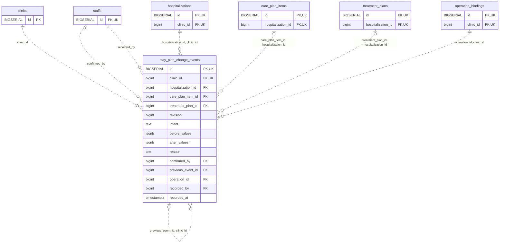

<!-- GENERATED: scripts/tools/generate-erd-detail.py; do not edit -->
# `stay_plan_change_events`

[詳細ERD一覧](index.md) · [概要ERD](../erd.md)

このページは、マイグレーションをファイル名順に静的解析した最終定義です。稼働DBの状態は未確認です。

## カラム

型・DEFAULTはDDLの宣言表記です。`bigserial` は採番宣言であり、DBカタログ上の型名ではありません。

| カラム | 型（DDL） | NULL | DEFAULT（DDL） | キー構成列 | 定義元 |
|:---|:---|:---|:---|:---|:---|
| `id` | `BIGSERIAL` | NOT NULL | — | PK, UK | [001_init.sql:9336](../../../backend/migrations/001_init.sql#L9336) |
| `clinic_id` | `bigint` | NOT NULL | — | FK, UK | [001_init.sql:9337](../../../backend/migrations/001_init.sql#L9337) |
| `hospitalization_id` | `bigint` | NOT NULL | — | FK | [001_init.sql:9338](../../../backend/migrations/001_init.sql#L9338) |
| `care_plan_item_id` | `bigint` | NULL | — | FK | [001_init.sql:9339](../../../backend/migrations/001_init.sql#L9339) |
| `treatment_plan_id` | `bigint` | NULL | — | FK | [001_init.sql:9340](../../../backend/migrations/001_init.sql#L9340) |
| `revision` | `bigint` | NOT NULL | — | — | [001_init.sql:9341](../../../backend/migrations/001_init.sql#L9341) |
| `intent` | `text` | NOT NULL | — | — | [001_init.sql:9342](../../../backend/migrations/001_init.sql#L9342) |
| `before_values` | `jsonb` | NOT NULL | — | — | [001_init.sql:9343](../../../backend/migrations/001_init.sql#L9343) |
| `after_values` | `jsonb` | NOT NULL | — | — | [001_init.sql:9344](../../../backend/migrations/001_init.sql#L9344) |
| `reason` | `text` | NULL | — | — | [001_init.sql:9345](../../../backend/migrations/001_init.sql#L9345) |
| `confirmed_by` | `bigint` | NULL | — | FK | [001_init.sql:9346](../../../backend/migrations/001_init.sql#L9346) |
| `previous_event_id` | `bigint` | NULL | — | FK | [001_init.sql:9347](../../../backend/migrations/001_init.sql#L9347) |
| `operation_id` | `bigint` | NOT NULL | — | FK | [001_init.sql:9348](../../../backend/migrations/001_init.sql#L9348) |
| `recorded_by` | `bigint` | NOT NULL | — | FK | [001_init.sql:9349](../../../backend/migrations/001_init.sql#L9349) |
| `recorded_at` | `timestamptz` | NOT NULL | `clock_timestamp()` | — | [001_init.sql:9350](../../../backend/migrations/001_init.sql#L9350) |

PK/FK/UKはキーの構成列を示します。複合キーの各列が単独で一意という意味ではありません。部分uniqueは下記indexの述語を参照してください。

## ERD

このテーブルの全カラムと、すべての参照先を表示します。参照先はFKの対象列だけを表示し、全カラムは各テーブルのページに置きます。

親側の任意参照はFK列のNULL可否、子側の最大1件は無条件のPK/UNIQUEから導出します。部分uniqueによる条件付きの最大件数は図に反映せず、index一覧に記録します。実線はFK全列が子のPKに含まれる識別関係、破線はそれ以外です。

## 外部キー（全件）

| 制約 | 子の列（順序あり） | 参照先 | 親の列（順序あり） | 削除時の動作 | 定義元 |
|:---|:---|:---|:---|:---|:---|
| `stay_plan_change_events_clinic_id_fkey` | `clinic_id` | [clinics](clinics.md) | `id` | `ON DELETE RESTRICT` | [001_init.sql:9337](../../../backend/migrations/001_init.sql#L9337) |
| `stay_plan_change_events_confirmed_by_fkey` | `confirmed_by` | [staffs](staffs.md) | `id` | `ON DELETE RESTRICT` | [001_init.sql:9346](../../../backend/migrations/001_init.sql#L9346) |
| `stay_plan_change_events_recorded_by_fkey` | `recorded_by` | [staffs](staffs.md) | `id` | `ON DELETE RESTRICT` | [001_init.sql:9349](../../../backend/migrations/001_init.sql#L9349) |
| `stay_plan_change_events_hospitalization_id_clinic_id_fkey` | `hospitalization_id, clinic_id` | [hospitalizations](hospitalizations.md) | `id, clinic_id` | `ON DELETE RESTRICT` | [001_init.sql:9354](../../../backend/migrations/001_init.sql#L9354) |
| `stay_plan_change_events_care_plan_item_id_hospitalization__fkey` | `care_plan_item_id, hospitalization_id` | [care_plan_items](care_plan_items.md) | `id, hospitalization_id` | `ON DELETE RESTRICT` | [001_init.sql:9355](../../../backend/migrations/001_init.sql#L9355) |
| `stay_plan_change_events_treatment_plan_id_hospitalization__fkey` | `treatment_plan_id, hospitalization_id` | [treatment_plans](treatment_plans.md) | `id, hospitalization_id` | `ON DELETE RESTRICT` | [001_init.sql:9356](../../../backend/migrations/001_init.sql#L9356) |
| `stay_plan_change_events_previous_event_id_clinic_id_fkey` | `previous_event_id, clinic_id` | [stay_plan_change_events](stay_plan_change_events.md) | `id, clinic_id` | `ON DELETE RESTRICT` | [001_init.sql:9357](../../../backend/migrations/001_init.sql#L9357) |
| `stay_plan_change_events_operation_id_clinic_id_fkey` | `operation_id, clinic_id` | [operation_bindings](operation_bindings.md) | `id, clinic_id` | `ON DELETE RESTRICT` | [001_init.sql:9358](../../../backend/migrations/001_init.sql#L9358) |

正確なON UPDATE・MATCH・DEFERRABLE等を含む制約DDL:

- `stay_plan_change_events_clinic_id_fkey`: `REFERENCES clinics(id) ON DELETE RESTRICT`
- `stay_plan_change_events_confirmed_by_fkey`: `REFERENCES staffs(id) ON DELETE RESTRICT`
- `stay_plan_change_events_recorded_by_fkey`: `REFERENCES staffs(id) ON DELETE RESTRICT`
- `stay_plan_change_events_hospitalization_id_clinic_id_fkey`: `FOREIGN KEY (hospitalization_id,clinic_id) REFERENCES hospitalizations(id,clinic_id) ON DELETE RESTRICT`
- `stay_plan_change_events_care_plan_item_id_hospitalization__fkey`: `FOREIGN KEY (care_plan_item_id,hospitalization_id) REFERENCES care_plan_items(id,hospitalization_id) ON DELETE RESTRICT`
- `stay_plan_change_events_treatment_plan_id_hospitalization__fkey`: `FOREIGN KEY (treatment_plan_id,hospitalization_id) REFERENCES treatment_plans(id,hospitalization_id) ON DELETE RESTRICT`
- `stay_plan_change_events_previous_event_id_clinic_id_fkey`: `FOREIGN KEY (previous_event_id,clinic_id) REFERENCES stay_plan_change_events(id,clinic_id) ON DELETE RESTRICT`
- `stay_plan_change_events_operation_id_clinic_id_fkey`: `FOREIGN KEY (operation_id,clinic_id) REFERENCES operation_bindings(id,clinic_id) ON DELETE RESTRICT`

## その他の制約

| 制約 | 種別 | DDL | 定義元 |
|:---|:---|:---|:---|
| `stay_plan_change_events_pkey` | primary | `PRIMARY KEY` | [001_init.sql:9336](../../../backend/migrations/001_init.sql#L9336) |
| `stay_plan_change_events_revision_check` | check | `CHECK (revision > 0)` | [001_init.sql:9341](../../../backend/migrations/001_init.sql#L9341) |
| `stay_plan_change_events_intent_check` | check | `CHECK (intent IN ('add','change','stop','post_completion_correction'))` | [001_init.sql:9342](../../../backend/migrations/001_init.sql#L9342) |
| `stay_plan_change_events_before_values_check` | check | `CHECK (jsonb_typeof(before_values)='object')` | [001_init.sql:9343](../../../backend/migrations/001_init.sql#L9343) |
| `stay_plan_change_events_after_values_check` | check | `CHECK (jsonb_typeof(after_values)='object')` | [001_init.sql:9344](../../../backend/migrations/001_init.sql#L9344) |
| `stay_plan_change_events_id_clinic_id_key` | unique | `UNIQUE (id,clinic_id)` | [001_init.sql:9351](../../../backend/migrations/001_init.sql#L9351) |
| `stay_plan_change_events_check` | check | `CHECK (num_nonnulls(care_plan_item_id,treatment_plan_id)=1)` | [001_init.sql:9352](../../../backend/migrations/001_init.sql#L9352) |
| `stay_plan_change_events_check1` | check | `CHECK (intent<>'post_completion_correction' OR (reason IS NOT NULL AND btrim(reason)<>''))` | [001_init.sql:9353](../../../backend/migrations/001_init.sql#L9353) |

## インデックス

| 名前 | UNIQUE | 述語 | DDL | 定義元 |
|:---|:---|:---|:---|:---|
| `uq_stay_care_change_version` | YES | `care_plan_item_id IS NOT NULL` | `CREATE UNIQUE INDEX uq_stay_care_change_version ON stay_plan_change_events(clinic_id,care_plan_item_id,revision) WHERE care_plan_item_id IS NOT NULL` | [001_init.sql:9360](../../../backend/migrations/001_init.sql#L9360) |
| `uq_stay_treatment_change_version` | YES | `treatment_plan_id IS NOT NULL` | `CREATE UNIQUE INDEX uq_stay_treatment_change_version ON stay_plan_change_events(clinic_id,treatment_plan_id,revision) WHERE treatment_plan_id IS NOT NULL` | [001_init.sql:9361](../../../backend/migrations/001_init.sql#L9361) |
