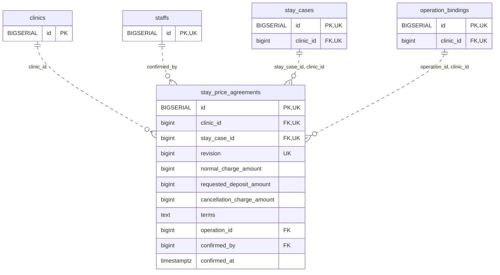

<!-- GENERATED: scripts/tools/generate-erd-detail.py; do not edit -->
# `stay_price_agreements`

[詳細ERD一覧](index.md) · [概要ERD](../erd.md)

このページは、マイグレーションをファイル名順に静的解析した最終定義です。稼働DBの状態は未確認です。

## カラム

型・DEFAULTはDDLの宣言表記です。`bigserial` は採番宣言であり、DBカタログ上の型名ではありません。

| カラム | 型（DDL） | NULL | DEFAULT（DDL） | キー構成列 | 定義元 |
|:---|:---|:---|:---|:---|:---|
| `id` | `BIGSERIAL` | NOT NULL | — | PK, UK | [001_init.sql:9361](../../../backend/migrations/001_init.sql#L9361) |
| `clinic_id` | `bigint` | NOT NULL | — | FK, UK | [001_init.sql:9362](../../../backend/migrations/001_init.sql#L9362) |
| `stay_case_id` | `bigint` | NOT NULL | — | FK, UK | [001_init.sql:9363](../../../backend/migrations/001_init.sql#L9363) |
| `revision` | `bigint` | NOT NULL | — | UK | [001_init.sql:9364](../../../backend/migrations/001_init.sql#L9364) |
| `normal_charge_amount` | `bigint` | NULL | — | — | [001_init.sql:9365](../../../backend/migrations/001_init.sql#L9365) |
| `requested_deposit_amount` | `bigint` | NULL | — | — | [001_init.sql:9366](../../../backend/migrations/001_init.sql#L9366) |
| `cancellation_charge_amount` | `bigint` | NULL | — | — | [001_init.sql:9367](../../../backend/migrations/001_init.sql#L9367) |
| `terms` | `text` | NULL | — | — | [001_init.sql:9368](../../../backend/migrations/001_init.sql#L9368) |
| `operation_id` | `bigint` | NOT NULL | — | FK | [001_init.sql:9369](../../../backend/migrations/001_init.sql#L9369) |
| `confirmed_by` | `bigint` | NOT NULL | — | FK | [001_init.sql:9370](../../../backend/migrations/001_init.sql#L9370) |
| `confirmed_at` | `timestamptz` | NOT NULL | `clock_timestamp()` | — | [001_init.sql:9371](../../../backend/migrations/001_init.sql#L9371) |

PK/FK/UKはキーの構成列を示します。複合キーの各列が単独で一意という意味ではありません。部分uniqueは下記indexの述語を参照してください。

## ERD

このテーブルの全カラムと、すべての参照先を表示します。参照先はFKの対象列だけを表示し、全カラムは各テーブルのページに置きます。

親側の任意参照はFK列のNULL可否、子側の最大1件は無条件のPK/UNIQUEから導出します。部分uniqueによる条件付きの最大件数は図に反映せず、index一覧に記録します。実線はFK全列が子のPKに含まれる識別関係、破線はそれ以外です。

## 外部キー（全件）

| 制約 | 子の列（順序あり） | 参照先 | 親の列（順序あり） | 削除時の動作 | 定義元 |
|:---|:---|:---|:---|:---|:---|
| `stay_price_agreements_clinic_id_fkey` | `clinic_id` | [clinics](clinics.md) | `id` | `ON DELETE RESTRICT` | [001_init.sql:9362](../../../backend/migrations/001_init.sql#L9362) |
| `stay_price_agreements_confirmed_by_fkey` | `confirmed_by` | [staffs](staffs.md) | `id` | `ON DELETE RESTRICT` | [001_init.sql:9370](../../../backend/migrations/001_init.sql#L9370) |
| `stay_price_agreements_stay_case_id_clinic_id_fkey` | `stay_case_id, clinic_id` | [stay_cases](stay_cases.md) | `id, clinic_id` | `ON DELETE RESTRICT` | [001_init.sql:9374](../../../backend/migrations/001_init.sql#L9374) |
| `stay_price_agreements_operation_id_clinic_id_fkey` | `operation_id, clinic_id` | [operation_bindings](operation_bindings.md) | `id, clinic_id` | `ON DELETE RESTRICT` | [001_init.sql:9375](../../../backend/migrations/001_init.sql#L9375) |

正確なON UPDATE・MATCH・DEFERRABLE等を含む制約DDL:

- `stay_price_agreements_clinic_id_fkey`: `REFERENCES clinics(id) ON DELETE RESTRICT`
- `stay_price_agreements_confirmed_by_fkey`: `REFERENCES staffs(id) ON DELETE RESTRICT`
- `stay_price_agreements_stay_case_id_clinic_id_fkey`: `FOREIGN KEY (stay_case_id,clinic_id) REFERENCES stay_cases(id,clinic_id) ON DELETE RESTRICT`
- `stay_price_agreements_operation_id_clinic_id_fkey`: `FOREIGN KEY (operation_id,clinic_id) REFERENCES operation_bindings(id,clinic_id) ON DELETE RESTRICT`

## その他の制約

| 制約 | 種別 | DDL | 定義元 |
|:---|:---|:---|:---|
| `stay_price_agreements_pkey` | primary | `PRIMARY KEY` | [001_init.sql:9361](../../../backend/migrations/001_init.sql#L9361) |
| `stay_price_agreements_revision_check` | check | `CHECK (revision > 0)` | [001_init.sql:9364](../../../backend/migrations/001_init.sql#L9364) |
| `stay_price_agreements_id_clinic_id_key` | unique | `UNIQUE (id,clinic_id)` | [001_init.sql:9372](../../../backend/migrations/001_init.sql#L9372) |
| `stay_price_agreements_clinic_id_stay_case_id_revision_key` | unique | `UNIQUE (clinic_id,stay_case_id,revision)` | [001_init.sql:9373](../../../backend/migrations/001_init.sql#L9373) |

## インデックス

明示的なCREATE INDEXなし。PK/UNIQUEに付随する暗黙のindexは制約欄を参照してください。
