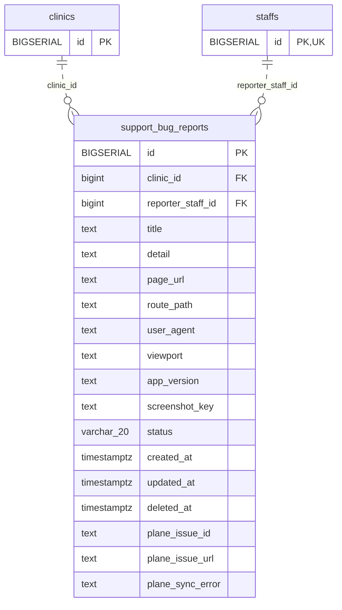

<!-- GENERATED: scripts/tools/generate-erd-detail.py; do not edit -->
# `support_bug_reports`

[詳細ERD一覧](index.md) · [概要ERD](../erd.md)

このページは、マイグレーションをファイル名順に静的解析した最終定義です。稼働DBの状態は未確認です。

## カラム

型・DEFAULTはDDLの宣言表記です。`bigserial` は採番宣言であり、DBカタログ上の型名ではありません。

| カラム | 型（DDL） | NULL | DEFAULT（DDL） | キー構成列 | 定義元 |
|:---|:---|:---|:---|:---|:---|
| `id` | `BIGSERIAL` | NOT NULL | — | PK | [001_init.sql:6564](../../../backend/migrations/001_init.sql#L6564) |
| `clinic_id` | `bigint` | NOT NULL | — | FK | [001_init.sql:6565](../../../backend/migrations/001_init.sql#L6565) |
| `reporter_staff_id` | `bigint` | NOT NULL | — | FK | [001_init.sql:6566](../../../backend/migrations/001_init.sql#L6566) |
| `title` | `text` | NOT NULL | — | — | [001_init.sql:6567](../../../backend/migrations/001_init.sql#L6567) |
| `detail` | `text` | NOT NULL | `''` | — | [001_init.sql:6568](../../../backend/migrations/001_init.sql#L6568) |
| `page_url` | `text` | NOT NULL | `''` | — | [001_init.sql:6569](../../../backend/migrations/001_init.sql#L6569) |
| `route_path` | `text` | NOT NULL | `''` | — | [001_init.sql:6570](../../../backend/migrations/001_init.sql#L6570) |
| `user_agent` | `text` | NOT NULL | `''` | — | [001_init.sql:6571](../../../backend/migrations/001_init.sql#L6571) |
| `viewport` | `text` | NOT NULL | `''` | — | [001_init.sql:6572](../../../backend/migrations/001_init.sql#L6572) |
| `app_version` | `text` | NOT NULL | `''` | — | [001_init.sql:6573](../../../backend/migrations/001_init.sql#L6573) |
| `screenshot_key` | `text` | NULL | — | — | [001_init.sql:6574](../../../backend/migrations/001_init.sql#L6574) |
| `status` | `varchar(20)` | NOT NULL | `'open'` | — | [001_init.sql:6575](../../../backend/migrations/001_init.sql#L6575) |
| `created_at` | `timestamptz` | NOT NULL | `now()` | — | [001_init.sql:6576](../../../backend/migrations/001_init.sql#L6576) |
| `updated_at` | `timestamptz` | NOT NULL | `now()` | — | [001_init.sql:6577](../../../backend/migrations/001_init.sql#L6577) |
| `deleted_at` | `timestamptz` | NULL | — | — | [001_init.sql:6578](../../../backend/migrations/001_init.sql#L6578) |
| `plane_issue_id` | `text` | NULL | — | — | [001_init.sql:6743](../../../backend/migrations/001_init.sql#L6743) |
| `plane_issue_url` | `text` | NULL | — | — | [001_init.sql:6744](../../../backend/migrations/001_init.sql#L6744) |
| `plane_sync_error` | `text` | NULL | — | — | [001_init.sql:6745](../../../backend/migrations/001_init.sql#L6745) |

PK/FK/UKはキーの構成列を示します。複合キーの各列が単独で一意という意味ではありません。部分uniqueは下記indexの述語を参照してください。

## ERD

このテーブルの全カラムと、すべての参照先を表示します。参照先はFKの対象列だけを表示し、全カラムは各テーブルのページに置きます。

親側の任意参照はFK列のNULL可否、子側の最大1件は無条件のPK/UNIQUEから導出します。部分uniqueによる条件付きの最大件数は図に反映せず、index一覧に記録します。実線はFK全列が子のPKに含まれる識別関係、破線はそれ以外です。

## 外部キー（全件）

| 制約 | 子の列（順序あり） | 参照先 | 親の列（順序あり） | 削除時の動作 | 定義元 |
|:---|:---|:---|:---|:---|:---|
| `support_bug_reports_clinic_id_fkey` | `clinic_id` | [clinics](clinics.md) | `id` | `ON DELETE RESTRICT` | [001_init.sql:6565](../../../backend/migrations/001_init.sql#L6565) |
| `support_bug_reports_reporter_staff_id_fkey` | `reporter_staff_id` | [staffs](staffs.md) | `id` | `ON DELETE RESTRICT` | [001_init.sql:6566](../../../backend/migrations/001_init.sql#L6566) |

正確なON UPDATE・MATCH・DEFERRABLE等を含む制約DDL:

- `support_bug_reports_clinic_id_fkey`: `REFERENCES clinics(id) ON DELETE RESTRICT`
- `support_bug_reports_reporter_staff_id_fkey`: `REFERENCES staffs(id)  ON DELETE RESTRICT`

## その他の制約

| 制約 | 種別 | DDL | 定義元 |
|:---|:---|:---|:---|
| `support_bug_reports_pkey` | primary | `PRIMARY KEY` | [001_init.sql:6564](../../../backend/migrations/001_init.sql#L6564) |

## インデックス

| 名前 | UNIQUE | 述語 | DDL | 定義元 |
|:---|:---|:---|:---|:---|
| `idx_support_bug_reports_clinic_created` | NO | `deleted_at IS NULL` | `CREATE INDEX idx_support_bug_reports_clinic_created     ON support_bug_reports (clinic_id, created_at DESC)     WHERE deleted_at IS NULL` | [001_init.sql:6581](../../../backend/migrations/001_init.sql#L6581) |
| `idx_support_bug_reports_clinic_status` | NO | `deleted_at IS NULL` | `CREATE INDEX idx_support_bug_reports_clinic_status     ON support_bug_reports (clinic_id, status)     WHERE deleted_at IS NULL` | [001_init.sql:6584](../../../backend/migrations/001_init.sql#L6584) |
