<!-- GENERATED: scripts/tools/generate-erd-detail.py; do not edit -->
# `support_delivery_results`

[詳細ERD一覧](index.md) · [概要ERD](../erd.md)

このページは、マイグレーションをファイル名順に静的解析した最終定義です。稼働DBの状態は未確認です。

## カラム

型・DEFAULTはDDLの宣言表記です。`bigserial` は採番宣言であり、DBカタログ上の型名ではありません。

| カラム | 型（DDL） | NULL | DEFAULT（DDL） | キー構成列 | 定義元 |
|:---|:---|:---|:---|:---|:---|
| `id` | `BIGSERIAL` | NOT NULL | — | PK, UK | [001_init.sql:10042](../../../backend/migrations/001_init.sql#L10042) |
| `clinic_id` | `bigint` | NOT NULL | — | FK, UK | [001_init.sql:10042](../../../backend/migrations/001_init.sql#L10042) |
| `attempt_id` | `bigint` | NOT NULL | — | FK, UK | [001_init.sql:10043](../../../backend/migrations/001_init.sql#L10043) |
| `destination_id` | `bigint` | NOT NULL | — | FK, UK | [001_init.sql:10043](../../../backend/migrations/001_init.sql#L10043) |
| `result_revision` | `bigint` | NOT NULL | — | UK | [001_init.sql:10043](../../../backend/migrations/001_init.sql#L10043) |
| `result_state` | `text` | NOT NULL | — | — | [001_init.sql:10044](../../../backend/migrations/001_init.sql#L10044) |
| `external_id` | `text` | NULL | — | — | [001_init.sql:10045](../../../backend/migrations/001_init.sql#L10045) |
| `evidence` | `jsonb` | NOT NULL | — | — | [001_init.sql:10045](../../../backend/migrations/001_init.sql#L10045) |
| `recorded_at` | `timestamptz` | NOT NULL | `clock_timestamp()` | — | [001_init.sql:10046](../../../backend/migrations/001_init.sql#L10046) |

PK/FK/UKはキーの構成列を示します。複合キーの各列が単独で一意という意味ではありません。部分uniqueは下記indexの述語を参照してください。

## ERD

このテーブルの全カラムと、すべての参照先を表示します。参照先はFKの対象列だけを表示し、全カラムは各テーブルのページに置きます。

親側の任意参照はFK列のNULL可否、子側の最大1件は無条件のPK/UNIQUEから導出します。部分uniqueによる条件付きの最大件数は図に反映せず、index一覧に記録します。実線はFK全列が子のPKに含まれる識別関係、破線はそれ以外です。

```mermaid
erDiagram
    support_delivery_results {
        BIGSERIAL id PK,UK
        bigint clinic_id FK,UK
        bigint attempt_id FK,UK
        bigint destination_id FK,UK
        bigint result_revision UK
        text result_state
        text external_id
        jsonb evidence
        timestamptz recorded_at
    }
    clinics {
        BIGSERIAL id PK
    }
    support_delivery_attempts {
        BIGSERIAL id PK,UK
        bigint clinic_id FK,UK
        bigint destination_id FK,UK
    }
    clinics ||..o{ support_delivery_results : "clinic_id"
    support_delivery_attempts ||..o{ support_delivery_results : "attempt_id, clinic_id, destination_id"
```

## 外部キー（全件）

| 制約 | 子の列（順序あり） | 参照先 | 親の列（順序あり） | 削除時の動作 | 定義元 |
|:---|:---|:---|:---|:---|:---|
| `support_delivery_results_clinic_id_fkey` | `clinic_id` | [clinics](clinics.md) | `id` | `ON DELETE RESTRICT` | [001_init.sql:10042](../../../backend/migrations/001_init.sql#L10042) |
| `support_delivery_results_attempt_id_clinic_id_destination__fkey` | `attempt_id, clinic_id, destination_id` | [support_delivery_attempts](support_delivery_attempts.md) | `id, clinic_id, destination_id` | `ON DELETE RESTRICT` | [001_init.sql:10049](../../../backend/migrations/001_init.sql#L10049) |

正確なON UPDATE・MATCH・DEFERRABLE等を含む制約DDL:

- `support_delivery_results_clinic_id_fkey`: `REFERENCES clinics(id) ON DELETE RESTRICT`
- `support_delivery_results_attempt_id_clinic_id_destination__fkey`: `FOREIGN KEY(attempt_id,clinic_id,destination_id) REFERENCES support_delivery_attempts(id,clinic_id,destination_id) ON DELETE RESTRICT`

## その他の制約

| 制約 | 種別 | DDL | 定義元 |
|:---|:---|:---|:---|
| `support_delivery_results_pkey` | primary | `PRIMARY KEY` | [001_init.sql:10042](../../../backend/migrations/001_init.sql#L10042) |
| `support_delivery_results_result_revision_check` | check | `CHECK(result_revision>0)` | [001_init.sql:10043](../../../backend/migrations/001_init.sql#L10043) |
| `support_delivery_results_result_state_check` | check | `CHECK(result_state IN('succeeded','definite_failure','unknown','verified_absent'))` | [001_init.sql:10044](../../../backend/migrations/001_init.sql#L10044) |
| `support_delivery_results_evidence_check` | check | `CHECK(jsonb_typeof(evidence)='object')` | [001_init.sql:10045](../../../backend/migrations/001_init.sql#L10045) |
| `support_delivery_results_id_clinic_id_attempt_id_destinatio_key` | unique | `UNIQUE(id,clinic_id,attempt_id,destination_id)` | [001_init.sql:10047](../../../backend/migrations/001_init.sql#L10047) |
| `support_delivery_results_clinic_id_attempt_id_result_revisi_key` | unique | `UNIQUE(clinic_id,attempt_id,result_revision)` | [001_init.sql:10047](../../../backend/migrations/001_init.sql#L10047) |
| `support_delivery_results_check` | check | `CHECK(result_state<>'succeeded' OR(external_id IS NOT NULL AND btrim(external_id)<>''))` | [001_init.sql:10048](../../../backend/migrations/001_init.sql#L10048) |

## インデックス

明示的なCREATE INDEXなし。PK/UNIQUEに付随する暗黙のindexは制約欄を参照してください。
