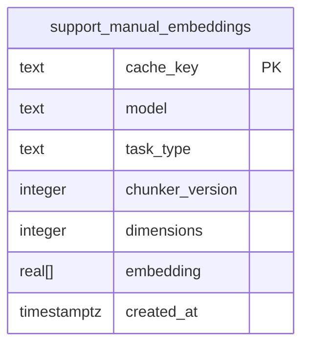

<!-- GENERATED: scripts/tools/generate-erd-detail.py; do not edit -->
# `support_manual_embeddings`

[詳細ERD一覧](index.md) · [概要ERD](../erd.md)

このページは、マイグレーションをファイル名順に静的解析した最終定義です。稼働DBの状態は未確認です。

## カラム

型・DEFAULTはDDLの宣言表記です。`bigserial` は採番宣言であり、DBカタログ上の型名ではありません。

| カラム | 型（DDL） | NULL | DEFAULT（DDL） | キー構成列 | 定義元 |
|:---|:---|:---|:---|:---|:---|
| `cache_key` | `text` | NOT NULL | — | PK | [037_support_manual_search.sql:6](../../../backend/migrations/037_support_manual_search.sql#L6) |
| `model` | `text` | NOT NULL | — | — | [037_support_manual_search.sql:7](../../../backend/migrations/037_support_manual_search.sql#L7) |
| `task_type` | `text` | NOT NULL | — | — | [037_support_manual_search.sql:8](../../../backend/migrations/037_support_manual_search.sql#L8) |
| `chunker_version` | `integer` | NOT NULL | — | — | [037_support_manual_search.sql:9](../../../backend/migrations/037_support_manual_search.sql#L9) |
| `dimensions` | `integer` | NOT NULL | — | — | [037_support_manual_search.sql:10](../../../backend/migrations/037_support_manual_search.sql#L10) |
| `embedding` | `real[]` | NOT NULL | — | — | [037_support_manual_search.sql:11](../../../backend/migrations/037_support_manual_search.sql#L11) |
| `created_at` | `timestamptz` | NOT NULL | `now()` | — | [037_support_manual_search.sql:12](../../../backend/migrations/037_support_manual_search.sql#L12) |

PK/FK/UKはキーの構成列を示します。複合キーの各列が単独で一意という意味ではありません。部分uniqueは下記indexの述語を参照してください。

## ERD

このテーブルの全カラムと、すべての参照先を表示します。参照先はFKの対象列だけを表示し、全カラムは各テーブルのページに置きます。

親側の任意参照はFK列のNULL可否、子側の最大1件は無条件のPK/UNIQUEから導出します。部分uniqueによる条件付きの最大件数は図に反映せず、index一覧に記録します。実線はFK全列が子のPKに含まれる識別関係、破線はそれ以外です。

## 外部キー（全件）

外部キーなし。

## その他の制約

| 制約 | 種別 | DDL | 定義元 |
|:---|:---|:---|:---|
| `support_manual_embeddings_pkey` | primary | `PRIMARY KEY` | [037_support_manual_search.sql:6](../../../backend/migrations/037_support_manual_search.sql#L6) |
| `support_manual_embeddings_dimensions_chk` | check | `CONSTRAINT support_manual_embeddings_dimensions_chk CHECK (dimensions = 1536)` | [037_support_manual_search.sql:13](../../../backend/migrations/037_support_manual_search.sql#L13) |
| `support_manual_embeddings_length_chk` | check | `CONSTRAINT support_manual_embeddings_length_chk CHECK (         array_ndims(embedding) = 1 AND cardinality(embedding) = 1536 AND array_lower(embedding, 1) = 1     )` | [037_support_manual_search.sql:14](../../../backend/migrations/037_support_manual_search.sql#L14) |
| `support_manual_embeddings_task_chk` | check | `CONSTRAINT support_manual_embeddings_task_chk CHECK (task_type = 'RETRIEVAL_DOCUMENT')` | [037_support_manual_search.sql:17](../../../backend/migrations/037_support_manual_search.sql#L17) |
| `support_manual_embeddings_version_chk` | check | `CONSTRAINT support_manual_embeddings_version_chk CHECK (chunker_version = 1)` | [037_support_manual_search.sql:18](../../../backend/migrations/037_support_manual_search.sql#L18) |

## インデックス

明示的なCREATE INDEXなし。PK/UNIQUEに付随する暗黙のindexは制約欄を参照してください。
