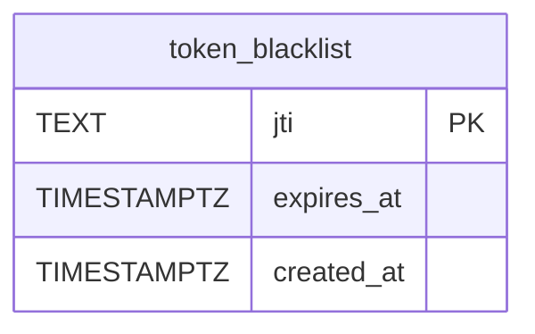

<!-- GENERATED: scripts/tools/generate-erd-detail.py; do not edit -->
# `token_blacklist`

[詳細ERD一覧](index.md) · [概要ERD](../erd.md)

このページは、マイグレーションをファイル名順に静的解析した最終定義です。稼働DBの状態は未確認です。

## カラム

型・DEFAULTはDDLの宣言表記です。`bigserial` は採番宣言であり、DBカタログ上の型名ではありません。

| カラム | 型（DDL） | NULL | DEFAULT（DDL） | キー構成列 | 定義元 |
|:---|:---|:---|:---|:---|:---|
| `jti` | `TEXT` | NOT NULL | — | PK | [001_init.sql:447](../../../backend/migrations/001_init.sql#L447) |
| `expires_at` | `TIMESTAMPTZ` | NOT NULL | — | — | [001_init.sql:448](../../../backend/migrations/001_init.sql#L448) |
| `created_at` | `TIMESTAMPTZ` | NOT NULL | `now()` | — | [001_init.sql:449](../../../backend/migrations/001_init.sql#L449) |

PK/FK/UKはキーの構成列を示します。複合キーの各列が単独で一意という意味ではありません。部分uniqueは下記indexの述語を参照してください。

## ERD

このテーブルの全カラムと、すべての参照先を表示します。参照先はFKの対象列だけを表示し、全カラムは各テーブルのページに置きます。

親側の任意参照はFK列のNULL可否、子側の最大1件は無条件のPK/UNIQUEから導出します。部分uniqueによる条件付きの最大件数は図に反映せず、index一覧に記録します。実線はFK全列が子のPKに含まれる識別関係、破線はそれ以外です。

## 外部キー（全件）

外部キーなし。

## その他の制約

| 制約 | 種別 | DDL | 定義元 |
|:---|:---|:---|:---|
| `token_blacklist_pkey` | primary | `PRIMARY KEY` | [001_init.sql:447](../../../backend/migrations/001_init.sql#L447) |

## インデックス

| 名前 | UNIQUE | 述語 | DDL | 定義元 |
|:---|:---|:---|:---|:---|
| `idx_token_blacklist_expires_at` | NO | — | `CREATE INDEX idx_token_blacklist_expires_at ON token_blacklist(expires_at)` | [001_init.sql:459](../../../backend/migrations/001_init.sql#L459) |
