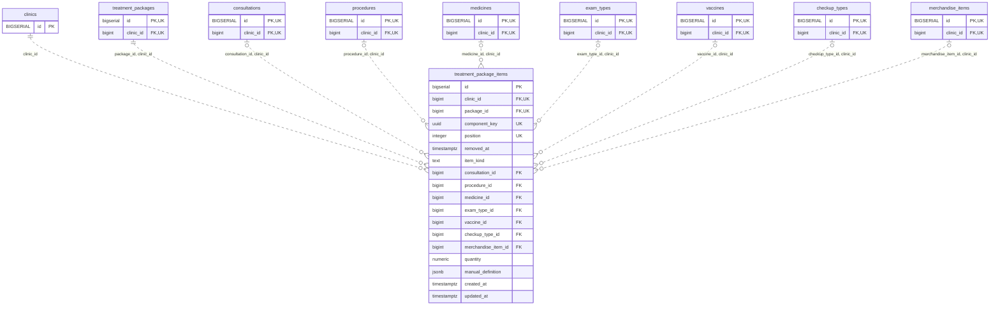

<!-- GENERATED: scripts/tools/generate-erd-detail.py; do not edit -->
# `treatment_package_items`

[詳細ERD一覧](index.md) · [概要ERD](../erd.md)

このページは、マイグレーションをファイル名順に静的解析した最終定義です。稼働DBの状態は未確認です。

## カラム

型・DEFAULTはDDLの宣言表記です。`bigserial` は採番宣言であり、DBカタログ上の型名ではありません。

| カラム | 型（DDL） | NULL | DEFAULT（DDL） | キー構成列 | 定義元 |
|:---|:---|:---|:---|:---|:---|
| `id` | `bigserial` | NOT NULL | — | PK | [001_init.sql:11238](../../../backend/migrations/001_init.sql#L11238) |
| `clinic_id` | `bigint` | NOT NULL | — | FK, UK | [001_init.sql:11239](../../../backend/migrations/001_init.sql#L11239) |
| `package_id` | `bigint` | NOT NULL | — | FK, UK | [001_init.sql:11240](../../../backend/migrations/001_init.sql#L11240) |
| `component_key` | `uuid` | NOT NULL | — | UK | [001_init.sql:11241](../../../backend/migrations/001_init.sql#L11241) |
| `position` | `integer` | NULL | — | UK | [001_init.sql:11242](../../../backend/migrations/001_init.sql#L11242) |
| `removed_at` | `timestamptz` | NULL | — | — | [001_init.sql:11243](../../../backend/migrations/001_init.sql#L11243) |
| `item_kind` | `text` | NOT NULL | — | — | [001_init.sql:11244](../../../backend/migrations/001_init.sql#L11244) |
| `consultation_id` | `bigint` | NULL | — | FK | [001_init.sql:11247](../../../backend/migrations/001_init.sql#L11247) |
| `procedure_id` | `bigint` | NULL | — | FK | [001_init.sql:11248](../../../backend/migrations/001_init.sql#L11248) |
| `medicine_id` | `bigint` | NULL | — | FK | [001_init.sql:11249](../../../backend/migrations/001_init.sql#L11249) |
| `exam_type_id` | `bigint` | NULL | — | FK | [001_init.sql:11250](../../../backend/migrations/001_init.sql#L11250) |
| `vaccine_id` | `bigint` | NULL | — | FK | [001_init.sql:11251](../../../backend/migrations/001_init.sql#L11251) |
| `checkup_type_id` | `bigint` | NULL | — | FK | [001_init.sql:11252](../../../backend/migrations/001_init.sql#L11252) |
| `merchandise_item_id` | `bigint` | NULL | — | FK | [001_init.sql:11253](../../../backend/migrations/001_init.sql#L11253) |
| `quantity` | `numeric` | NOT NULL | — | — | [001_init.sql:11254](../../../backend/migrations/001_init.sql#L11254) |
| `manual_definition` | `jsonb` | NULL | — | — | [001_init.sql:11259](../../../backend/migrations/001_init.sql#L11259) |
| `created_at` | `timestamptz` | NOT NULL | `clock_timestamp()` | — | [001_init.sql:11260](../../../backend/migrations/001_init.sql#L11260) |
| `updated_at` | `timestamptz` | NOT NULL | `clock_timestamp()` | — | [001_init.sql:11261](../../../backend/migrations/001_init.sql#L11261) |

PK/FK/UKはキーの構成列を示します。複合キーの各列が単独で一意という意味ではありません。部分uniqueは下記indexの述語を参照してください。

## ERD

このテーブルの全カラムと、すべての参照先を表示します。参照先はFKの対象列だけを表示し、全カラムは各テーブルのページに置きます。

親側の任意参照はFK列のNULL可否、子側の最大1件は無条件のPK/UNIQUEから導出します。部分uniqueによる条件付きの最大件数は図に反映せず、index一覧に記録します。実線はFK全列が子のPKに含まれる識別関係、破線はそれ以外です。

## 外部キー（全件）

| 制約 | 子の列（順序あり） | 参照先 | 親の列（順序あり） | 削除時の動作 | 定義元 |
|:---|:---|:---|:---|:---|:---|
| `treatment_package_items_clinic_id_fkey` | `clinic_id` | [clinics](clinics.md) | `id` | `ON DELETE RESTRICT` | [001_init.sql:11239](../../../backend/migrations/001_init.sql#L11239) |
| `fk_treatment_package_items_package` | `package_id, clinic_id` | [treatment_packages](treatment_packages.md) | `id, clinic_id` | `ON DELETE RESTRICT` | [001_init.sql:11262](../../../backend/migrations/001_init.sql#L11262) |
| `fk_treatment_package_items_consultation` | `consultation_id, clinic_id` | [consultations](consultations.md) | `id, clinic_id` | `ON DELETE NO ACTION` | [001_init.sql:11293](../../../backend/migrations/001_init.sql#L11293) |
| `fk_treatment_package_items_procedure` | `procedure_id, clinic_id` | [procedures](procedures.md) | `id, clinic_id` | `ON DELETE NO ACTION` | [001_init.sql:11295](../../../backend/migrations/001_init.sql#L11295) |
| `fk_treatment_package_items_medicine` | `medicine_id, clinic_id` | [medicines](medicines.md) | `id, clinic_id` | `ON DELETE NO ACTION` | [001_init.sql:11297](../../../backend/migrations/001_init.sql#L11297) |
| `fk_treatment_package_items_exam_type` | `exam_type_id, clinic_id` | [exam_types](exam_types.md) | `id, clinic_id` | `ON DELETE NO ACTION` | [001_init.sql:11299](../../../backend/migrations/001_init.sql#L11299) |
| `fk_treatment_package_items_vaccine` | `vaccine_id, clinic_id` | [vaccines](vaccines.md) | `id, clinic_id` | `ON DELETE NO ACTION` | [001_init.sql:11301](../../../backend/migrations/001_init.sql#L11301) |
| `fk_treatment_package_items_checkup_type` | `checkup_type_id, clinic_id` | [checkup_types](checkup_types.md) | `id, clinic_id` | `ON DELETE NO ACTION` | [001_init.sql:11303](../../../backend/migrations/001_init.sql#L11303) |
| `fk_treatment_package_items_merchandise_item` | `merchandise_item_id, clinic_id` | [merchandise_items](merchandise_items.md) | `id, clinic_id` | `ON DELETE NO ACTION` | [001_init.sql:11305](../../../backend/migrations/001_init.sql#L11305) |

正確なON UPDATE・MATCH・DEFERRABLE等を含む制約DDL:

- `treatment_package_items_clinic_id_fkey`: `REFERENCES clinics(id) ON DELETE RESTRICT`
- `fk_treatment_package_items_package`: `CONSTRAINT fk_treatment_package_items_package         FOREIGN KEY (package_id, clinic_id)         REFERENCES treatment_packages (id, clinic_id) ON DELETE RESTRICT`
- `fk_treatment_package_items_consultation`: `CONSTRAINT fk_treatment_package_items_consultation         FOREIGN KEY (consultation_id, clinic_id) REFERENCES consultations (id, clinic_id)`
- `fk_treatment_package_items_procedure`: `CONSTRAINT fk_treatment_package_items_procedure         FOREIGN KEY (procedure_id, clinic_id) REFERENCES procedures (id, clinic_id)`
- `fk_treatment_package_items_medicine`: `CONSTRAINT fk_treatment_package_items_medicine         FOREIGN KEY (medicine_id, clinic_id) REFERENCES medicines (id, clinic_id)`
- `fk_treatment_package_items_exam_type`: `CONSTRAINT fk_treatment_package_items_exam_type         FOREIGN KEY (exam_type_id, clinic_id) REFERENCES exam_types (id, clinic_id)`
- `fk_treatment_package_items_vaccine`: `CONSTRAINT fk_treatment_package_items_vaccine         FOREIGN KEY (vaccine_id, clinic_id) REFERENCES vaccines (id, clinic_id)`
- `fk_treatment_package_items_checkup_type`: `CONSTRAINT fk_treatment_package_items_checkup_type         FOREIGN KEY (checkup_type_id, clinic_id) REFERENCES checkup_types (id, clinic_id)`
- `fk_treatment_package_items_merchandise_item`: `CONSTRAINT fk_treatment_package_items_merchandise_item         FOREIGN KEY (merchandise_item_id, clinic_id) REFERENCES merchandise_items (id, clinic_id)`

## その他の制約

| 制約 | 種別 | DDL | 定義元 |
|:---|:---|:---|:---|
| `treatment_package_items_pkey` | primary | `PRIMARY KEY` | [001_init.sql:11238](../../../backend/migrations/001_init.sql#L11238) |
| `treatment_package_items_component_key_check` | check | `CHECK (component_key <> '00000000-0000-0000-0000-000000000000'::uuid)` | [001_init.sql:11241](../../../backend/migrations/001_init.sql#L11241) |
| `treatment_package_items_position_check` | check | `CHECK (position IS NULL OR position >= 0)` | [001_init.sql:11242](../../../backend/migrations/001_init.sql#L11242) |
| `treatment_package_items_item_kind_check` | check | `CHECK (item_kind IN (         'consultation','procedure','medicine','examination_type',         'vaccine','checkup_type','merchandise_item','manual_other'))` | [001_init.sql:11244](../../../backend/migrations/001_init.sql#L11244) |
| `treatment_package_items_quantity_check` | check | `CHECK (         quantity > 0         AND quantity <> 'Infinity'::numeric         AND quantity <> '-Infinity'::numeric         AND quantity <> 'NaN'::numeric)` | [001_init.sql:11254](../../../backend/migrations/001_init.sql#L11254) |
| `ck_treatment_package_items_position_removed` | check | `CONSTRAINT ck_treatment_package_items_position_removed         CHECK ((removed_at IS NULL) = (position IS NOT NULL))` | [001_init.sql:11265](../../../backend/migrations/001_init.sql#L11265) |
| `uq_treatment_package_items_component` | unique | `CONSTRAINT uq_treatment_package_items_component         UNIQUE (clinic_id, package_id, component_key)` | [001_init.sql:11267](../../../backend/migrations/001_init.sql#L11267) |
| `uq_treatment_package_items_position` | unique | `CONSTRAINT uq_treatment_package_items_position         UNIQUE (clinic_id, package_id, position) DEFERRABLE INITIALLY DEFERRED` | [001_init.sql:11270](../../../backend/migrations/001_init.sql#L11270) |
| `ck_treatment_package_items_typed_fk` | check | `CONSTRAINT ck_treatment_package_items_typed_fk CHECK (         CASE item_kind             WHEN 'consultation'       THEN consultation_id     IS NOT NULL             WHEN 'procedure'          THEN procedure_id        IS NOT NULL             WHEN 'medicine'           THEN medicine_id         IS NOT NULL             WHEN 'examination_type'   THEN exam_type_id        IS NOT NULL             WHEN 'vaccine'            THEN vaccine_id          IS NOT NULL             WHEN 'checkup_type'       THEN checkup_type_id     IS NOT NULL             WHEN 'merchandise_item'   THEN merchandise_item_id IS NOT NULL             ELSE TRUE         END         AND num_nonnulls(consultation_id, procedure_id, medicine_id, exam_type_id,             vaccine_id, checkup_type_id, merchandise_item_id)             = CASE WHEN item_kind = 'manual_other' THEN 0 ELSE 1 END)` | [001_init.sql:11274](../../../backend/migrations/001_init.sql#L11274) |
| `ck_treatment_package_items_manual_definition` | check | `CONSTRAINT ck_treatment_package_items_manual_definition CHECK (         CASE WHEN item_kind = 'manual_other'              THEN manual_definition IS NOT NULL AND jsonb_typeof(manual_definition) = 'object'              ELSE manual_definition IS NULL END)` | [001_init.sql:11289](../../../backend/migrations/001_init.sql#L11289) |

## インデックス

| 名前 | UNIQUE | 述語 | DDL | 定義元 |
|:---|:---|:---|:---|:---|
| `idx_treatment_package_items_live` | NO | `removed_at IS NULL` | `CREATE INDEX idx_treatment_package_items_live     ON treatment_package_items (clinic_id, package_id, position) WHERE removed_at IS NULL` | [001_init.sql:11308](../../../backend/migrations/001_init.sql#L11308) |
