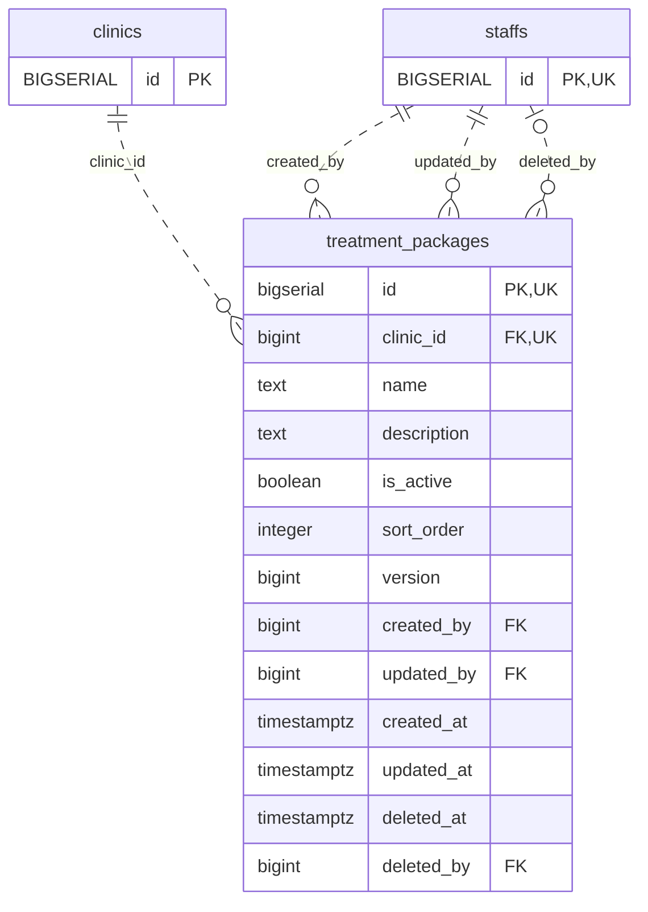

<!-- GENERATED: scripts/tools/generate-erd-detail.py; do not edit -->
# `treatment_packages`

[詳細ERD一覧](index.md) · [概要ERD](../erd.md)

このページは、マイグレーションをファイル名順に静的解析した最終定義です。稼働DBの状態は未確認です。

## カラム

型・DEFAULTはDDLの宣言表記です。`bigserial` は採番宣言であり、DBカタログ上の型名ではありません。

| カラム | 型（DDL） | NULL | DEFAULT（DDL） | キー構成列 | 定義元 |
|:---|:---|:---|:---|:---|:---|
| `id` | `bigserial` | NOT NULL | — | PK, UK | [001_init.sql:11228](../../../backend/migrations/001_init.sql#L11228) |
| `clinic_id` | `bigint` | NOT NULL | — | FK, UK | [001_init.sql:11229](../../../backend/migrations/001_init.sql#L11229) |
| `name` | `text` | NOT NULL | — | — | [001_init.sql:11230](../../../backend/migrations/001_init.sql#L11230) |
| `description` | `text` | NOT NULL | `''` | — | [001_init.sql:11231](../../../backend/migrations/001_init.sql#L11231) |
| `is_active` | `boolean` | NOT NULL | — | — | [001_init.sql:11232](../../../backend/migrations/001_init.sql#L11232) |
| `sort_order` | `integer` | NOT NULL | — | — | [001_init.sql:11233](../../../backend/migrations/001_init.sql#L11233) |
| `version` | `bigint` | NOT NULL | `1` | — | [001_init.sql:11234](../../../backend/migrations/001_init.sql#L11234) |
| `created_by` | `bigint` | NOT NULL | — | FK | [001_init.sql:11235](../../../backend/migrations/001_init.sql#L11235) |
| `updated_by` | `bigint` | NOT NULL | — | FK | [001_init.sql:11236](../../../backend/migrations/001_init.sql#L11236) |
| `created_at` | `timestamptz` | NOT NULL | `clock_timestamp()` | — | [001_init.sql:11237](../../../backend/migrations/001_init.sql#L11237) |
| `updated_at` | `timestamptz` | NOT NULL | `clock_timestamp()` | — | [001_init.sql:11238](../../../backend/migrations/001_init.sql#L11238) |
| `deleted_at` | `timestamptz` | NULL | — | — | [001_init.sql:11239](../../../backend/migrations/001_init.sql#L11239) |
| `deleted_by` | `bigint` | NULL | — | FK | [001_init.sql:11240](../../../backend/migrations/001_init.sql#L11240) |

PK/FK/UKはキーの構成列を示します。複合キーの各列が単独で一意という意味ではありません。部分uniqueは下記indexの述語を参照してください。

## ERD

このテーブルの全カラムと、すべての参照先を表示します。参照先はFKの対象列だけを表示し、全カラムは各テーブルのページに置きます。

親側の任意参照はFK列のNULL可否、子側の最大1件は無条件のPK/UNIQUEから導出します。部分uniqueによる条件付きの最大件数は図に反映せず、index一覧に記録します。実線はFK全列が子のPKに含まれる識別関係、破線はそれ以外です。

## 外部キー（全件）

| 制約 | 子の列（順序あり） | 参照先 | 親の列（順序あり） | 削除時の動作 | 定義元 |
|:---|:---|:---|:---|:---|:---|
| `treatment_packages_clinic_id_fkey` | `clinic_id` | [clinics](clinics.md) | `id` | `ON DELETE RESTRICT` | [001_init.sql:11229](../../../backend/migrations/001_init.sql#L11229) |
| `treatment_packages_created_by_fkey` | `created_by` | [staffs](staffs.md) | `id` | `ON DELETE NO ACTION` | [001_init.sql:11235](../../../backend/migrations/001_init.sql#L11235) |
| `treatment_packages_updated_by_fkey` | `updated_by` | [staffs](staffs.md) | `id` | `ON DELETE NO ACTION` | [001_init.sql:11236](../../../backend/migrations/001_init.sql#L11236) |
| `treatment_packages_deleted_by_fkey` | `deleted_by` | [staffs](staffs.md) | `id` | `ON DELETE NO ACTION` | [001_init.sql:11240](../../../backend/migrations/001_init.sql#L11240) |

正確なON UPDATE・MATCH・DEFERRABLE等を含む制約DDL:

- `treatment_packages_clinic_id_fkey`: `REFERENCES clinics(id) ON DELETE RESTRICT`
- `treatment_packages_created_by_fkey`: `REFERENCES staffs(id)`
- `treatment_packages_updated_by_fkey`: `REFERENCES staffs(id)`
- `treatment_packages_deleted_by_fkey`: `REFERENCES staffs(id)`

## その他の制約

| 制約 | 種別 | DDL | 定義元 |
|:---|:---|:---|:---|
| `treatment_packages_pkey` | primary | `PRIMARY KEY` | [001_init.sql:11228](../../../backend/migrations/001_init.sql#L11228) |
| `treatment_packages_name_check` | check | `CHECK (btrim(name) <> '')` | [001_init.sql:11230](../../../backend/migrations/001_init.sql#L11230) |
| `treatment_packages_sort_order_check` | check | `CHECK (sort_order >= 0)` | [001_init.sql:11233](../../../backend/migrations/001_init.sql#L11233) |
| `treatment_packages_version_check` | check | `CHECK (version > 0)` | [001_init.sql:11234](../../../backend/migrations/001_init.sql#L11234) |
| `uq_treatment_packages_id_clinic` | unique | `CONSTRAINT uq_treatment_packages_id_clinic UNIQUE (id, clinic_id)` | [001_init.sql:11241](../../../backend/migrations/001_init.sql#L11241) |
| `ck_treatment_packages_soft_delete_pair` | check | `CONSTRAINT ck_treatment_packages_soft_delete_pair         CHECK ((deleted_at IS NULL) = (deleted_by IS NULL))` | [001_init.sql:11242](../../../backend/migrations/001_init.sql#L11242) |

## インデックス

| 名前 | UNIQUE | 述語 | DDL | 定義元 |
|:---|:---|:---|:---|:---|
| `idx_treatment_packages_list` | NO | — | `CREATE INDEX idx_treatment_packages_list     ON treatment_packages (clinic_id, deleted_at, is_active, sort_order, id)` | [001_init.sql:11246](../../../backend/migrations/001_init.sql#L11246) |
