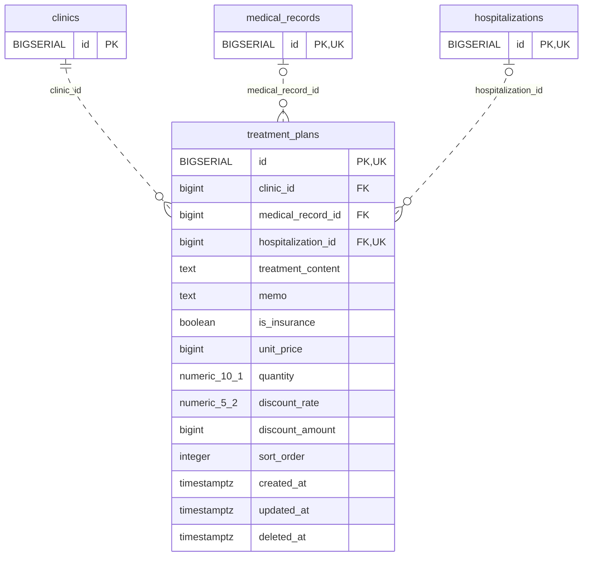

<!-- GENERATED: scripts/tools/generate-erd-detail.py; do not edit -->
# `treatment_plans`

[詳細ERD一覧](index.md) · [概要ERD](../erd.md)

このページは、マイグレーションをファイル名順に静的解析した最終定義です。稼働DBの状態は未確認です。

## カラム

型・DEFAULTはDDLの宣言表記です。`bigserial` は採番宣言であり、DBカタログ上の型名ではありません。

| カラム | 型（DDL） | NULL | DEFAULT（DDL） | キー構成列 | 定義元 |
|:---|:---|:---|:---|:---|:---|
| `id` | `BIGSERIAL` | NOT NULL | — | PK, UK | [001_init.sql:1630](../../../backend/migrations/001_init.sql#L1630) |
| `clinic_id` | `bigint` | NOT NULL | — | FK | [001_init.sql:1631](../../../backend/migrations/001_init.sql#L1631) |
| `medical_record_id` | `bigint` | NULL | — | FK | [001_init.sql:1632](../../../backend/migrations/001_init.sql#L1632) |
| `hospitalization_id` | `bigint` | NULL | — | FK, UK | [001_init.sql:1633](../../../backend/migrations/001_init.sql#L1633) |
| `treatment_content` | `text` | NOT NULL | `''` | — | [001_init.sql:1634](../../../backend/migrations/001_init.sql#L1634) |
| `memo` | `text` | NOT NULL | `''` | — | [001_init.sql:1635](../../../backend/migrations/001_init.sql#L1635) |
| `is_insurance` | `boolean` | NULL | `false` | — | [001_init.sql:1636](../../../backend/migrations/001_init.sql#L1636) |
| `unit_price` | `bigint` | NULL | `0` | — | [001_init.sql:1637](../../../backend/migrations/001_init.sql#L1637) |
| `quantity` | `numeric(10,1)` | NULL | `1` | — | [001_init.sql:1638](../../../backend/migrations/001_init.sql#L1638) |
| `discount_rate` | `numeric(5,2)` | NULL | `0` | — | [001_init.sql:1639](../../../backend/migrations/001_init.sql#L1639) |
| `discount_amount` | `bigint` | NULL | `0` | — | [001_init.sql:1640](../../../backend/migrations/001_init.sql#L1640) |
| `sort_order` | `integer` | NULL | `0` | — | [001_init.sql:1642](../../../backend/migrations/001_init.sql#L1642) |
| `created_at` | `timestamptz` | NOT NULL | `now()` | — | [001_init.sql:1643](../../../backend/migrations/001_init.sql#L1643) |
| `updated_at` | `timestamptz` | NOT NULL | `now()` | — | [001_init.sql:1644](../../../backend/migrations/001_init.sql#L1644) |
| `deleted_at` | `timestamptz` | NULL | — | — | [001_init.sql:1645](../../../backend/migrations/001_init.sql#L1645) |

PK/FK/UKはキーの構成列を示します。複合キーの各列が単独で一意という意味ではありません。部分uniqueは下記indexの述語を参照してください。

## ERD

このテーブルの全カラムと、すべての参照先を表示します。参照先はFKの対象列だけを表示し、全カラムは各テーブルのページに置きます。

親側の任意参照はFK列のNULL可否、子側の最大1件は無条件のPK/UNIQUEから導出します。部分uniqueによる条件付きの最大件数は図に反映せず、index一覧に記録します。実線はFK全列が子のPKに含まれる識別関係、破線はそれ以外です。

## 外部キー（全件）

| 制約 | 子の列（順序あり） | 参照先 | 親の列（順序あり） | 削除時の動作 | 定義元 |
|:---|:---|:---|:---|:---|:---|
| `treatment_plans_clinic_id_fkey` | `clinic_id` | [clinics](clinics.md) | `id` | `ON DELETE RESTRICT` | [001_init.sql:1631](../../../backend/migrations/001_init.sql#L1631) |
| `treatment_plans_medical_record_id_fkey` | `medical_record_id` | [medical_records](medical_records.md) | `id` | `ON DELETE CASCADE` | [001_init.sql:1632](../../../backend/migrations/001_init.sql#L1632) |
| `treatment_plans_hospitalization_id_fkey` | `hospitalization_id` | [hospitalizations](hospitalizations.md) | `id` | `ON DELETE CASCADE` | [001_init.sql:1633](../../../backend/migrations/001_init.sql#L1633) |

正確なON UPDATE・MATCH・DEFERRABLE等を含む制約DDL:

- `treatment_plans_clinic_id_fkey`: `REFERENCES clinics(id) ON DELETE RESTRICT`
- `treatment_plans_medical_record_id_fkey`: `REFERENCES medical_records(id) ON DELETE CASCADE`
- `treatment_plans_hospitalization_id_fkey`: `REFERENCES hospitalizations(id) ON DELETE CASCADE`

## その他の制約

| 制約 | 種別 | DDL | 定義元 |
|:---|:---|:---|:---|
| `treatment_plans_pkey` | primary | `PRIMARY KEY` | [001_init.sql:1630](../../../backend/migrations/001_init.sql#L1630) |
| `chk_treatment_plans_ref` | check | `CONSTRAINT chk_treatment_plans_ref CHECK (         (medical_record_id IS NOT NULL AND hospitalization_id IS NULL) OR         (medical_record_id IS NULL AND hospitalization_id IS NOT NULL)     )` | [001_init.sql:1646](../../../backend/migrations/001_init.sql#L1646) |
| `uq_treatment_plans_id_stay` | unique | `CONSTRAINT uq_treatment_plans_id_stay UNIQUE(id,hospitalization_id)` | [001_init.sql:9334](../../../backend/migrations/001_init.sql#L9334) |

## インデックス

| 名前 | UNIQUE | 述語 | DDL | 定義元 |
|:---|:---|:---|:---|:---|
| `idx_treatment_plans_medical_record_id` | NO | — | `CREATE INDEX idx_treatment_plans_medical_record_id ON treatment_plans(medical_record_id)` | [001_init.sql:2303](../../../backend/migrations/001_init.sql#L2303) |
| `idx_treatment_plans_hospitalization_id` | NO | — | `CREATE INDEX idx_treatment_plans_hospitalization_id ON treatment_plans(hospitalization_id)` | [001_init.sql:2304](../../../backend/migrations/001_init.sql#L2304) |
| `idx_treatment_plans_clinic_id` | NO | `deleted_at IS NULL` | `CREATE INDEX idx_treatment_plans_clinic_id ON treatment_plans(clinic_id) WHERE deleted_at IS NULL` | [001_init.sql:2305](../../../backend/migrations/001_init.sql#L2305) |
