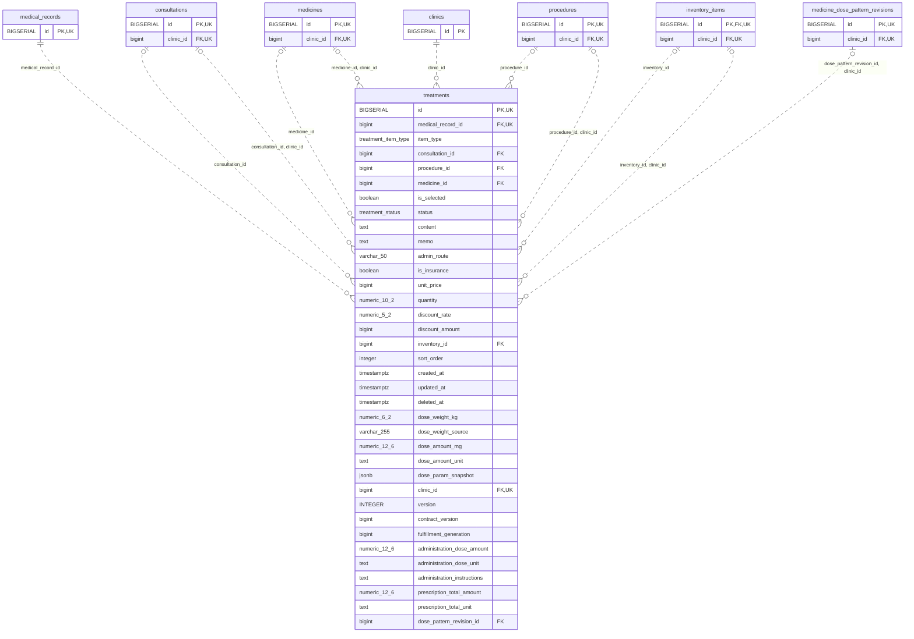

<!-- GENERATED: scripts/tools/generate-erd-detail.py; do not edit -->
# `treatments`

[詳細ERD一覧](index.md) · [概要ERD](../erd.md)

このページは、マイグレーションをファイル名順に静的解析した最終定義です。稼働DBの状態は未確認です。

## カラム

型・DEFAULTはDDLの宣言表記です。`bigserial` は採番宣言であり、DBカタログ上の型名ではありません。

| カラム | 型（DDL） | NULL | DEFAULT（DDL） | キー構成列 | 定義元 |
|:---|:---|:---|:---|:---|:---|
| `id` | `BIGSERIAL` | NOT NULL | — | PK, UK | [001_init.sql:1608](../../../backend/migrations/001_init.sql#L1608) |
| `medical_record_id` | `bigint` | NOT NULL | — | FK, UK | [001_init.sql:1609](../../../backend/migrations/001_init.sql#L1609) |
| `item_type` | `treatment_item_type` | NOT NULL | `'other'` | — | [001_init.sql:1610](../../../backend/migrations/001_init.sql#L1610) |
| `consultation_id` | `bigint` | NULL | — | FK | [001_init.sql:1611](../../../backend/migrations/001_init.sql#L1611) |
| `procedure_id` | `bigint` | NULL | — | FK | [001_init.sql:1612](../../../backend/migrations/001_init.sql#L1612) |
| `medicine_id` | `bigint` | NULL | — | FK | [001_init.sql:1613](../../../backend/migrations/001_init.sql#L1613) |
| `is_selected` | `boolean` | NULL | `false` | — | [001_init.sql:1614](../../../backend/migrations/001_init.sql#L1614) |
| `status` | `treatment_status` | NULL | `'pending'` | — | [001_init.sql:1615](../../../backend/migrations/001_init.sql#L1615) |
| `content` | `text` | NOT NULL | `''` | — | [001_init.sql:1616](../../../backend/migrations/001_init.sql#L1616) |
| `memo` | `text` | NOT NULL | `''` | — | [001_init.sql:1617](../../../backend/migrations/001_init.sql#L1617) |
| `admin_route` | `varchar(50)` | NOT NULL | `''` | — | [001_init.sql:1618](../../../backend/migrations/001_init.sql#L1618) |
| `is_insurance` | `boolean` | NULL | `false` | — | [001_init.sql:1619](../../../backend/migrations/001_init.sql#L1619) |
| `unit_price` | `bigint` | NULL | `0` | — | [001_init.sql:1620](../../../backend/migrations/001_init.sql#L1620) |
| `quantity` | `numeric(10,2)` | NULL | `1` | — | [001_init.sql:3570](../../../backend/migrations/001_init.sql#L3570) |
| `discount_rate` | `numeric(5,2)` | NULL | `0` | — | [001_init.sql:1622](../../../backend/migrations/001_init.sql#L1622) |
| `discount_amount` | `bigint` | NULL | `0` | — | [001_init.sql:1623](../../../backend/migrations/001_init.sql#L1623) |
| `inventory_id` | `bigint` | NULL | — | FK | [001_init.sql:1624](../../../backend/migrations/001_init.sql#L1624) |
| `sort_order` | `integer` | NULL | `0` | — | [001_init.sql:1625](../../../backend/migrations/001_init.sql#L1625) |
| `created_at` | `timestamptz` | NOT NULL | `now()` | — | [001_init.sql:1626](../../../backend/migrations/001_init.sql#L1626) |
| `updated_at` | `timestamptz` | NOT NULL | `now()` | — | [001_init.sql:1627](../../../backend/migrations/001_init.sql#L1627) |
| `deleted_at` | `timestamptz` | NULL | — | — | [001_init.sql:1628](../../../backend/migrations/001_init.sql#L1628) |
| `dose_weight_kg` | `numeric(6,2)` | NULL | — | — | [001_init.sql:3571](../../../backend/migrations/001_init.sql#L3571) |
| `dose_weight_source` | `varchar(255)` | NULL | — | — | [001_init.sql:3572](../../../backend/migrations/001_init.sql#L3572) |
| `dose_amount_mg` | `numeric(12,6)` | NULL | — | — | [001_init.sql:3573](../../../backend/migrations/001_init.sql#L3573) |
| `dose_amount_unit` | `text` | NULL | — | — | [001_init.sql:3574](../../../backend/migrations/001_init.sql#L3574) |
| `dose_param_snapshot` | `jsonb` | NULL | — | — | [001_init.sql:3575](../../../backend/migrations/001_init.sql#L3575) |
| `clinic_id` | `bigint` | NOT NULL | — | FK, UK | [001_init.sql:3581](../../../backend/migrations/001_init.sql#L3581) |
| `version` | `INTEGER` | NOT NULL | `1` | — | [001_init.sql:6345](../../../backend/migrations/001_init.sql#L6345) |
| `contract_version` | `bigint` | NOT NULL | `1` | — | [001_init.sql:8296](../../../backend/migrations/001_init.sql#L8296) |
| `fulfillment_generation` | `bigint` | NOT NULL | `1` | — | [001_init.sql:8297](../../../backend/migrations/001_init.sql#L8297) |
| `administration_dose_amount` | `numeric(12,6)` | NULL | — | — | [001_init.sql:8843](../../../backend/migrations/001_init.sql#L8843) |
| `administration_dose_unit` | `text` | NULL | — | — | [001_init.sql:8844](../../../backend/migrations/001_init.sql#L8844) |
| `administration_instructions` | `text` | NULL | — | — | [001_init.sql:8845](../../../backend/migrations/001_init.sql#L8845) |
| `prescription_total_amount` | `numeric(12,6)` | NULL | — | — | [001_init.sql:8846](../../../backend/migrations/001_init.sql#L8846) |
| `prescription_total_unit` | `text` | NULL | — | — | [001_init.sql:8847](../../../backend/migrations/001_init.sql#L8847) |
| `dose_pattern_revision_id` | `bigint` | NULL | — | FK | [001_init.sql:9168](../../../backend/migrations/001_init.sql#L9168) |

PK/FK/UKはキーの構成列を示します。複合キーの各列が単独で一意という意味ではありません。部分uniqueは下記indexの述語を参照してください。

## ERD

このテーブルの全カラムと、すべての参照先を表示します。参照先はFKの対象列だけを表示し、全カラムは各テーブルのページに置きます。

親側の任意参照はFK列のNULL可否、子側の最大1件は無条件のPK/UNIQUEから導出します。部分uniqueによる条件付きの最大件数は図に反映せず、index一覧に記録します。実線はFK全列が子のPKに含まれる識別関係、破線はそれ以外です。

## 外部キー（全件）

| 制約 | 子の列（順序あり） | 参照先 | 親の列（順序あり） | 削除時の動作 | 定義元 |
|:---|:---|:---|:---|:---|:---|
| `treatments_medical_record_id_fkey` | `medical_record_id` | [medical_records](medical_records.md) | `id` | `ON DELETE CASCADE` | [001_init.sql:1609](../../../backend/migrations/001_init.sql#L1609) |
| `treatments_consultation_id_fkey` | `consultation_id` | [consultations](consultations.md) | `id` | `ON DELETE SET NULL` | [001_init.sql:1611](../../../backend/migrations/001_init.sql#L1611) |
| `treatments_procedure_id_fkey` | `procedure_id` | [procedures](procedures.md) | `id` | `ON DELETE SET NULL` | [001_init.sql:1612](../../../backend/migrations/001_init.sql#L1612) |
| `treatments_medicine_id_fkey` | `medicine_id` | [medicines](medicines.md) | `id` | `ON DELETE SET NULL` | [001_init.sql:1613](../../../backend/migrations/001_init.sql#L1613) |
| `treatments_inventory_id_fkey` | `inventory_id` | [inventory_items](inventory_items.md) | `id` | `ON DELETE SET NULL` | [001_init.sql:1624](../../../backend/migrations/001_init.sql#L1624) |
| `fk_treatments_clinic_id` | `clinic_id` | [clinics](clinics.md) | `id` | `ON DELETE RESTRICT` | [001_init.sql:3584](../../../backend/migrations/001_init.sql#L3584) |
| `fk_treatments_medicine_clinic` | `medicine_id, clinic_id` | [medicines](medicines.md) | `id, clinic_id` | `ON DELETE SET NULL (medicine_id)` | [001_init.sql:3593](../../../backend/migrations/001_init.sql#L3593) |
| `fk_treatments_consultation_clinic` | `consultation_id, clinic_id` | [consultations](consultations.md) | `id, clinic_id` | `ON DELETE SET NULL (consultation_id)` | [001_init.sql:3599](../../../backend/migrations/001_init.sql#L3599) |
| `fk_treatments_procedure_clinic` | `procedure_id, clinic_id` | [procedures](procedures.md) | `id, clinic_id` | `ON DELETE SET NULL (procedure_id)` | [001_init.sql:3605](../../../backend/migrations/001_init.sql#L3605) |
| `fk_treatments_inventory_clinic` | `inventory_id, clinic_id` | [inventory_items](inventory_items.md) | `id, clinic_id` | `ON DELETE SET NULL (inventory_id)` | [001_init.sql:3611](../../../backend/migrations/001_init.sql#L3611) |
| `fk_treatment_selected_dose_pattern` | `dose_pattern_revision_id, clinic_id` | [medicine_dose_pattern_revisions](medicine_dose_pattern_revisions.md) | `id, clinic_id` | `ON DELETE RESTRICT` | [001_init.sql:9169](../../../backend/migrations/001_init.sql#L9169) |

正確なON UPDATE・MATCH・DEFERRABLE等を含む制約DDL:

- `treatments_medical_record_id_fkey`: `REFERENCES medical_records(id) ON DELETE CASCADE`
- `treatments_consultation_id_fkey`: `REFERENCES consultations(id) ON DELETE SET NULL`
- `treatments_procedure_id_fkey`: `REFERENCES procedures(id) ON DELETE SET NULL`
- `treatments_medicine_id_fkey`: `REFERENCES medicines(id) ON DELETE SET NULL`
- `treatments_inventory_id_fkey`: `REFERENCES inventory_items(id) ON DELETE SET NULL`
- `fk_treatments_clinic_id`: `CONSTRAINT fk_treatments_clinic_id     FOREIGN KEY (clinic_id)     REFERENCES clinics (id)     ON DELETE RESTRICT`
- `fk_treatments_medicine_clinic`: `CONSTRAINT fk_treatments_medicine_clinic     FOREIGN KEY (medicine_id, clinic_id)     REFERENCES medicines (id, clinic_id)     ON DELETE SET NULL (medicine_id)`
- `fk_treatments_consultation_clinic`: `CONSTRAINT fk_treatments_consultation_clinic     FOREIGN KEY (consultation_id, clinic_id)     REFERENCES consultations (id, clinic_id)     ON DELETE SET NULL (consultation_id)`
- `fk_treatments_procedure_clinic`: `CONSTRAINT fk_treatments_procedure_clinic     FOREIGN KEY (procedure_id, clinic_id)     REFERENCES procedures (id, clinic_id)     ON DELETE SET NULL (procedure_id)`
- `fk_treatments_inventory_clinic`: `CONSTRAINT fk_treatments_inventory_clinic     FOREIGN KEY (inventory_id, clinic_id)     REFERENCES inventory_items (id, clinic_id)     ON DELETE SET NULL (inventory_id)`
- `fk_treatment_selected_dose_pattern`: `CONSTRAINT fk_treatment_selected_dose_pattern  FOREIGN KEY (dose_pattern_revision_id,clinic_id) REFERENCES medicine_dose_pattern_revisions(id,clinic_id) ON DELETE RESTRICT`

## その他の制約

| 制約 | 種別 | DDL | 定義元 |
|:---|:---|:---|:---|
| `treatments_pkey` | primary | `PRIMARY KEY` | [001_init.sql:1608](../../../backend/migrations/001_init.sql#L1608) |
| `chk_treatment_item_ref` | check | `CONSTRAINT chk_treatment_item_ref CHECK (         (item_type = 'consultation' AND procedure_id IS NULL AND medicine_id IS NULL) OR         (item_type = 'procedure'    AND consultation_id IS NULL AND medicine_id IS NULL) OR         (item_type = 'medicine'     AND consultation_id IS NULL AND procedure_id IS NULL) OR         (item_type = 'other'        AND consultation_id IS NULL AND procedure_id IS NULL AND medicine_id IS NULL)     )` | [001_init.sql:1629](../../../backend/migrations/001_init.sql#L1629) |
| `chk_treatment_quantity` | check | `CONSTRAINT chk_treatment_quantity CHECK (quantity > 0)` | [001_init.sql:1635](../../../backend/migrations/001_init.sql#L1635) |
| `uq_treatments_id_clinic` | unique | `CONSTRAINT uq_treatments_id_clinic UNIQUE (id, clinic_id)` | [001_init.sql:7939](../../../backend/migrations/001_init.sql#L7939) |
| `treatments_contract_version_check` | check | `CHECK (contract_version > 0)` | [001_init.sql:8296](../../../backend/migrations/001_init.sql#L8296) |
| `treatments_fulfillment_generation_check` | check | `CHECK (fulfillment_generation > 0)` | [001_init.sql:8297](../../../backend/migrations/001_init.sql#L8297) |
| `ck_administration_dose_pair` | check | `CONSTRAINT ck_administration_dose_pair CHECK (       (administration_dose_amount IS NULL AND administration_dose_unit IS NULL)       OR (administration_dose_amount IS NOT NULL AND administration_dose_unit IS NOT NULL AND btrim(administration_dose_unit)<>''))` | [001_init.sql:8848](../../../backend/migrations/001_init.sql#L8848) |
| `ck_prescription_total_pair` | check | `CONSTRAINT ck_prescription_total_pair CHECK (       (prescription_total_amount IS NULL AND prescription_total_unit IS NULL)       OR (prescription_total_amount IS NOT NULL AND prescription_total_unit IS NOT NULL AND btrim(prescription_total_unit)<>''))` | [001_init.sql:8851](../../../backend/migrations/001_init.sql#L8851) |
| `uq_treatment_record_clinic` | unique | `CONSTRAINT uq_treatment_record_clinic UNIQUE(id,clinic_id,medical_record_id)` | [001_init.sql:10116](../../../backend/migrations/001_init.sql#L10116) |

## インデックス

| 名前 | UNIQUE | 述語 | DDL | 定義元 |
|:---|:---|:---|:---|:---|
| `idx_treatments_medical_record_id` | NO | — | `CREATE INDEX idx_treatments_medical_record_id ON treatments(medical_record_id)` | [001_init.sql:2297](../../../backend/migrations/001_init.sql#L2297) |
| `idx_treatments_consultation_id` | NO | `consultation_id IS NOT NULL` | `CREATE INDEX idx_treatments_consultation_id ON treatments(consultation_id) WHERE consultation_id IS NOT NULL` | [001_init.sql:2454](../../../backend/migrations/001_init.sql#L2454) |
| `idx_treatments_procedure_id` | NO | `procedure_id IS NOT NULL` | `CREATE INDEX idx_treatments_procedure_id ON treatments(procedure_id) WHERE procedure_id IS NOT NULL` | [001_init.sql:2455](../../../backend/migrations/001_init.sql#L2455) |
| `idx_treatments_medicine_id` | NO | `medicine_id IS NOT NULL` | `CREATE INDEX idx_treatments_medicine_id ON treatments(medicine_id) WHERE medicine_id IS NOT NULL` | [001_init.sql:2456](../../../backend/migrations/001_init.sql#L2456) |
| `idx_treatments_inventory_id` | NO | `inventory_id IS NOT NULL` | `CREATE INDEX idx_treatments_inventory_id ON treatments(inventory_id) WHERE inventory_id IS NOT NULL` | [001_init.sql:2457](../../../backend/migrations/001_init.sql#L2457) |
| `idx_treatments_clinic_id` | NO | — | `CREATE INDEX idx_treatments_clinic_id     ON treatments (clinic_id)` | [001_init.sql:3589](../../../backend/migrations/001_init.sql#L3589) |
| `idx_treatments_content_fold_trgm` | NO | — | `CREATE INDEX idx_treatments_content_fold_trgm   ON treatments USING gin ((translate(content, 'ァアィイゥウェエォオカガキギクグケゲコゴサザシジスズセゼソゾタダチヂッツヅテデトドナニヌネノハバパヒビピフブプヘベペホボポマミムメモャヤュユョヨラリルレロヮワヰヱヲンヴヵヶ　', 'ぁあぃいぅうぇえぉおかがきぎくぐけげこごさざしじすずせぜそぞただちぢっつづてでとどなにぬねのはばぱひびぴふぶぷへべぺほぼぽまみむめもゃやゅゆょよらりるれろゎわゐゑをんゔゕゖ ')) gin_trgm_ops)` | [001_init.sql:6723](../../../backend/migrations/001_init.sql#L6723) |
| `idx_treatments_memo_fold_trgm` | NO | — | `CREATE INDEX idx_treatments_memo_fold_trgm   ON treatments USING gin ((translate(memo, 'ァアィイゥウェエォオカガキギクグケゲコゴサザシジスズセゼソゾタダチヂッツヅテデトドナニヌネノハバパヒビピフブプヘベペホボポマミムメモャヤュユョヨラリルレロヮワヰヱヲンヴヵヶ　', 'ぁあぃいぅうぇえぉおかがきぎくぐけげこごさざしじすずせぜそぞただちぢっつづてでとどなにぬねのはばぱひびぴふぶぷへべぺほぼぽまみむめもゃやゅゆょよらりるれろゎわゐゑをんゔゕゖ ')) gin_trgm_ops)` | [001_init.sql:6726](../../../backend/migrations/001_init.sql#L6726) |
