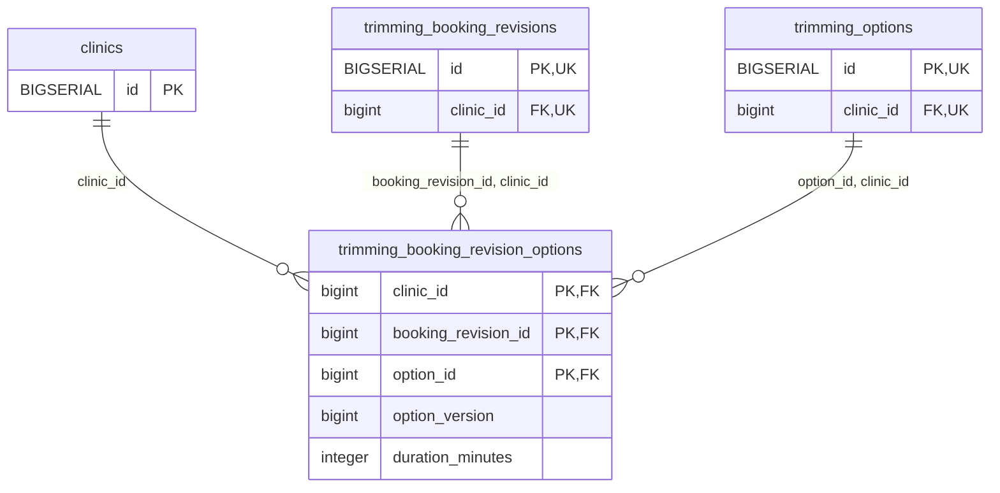

<!-- GENERATED: scripts/tools/generate-erd-detail.py; do not edit -->
# `trimming_booking_revision_options`

[詳細ERD一覧](index.md) · [概要ERD](../erd.md)

このページは、マイグレーションをファイル名順に静的解析した最終定義です。稼働DBの状態は未確認です。

## カラム

型・DEFAULTはDDLの宣言表記です。`bigserial` は採番宣言であり、DBカタログ上の型名ではありません。

| カラム | 型（DDL） | NULL | DEFAULT（DDL） | キー構成列 | 定義元 |
|:---|:---|:---|:---|:---|:---|
| `clinic_id` | `bigint` | NOT NULL | — | PK, FK | [001_init.sql:8060](../../../backend/migrations/001_init.sql#L8060) |
| `booking_revision_id` | `bigint` | NOT NULL | — | PK, FK | [001_init.sql:8061](../../../backend/migrations/001_init.sql#L8061) |
| `option_id` | `bigint` | NOT NULL | — | PK, FK | [001_init.sql:8062](../../../backend/migrations/001_init.sql#L8062) |
| `option_version` | `bigint` | NOT NULL | — | — | [001_init.sql:8063](../../../backend/migrations/001_init.sql#L8063) |
| `duration_minutes` | `integer` | NOT NULL | — | — | [001_init.sql:8064](../../../backend/migrations/001_init.sql#L8064) |

PK/FK/UKはキーの構成列を示します。複合キーの各列が単独で一意という意味ではありません。部分uniqueは下記indexの述語を参照してください。

## ERD

このテーブルの全カラムと、すべての参照先を表示します。参照先はFKの対象列だけを表示し、全カラムは各テーブルのページに置きます。

親側の任意参照はFK列のNULL可否、子側の最大1件は無条件のPK/UNIQUEから導出します。部分uniqueによる条件付きの最大件数は図に反映せず、index一覧に記録します。実線はFK全列が子のPKに含まれる識別関係、破線はそれ以外です。

## 外部キー（全件）

| 制約 | 子の列（順序あり） | 参照先 | 親の列（順序あり） | 削除時の動作 | 定義元 |
|:---|:---|:---|:---|:---|:---|
| `trimming_booking_revision_options_clinic_id_fkey` | `clinic_id` | [clinics](clinics.md) | `id` | `ON DELETE RESTRICT` | [001_init.sql:8060](../../../backend/migrations/001_init.sql#L8060) |
| `trimming_booking_revision_opt_booking_revision_id_clinic_i_fkey` | `booking_revision_id, clinic_id` | [trimming_booking_revisions](trimming_booking_revisions.md) | `id, clinic_id` | `ON DELETE RESTRICT` | [001_init.sql:8066](../../../backend/migrations/001_init.sql#L8066) |
| `trimming_booking_revision_options_option_id_clinic_id_fkey` | `option_id, clinic_id` | [trimming_options](trimming_options.md) | `id, clinic_id` | `ON DELETE RESTRICT` | [001_init.sql:8067](../../../backend/migrations/001_init.sql#L8067) |

正確なON UPDATE・MATCH・DEFERRABLE等を含む制約DDL:

- `trimming_booking_revision_options_clinic_id_fkey`: `REFERENCES clinics(id) ON DELETE RESTRICT`
- `trimming_booking_revision_opt_booking_revision_id_clinic_i_fkey`: `FOREIGN KEY (booking_revision_id, clinic_id) REFERENCES trimming_booking_revisions(id, clinic_id) ON DELETE RESTRICT`
- `trimming_booking_revision_options_option_id_clinic_id_fkey`: `FOREIGN KEY (option_id, clinic_id) REFERENCES trimming_options(id, clinic_id) ON DELETE RESTRICT`

## その他の制約

| 制約 | 種別 | DDL | 定義元 |
|:---|:---|:---|:---|
| `trimming_booking_revision_options_option_version_check` | check | `CHECK (option_version > 0)` | [001_init.sql:8063](../../../backend/migrations/001_init.sql#L8063) |
| `trimming_booking_revision_options_duration_minutes_check` | check | `CHECK (duration_minutes >= 0)` | [001_init.sql:8064](../../../backend/migrations/001_init.sql#L8064) |
| `trimming_booking_revision_options_pkey` | primary | `PRIMARY KEY (clinic_id, booking_revision_id, option_id)` | [001_init.sql:8065](../../../backend/migrations/001_init.sql#L8065) |

## インデックス

明示的なCREATE INDEXなし。PK/UNIQUEに付随する暗黙のindexは制約欄を参照してください。
