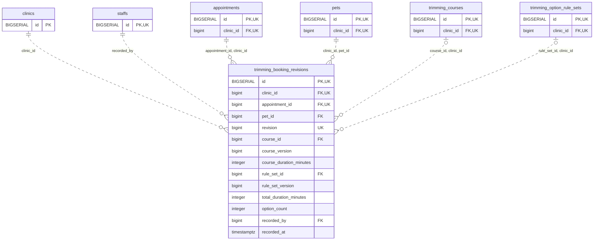

<!-- GENERATED: scripts/tools/generate-erd-detail.py; do not edit -->
# `trimming_booking_revisions`

[詳細ERD一覧](index.md) · [概要ERD](../erd.md)

このページは、マイグレーションをファイル名順に静的解析した最終定義です。稼働DBの状態は未確認です。

## カラム

型・DEFAULTはDDLの宣言表記です。`bigserial` は採番宣言であり、DBカタログ上の型名ではありません。

| カラム | 型（DDL） | NULL | DEFAULT（DDL） | キー構成列 | 定義元 |
|:---|:---|:---|:---|:---|:---|
| `id` | `BIGSERIAL` | NOT NULL | — | PK, UK | [001_init.sql:8031](../../../backend/migrations/001_init.sql#L8031) |
| `clinic_id` | `bigint` | NOT NULL | — | FK, UK | [001_init.sql:8032](../../../backend/migrations/001_init.sql#L8032) |
| `appointment_id` | `bigint` | NOT NULL | — | FK, UK | [001_init.sql:8033](../../../backend/migrations/001_init.sql#L8033) |
| `pet_id` | `bigint` | NOT NULL | — | FK | [001_init.sql:8034](../../../backend/migrations/001_init.sql#L8034) |
| `revision` | `bigint` | NOT NULL | — | UK | [001_init.sql:8035](../../../backend/migrations/001_init.sql#L8035) |
| `course_id` | `bigint` | NULL | — | FK | [001_init.sql:8036](../../../backend/migrations/001_init.sql#L8036) |
| `course_version` | `bigint` | NULL | — | — | [001_init.sql:8037](../../../backend/migrations/001_init.sql#L8037) |
| `course_duration_minutes` | `integer` | NULL | — | — | [001_init.sql:8038](../../../backend/migrations/001_init.sql#L8038) |
| `rule_set_id` | `bigint` | NULL | — | FK | [001_init.sql:8039](../../../backend/migrations/001_init.sql#L8039) |
| `rule_set_version` | `bigint` | NULL | — | — | [001_init.sql:8040](../../../backend/migrations/001_init.sql#L8040) |
| `total_duration_minutes` | `integer` | NOT NULL | — | — | [001_init.sql:8041](../../../backend/migrations/001_init.sql#L8041) |
| `option_count` | `integer` | NOT NULL | — | — | [001_init.sql:8042](../../../backend/migrations/001_init.sql#L8042) |
| `recorded_by` | `bigint` | NOT NULL | — | FK | [001_init.sql:8043](../../../backend/migrations/001_init.sql#L8043) |
| `recorded_at` | `timestamptz` | NOT NULL | `clock_timestamp()` | — | [001_init.sql:8044](../../../backend/migrations/001_init.sql#L8044) |

PK/FK/UKはキーの構成列を示します。複合キーの各列が単独で一意という意味ではありません。部分uniqueは下記indexの述語を参照してください。

## ERD

このテーブルの全カラムと、すべての参照先を表示します。参照先はFKの対象列だけを表示し、全カラムは各テーブルのページに置きます。

親側の任意参照はFK列のNULL可否、子側の最大1件は無条件のPK/UNIQUEから導出します。部分uniqueによる条件付きの最大件数は図に反映せず、index一覧に記録します。実線はFK全列が子のPKに含まれる識別関係、破線はそれ以外です。

## 外部キー（全件）

| 制約 | 子の列（順序あり） | 参照先 | 親の列（順序あり） | 削除時の動作 | 定義元 |
|:---|:---|:---|:---|:---|:---|
| `trimming_booking_revisions_clinic_id_fkey` | `clinic_id` | [clinics](clinics.md) | `id` | `ON DELETE RESTRICT` | [001_init.sql:8032](../../../backend/migrations/001_init.sql#L8032) |
| `trimming_booking_revisions_recorded_by_fkey` | `recorded_by` | [staffs](staffs.md) | `id` | `ON DELETE RESTRICT` | [001_init.sql:8043](../../../backend/migrations/001_init.sql#L8043) |
| `trimming_booking_revisions_appointment_id_clinic_id_fkey` | `appointment_id, clinic_id` | [appointments](appointments.md) | `id, clinic_id` | `ON DELETE RESTRICT` | [001_init.sql:8052](../../../backend/migrations/001_init.sql#L8052) |
| `trimming_booking_revisions_clinic_id_pet_id_fkey` | `clinic_id, pet_id` | [pets](pets.md) | `clinic_id, id` | `ON DELETE RESTRICT` | [001_init.sql:8053](../../../backend/migrations/001_init.sql#L8053) |
| `trimming_booking_revisions_course_id_clinic_id_fkey` | `course_id, clinic_id` | [trimming_courses](trimming_courses.md) | `id, clinic_id` | `ON DELETE RESTRICT` | [001_init.sql:8054](../../../backend/migrations/001_init.sql#L8054) |
| `trimming_booking_revisions_rule_set_id_clinic_id_fkey` | `rule_set_id, clinic_id` | [trimming_option_rule_sets](trimming_option_rule_sets.md) | `id, clinic_id` | `ON DELETE RESTRICT` | [001_init.sql:8055](../../../backend/migrations/001_init.sql#L8055) |

正確なON UPDATE・MATCH・DEFERRABLE等を含む制約DDL:

- `trimming_booking_revisions_clinic_id_fkey`: `REFERENCES clinics(id) ON DELETE RESTRICT`
- `trimming_booking_revisions_recorded_by_fkey`: `REFERENCES staffs(id) ON DELETE RESTRICT`
- `trimming_booking_revisions_appointment_id_clinic_id_fkey`: `FOREIGN KEY (appointment_id, clinic_id) REFERENCES appointments(id, clinic_id) ON DELETE RESTRICT`
- `trimming_booking_revisions_clinic_id_pet_id_fkey`: `FOREIGN KEY (clinic_id, pet_id) REFERENCES pets(clinic_id, id) ON DELETE RESTRICT`
- `trimming_booking_revisions_course_id_clinic_id_fkey`: `FOREIGN KEY (course_id, clinic_id) REFERENCES trimming_courses(id, clinic_id) ON DELETE RESTRICT`
- `trimming_booking_revisions_rule_set_id_clinic_id_fkey`: `FOREIGN KEY (rule_set_id, clinic_id) REFERENCES trimming_option_rule_sets(id, clinic_id) ON DELETE RESTRICT`

## その他の制約

| 制約 | 種別 | DDL | 定義元 |
|:---|:---|:---|:---|
| `trimming_booking_revisions_pkey` | primary | `PRIMARY KEY` | [001_init.sql:8031](../../../backend/migrations/001_init.sql#L8031) |
| `trimming_booking_revisions_revision_check` | check | `CHECK (revision > 0)` | [001_init.sql:8035](../../../backend/migrations/001_init.sql#L8035) |
| `trimming_booking_revisions_total_duration_minutes_check` | check | `CHECK (total_duration_minutes > 0)` | [001_init.sql:8041](../../../backend/migrations/001_init.sql#L8041) |
| `trimming_booking_revisions_option_count_check` | check | `CHECK (option_count >= 0)` | [001_init.sql:8042](../../../backend/migrations/001_init.sql#L8042) |
| `trimming_booking_revisions_id_clinic_id_key` | unique | `UNIQUE (id, clinic_id)` | [001_init.sql:8045](../../../backend/migrations/001_init.sql#L8045) |
| `trimming_booking_revisions_clinic_id_appointment_id_revisio_key` | unique | `UNIQUE (clinic_id, appointment_id, revision)` | [001_init.sql:8046](../../../backend/migrations/001_init.sql#L8046) |
| `trimming_booking_revisions_check` | check | `CHECK ((course_id IS NULL AND course_version IS NULL AND course_duration_minutes IS NULL)         OR (course_id IS NOT NULL AND course_version IS NOT NULL AND course_version > 0             AND course_duration_minutes IS NOT NULL AND course_duration_minutes > 0))` | [001_init.sql:8047](../../../backend/migrations/001_init.sql#L8047) |
| `trimming_booking_revisions_check1` | check | `CHECK ((rule_set_id IS NULL AND rule_set_version IS NULL)         OR (rule_set_id IS NOT NULL AND rule_set_version IS NOT NULL AND rule_set_version > 0))` | [001_init.sql:8050](../../../backend/migrations/001_init.sql#L8050) |

## インデックス

明示的なCREATE INDEXなし。PK/UNIQUEに付随する暗黙のindexは制約欄を参照してください。
