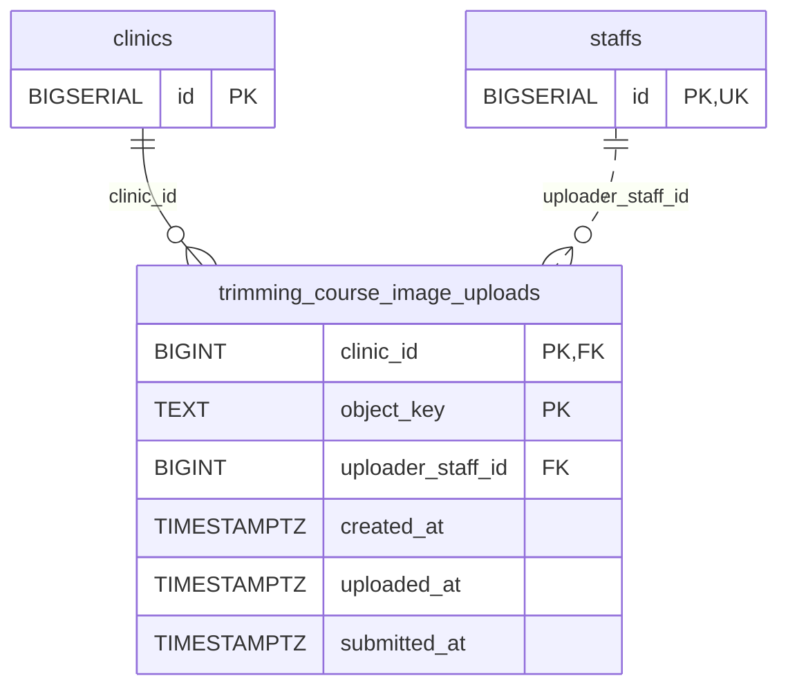

<!-- GENERATED: scripts/tools/generate-erd-detail.py; do not edit -->
# `trimming_course_image_uploads`

[詳細ERD一覧](index.md) · [概要ERD](../erd.md)

このページは、マイグレーションをファイル名順に静的解析した最終定義です。稼働DBの状態は未確認です。

## カラム

型・DEFAULTはDDLの宣言表記です。`bigserial` は採番宣言であり、DBカタログ上の型名ではありません。

| カラム | 型（DDL） | NULL | DEFAULT（DDL） | キー構成列 | 定義元 |
|:---|:---|:---|:---|:---|:---|
| `clinic_id` | `BIGINT` | NOT NULL | — | PK, FK | [001_init.sql:11346](../../../backend/migrations/001_init.sql#L11346) |
| `object_key` | `TEXT` | NOT NULL | — | PK | [001_init.sql:11347](../../../backend/migrations/001_init.sql#L11347) |
| `uploader_staff_id` | `BIGINT` | NOT NULL | — | FK | [001_init.sql:11348](../../../backend/migrations/001_init.sql#L11348) |
| `created_at` | `TIMESTAMPTZ` | NOT NULL | `NOW()` | — | [001_init.sql:11349](../../../backend/migrations/001_init.sql#L11349) |
| `uploaded_at` | `TIMESTAMPTZ` | NULL | — | — | [001_init.sql:11350](../../../backend/migrations/001_init.sql#L11350) |
| `submitted_at` | `TIMESTAMPTZ` | NULL | — | — | [001_init.sql:11351](../../../backend/migrations/001_init.sql#L11351) |

PK/FK/UKはキーの構成列を示します。複合キーの各列が単独で一意という意味ではありません。部分uniqueは下記indexの述語を参照してください。

## ERD

このテーブルの全カラムと、すべての参照先を表示します。参照先はFKの対象列だけを表示し、全カラムは各テーブルのページに置きます。

親側の任意参照はFK列のNULL可否、子側の最大1件は無条件のPK/UNIQUEから導出します。部分uniqueによる条件付きの最大件数は図に反映せず、index一覧に記録します。実線はFK全列が子のPKに含まれる識別関係、破線はそれ以外です。

## 外部キー（全件）

| 制約 | 子の列（順序あり） | 参照先 | 親の列（順序あり） | 削除時の動作 | 定義元 |
|:---|:---|:---|:---|:---|:---|
| `trimming_course_image_uploads_clinic_id_fkey` | `clinic_id` | [clinics](clinics.md) | `id` | `ON DELETE RESTRICT` | [001_init.sql:11346](../../../backend/migrations/001_init.sql#L11346) |
| `trimming_course_image_uploads_uploader_staff_id_fkey` | `uploader_staff_id` | [staffs](staffs.md) | `id` | `ON DELETE RESTRICT` | [001_init.sql:11348](../../../backend/migrations/001_init.sql#L11348) |

正確なON UPDATE・MATCH・DEFERRABLE等を含む制約DDL:

- `trimming_course_image_uploads_clinic_id_fkey`: `REFERENCES clinics(id) ON DELETE RESTRICT`
- `trimming_course_image_uploads_uploader_staff_id_fkey`: `REFERENCES staffs(id) ON DELETE RESTRICT`

## その他の制約

| 制約 | 種別 | DDL | 定義元 |
|:---|:---|:---|:---|
| `trimming_course_image_uploads_pkey` | primary | `PRIMARY KEY (clinic_id, object_key)` | [001_init.sql:11352](../../../backend/migrations/001_init.sql#L11352) |
| `trimming_course_image_uploads_check` | check | `CHECK (clinic_id > 0 AND uploader_staff_id > 0)` | [001_init.sql:11353](../../../backend/migrations/001_init.sql#L11353) |
| `trimming_course_image_uploads_check1` | check | <code>CHECK (object_key LIKE &#x27;trimming-images/&#x27; &#124;&#124; clinic_id::text &#124;&#124; &#x27;/%&#x27;            AND object_key ~ &#x27;^trimming-images/[1-9][0-9]*/[0-9]+_[0-9a-f]{32}\.(jpg&#124;jpeg&#124;png&#124;gif)$&#x27;)</code> | [001_init.sql:11354](../../../backend/migrations/001_init.sql#L11354) |

## インデックス

明示的なCREATE INDEXなし。PK/UNIQUEに付随する暗黙のindexは制約欄を参照してください。
