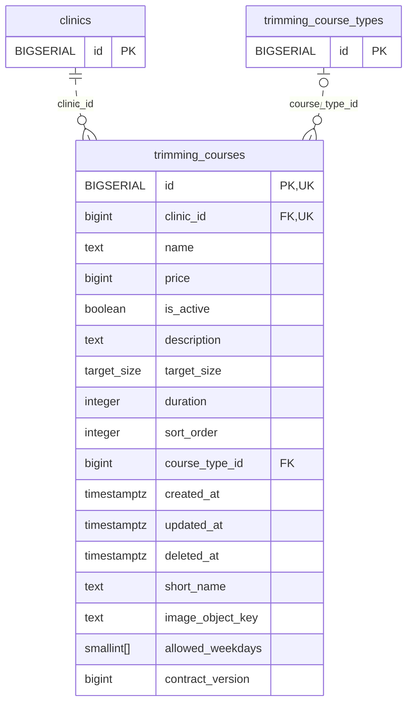

<!-- GENERATED: scripts/tools/generate-erd-detail.py; do not edit -->
# `trimming_courses`

[詳細ERD一覧](index.md) · [概要ERD](../erd.md)

このページは、マイグレーションをファイル名順に静的解析した最終定義です。稼働DBの状態は未確認です。

## カラム

型・DEFAULTはDDLの宣言表記です。`bigserial` は採番宣言であり、DBカタログ上の型名ではありません。

| カラム | 型（DDL） | NULL | DEFAULT（DDL） | キー構成列 | 定義元 |
|:---|:---|:---|:---|:---|:---|
| `id` | `BIGSERIAL` | NOT NULL | — | PK, UK | [001_init.sql:1007](../../../backend/migrations/001_init.sql#L1007) |
| `clinic_id` | `bigint` | NOT NULL | — | FK, UK | [001_init.sql:1008](../../../backend/migrations/001_init.sql#L1008) |
| `name` | `text` | NOT NULL | — | — | [001_init.sql:1009](../../../backend/migrations/001_init.sql#L1009) |
| `price` | `bigint` | NULL | — | — | [001_init.sql:1010](../../../backend/migrations/001_init.sql#L1010) |
| `is_active` | `boolean` | NOT NULL | `true` | — | [001_init.sql:1011](../../../backend/migrations/001_init.sql#L1011) |
| `description` | `text` | NOT NULL | `''` | — | [001_init.sql:1012](../../../backend/migrations/001_init.sql#L1012) |
| `target_size` | `target_size` | NULL | — | — | [001_init.sql:1013](../../../backend/migrations/001_init.sql#L1013) |
| `duration` | `integer` | NULL | — | — | [001_init.sql:1014](../../../backend/migrations/001_init.sql#L1014) |
| `sort_order` | `integer` | NULL | `0` | — | [001_init.sql:1015](../../../backend/migrations/001_init.sql#L1015) |
| `course_type_id` | `bigint` | NULL | — | FK | [001_init.sql:1016](../../../backend/migrations/001_init.sql#L1016) |
| `created_at` | `timestamptz` | NOT NULL | `now()` | — | [001_init.sql:1017](../../../backend/migrations/001_init.sql#L1017) |
| `updated_at` | `timestamptz` | NOT NULL | `now()` | — | [001_init.sql:1018](../../../backend/migrations/001_init.sql#L1018) |
| `deleted_at` | `timestamptz` | NULL | — | — | [001_init.sql:1019](../../../backend/migrations/001_init.sql#L1019) |
| `short_name` | `text` | NULL | — | — | [001_init.sql:7926](../../../backend/migrations/001_init.sql#L7926) |
| `image_object_key` | `text` | NULL | — | — | [001_init.sql:7927](../../../backend/migrations/001_init.sql#L7927) |
| `allowed_weekdays` | `smallint[]` | NULL | — | — | [001_init.sql:7928](../../../backend/migrations/001_init.sql#L7928) |
| `contract_version` | `bigint` | NOT NULL | `1` | — | [001_init.sql:7929](../../../backend/migrations/001_init.sql#L7929) |

PK/FK/UKはキーの構成列を示します。複合キーの各列が単独で一意という意味ではありません。部分uniqueは下記indexの述語を参照してください。

## ERD

このテーブルの全カラムと、すべての参照先を表示します。参照先はFKの対象列だけを表示し、全カラムは各テーブルのページに置きます。

親側の任意参照はFK列のNULL可否、子側の最大1件は無条件のPK/UNIQUEから導出します。部分uniqueによる条件付きの最大件数は図に反映せず、index一覧に記録します。実線はFK全列が子のPKに含まれる識別関係、破線はそれ以外です。

## 外部キー（全件）

| 制約 | 子の列（順序あり） | 参照先 | 親の列（順序あり） | 削除時の動作 | 定義元 |
|:---|:---|:---|:---|:---|:---|
| `trimming_courses_clinic_id_fkey` | `clinic_id` | [clinics](clinics.md) | `id` | `ON DELETE RESTRICT` | [001_init.sql:1008](../../../backend/migrations/001_init.sql#L1008) |
| `trimming_courses_course_type_id_fkey` | `course_type_id` | [trimming_course_types](trimming_course_types.md) | `id` | `ON DELETE SET NULL` | [001_init.sql:1016](../../../backend/migrations/001_init.sql#L1016) |

正確なON UPDATE・MATCH・DEFERRABLE等を含む制約DDL:

- `trimming_courses_clinic_id_fkey`: `REFERENCES clinics(id) ON DELETE RESTRICT`
- `trimming_courses_course_type_id_fkey`: `REFERENCES trimming_course_types(id) ON DELETE SET NULL`

## その他の制約

| 制約 | 種別 | DDL | 定義元 |
|:---|:---|:---|:---|
| `trimming_courses_pkey` | primary | `PRIMARY KEY` | [001_init.sql:1007](../../../backend/migrations/001_init.sql#L1007) |
| `trimming_courses_contract_version_check` | check | `CHECK (contract_version > 0)` | [001_init.sql:7929](../../../backend/migrations/001_init.sql#L7929) |
| `ck_trimming_course_short_name` | check | `CONSTRAINT ck_trimming_course_short_name CHECK (short_name IS NULL OR btrim(short_name) <> '')` | [001_init.sql:7930](../../../backend/migrations/001_init.sql#L7930) |
| `ck_trimming_course_image_key` | check | `CONSTRAINT ck_trimming_course_image_key CHECK (image_object_key IS NULL OR btrim(image_object_key) <> '')` | [001_init.sql:7931](../../../backend/migrations/001_init.sql#L7931) |
| `ck_trimming_course_weekdays` | check | `CONSTRAINT ck_trimming_course_weekdays CHECK (app_private.valid_trimming_weekdays(allowed_weekdays))` | [001_init.sql:7932](../../../backend/migrations/001_init.sql#L7932) |
| `uq_trimming_courses_id_clinic` | unique | `CONSTRAINT uq_trimming_courses_id_clinic UNIQUE (id, clinic_id)` | [001_init.sql:7933](../../../backend/migrations/001_init.sql#L7933) |

## インデックス

| 名前 | UNIQUE | 述語 | DDL | 定義元 |
|:---|:---|:---|:---|:---|
| `idx_trimming_courses_course_type_id` | NO | `course_type_id IS NOT NULL` | `CREATE INDEX idx_trimming_courses_course_type_id ON trimming_courses(course_type_id) WHERE course_type_id IS NOT NULL` | [001_init.sql:1022](../../../backend/migrations/001_init.sql#L1022) |
| `idx_trimming_courses_clinic_id` | NO | — | `CREATE INDEX idx_trimming_courses_clinic_id ON trimming_courses(clinic_id)` | [001_init.sql:2246](../../../backend/migrations/001_init.sql#L2246) |
| `idx_trimming_courses_clinic_sort` | NO | `deleted_at IS NULL` | `CREATE INDEX idx_trimming_courses_clinic_sort  ON trimming_courses(clinic_id, sort_order)        WHERE deleted_at IS NULL` | [001_init.sql:2282](../../../backend/migrations/001_init.sql#L2282) |
| `idx_trimming_courses_clinic_name` | YES | `deleted_at IS NULL` | `CREATE UNIQUE INDEX idx_trimming_courses_clinic_name ON trimming_courses(clinic_id, name) WHERE deleted_at IS NULL` | [001_init.sql:2478](../../../backend/migrations/001_init.sql#L2478) |
| `idx_trimming_courses_active` | NO | `deleted_at IS NULL` | `CREATE INDEX idx_trimming_courses_active ON trimming_courses(id) WHERE deleted_at IS NULL` | [001_init.sql:2498](../../../backend/migrations/001_init.sql#L2498) |
