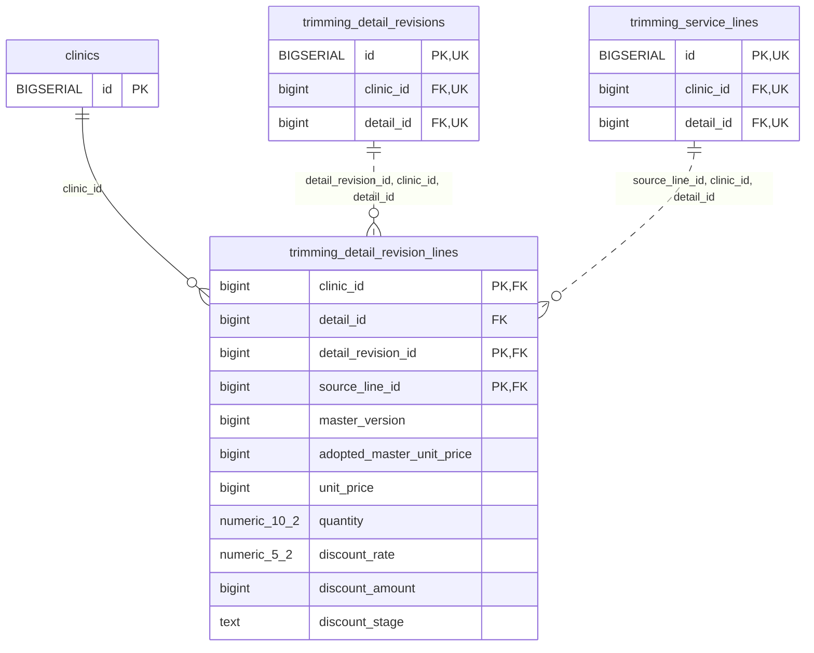

<!-- GENERATED: scripts/tools/generate-erd-detail.py; do not edit -->
# `trimming_detail_revision_lines`

[詳細ERD一覧](index.md) · [概要ERD](../erd.md)

このページは、マイグレーションをファイル名順に静的解析した最終定義です。稼働DBの状態は未確認です。

## カラム

型・DEFAULTはDDLの宣言表記です。`bigserial` は採番宣言であり、DBカタログ上の型名ではありません。

| カラム | 型（DDL） | NULL | DEFAULT（DDL） | キー構成列 | 定義元 |
|:---|:---|:---|:---|:---|:---|
| `clinic_id` | `bigint` | NOT NULL | — | PK, FK | [001_init.sql:8117](../../../backend/migrations/001_init.sql#L8117) |
| `detail_id` | `bigint` | NOT NULL | — | FK | [001_init.sql:8118](../../../backend/migrations/001_init.sql#L8118) |
| `detail_revision_id` | `bigint` | NOT NULL | — | PK, FK | [001_init.sql:8119](../../../backend/migrations/001_init.sql#L8119) |
| `source_line_id` | `bigint` | NOT NULL | — | PK, FK | [001_init.sql:8120](../../../backend/migrations/001_init.sql#L8120) |
| `master_version` | `bigint` | NOT NULL | — | — | [001_init.sql:8121](../../../backend/migrations/001_init.sql#L8121) |
| `adopted_master_unit_price` | `bigint` | NULL | — | — | [001_init.sql:8122](../../../backend/migrations/001_init.sql#L8122) |
| `unit_price` | `bigint` | NULL | — | — | [001_init.sql:8123](../../../backend/migrations/001_init.sql#L8123) |
| `quantity` | `numeric(10,2)` | NOT NULL | — | — | [001_init.sql:8124](../../../backend/migrations/001_init.sql#L8124) |
| `discount_rate` | `numeric(5,2)` | NOT NULL | — | — | [001_init.sql:8125](../../../backend/migrations/001_init.sql#L8125) |
| `discount_amount` | `bigint` | NOT NULL | — | — | [001_init.sql:8126](../../../backend/migrations/001_init.sql#L8126) |
| `discount_stage` | `text` | NOT NULL | — | — | [001_init.sql:8127](../../../backend/migrations/001_init.sql#L8127) |

PK/FK/UKはキーの構成列を示します。複合キーの各列が単独で一意という意味ではありません。部分uniqueは下記indexの述語を参照してください。

## ERD

このテーブルの全カラムと、すべての参照先を表示します。参照先はFKの対象列だけを表示し、全カラムは各テーブルのページに置きます。

親側の任意参照はFK列のNULL可否、子側の最大1件は無条件のPK/UNIQUEから導出します。部分uniqueによる条件付きの最大件数は図に反映せず、index一覧に記録します。実線はFK全列が子のPKに含まれる識別関係、破線はそれ以外です。

## 外部キー（全件）

| 制約 | 子の列（順序あり） | 参照先 | 親の列（順序あり） | 削除時の動作 | 定義元 |
|:---|:---|:---|:---|:---|:---|
| `trimming_detail_revision_lines_clinic_id_fkey` | `clinic_id` | [clinics](clinics.md) | `id` | `ON DELETE RESTRICT` | [001_init.sql:8117](../../../backend/migrations/001_init.sql#L8117) |
| `trimming_detail_revision_line_detail_revision_id_clinic_id_fkey` | `detail_revision_id, clinic_id, detail_id` | [trimming_detail_revisions](trimming_detail_revisions.md) | `id, clinic_id, detail_id` | `ON DELETE RESTRICT` | [001_init.sql:8129](../../../backend/migrations/001_init.sql#L8129) |
| `trimming_detail_revision_line_source_line_id_clinic_id_det_fkey` | `source_line_id, clinic_id, detail_id` | [trimming_service_lines](trimming_service_lines.md) | `id, clinic_id, detail_id` | `ON DELETE RESTRICT` | [001_init.sql:8130](../../../backend/migrations/001_init.sql#L8130) |

正確なON UPDATE・MATCH・DEFERRABLE等を含む制約DDL:

- `trimming_detail_revision_lines_clinic_id_fkey`: `REFERENCES clinics(id) ON DELETE RESTRICT`
- `trimming_detail_revision_line_detail_revision_id_clinic_id_fkey`: `FOREIGN KEY (detail_revision_id,clinic_id,detail_id) REFERENCES trimming_detail_revisions(id,clinic_id,detail_id) ON DELETE RESTRICT`
- `trimming_detail_revision_line_source_line_id_clinic_id_det_fkey`: `FOREIGN KEY (source_line_id,clinic_id,detail_id) REFERENCES trimming_service_lines(id,clinic_id,detail_id) ON DELETE RESTRICT`

## その他の制約

| 制約 | 種別 | DDL | 定義元 |
|:---|:---|:---|:---|
| `trimming_detail_revision_lines_master_version_check` | check | `CHECK (master_version > 0)` | [001_init.sql:8121](../../../backend/migrations/001_init.sql#L8121) |
| `trimming_detail_revision_lines_quantity_check` | check | `CHECK (quantity > 0)` | [001_init.sql:8124](../../../backend/migrations/001_init.sql#L8124) |
| `trimming_detail_revision_lines_discount_rate_check` | check | `CHECK (discount_rate BETWEEN 0 AND 100)` | [001_init.sql:8125](../../../backend/migrations/001_init.sql#L8125) |
| `trimming_detail_revision_lines_discount_amount_check` | check | `CHECK (discount_amount >= 0)` | [001_init.sql:8126](../../../backend/migrations/001_init.sql#L8126) |
| `trimming_detail_revision_lines_discount_stage_check` | check | `CHECK (discount_stage IN ('unit','line'))` | [001_init.sql:8127](../../../backend/migrations/001_init.sql#L8127) |
| `trimming_detail_revision_lines_pkey` | primary | `PRIMARY KEY (clinic_id,detail_revision_id,source_line_id)` | [001_init.sql:8128](../../../backend/migrations/001_init.sql#L8128) |

## インデックス

明示的なCREATE INDEXなし。PK/UNIQUEに付随する暗黙のindexは制約欄を参照してください。
