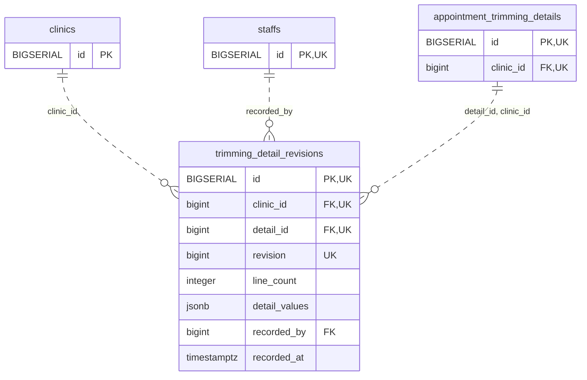

<!-- GENERATED: scripts/tools/generate-erd-detail.py; do not edit -->
# `trimming_detail_revisions`

[詳細ERD一覧](index.md) · [概要ERD](../erd.md)

このページは、マイグレーションをファイル名順に静的解析した最終定義です。稼働DBの状態は未確認です。

## カラム

型・DEFAULTはDDLの宣言表記です。`bigserial` は採番宣言であり、DBカタログ上の型名ではありません。

| カラム | 型（DDL） | NULL | DEFAULT（DDL） | キー構成列 | 定義元 |
|:---|:---|:---|:---|:---|:---|
| `id` | `BIGSERIAL` | NOT NULL | — | PK, UK | [001_init.sql:8104](../../../backend/migrations/001_init.sql#L8104) |
| `clinic_id` | `bigint` | NOT NULL | — | FK, UK | [001_init.sql:8105](../../../backend/migrations/001_init.sql#L8105) |
| `detail_id` | `bigint` | NOT NULL | — | FK, UK | [001_init.sql:8106](../../../backend/migrations/001_init.sql#L8106) |
| `revision` | `bigint` | NOT NULL | — | UK | [001_init.sql:8107](../../../backend/migrations/001_init.sql#L8107) |
| `line_count` | `integer` | NOT NULL | — | — | [001_init.sql:8108](../../../backend/migrations/001_init.sql#L8108) |
| `detail_values` | `jsonb` | NOT NULL | — | — | [001_init.sql:8109](../../../backend/migrations/001_init.sql#L8109) |
| `recorded_by` | `bigint` | NOT NULL | — | FK | [001_init.sql:8110](../../../backend/migrations/001_init.sql#L8110) |
| `recorded_at` | `timestamptz` | NOT NULL | `clock_timestamp()` | — | [001_init.sql:8111](../../../backend/migrations/001_init.sql#L8111) |

PK/FK/UKはキーの構成列を示します。複合キーの各列が単独で一意という意味ではありません。部分uniqueは下記indexの述語を参照してください。

## ERD

このテーブルの全カラムと、すべての参照先を表示します。参照先はFKの対象列だけを表示し、全カラムは各テーブルのページに置きます。

親側の任意参照はFK列のNULL可否、子側の最大1件は無条件のPK/UNIQUEから導出します。部分uniqueによる条件付きの最大件数は図に反映せず、index一覧に記録します。実線はFK全列が子のPKに含まれる識別関係、破線はそれ以外です。

## 外部キー（全件）

| 制約 | 子の列（順序あり） | 参照先 | 親の列（順序あり） | 削除時の動作 | 定義元 |
|:---|:---|:---|:---|:---|:---|
| `trimming_detail_revisions_clinic_id_fkey` | `clinic_id` | [clinics](clinics.md) | `id` | `ON DELETE RESTRICT` | [001_init.sql:8105](../../../backend/migrations/001_init.sql#L8105) |
| `trimming_detail_revisions_recorded_by_fkey` | `recorded_by` | [staffs](staffs.md) | `id` | `ON DELETE RESTRICT` | [001_init.sql:8110](../../../backend/migrations/001_init.sql#L8110) |
| `trimming_detail_revisions_detail_id_clinic_id_fkey` | `detail_id, clinic_id` | [appointment_trimming_details](appointment_trimming_details.md) | `id, clinic_id` | `ON DELETE RESTRICT` | [001_init.sql:8114](../../../backend/migrations/001_init.sql#L8114) |

正確なON UPDATE・MATCH・DEFERRABLE等を含む制約DDL:

- `trimming_detail_revisions_clinic_id_fkey`: `REFERENCES clinics(id) ON DELETE RESTRICT`
- `trimming_detail_revisions_recorded_by_fkey`: `REFERENCES staffs(id) ON DELETE RESTRICT`
- `trimming_detail_revisions_detail_id_clinic_id_fkey`: `FOREIGN KEY (detail_id,clinic_id) REFERENCES appointment_trimming_details(id,clinic_id) ON DELETE RESTRICT`

## その他の制約

| 制約 | 種別 | DDL | 定義元 |
|:---|:---|:---|:---|
| `trimming_detail_revisions_pkey` | primary | `PRIMARY KEY` | [001_init.sql:8104](../../../backend/migrations/001_init.sql#L8104) |
| `trimming_detail_revisions_revision_check` | check | `CHECK (revision > 0)` | [001_init.sql:8107](../../../backend/migrations/001_init.sql#L8107) |
| `trimming_detail_revisions_line_count_check` | check | `CHECK (line_count >= 0)` | [001_init.sql:8108](../../../backend/migrations/001_init.sql#L8108) |
| `trimming_detail_revisions_detail_values_check` | check | `CHECK (jsonb_typeof(detail_values)='object')` | [001_init.sql:8109](../../../backend/migrations/001_init.sql#L8109) |
| `trimming_detail_revisions_id_clinic_id_detail_id_key` | unique | `UNIQUE (id,clinic_id,detail_id)` | [001_init.sql:8112](../../../backend/migrations/001_init.sql#L8112) |
| `trimming_detail_revisions_clinic_id_detail_id_revision_key` | unique | `UNIQUE (clinic_id,detail_id,revision)` | [001_init.sql:8113](../../../backend/migrations/001_init.sql#L8113) |

## インデックス

明示的なCREATE INDEXなし。PK/UNIQUEに付随する暗黙のindexは制約欄を参照してください。
