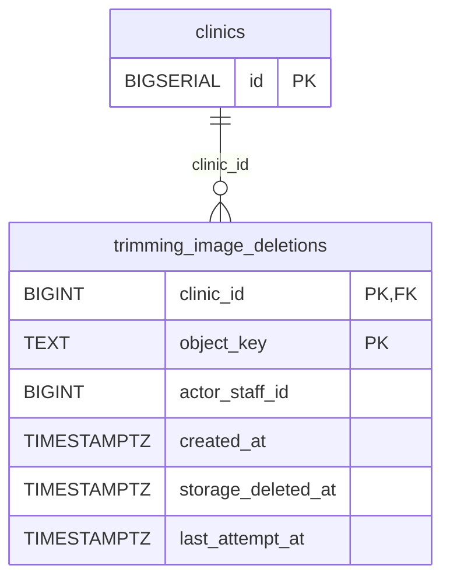

<!-- GENERATED: scripts/tools/generate-erd-detail.py; do not edit -->
# `trimming_image_deletions`

[詳細ERD一覧](index.md) · [概要ERD](../erd.md)

このページは、マイグレーションをファイル名順に静的解析した最終定義です。稼働DBの状態は未確認です。

## カラム

型・DEFAULTはDDLの宣言表記です。`bigserial` は採番宣言であり、DBカタログ上の型名ではありません。

| カラム | 型（DDL） | NULL | DEFAULT（DDL） | キー構成列 | 定義元 |
|:---|:---|:---|:---|:---|:---|
| `clinic_id` | `BIGINT` | NOT NULL | — | PK, FK | [001_init.sql:7483](../../../backend/migrations/001_init.sql#L7483) |
| `object_key` | `TEXT` | NOT NULL | — | PK | [001_init.sql:7484](../../../backend/migrations/001_init.sql#L7484) |
| `actor_staff_id` | `BIGINT` | NOT NULL | — | — | [001_init.sql:7485](../../../backend/migrations/001_init.sql#L7485) |
| `created_at` | `TIMESTAMPTZ` | NOT NULL | `NOW()` | — | [001_init.sql:7486](../../../backend/migrations/001_init.sql#L7486) |
| `storage_deleted_at` | `TIMESTAMPTZ` | NULL | — | — | [001_init.sql:7540](../../../backend/migrations/001_init.sql#L7540) |
| `last_attempt_at` | `TIMESTAMPTZ` | NULL | — | — | [001_init.sql:7541](../../../backend/migrations/001_init.sql#L7541) |

PK/FK/UKはキーの構成列を示します。複合キーの各列が単独で一意という意味ではありません。部分uniqueは下記indexの述語を参照してください。

## ERD

このテーブルの全カラムと、すべての参照先を表示します。参照先はFKの対象列だけを表示し、全カラムは各テーブルのページに置きます。

親側の任意参照はFK列のNULL可否、子側の最大1件は無条件のPK/UNIQUEから導出します。部分uniqueによる条件付きの最大件数は図に反映せず、index一覧に記録します。実線はFK全列が子のPKに含まれる識別関係、破線はそれ以外です。

## 外部キー（全件）

| 制約 | 子の列（順序あり） | 参照先 | 親の列（順序あり） | 削除時の動作 | 定義元 |
|:---|:---|:---|:---|:---|:---|
| `trimming_image_deletions_clinic_id_fkey` | `clinic_id` | [clinics](clinics.md) | `id` | `ON DELETE RESTRICT` | [001_init.sql:7483](../../../backend/migrations/001_init.sql#L7483) |

正確なON UPDATE・MATCH・DEFERRABLE等を含む制約DDL:

- `trimming_image_deletions_clinic_id_fkey`: `REFERENCES clinics(id) ON DELETE RESTRICT`

## その他の制約

| 制約 | 種別 | DDL | 定義元 |
|:---|:---|:---|:---|
| `trimming_image_deletions_pkey` | primary | `PRIMARY KEY (clinic_id, object_key)` | [001_init.sql:7487](../../../backend/migrations/001_init.sql#L7487) |

## インデックス

| 名前 | UNIQUE | 述語 | DDL | 定義元 |
|:---|:---|:---|:---|:---|
| `idx_trimming_image_deletions_pending` | NO | `storage_deleted_at IS NULL` | `CREATE INDEX idx_trimming_image_deletions_pending     ON trimming_image_deletions (clinic_id, last_attempt_at, object_key)     WHERE storage_deleted_at IS NULL` | [001_init.sql:7543](../../../backend/migrations/001_init.sql#L7543) |
