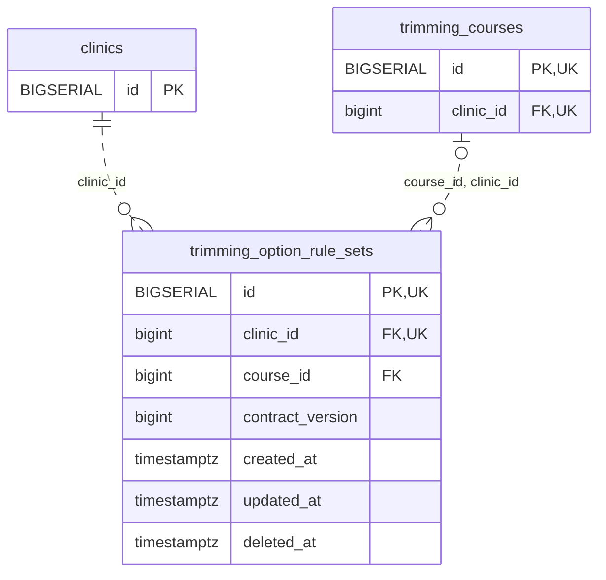

<!-- GENERATED: scripts/tools/generate-erd-detail.py; do not edit -->
# `trimming_option_rule_sets`

[詳細ERD一覧](index.md) · [概要ERD](../erd.md)

このページは、マイグレーションをファイル名順に静的解析した最終定義です。稼働DBの状態は未確認です。

## カラム

型・DEFAULTはDDLの宣言表記です。`bigserial` は採番宣言であり、DBカタログ上の型名ではありません。

| カラム | 型（DDL） | NULL | DEFAULT（DDL） | キー構成列 | 定義元 |
|:---|:---|:---|:---|:---|:---|
| `id` | `BIGSERIAL` | NOT NULL | — | PK, UK | [001_init.sql:7972](../../../backend/migrations/001_init.sql#L7972) |
| `clinic_id` | `bigint` | NOT NULL | — | FK, UK | [001_init.sql:7973](../../../backend/migrations/001_init.sql#L7973) |
| `course_id` | `bigint` | NULL | — | FK | [001_init.sql:7974](../../../backend/migrations/001_init.sql#L7974) |
| `contract_version` | `bigint` | NOT NULL | `1` | — | [001_init.sql:7975](../../../backend/migrations/001_init.sql#L7975) |
| `created_at` | `timestamptz` | NOT NULL | `clock_timestamp()` | — | [001_init.sql:7976](../../../backend/migrations/001_init.sql#L7976) |
| `updated_at` | `timestamptz` | NOT NULL | `clock_timestamp()` | — | [001_init.sql:7977](../../../backend/migrations/001_init.sql#L7977) |
| `deleted_at` | `timestamptz` | NULL | — | — | [001_init.sql:7978](../../../backend/migrations/001_init.sql#L7978) |

PK/FK/UKはキーの構成列を示します。複合キーの各列が単独で一意という意味ではありません。部分uniqueは下記indexの述語を参照してください。

## ERD

このテーブルの全カラムと、すべての参照先を表示します。参照先はFKの対象列だけを表示し、全カラムは各テーブルのページに置きます。

親側の任意参照はFK列のNULL可否、子側の最大1件は無条件のPK/UNIQUEから導出します。部分uniqueによる条件付きの最大件数は図に反映せず、index一覧に記録します。実線はFK全列が子のPKに含まれる識別関係、破線はそれ以外です。

## 外部キー（全件）

| 制約 | 子の列（順序あり） | 参照先 | 親の列（順序あり） | 削除時の動作 | 定義元 |
|:---|:---|:---|:---|:---|:---|
| `trimming_option_rule_sets_clinic_id_fkey` | `clinic_id` | [clinics](clinics.md) | `id` | `ON DELETE RESTRICT` | [001_init.sql:7973](../../../backend/migrations/001_init.sql#L7973) |
| `trimming_option_rule_sets_course_id_clinic_id_fkey` | `course_id, clinic_id` | [trimming_courses](trimming_courses.md) | `id, clinic_id` | `ON DELETE RESTRICT` | [001_init.sql:7980](../../../backend/migrations/001_init.sql#L7980) |

正確なON UPDATE・MATCH・DEFERRABLE等を含む制約DDL:

- `trimming_option_rule_sets_clinic_id_fkey`: `REFERENCES clinics(id) ON DELETE RESTRICT`
- `trimming_option_rule_sets_course_id_clinic_id_fkey`: `FOREIGN KEY (course_id, clinic_id) REFERENCES trimming_courses(id, clinic_id) ON DELETE RESTRICT`

## その他の制約

| 制約 | 種別 | DDL | 定義元 |
|:---|:---|:---|:---|
| `trimming_option_rule_sets_pkey` | primary | `PRIMARY KEY` | [001_init.sql:7972](../../../backend/migrations/001_init.sql#L7972) |
| `trimming_option_rule_sets_contract_version_check` | check | `CHECK (contract_version > 0)` | [001_init.sql:7975](../../../backend/migrations/001_init.sql#L7975) |
| `trimming_option_rule_sets_id_clinic_id_key` | unique | `UNIQUE (id, clinic_id)` | [001_init.sql:7979](../../../backend/migrations/001_init.sql#L7979) |

## インデックス

| 名前 | UNIQUE | 述語 | DDL | 定義元 |
|:---|:---|:---|:---|:---|
| `uq_trimming_rule_set_course_active` | YES | `course_id IS NOT NULL AND deleted_at IS NULL` | `CREATE UNIQUE INDEX uq_trimming_rule_set_course_active ON trimming_option_rule_sets(clinic_id, course_id)  WHERE course_id IS NOT NULL AND deleted_at IS NULL` | [001_init.sql:7982](../../../backend/migrations/001_init.sql#L7982) |
| `uq_trimming_rule_set_no_course_active` | YES | `course_id IS NULL AND deleted_at IS NULL` | `CREATE UNIQUE INDEX uq_trimming_rule_set_no_course_active ON trimming_option_rule_sets(clinic_id)  WHERE course_id IS NULL AND deleted_at IS NULL` | [001_init.sql:7984](../../../backend/migrations/001_init.sql#L7984) |
