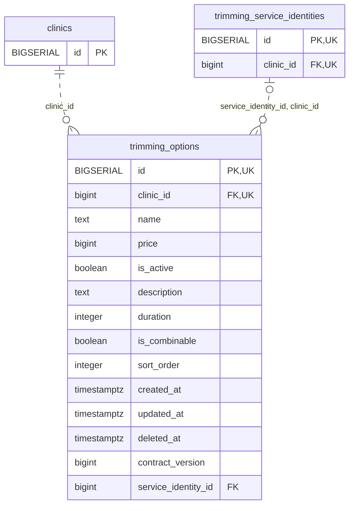

<!-- GENERATED: scripts/tools/generate-erd-detail.py; do not edit -->
# `trimming_options`

[詳細ERD一覧](index.md) · [概要ERD](../erd.md)

このページは、マイグレーションをファイル名順に静的解析した最終定義です。稼働DBの状態は未確認です。

## カラム

型・DEFAULTはDDLの宣言表記です。`bigserial` は採番宣言であり、DBカタログ上の型名ではありません。

| カラム | 型（DDL） | NULL | DEFAULT（DDL） | キー構成列 | 定義元 |
|:---|:---|:---|:---|:---|:---|
| `id` | `BIGSERIAL` | NOT NULL | — | PK, UK | [001_init.sql:1028](../../../backend/migrations/001_init.sql#L1028) |
| `clinic_id` | `bigint` | NOT NULL | — | FK, UK | [001_init.sql:1029](../../../backend/migrations/001_init.sql#L1029) |
| `name` | `text` | NOT NULL | — | — | [001_init.sql:1030](../../../backend/migrations/001_init.sql#L1030) |
| `price` | `bigint` | NULL | — | — | [001_init.sql:1031](../../../backend/migrations/001_init.sql#L1031) |
| `is_active` | `boolean` | NOT NULL | `true` | — | [001_init.sql:1032](../../../backend/migrations/001_init.sql#L1032) |
| `description` | `text` | NOT NULL | `''` | — | [001_init.sql:1033](../../../backend/migrations/001_init.sql#L1033) |
| `duration` | `integer` | NULL | — | — | [001_init.sql:1034](../../../backend/migrations/001_init.sql#L1034) |
| `is_combinable` | `boolean` | NOT NULL | `true` | — | [001_init.sql:1035](../../../backend/migrations/001_init.sql#L1035) |
| `sort_order` | `integer` | NULL | `0` | — | [001_init.sql:1036](../../../backend/migrations/001_init.sql#L1036) |
| `created_at` | `timestamptz` | NOT NULL | `now()` | — | [001_init.sql:1037](../../../backend/migrations/001_init.sql#L1037) |
| `updated_at` | `timestamptz` | NOT NULL | `now()` | — | [001_init.sql:1038](../../../backend/migrations/001_init.sql#L1038) |
| `deleted_at` | `timestamptz` | NULL | — | — | [001_init.sql:1039](../../../backend/migrations/001_init.sql#L1039) |
| `contract_version` | `bigint` | NOT NULL | `1` | — | [001_init.sql:7935](../../../backend/migrations/001_init.sql#L7935) |
| `service_identity_id` | `bigint` | NULL | — | FK | [001_init.sql:7966](../../../backend/migrations/001_init.sql#L7966) |

PK/FK/UKはキーの構成列を示します。複合キーの各列が単独で一意という意味ではありません。部分uniqueは下記indexの述語を参照してください。

## ERD

このテーブルの全カラムと、すべての参照先を表示します。参照先はFKの対象列だけを表示し、全カラムは各テーブルのページに置きます。

親側の任意参照はFK列のNULL可否、子側の最大1件は無条件のPK/UNIQUEから導出します。部分uniqueによる条件付きの最大件数は図に反映せず、index一覧に記録します。実線はFK全列が子のPKに含まれる識別関係、破線はそれ以外です。

## 外部キー（全件）

| 制約 | 子の列（順序あり） | 参照先 | 親の列（順序あり） | 削除時の動作 | 定義元 |
|:---|:---|:---|:---|:---|:---|
| `trimming_options_clinic_id_fkey` | `clinic_id` | [clinics](clinics.md) | `id` | `ON DELETE RESTRICT` | [001_init.sql:1029](../../../backend/migrations/001_init.sql#L1029) |
| `fk_trimming_option_service_identity` | `service_identity_id, clinic_id` | [trimming_service_identities](trimming_service_identities.md) | `id, clinic_id` | `ON DELETE RESTRICT` | [001_init.sql:7967](../../../backend/migrations/001_init.sql#L7967) |

正確なON UPDATE・MATCH・DEFERRABLE等を含む制約DDL:

- `trimming_options_clinic_id_fkey`: `REFERENCES clinics(id) ON DELETE RESTRICT`
- `fk_trimming_option_service_identity`: `CONSTRAINT fk_trimming_option_service_identity  FOREIGN KEY (service_identity_id, clinic_id)  REFERENCES trimming_service_identities(id, clinic_id) ON DELETE RESTRICT`

## その他の制約

| 制約 | 種別 | DDL | 定義元 |
|:---|:---|:---|:---|
| `trimming_options_pkey` | primary | `PRIMARY KEY` | [001_init.sql:1028](../../../backend/migrations/001_init.sql#L1028) |
| `trimming_options_contract_version_check` | check | `CHECK (contract_version > 0)` | [001_init.sql:7935](../../../backend/migrations/001_init.sql#L7935) |
| `uq_trimming_options_id_clinic` | unique | `CONSTRAINT uq_trimming_options_id_clinic UNIQUE (id, clinic_id)` | [001_init.sql:7936](../../../backend/migrations/001_init.sql#L7936) |

## インデックス

| 名前 | UNIQUE | 述語 | DDL | 定義元 |
|:---|:---|:---|:---|:---|
| `idx_trimming_options_clinic_id` | NO | — | `CREATE INDEX idx_trimming_options_clinic_id ON trimming_options(clinic_id)` | [001_init.sql:2247](../../../backend/migrations/001_init.sql#L2247) |
| `idx_trimming_options_clinic_sort` | NO | `deleted_at IS NULL` | `CREATE INDEX idx_trimming_options_clinic_sort  ON trimming_options(clinic_id, sort_order)        WHERE deleted_at IS NULL` | [001_init.sql:2283](../../../backend/migrations/001_init.sql#L2283) |
| `idx_trimming_options_clinic_name` | YES | `deleted_at IS NULL` | `CREATE UNIQUE INDEX idx_trimming_options_clinic_name ON trimming_options(clinic_id, name) WHERE deleted_at IS NULL` | [001_init.sql:2479](../../../backend/migrations/001_init.sql#L2479) |
| `idx_trimming_options_active` | NO | `deleted_at IS NULL` | `CREATE INDEX idx_trimming_options_active ON trimming_options(id) WHERE deleted_at IS NULL` | [001_init.sql:2499](../../../backend/migrations/001_init.sql#L2499) |
