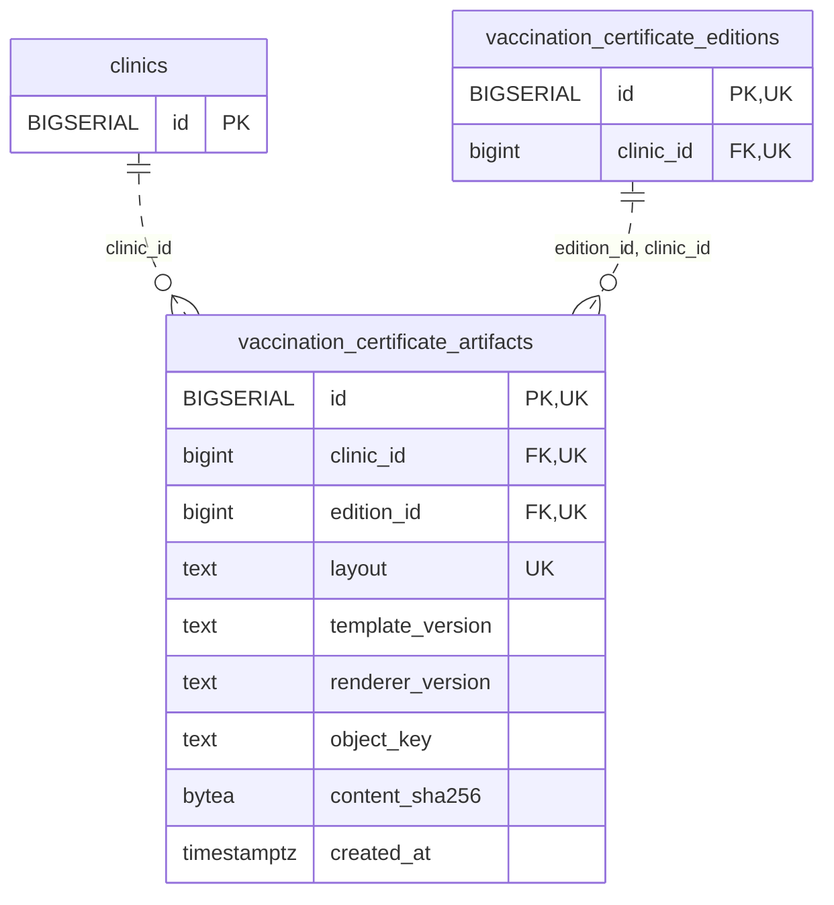

<!-- GENERATED: scripts/tools/generate-erd-detail.py; do not edit -->
# `vaccination_certificate_artifacts`

[詳細ERD一覧](index.md) · [概要ERD](../erd.md)

このページは、マイグレーションをファイル名順に静的解析した最終定義です。稼働DBの状態は未確認です。

## カラム

型・DEFAULTはDDLの宣言表記です。`bigserial` は採番宣言であり、DBカタログ上の型名ではありません。

| カラム | 型（DDL） | NULL | DEFAULT（DDL） | キー構成列 | 定義元 |
|:---|:---|:---|:---|:---|:---|
| `id` | `BIGSERIAL` | NOT NULL | — | PK, UK | [001_init.sql:8345](../../../backend/migrations/001_init.sql#L8345) |
| `clinic_id` | `bigint` | NOT NULL | — | FK, UK | [001_init.sql:8346](../../../backend/migrations/001_init.sql#L8346) |
| `edition_id` | `bigint` | NOT NULL | — | FK, UK | [001_init.sql:8347](../../../backend/migrations/001_init.sql#L8347) |
| `layout` | `text` | NOT NULL | — | UK | [001_init.sql:8348](../../../backend/migrations/001_init.sql#L8348) |
| `template_version` | `text` | NOT NULL | — | — | [001_init.sql:8349](../../../backend/migrations/001_init.sql#L8349) |
| `renderer_version` | `text` | NOT NULL | — | — | [001_init.sql:8350](../../../backend/migrations/001_init.sql#L8350) |
| `object_key` | `text` | NOT NULL | — | — | [001_init.sql:8351](../../../backend/migrations/001_init.sql#L8351) |
| `content_sha256` | `bytea` | NOT NULL | — | — | [001_init.sql:8352](../../../backend/migrations/001_init.sql#L8352) |
| `created_at` | `timestamptz` | NOT NULL | `clock_timestamp()` | — | [001_init.sql:8353](../../../backend/migrations/001_init.sql#L8353) |

PK/FK/UKはキーの構成列を示します。複合キーの各列が単独で一意という意味ではありません。部分uniqueは下記indexの述語を参照してください。

## ERD

このテーブルの全カラムと、すべての参照先を表示します。参照先はFKの対象列だけを表示し、全カラムは各テーブルのページに置きます。

親側の任意参照はFK列のNULL可否、子側の最大1件は無条件のPK/UNIQUEから導出します。部分uniqueによる条件付きの最大件数は図に反映せず、index一覧に記録します。実線はFK全列が子のPKに含まれる識別関係、破線はそれ以外です。

## 外部キー（全件）

| 制約 | 子の列（順序あり） | 参照先 | 親の列（順序あり） | 削除時の動作 | 定義元 |
|:---|:---|:---|:---|:---|:---|
| `vaccination_certificate_artifacts_clinic_id_fkey` | `clinic_id` | [clinics](clinics.md) | `id` | `ON DELETE RESTRICT` | [001_init.sql:8346](../../../backend/migrations/001_init.sql#L8346) |
| `vaccination_certificate_artifacts_edition_id_clinic_id_fkey` | `edition_id, clinic_id` | [vaccination_certificate_editions](vaccination_certificate_editions.md) | `id, clinic_id` | `ON DELETE RESTRICT` | [001_init.sql:8356](../../../backend/migrations/001_init.sql#L8356) |

正確なON UPDATE・MATCH・DEFERRABLE等を含む制約DDL:

- `vaccination_certificate_artifacts_clinic_id_fkey`: `REFERENCES clinics(id) ON DELETE RESTRICT`
- `vaccination_certificate_artifacts_edition_id_clinic_id_fkey`: `FOREIGN KEY (edition_id,clinic_id) REFERENCES vaccination_certificate_editions(id,clinic_id) ON DELETE RESTRICT`

## その他の制約

| 制約 | 種別 | DDL | 定義元 |
|:---|:---|:---|:---|
| `vaccination_certificate_artifacts_pkey` | primary | `PRIMARY KEY` | [001_init.sql:8345](../../../backend/migrations/001_init.sql#L8345) |
| `vaccination_certificate_artifacts_layout_check` | check | `CHECK (layout IN ('portrait','landscape','rabies'))` | [001_init.sql:8348](../../../backend/migrations/001_init.sql#L8348) |
| `vaccination_certificate_artifacts_template_version_check` | check | `CHECK (btrim(template_version)<>'')` | [001_init.sql:8349](../../../backend/migrations/001_init.sql#L8349) |
| `vaccination_certificate_artifacts_renderer_version_check` | check | `CHECK (btrim(renderer_version)<>'')` | [001_init.sql:8350](../../../backend/migrations/001_init.sql#L8350) |
| `vaccination_certificate_artifacts_object_key_check` | check | `CHECK (btrim(object_key)<>'')` | [001_init.sql:8351](../../../backend/migrations/001_init.sql#L8351) |
| `vaccination_certificate_artifacts_content_sha256_check` | check | `CHECK (octet_length(content_sha256)=32)` | [001_init.sql:8352](../../../backend/migrations/001_init.sql#L8352) |
| `vaccination_certificate_artifacts_id_clinic_id_edition_id_key` | unique | `UNIQUE (id,clinic_id,edition_id)` | [001_init.sql:8354](../../../backend/migrations/001_init.sql#L8354) |
| `vaccination_certificate_artifac_clinic_id_edition_id_layout_key` | unique | `UNIQUE (clinic_id,edition_id,layout)` | [001_init.sql:8355](../../../backend/migrations/001_init.sql#L8355) |

## インデックス

明示的なCREATE INDEXなし。PK/UNIQUEに付随する暗黙のindexは制約欄を参照してください。
