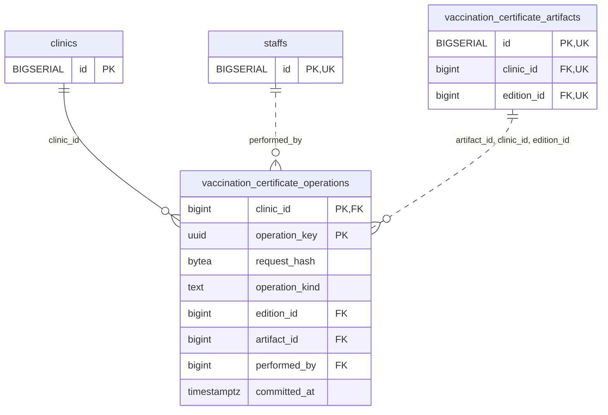

<!-- GENERATED: scripts/tools/generate-erd-detail.py; do not edit -->
# `vaccination_certificate_operations`

[詳細ERD一覧](index.md) · [概要ERD](../erd.md)

このページは、マイグレーションをファイル名順に静的解析した最終定義です。稼働DBの状態は未確認です。

## カラム

型・DEFAULTはDDLの宣言表記です。`bigserial` は採番宣言であり、DBカタログ上の型名ではありません。

| カラム | 型（DDL） | NULL | DEFAULT（DDL） | キー構成列 | 定義元 |
|:---|:---|:---|:---|:---|:---|
| `clinic_id` | `bigint` | NOT NULL | — | PK, FK | [001_init.sql:8371](../../../backend/migrations/001_init.sql#L8371) |
| `operation_key` | `uuid` | NOT NULL | — | PK | [001_init.sql:8372](../../../backend/migrations/001_init.sql#L8372) |
| `request_hash` | `bytea` | NOT NULL | — | — | [001_init.sql:8373](../../../backend/migrations/001_init.sql#L8373) |
| `operation_kind` | `text` | NOT NULL | — | — | [001_init.sql:8374](../../../backend/migrations/001_init.sql#L8374) |
| `edition_id` | `bigint` | NOT NULL | — | FK | [001_init.sql:8375](../../../backend/migrations/001_init.sql#L8375) |
| `artifact_id` | `bigint` | NOT NULL | — | FK | [001_init.sql:8376](../../../backend/migrations/001_init.sql#L8376) |
| `performed_by` | `bigint` | NOT NULL | — | FK | [001_init.sql:8377](../../../backend/migrations/001_init.sql#L8377) |
| `committed_at` | `timestamptz` | NOT NULL | `clock_timestamp()` | — | [001_init.sql:8378](../../../backend/migrations/001_init.sql#L8378) |

PK/FK/UKはキーの構成列を示します。複合キーの各列が単独で一意という意味ではありません。部分uniqueは下記indexの述語を参照してください。

## ERD

このテーブルの全カラムと、すべての参照先を表示します。参照先はFKの対象列だけを表示し、全カラムは各テーブルのページに置きます。

親側の任意参照はFK列のNULL可否、子側の最大1件は無条件のPK/UNIQUEから導出します。部分uniqueによる条件付きの最大件数は図に反映せず、index一覧に記録します。実線はFK全列が子のPKに含まれる識別関係、破線はそれ以外です。

## 外部キー（全件）

| 制約 | 子の列（順序あり） | 参照先 | 親の列（順序あり） | 削除時の動作 | 定義元 |
|:---|:---|:---|:---|:---|:---|
| `vaccination_certificate_operations_clinic_id_fkey` | `clinic_id` | [clinics](clinics.md) | `id` | `ON DELETE RESTRICT` | [001_init.sql:8371](../../../backend/migrations/001_init.sql#L8371) |
| `vaccination_certificate_operations_performed_by_fkey` | `performed_by` | [staffs](staffs.md) | `id` | `ON DELETE RESTRICT` | [001_init.sql:8377](../../../backend/migrations/001_init.sql#L8377) |
| `vaccination_certificate_opera_artifact_id_clinic_id_editio_fkey` | `artifact_id, clinic_id, edition_id` | [vaccination_certificate_artifacts](vaccination_certificate_artifacts.md) | `id, clinic_id, edition_id` | `ON DELETE RESTRICT` | [001_init.sql:8380](../../../backend/migrations/001_init.sql#L8380) |

正確なON UPDATE・MATCH・DEFERRABLE等を含む制約DDL:

- `vaccination_certificate_operations_clinic_id_fkey`: `REFERENCES clinics(id) ON DELETE RESTRICT`
- `vaccination_certificate_operations_performed_by_fkey`: `REFERENCES staffs(id) ON DELETE RESTRICT`
- `vaccination_certificate_opera_artifact_id_clinic_id_editio_fkey`: `FOREIGN KEY (artifact_id,clinic_id,edition_id) REFERENCES vaccination_certificate_artifacts(id,clinic_id,edition_id) ON DELETE RESTRICT`

## その他の制約

| 制約 | 種別 | DDL | 定義元 |
|:---|:---|:---|:---|
| `vaccination_certificate_operations_request_hash_check` | check | `CHECK (octet_length(request_hash)=32)` | [001_init.sql:8373](../../../backend/migrations/001_init.sql#L8373) |
| `vaccination_certificate_operations_operation_kind_check` | check | `CHECK (operation_kind IN ('issue','reprint'))` | [001_init.sql:8374](../../../backend/migrations/001_init.sql#L8374) |
| `vaccination_certificate_operations_pkey` | primary | `PRIMARY KEY (clinic_id,operation_key)` | [001_init.sql:8379](../../../backend/migrations/001_init.sql#L8379) |

## インデックス

| 名前 | UNIQUE | 述語 | DDL | 定義元 |
|:---|:---|:---|:---|:---|
| `uq_certificate_issue_once` | YES | `operation_kind='issue'` | `CREATE UNIQUE INDEX uq_certificate_issue_once ON vaccination_certificate_operations(clinic_id,edition_id) WHERE operation_kind='issue'` | [001_init.sql:8687](../../../backend/migrations/001_init.sql#L8687) |
