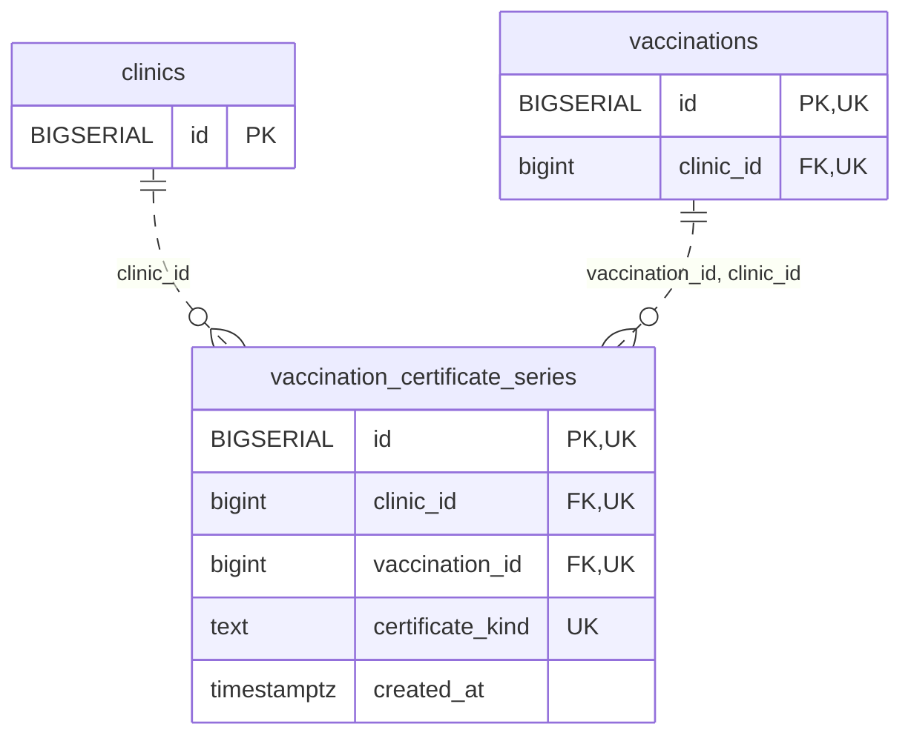

<!-- GENERATED: scripts/tools/generate-erd-detail.py; do not edit -->
# `vaccination_certificate_series`

[詳細ERD一覧](index.md) · [概要ERD](../erd.md)

このページは、マイグレーションをファイル名順に静的解析した最終定義です。稼働DBの状態は未確認です。

## カラム

型・DEFAULTはDDLの宣言表記です。`bigserial` は採番宣言であり、DBカタログ上の型名ではありません。

| カラム | 型（DDL） | NULL | DEFAULT（DDL） | キー構成列 | 定義元 |
|:---|:---|:---|:---|:---|:---|
| `id` | `BIGSERIAL` | NOT NULL | — | PK, UK | [001_init.sql:8319](../../../backend/migrations/001_init.sql#L8319) |
| `clinic_id` | `bigint` | NOT NULL | — | FK, UK | [001_init.sql:8320](../../../backend/migrations/001_init.sql#L8320) |
| `vaccination_id` | `bigint` | NOT NULL | — | FK, UK | [001_init.sql:8321](../../../backend/migrations/001_init.sql#L8321) |
| `certificate_kind` | `text` | NOT NULL | — | UK | [001_init.sql:8322](../../../backend/migrations/001_init.sql#L8322) |
| `created_at` | `timestamptz` | NOT NULL | `clock_timestamp()` | — | [001_init.sql:8323](../../../backend/migrations/001_init.sql#L8323) |

PK/FK/UKはキーの構成列を示します。複合キーの各列が単独で一意という意味ではありません。部分uniqueは下記indexの述語を参照してください。

## ERD

このテーブルの全カラムと、すべての参照先を表示します。参照先はFKの対象列だけを表示し、全カラムは各テーブルのページに置きます。

親側の任意参照はFK列のNULL可否、子側の最大1件は無条件のPK/UNIQUEから導出します。部分uniqueによる条件付きの最大件数は図に反映せず、index一覧に記録します。実線はFK全列が子のPKに含まれる識別関係、破線はそれ以外です。

## 外部キー（全件）

| 制約 | 子の列（順序あり） | 参照先 | 親の列（順序あり） | 削除時の動作 | 定義元 |
|:---|:---|:---|:---|:---|:---|
| `vaccination_certificate_series_clinic_id_fkey` | `clinic_id` | [clinics](clinics.md) | `id` | `ON DELETE RESTRICT` | [001_init.sql:8320](../../../backend/migrations/001_init.sql#L8320) |
| `vaccination_certificate_series_vaccination_id_clinic_id_fkey` | `vaccination_id, clinic_id` | [vaccinations](vaccinations.md) | `id, clinic_id` | `ON DELETE RESTRICT` | [001_init.sql:8326](../../../backend/migrations/001_init.sql#L8326) |

正確なON UPDATE・MATCH・DEFERRABLE等を含む制約DDL:

- `vaccination_certificate_series_clinic_id_fkey`: `REFERENCES clinics(id) ON DELETE RESTRICT`
- `vaccination_certificate_series_vaccination_id_clinic_id_fkey`: `FOREIGN KEY (vaccination_id,clinic_id) REFERENCES vaccinations(id,clinic_id) ON DELETE RESTRICT`

## その他の制約

| 制約 | 種別 | DDL | 定義元 |
|:---|:---|:---|:---|
| `vaccination_certificate_series_pkey` | primary | `PRIMARY KEY` | [001_init.sql:8319](../../../backend/migrations/001_init.sql#L8319) |
| `vaccination_certificate_series_certificate_kind_check` | check | `CHECK (certificate_kind IN ('normal','rabies'))` | [001_init.sql:8322](../../../backend/migrations/001_init.sql#L8322) |
| `vaccination_certificate_series_id_clinic_id_key` | unique | `UNIQUE (id,clinic_id)` | [001_init.sql:8324](../../../backend/migrations/001_init.sql#L8324) |
| `vaccination_certificate_serie_clinic_id_vaccination_id_cert_key` | unique | `UNIQUE (clinic_id,vaccination_id,certificate_kind)` | [001_init.sql:8325](../../../backend/migrations/001_init.sql#L8325) |

## インデックス

明示的なCREATE INDEXなし。PK/UNIQUEに付随する暗黙のindexは制約欄を参照してください。
