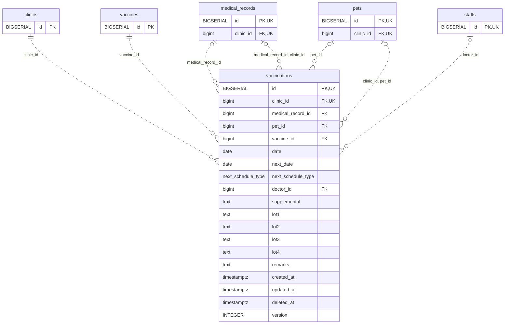

<!-- GENERATED: scripts/tools/generate-erd-detail.py; do not edit -->
# `vaccinations`

[詳細ERD一覧](index.md) · [概要ERD](../erd.md)

このページは、マイグレーションをファイル名順に静的解析した最終定義です。稼働DBの状態は未確認です。

## カラム

型・DEFAULTはDDLの宣言表記です。`bigserial` は採番宣言であり、DBカタログ上の型名ではありません。

| カラム | 型（DDL） | NULL | DEFAULT（DDL） | キー構成列 | 定義元 |
|:---|:---|:---|:---|:---|:---|
| `id` | `BIGSERIAL` | NOT NULL | — | PK, UK | [001_init.sql:1478](../../../backend/migrations/001_init.sql#L1478) |
| `clinic_id` | `bigint` | NOT NULL | — | FK, UK | [001_init.sql:1479](../../../backend/migrations/001_init.sql#L1479) |
| `medical_record_id` | `bigint` | NULL | — | FK | [001_init.sql:1480](../../../backend/migrations/001_init.sql#L1480) |
| `pet_id` | `bigint` | NULL | — | FK | [001_init.sql:1481](../../../backend/migrations/001_init.sql#L1481) |
| `vaccine_id` | `bigint` | NOT NULL | — | FK | [001_init.sql:1482](../../../backend/migrations/001_init.sql#L1482) |
| `date` | `date` | NOT NULL | — | — | [001_init.sql:1483](../../../backend/migrations/001_init.sql#L1483) |
| `next_date` | `date` | NULL | — | — | [001_init.sql:1484](../../../backend/migrations/001_init.sql#L1484) |
| `next_schedule_type` | `next_schedule_type` | NULL | — | — | [001_init.sql:1485](../../../backend/migrations/001_init.sql#L1485) |
| `doctor_id` | `bigint` | NULL | — | FK | [001_init.sql:1486](../../../backend/migrations/001_init.sql#L1486) |
| `supplemental` | `text` | NOT NULL | `''` | — | [001_init.sql:1487](../../../backend/migrations/001_init.sql#L1487) |
| `lot1` | `text` | NOT NULL | `''` | — | [001_init.sql:1488](../../../backend/migrations/001_init.sql#L1488) |
| `lot2` | `text` | NOT NULL | `''` | — | [001_init.sql:1489](../../../backend/migrations/001_init.sql#L1489) |
| `lot3` | `text` | NOT NULL | `''` | — | [001_init.sql:1490](../../../backend/migrations/001_init.sql#L1490) |
| `lot4` | `text` | NOT NULL | `''` | — | [001_init.sql:1491](../../../backend/migrations/001_init.sql#L1491) |
| `remarks` | `text` | NOT NULL | `''` | — | [001_init.sql:1492](../../../backend/migrations/001_init.sql#L1492) |
| `created_at` | `timestamptz` | NOT NULL | `now()` | — | [001_init.sql:1493](../../../backend/migrations/001_init.sql#L1493) |
| `updated_at` | `timestamptz` | NOT NULL | `now()` | — | [001_init.sql:1494](../../../backend/migrations/001_init.sql#L1494) |
| `deleted_at` | `timestamptz` | NULL | — | — | [001_init.sql:1495](../../../backend/migrations/001_init.sql#L1495) |
| `version` | `INTEGER` | NOT NULL | `1` | — | [005_child_records_version.sql:19](../../../backend/migrations/005_child_records_version.sql#L19) |

PK/FK/UKはキーの構成列を示します。複合キーの各列が単独で一意という意味ではありません。部分uniqueは下記indexの述語を参照してください。

## ERD

このテーブルの全カラムと、すべての参照先を表示します。参照先はFKの対象列だけを表示し、全カラムは各テーブルのページに置きます。

親側の任意参照はFK列のNULL可否、子側の最大1件は無条件のPK/UNIQUEから導出します。部分uniqueによる条件付きの最大件数は図に反映せず、index一覧に記録します。実線はFK全列が子のPKに含まれる識別関係、破線はそれ以外です。

## 外部キー（全件）

| 制約 | 子の列（順序あり） | 参照先 | 親の列（順序あり） | 削除時の動作 | 定義元 |
|:---|:---|:---|:---|:---|:---|
| `vaccinations_clinic_id_fkey` | `clinic_id` | [clinics](clinics.md) | `id` | `ON DELETE RESTRICT` | [001_init.sql:1479](../../../backend/migrations/001_init.sql#L1479) |
| `vaccinations_medical_record_id_fkey` | `medical_record_id` | [medical_records](medical_records.md) | `id` | `ON DELETE CASCADE` | [001_init.sql:1480](../../../backend/migrations/001_init.sql#L1480) |
| `vaccinations_pet_id_fkey` | `pet_id` | [pets](pets.md) | `id` | `ON DELETE RESTRICT` | [001_init.sql:1481](../../../backend/migrations/001_init.sql#L1481) |
| `vaccinations_vaccine_id_fkey` | `vaccine_id` | [vaccines](vaccines.md) | `id` | `ON DELETE RESTRICT` | [001_init.sql:1482](../../../backend/migrations/001_init.sql#L1482) |
| `vaccinations_doctor_id_fkey` | `doctor_id` | [staffs](staffs.md) | `id` | `ON DELETE SET NULL` | [001_init.sql:1486](../../../backend/migrations/001_init.sql#L1486) |
| `fk_vaccinations_clinic_pet` | `clinic_id, pet_id` | [pets](pets.md) | `clinic_id, id` | `ON DELETE RESTRICT` | [001_init.sql:4370](../../../backend/migrations/001_init.sql#L4370) |
| `fk_vaccinations_medical_record_clinic` | `medical_record_id, clinic_id` | [medical_records](medical_records.md) | `id, clinic_id` | `ON DELETE RESTRICT` | [001_init.sql:4376](../../../backend/migrations/001_init.sql#L4376) |

正確なON UPDATE・MATCH・DEFERRABLE等を含む制約DDL:

- `vaccinations_clinic_id_fkey`: `REFERENCES clinics(id) ON DELETE RESTRICT`
- `vaccinations_medical_record_id_fkey`: `REFERENCES medical_records(id) ON DELETE CASCADE`
- `vaccinations_pet_id_fkey`: `REFERENCES pets(id) ON DELETE RESTRICT`
- `vaccinations_vaccine_id_fkey`: `REFERENCES vaccines(id) ON DELETE RESTRICT`
- `vaccinations_doctor_id_fkey`: `REFERENCES staffs(id) ON DELETE SET NULL`
- `fk_vaccinations_clinic_pet`: `CONSTRAINT fk_vaccinations_clinic_pet     FOREIGN KEY (clinic_id, pet_id)     REFERENCES pets (clinic_id, id)     ON DELETE RESTRICT`
- `fk_vaccinations_medical_record_clinic`: `CONSTRAINT fk_vaccinations_medical_record_clinic     FOREIGN KEY (medical_record_id, clinic_id)     REFERENCES medical_records (id, clinic_id)     ON DELETE RESTRICT`

## その他の制約

| 制約 | 種別 | DDL | 定義元 |
|:---|:---|:---|:---|
| `vaccinations_pkey` | primary | `PRIMARY KEY` | [001_init.sql:1478](../../../backend/migrations/001_init.sql#L1478) |
| `uq_vaccinations_id_clinic` | unique | `CONSTRAINT uq_vaccinations_id_clinic UNIQUE (id, clinic_id)` | [001_init.sql:4043](../../../backend/migrations/001_init.sql#L4043) |

## インデックス

| 名前 | UNIQUE | 述語 | DDL | 定義元 |
|:---|:---|:---|:---|:---|
| `idx_vaccinations_clinic_id` | NO | — | `CREATE INDEX idx_vaccinations_clinic_id ON vaccinations(clinic_id)` | [001_init.sql:2285](../../../backend/migrations/001_init.sql#L2285) |
| `idx_vaccinations_medical_record_id` | NO | — | `CREATE INDEX idx_vaccinations_medical_record_id ON vaccinations(medical_record_id)` | [001_init.sql:2286](../../../backend/migrations/001_init.sql#L2286) |
| `idx_vaccinations_pet_id` | NO | — | `CREATE INDEX idx_vaccinations_pet_id ON vaccinations(pet_id)` | [001_init.sql:2287](../../../backend/migrations/001_init.sql#L2287) |
| `idx_vaccinations_vaccine_id` | NO | — | `CREATE INDEX idx_vaccinations_vaccine_id ON vaccinations(vaccine_id)` | [001_init.sql:2288](../../../backend/migrations/001_init.sql#L2288) |
| `idx_vaccinations_clinic_date` | NO | `deleted_at IS NULL` | `CREATE INDEX idx_vaccinations_clinic_date   ON vaccinations(clinic_id, date)   WHERE deleted_at IS NULL` | [001_init.sql:2382](../../../backend/migrations/001_init.sql#L2382) |
| `idx_vaccinations_clinic_pet_date_active` | NO | `deleted_at IS NULL` | `CREATE INDEX idx_vaccinations_clinic_pet_date_active     ON vaccinations(clinic_id, pet_id, date, id)     WHERE deleted_at IS NULL` | [001_init.sql:4057](../../../backend/migrations/001_init.sql#L4057) |
