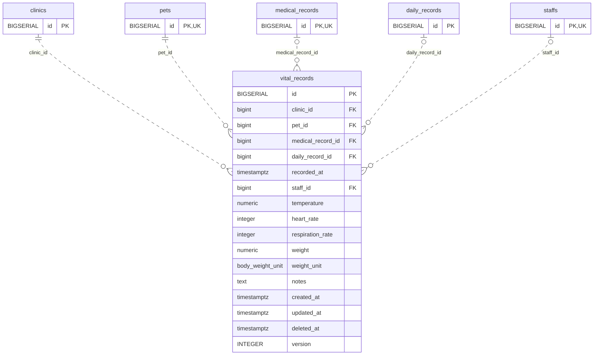

<!-- GENERATED: scripts/tools/generate-erd-detail.py; do not edit -->
# `vital_records`

[詳細ERD一覧](index.md) · [概要ERD](../erd.md)

このページは、マイグレーションをファイル名順に静的解析した最終定義です。稼働DBの状態は未確認です。

## カラム

型・DEFAULTはDDLの宣言表記です。`bigserial` は採番宣言であり、DBカタログ上の型名ではありません。

| カラム | 型（DDL） | NULL | DEFAULT（DDL） | キー構成列 | 定義元 |
|:---|:---|:---|:---|:---|:---|
| `id` | `BIGSERIAL` | NOT NULL | — | PK | [001_init.sql:1747](../../../backend/migrations/001_init.sql#L1747) |
| `clinic_id` | `bigint` | NOT NULL | — | FK | [001_init.sql:1748](../../../backend/migrations/001_init.sql#L1748) |
| `pet_id` | `bigint` | NOT NULL | — | FK | [001_init.sql:1749](../../../backend/migrations/001_init.sql#L1749) |
| `medical_record_id` | `bigint` | NULL | — | FK | [001_init.sql:1750](../../../backend/migrations/001_init.sql#L1750) |
| `daily_record_id` | `bigint` | NULL | — | FK | [001_init.sql:1751](../../../backend/migrations/001_init.sql#L1751) |
| `recorded_at` | `timestamptz` | NOT NULL | `now()` | — | [001_init.sql:1752](../../../backend/migrations/001_init.sql#L1752) |
| `staff_id` | `bigint` | NULL | — | FK | [001_init.sql:1753](../../../backend/migrations/001_init.sql#L1753) |
| `temperature` | `numeric` | NULL | — | — | [001_init.sql:1754](../../../backend/migrations/001_init.sql#L1754) |
| `heart_rate` | `integer` | NULL | — | — | [001_init.sql:1755](../../../backend/migrations/001_init.sql#L1755) |
| `respiration_rate` | `integer` | NULL | — | — | [001_init.sql:1756](../../../backend/migrations/001_init.sql#L1756) |
| `weight` | `numeric` | NULL | — | — | [001_init.sql:1757](../../../backend/migrations/001_init.sql#L1757) |
| `weight_unit` | `body_weight_unit` | NULL | `'Kg'` | — | [001_init.sql:1758](../../../backend/migrations/001_init.sql#L1758) |
| `notes` | `text` | NOT NULL | `''` | — | [001_init.sql:1759](../../../backend/migrations/001_init.sql#L1759) |
| `created_at` | `timestamptz` | NOT NULL | `now()` | — | [001_init.sql:1760](../../../backend/migrations/001_init.sql#L1760) |
| `updated_at` | `timestamptz` | NOT NULL | `now()` | — | [001_init.sql:1761](../../../backend/migrations/001_init.sql#L1761) |
| `deleted_at` | `timestamptz` | NULL | — | — | [001_init.sql:1762](../../../backend/migrations/001_init.sql#L1762) |
| `version` | `INTEGER` | NOT NULL | `1` | — | [005_child_records_version.sql:13](../../../backend/migrations/005_child_records_version.sql#L13) |

PK/FK/UKはキーの構成列を示します。複合キーの各列が単独で一意という意味ではありません。部分uniqueは下記indexの述語を参照してください。

## ERD

このテーブルの全カラムと、すべての参照先を表示します。参照先はFKの対象列だけを表示し、全カラムは各テーブルのページに置きます。

親側の任意参照はFK列のNULL可否、子側の最大1件は無条件のPK/UNIQUEから導出します。部分uniqueによる条件付きの最大件数は図に反映せず、index一覧に記録します。実線はFK全列が子のPKに含まれる識別関係、破線はそれ以外です。

## 外部キー（全件）

| 制約 | 子の列（順序あり） | 参照先 | 親の列（順序あり） | 削除時の動作 | 定義元 |
|:---|:---|:---|:---|:---|:---|
| `vital_records_clinic_id_fkey` | `clinic_id` | [clinics](clinics.md) | `id` | `ON DELETE RESTRICT` | [001_init.sql:1748](../../../backend/migrations/001_init.sql#L1748) |
| `vital_records_pet_id_fkey` | `pet_id` | [pets](pets.md) | `id` | `ON DELETE RESTRICT` | [001_init.sql:1749](../../../backend/migrations/001_init.sql#L1749) |
| `vital_records_medical_record_id_fkey` | `medical_record_id` | [medical_records](medical_records.md) | `id` | `ON DELETE CASCADE` | [001_init.sql:1750](../../../backend/migrations/001_init.sql#L1750) |
| `vital_records_daily_record_id_fkey` | `daily_record_id` | [daily_records](daily_records.md) | `id` | `ON DELETE CASCADE` | [001_init.sql:1751](../../../backend/migrations/001_init.sql#L1751) |
| `vital_records_staff_id_fkey` | `staff_id` | [staffs](staffs.md) | `id` | `ON DELETE SET NULL` | [001_init.sql:1753](../../../backend/migrations/001_init.sql#L1753) |

正確なON UPDATE・MATCH・DEFERRABLE等を含む制約DDL:

- `vital_records_clinic_id_fkey`: `REFERENCES clinics(id) ON DELETE RESTRICT`
- `vital_records_pet_id_fkey`: `REFERENCES pets(id) ON DELETE RESTRICT`
- `vital_records_medical_record_id_fkey`: `REFERENCES medical_records(id) ON DELETE CASCADE`
- `vital_records_daily_record_id_fkey`: `REFERENCES daily_records(id) ON DELETE CASCADE`
- `vital_records_staff_id_fkey`: `REFERENCES staffs(id) ON DELETE SET NULL`

## その他の制約

| 制約 | 種別 | DDL | 定義元 |
|:---|:---|:---|:---|
| `vital_records_pkey` | primary | `PRIMARY KEY` | [001_init.sql:1747](../../../backend/migrations/001_init.sql#L1747) |
| `chk_vital_records_context` | check | `CONSTRAINT chk_vital_records_context CHECK (         (medical_record_id IS NOT NULL) OR (daily_record_id IS NOT NULL)     )` | [001_init.sql:1763](../../../backend/migrations/001_init.sql#L1763) |
| `chk_vital_temperature` | check | `CONSTRAINT chk_vital_temperature CHECK (temperature IS NULL OR (temperature >= 30.0 AND temperature <= 50.0))` | [001_init.sql:1766](../../../backend/migrations/001_init.sql#L1766) |
| `chk_vital_heart_rate` | check | `CONSTRAINT chk_vital_heart_rate CHECK (heart_rate IS NULL OR (heart_rate > 0 AND heart_rate < 500))` | [001_init.sql:1767](../../../backend/migrations/001_init.sql#L1767) |
| `chk_vital_respiration` | check | `CONSTRAINT chk_vital_respiration CHECK (respiration_rate IS NULL OR (respiration_rate > 0 AND respiration_rate < 200))` | [001_init.sql:1768](../../../backend/migrations/001_init.sql#L1768) |
| `chk_vital_weight` | check | `CONSTRAINT chk_vital_weight CHECK (weight IS NULL OR weight > 0)` | [001_init.sql:1769](../../../backend/migrations/001_init.sql#L1769) |

## インデックス

| 名前 | UNIQUE | 述語 | DDL | 定義元 |
|:---|:---|:---|:---|:---|
| `idx_vital_records_medical_record_id` | NO | — | `CREATE INDEX idx_vital_records_medical_record_id ON vital_records(medical_record_id)` | [001_init.sql:2278](../../../backend/migrations/001_init.sql#L2278) |
| `idx_vital_records_daily_record_id` | NO | — | `CREATE INDEX idx_vital_records_daily_record_id ON vital_records(daily_record_id)` | [001_init.sql:2279](../../../backend/migrations/001_init.sql#L2279) |
| `idx_vital_records_pet_id` | NO | — | `CREATE INDEX idx_vital_records_pet_id ON vital_records(pet_id)` | [001_init.sql:2280](../../../backend/migrations/001_init.sql#L2280) |
| `idx_vital_records_clinic_id` | NO | `deleted_at IS NULL` | `CREATE INDEX idx_vital_records_clinic_id ON vital_records(clinic_id) WHERE deleted_at IS NULL` | [001_init.sql:2281](../../../backend/migrations/001_init.sql#L2281) |
| `idx_vital_records_staff_id` | NO | — | `CREATE INDEX idx_vital_records_staff_id ON vital_records(staff_id)` | [001_init.sql:2318](../../../backend/migrations/001_init.sql#L2318) |
