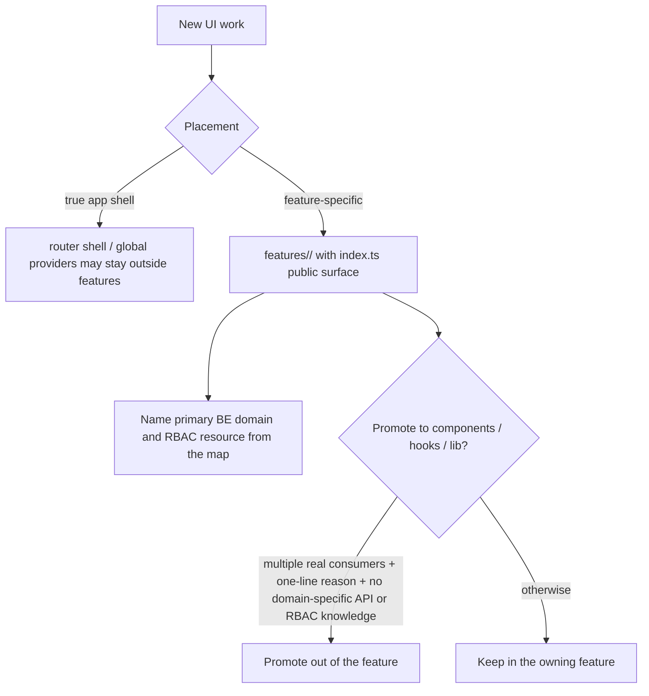

# FE feature ↔ BE domain / RBAC map

> **Purpose**: One thin map so new screens know **which `features/` folder**, **which BE domain package**, and **which RBAC resource** they touch (ARCH-A7).
> **Scope**: Placement and boundary rules only. No FE Clean Architecture re-org, no bulk Feature Indexing rewrite.
> **Related**: [ADR-006](adr/006-backend-domain-package-boundaries.md), [model write-owner catalog](model-write-owner-catalog.md), `frontend/src/features/CLAUDE.md`, `backend/internal/model/permission.go`.

## Rules

### A7-1 — Use this map for placement

New UI work names: **feature folder**, **primary BE domain**, **primary Resource\***. If a row is missing, add it in the same PR.

### A7-2 — New UI lives under `features/`

| Do | Don't |
|----|--------|
| `frontend/src/features/<feature>/…` with `index.ts` public surface | New screens only under `components/` / `hooks/` / `lib/` |
| Import other features via `@/features/<name>` | Deep import into another feature’s internals |

Exception: true app shell (router shell, global providers) may stay outside `features/`.

### A7-3 — Shared promotion (`components` / `hooks` / `lib`)

Promote out of a feature only when **all** hold:

1. **≥ 2** feature (or app shell) consumers, and  
2. A one-line reason in the PR (not “might reuse”), and  
3. No domain-specific API/RBAC knowledge that belongs in a feature.

Otherwise keep code in the owning feature.

### A7-4 — `shared-liff` vs `line-reservation`

| Surface | Owns | Must not |
|---------|------|----------|
| `features/line-reservation` | Staff-side LINE reservation **settings** UI (hospital config) | Embed full public LIFF booking runtime |
| `src/shared-liff` | Public LIFF booking runtime / shared LIFF widgets used by LIFF entry | Import staff app feature internals or staff-only RBAC hooks |

BE: both talk primarily to **`reservation`** (LIFF routes + settings). Do not invent a second appointment write path on the FE.

### A7-5 — Feature Indexing repairs are local

If `index.ts` public surface drifts, fix **that feature only**. No monorepo-wide re-export reshuffle.

## Map (primary ownership)

RBAC strings match `model.Resource*` / generated FE constants (kebab-case values).

| FE feature | Primary BE domain(s) | Primary RBAC resource(s) | Notes |
|---|---|---|---|
| `auth` | `auth` | (login / session; permission groups via master) | Login, me, password flows |
| `reception` | `reservation`, `owner`, `pet`, `medicalrecord`, `billing` | `reception`, `owners`, `reservations`, `medical-records`, `accounting`, `hospitalization` | Front desk board; multi-read/action permissions |
| `owners` | `owner` (+ medicalrecord reads/actions) | `owners`, `medical-records` | |
| `pets` | `pet` | `owners` (pet under owner UX) | Pet APIs; permission often owner-scoped UI |
| `reservations` | `reservation` | `reservations` | Admin booking |
| `line-reservation` | `reservation` | `hospital-settings` / reservation masters as used by settings UI | Staff settings for LIFF |
| *(shared-liff)* | `reservation` | public LIFF (clinic-scoped token / open routes) | Not under `features/`; see A7-4 |
| `medical-records` | `medicalrecord` (+ billing actions) | `medical-records`, `accounting` | |
| `examinations` | `medicalrecord` | `examinations`, `examination-unconfirm` | |
| `checkups` | `medicalrecord` | `checkups`, `medical-records` | （追記（2026-10-07 監査）: `checkup-package-import` は EMR-249 / `backend/migrations/019_drop_checkup_package_import_permission.sql` で廃止済みの権限リソース。現行 36 リソース一覧は [auth.md §3](auth.md)） |
| `vaccinations` | `medicalrecord` | `vaccinations` | |
| `hospitalization` | `medicalrecord` (+ `billing` on discharge) | `hospitalization` | Cross-domain discharge: orchestration catalog |
| `accounting` | `billing` | `accounting`, `accounting-cancel`, `accounting-post-close-edit`, `cash-register-close`, `discount` | |
| `estimates` | `billing` | `estimates` | |
| `cash-register` | `billing` | `cash-register-close` | |
| `accounting-reports` | `billing` (+ clinic settings) | `accounting-reports`, `cash-register-close`, `hospital-settings` | |
| `closing-settings` | `clinic` / billing close config | `closing-settings` | |
| `inventory` | `inventory` | `inventory`, `master-merchandise` | |
| `trimming` | `trimming` (+ `reservation` intents) | `trimming`, `master-trimming` | |
| `shifts` | `staff` | `shifts`, `master-staff` | |
| `master` | various masters | `master-*` (species, medical, reservation-type, staff, insurance, payment-method, …) | Split UI by master resource |
| `clinic-settings` | `clinic` | `hospital-settings` | |
| `settings` | `lstep`, `clinic`, … | `hospital-settings`, `lstep-*` as pages require | Hospital admin hub pages |
| `lstep` | `lstep` (+ clinic/owner reads) | `lstep-csv-import`, `lstep-analytics`, `hospital-settings`, `owners` | Staff LSTEP ops |
| `manual` | `manualarticle` | `manual-edit` | |
| `identity-links` | `identitylink` | `identity-links` | No FE assumption of owner/pet package coupling |
| `support` | `support` | なし（認証済みスタッフ全員）。共有 READ — バグ報告一覧・チャット ROOM ボード・`chat/exchanges` ペアは全医院共有（2026-10 の意図的な製品判断）。個人の `GET`/`DELETE /api/v1/support/chat/history` だけが認証コンテキストの clinic×staff スコープ（全 chat 履歴が個人限定という意味ではない）。バグ報告の status PATCH・Plane 連携・DELETE は報告医院のみで他医院は 404 — backend が最終強制（この hospital スコープはバグ報告 mutation のみで、個人 history DELETE や chat POST には適用しない） | サポートウィジェット（バグ報告 + LLMヘルプチャット）。`POST /support/chat` は LLM コストのため rate limit。画面契約の詳細は [settings README §バグ報告一覧](../spec/screens/settings/README.md#バグ報告一覧)・[§チャット履歴](../spec/screens/settings/README.md#チャット履歴)。FE `features/support` |
| `lab-device` | `medicalrecord` | `lab-import` | `/lab-device` board · ADR-007 · routes under medicalrecord lab-device APIs; FE `features/lab-device` |
| `aggregation` | `lstep` / reporting reads | (feature-specific; often analytics-adjacent) | Keep reads fail-closed to clinic |
| `owner-report` | multi clinical read | `examinations`, `vaccinations`, `checkups`, `trimming`, `reservations`, … | Composite read UI; permission per section |

## Anti-patterns

- New “shared” billing helper used by one feature only → keep in that feature.  
- FE calling multiple BE domains for a **write** without an owner-documented API → backend orchestration first ([cross-domain catalog](cross-domain-orchestration-catalog.md)).  
- Moving all features into `components/` “layers” → **rejected** (A7 complete condition).

## PR checklist

- [ ] Feature folder named from this map (or map updated)  
- [ ] Primary Resource\* called out  
- [ ] No deep import across features  
- [ ] Shared promotion meets A7-3  
- [ ] LIFF work respects A7-4  
