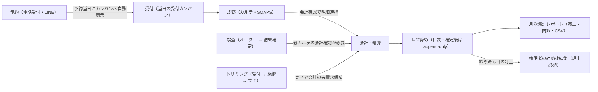

# 操作マニュアル（納品版・現場スタッフ向け）

> Current task status is tracked in Plane `EMR-41`. This local document remains supporting execution/evidence material; see the [migration receipt](../work/plane/plane-md-migration-20260923-receipt.md) for the crosswalk.

> **対象 Issue**: #256 ／ **リポジトリ由来 slice 同期日**: 2026-09-06（`7c6592f9f`） ／ **状態**: ドラフト（repo 由来ナビ完成・**U13 = 解消 — 2026-10-04 決定で説明会は開催せず本マニュアルで代替。実施証跡の記入は適用外**・#254 依存は未 close）
> **読者**: 受付・獣医師・看護師・トリマー・経理などの現場スタッフ
> **使い方**: 本書は「どの画面で・何をするか」への最短ナビゲーションです。各節は要点サマリーと参照リンクのみで構成し、詳細手順はリンク先（画面別ドキュメントとシステム内マニュアル）を正本とします。

---

## 0. マニュアルの読み方 — 正本はシステム内マニュアル

日々の操作手順の正本は、**システム内マニュアル**（ログイン後、サイドバー「取扱説明書」→ `/manual`）です。検索・スクリーンショット・業務フロー解説を内蔵しています。

- 画面仕様の詳細（開発者・管理者向け）: [../spec/screens/](../spec/screens/README.md)
- システム内マニュアル自体の使い方: [取扱説明書 仕様書](../spec/screens/35-internal-manual.md)
- 管理者向けの設定・運用・構成概要は [DELIVERY_PACKAGE.md](DELIVERY_PACKAGE.md)（#258）

本書の各節は「システム内マニュアルのどの記事を見るか」+「画面仕様書はどれか」を示します。

### 0.1 主要 8 業務のカバレッジ（#256 受け入れ条件）

| # | 業務 | 本書 | システム内マニュアル（正本） | 画面仕様 |
|---|---|---|---|---|
| 1 | 受付 | §2.1 | 業務フロー「受付の 1 日の流れ」「新規飼主の登録から初診会計まで」「既存飼主の来院対応」 | [01-reception](../spec/screens/01-reception.md) |
| 2 | 診察カルテ | §2.2 | 画面マニュアル「カルテ」 | [05](../spec/screens/05-medical-records-list.md)／[06](../spec/screens/06-medical-records-form.md)／[99-flow](../spec/screens/99-medical-record-flow.md) |
| 3 | 検査 | §7 | 画面マニュアル「検査管理」 | [12](../spec/screens/12-examinations-list.md)／[13](../spec/screens/13-examinations-form.md) |
| 4 | 会計 / 締め | §2.3–2.4 | 業務フロー「新規飼主の登録から初診会計まで」「会計の取消・返金」「日次締めの流れ」「月次締め・レポート」 | [10](../spec/screens/10-accounting-list.md)／[11](../spec/screens/11-accounting-detail.md)／[29](../spec/screens/29-closing-aggregation.md)／[32](../spec/screens/32-accounting-reports.md) |
| 5 | 予約 | §3 | 画面マニュアル「予約管理」／業務フロー「電話対応」 | [02-reservations](../spec/screens/02-reservations.md)／[24-shift-calendar](../spec/screens/24-shift-calendar.md) |
| 6 | トリミング | §4 | 画面マニュアル「トリミング」 | [16](../spec/screens/16-trimming-list.md)／[17](../spec/screens/17-trimming-form.md) |
| 7 | LINE 予約 | §6 | 画面マニュアル「LINE予約管理」／業務フロー「LINE・Lステップ連携の全体像」 | [28](../spec/screens/28-line-reservation.md)／[31](../spec/screens/31-lstep-integration.md) |
| 8 | 集計 | §8 | 業務フロー「月次締め・レポート」 | [32-accounting-reports](../spec/screens/32-accounting-reports.md)／[36-aggregation-dashboard](../spec/screens/36-aggregation-dashboard.md) |

> **残作業（repo 外 / 依存）**: システム内マニュアルのスクリーンショットと文言の最終突合は #254 デモ UAT 結果に依存。紛らわしい操作の FAQ 追記も同依存。操作説明会は **2026-10-04 決定で開催せず本マニュアルで代替**（U13 解消・§10）。
>
> **会計フロー（RQ-002）**: システム内マニュアルを実装整合済みです。カルテ確定だけでは会計は自動作成されず、会計画面で作成して未請求明細を pull します（[99-medical-record-flow.md](../spec/screens/99-medical-record-flow.md)）。退院時の会計は `create_accounting` 選択時のみ同時作成。D-254 の FAQ・スクショ最終突合は別依存のままです（[REPAIR-QUEUE](../work/docs-audit/docs-perfection/REPAIR-QUEUE.md)）。

---

## 1. ログイン

| 参照先 | 場所 |
|---|---|
| 画面仕様 | [ログイン](../spec/screens/21-login.md) |
| システム内マニュアル | 画面マニュアル「ログイン」／業務フロー「新人スタッフ初日セットアップ」 |

**要点**:
- メールアドレス + パスワードでログイン。初回ログイン時の強制変更機能はありません。管理者から受け取ったパスワードの扱いは院内ルールに従ってください。
- パスワードを忘れた場合はログイン画面の「パスワードをお忘れですか？」から本人がリセットするか、`master-staff:edit` と `master-permission:edit` を持つ管理者がスタッフマスタで新しいパスワードを設定します。システムが一時パスワードを生成・再発行する機能ではありません。
- 複数医院に所属するスタッフは、ログイン後にサイドバー上部で医院を切り替えられます。
- **ブルートフォース対策（実装正本）**: ログインは**失敗応答のみカウント**する二段レート制限 — **同一 IP につき 30 回 / 1 分**・**同一アカウント（メールアドレス）につき 10 回 / 1 分**（`DefaultAuthRateLimitConfig().Login` / `.LoginPerAccount` / [21-login.md](../spec/screens/21-login.md)）。成功したログインは回数に含まれないため、院内で IP を共有していても通常運用では枯渇しない。超過すると `Retry-After` 付きで一時的に拒否され、画面は自動で 1 回再試行する。
- **誤記載の訂正（Q&A No.25 / #256 AC）**: 「失敗 5 回でアカウントがロックされ、管理者の解除が必要」は**誤り**。アカウント単位のロック機構・解除ボタンは存在しない。ログインできない場合は (1) 1〜2 分待って再試行 → (2) パスワードリセット → (3) 管理者にアカウントの「有効/無効」状態を確認、の順で対処する。

---

## 2. 基本フロー: 受付 → 診察 → 会計 → 締め

1 日の診療業務の背骨となるフローです。検査・トリミングの明細と予約がどこで本流に合流するかを示します。

### 2.1 受付（当日の受付カンバン）

| 参照先 | 場所 |
|---|---|
| 画面仕様 | [当日の受付](../spec/screens/01-reception.md) |
| システム内マニュアル | 業務フロー「受付の 1 日の流れ」「新規飼主の登録から初診会計まで」「既存飼主の来院対応」 |

**要点**:
- ホーム画面（`/`）はカンバンボード。予約患者が自動で並び、来院したらカードを「受付済」へドラッグ。
- 予約なし来院（ウォークイン）はその場で受付カードを新規作成。
- 新規飼主はまず「飼主・ペット」画面で登録してから受付（§5 参照）。
- 診察への移行は受付カードの「カルテ作成」から行い、作成と同時にステータスが「診療中」へ進みます（カードのドラッグでは進めません）。診療中のカードからは「カルテ入力」「検査」へそのまま遷移できます。会計へは「診察を終了する」でカードを「会計待ち」へ進めてから、そのカードの「会計へ進む」を使います（診療中カードに会計ボタンはありません）。

### 2.2 診察（カルテ入力）

| 参照先 | 場所 |
|---|---|
| 画面仕様 | [カルテ一覧](../spec/screens/05-medical-records-list.md)／[カルテ詳細・入力](../spec/screens/06-medical-records-form.md)／[カルテ登録・編集フロー詳細](../spec/screens/99-medical-record-flow.md) |
| システム内マニュアル | 画面マニュアル「カルテ」 |

**要点**:
- SOAPS 形式で診察内容を記録。検査・処置・処方・物販の明細がそのまま会計へ連携される。
- カルテの「会計確認」を完了すると明細を会計へ取り込め、その後にカルテを確定できます。会計画面に明細が出ないときは、親カルテの会計確認を確認します。
- 検査オーダー・結果は[検査管理](../spec/screens/12-examinations-list.md)（`/examinations`）で管理。検査結果の確定は結果をロックしますが、会計連携には親カルテの会計確認が別途必要です。

### 2.3 会計

| 参照先 | 場所 |
|---|---|
| 画面仕様 | [会計一覧](../spec/screens/10-accounting-list.md)／[会計精算 詳細](../spec/screens/11-accounting-detail.md)／[未納者一覧](../spec/screens/30-unpaid-list.md) |
| システム内マニュアル | 業務フロー「新規飼主の登録から初診会計まで」「会計の取消・返金」「未払い（売掛）管理」 |

**要点**:
- 受付カードの「会計」ボタン、または会計管理（`/accounting`）から精算。カルテ連携明細＋保険適用＋複数支払方法の併用（現金 + カード等）に対応。
- **未締めの確定済み会計**: 「取消」→「新規会計登録」で作り直す運用では、取消の操作者・時刻・変更前後の状態が監査ログに記録される。取消理由の入力・保存機能はない。
- **締め済みの日の会計訂正**: レジ締め自体の取消・巻き戻しはできない（append-only）。`accounting-post-close-edit` 権限を持つスタッフが会計詳細から **理由必須** の締め後編集を行い、監査ログと訂正台帳に追記される（W-013）。

精算済み会計を再保存しても、最初の確定日時は変更されません。保存エラー時は支払確定表示を更新せず、エラーを表示します。通信が切れて結果が不明な場合は、会計一覧で登録・更新状態を確認してから操作してください。詳細は[会計精算仕様](../spec/screens/11-accounting-detail.md#21-精算済みデータの保護と修正)を参照します。

### 2.4 レジ締め（日次・月次）

| 参照先 | 場所 |
|---|---|
| 画面仕様 | [レジ締め・履歴](../spec/screens/29-closing-aggregation.md)／[月次集計レポート](../spec/screens/32-accounting-reports.md) |
| 業務仕様 | [レジ締め・売上集計](../spec/cash-register.md) |
| システム内マニュアル | 業務フロー「日次締めの流れ」「月次締め・レポート」 |

**要点**:
- レジ締め（`/accounting/close`）で現金を実査して突合。区分は AM／PM／EMG（時間帯の境界は管理者が「締め時間設定」で定義）。
- 締め確定後のレコードは **変更・削除・再開不可**（append-only）。二重締めは拒否される。
- 締め後に会計を直す場合は締めを取り消さず、締め後編集（理由必須）を使う。
- 月次は月次集計レポート（`/accounting/reports`）で売上・支払方法内訳・CSV 出力。

**入院管理（補足）**: 入院ペットのケージ割当・状況は入院管理画面で扱う。画面仕様は [入院一覧](../spec/screens/07-hospitalization-list.md)・[入院詳細](../spec/screens/08-hospitalization-detail.md)・[入院フォーム](../spec/screens/09-hospitalization-form.md)・[ケージマスタ](../spec/screens/settings/master-cage.md) を参照。日常手順はシステム内画面マニュアルが正本。

---

## 3. 予約

| 参照先 | 場所 |
|---|---|
| 画面仕様 | [予約管理](../spec/screens/02-reservations.md)／[シフトカレンダー](../spec/screens/24-shift-calendar.md) |
| システム内マニュアル | 画面マニュアル「予約管理」／業務フロー「電話対応」 |

**要点**:
- カレンダー形式（`/reservations`）で診察・トリミング・手術等の全予約を統合管理。15 分単位でスナップ。
- スタッフ指名予約に対応。予約当日はホームのカンバンに自動表示される。
- 予約の変更・キャンセルもこの画面から。
- 日時変更は 2 通り: 予約詳細の「編集」から日時を変えて保存する方法と、週表示で予約ブロックを上下にドラッグ（15 分単位）する方法。開始時刻を変えると終了時刻は自動計算され、同一担当者・同一時間帯の重複は保存前に警告されます。
- 次回予定（未予約の来院意向）はカルテ記録の流れから tentative として登録でき、一覧・期限切れの確認は予約管理側で行う。通常予約の空き枠や LINE 予約完了通知には影響しない（業務フロー: [reservation-to-record-flow.md](../spec/reservation-to-record-flow.md)）。

---

## 4. トリミング

| 参照先 | 場所 |
|---|---|
| 画面仕様 | [トリミング一覧](../spec/screens/16-trimming-list.md)／[トリミング登録/編集](../spec/screens/17-trimming-form.md) |
| システム内マニュアル | 画面マニュアル「トリミング」 |

**要点**:
- 受付 → 施術 → 完了の進捗を管理（`/trimming`）。コース・オプション・カットスタイル・施術画像を記録。
- トリミング区分の受付カードからは「トリミングカルテ」導線で登録画面（`/trimming/new`）へ進めます。
- 前回と同じ施術は、登録画面右側の「過去の施術履歴」カードをクリックしてコース・オプション・スタイル要望等を取り込めます（体重・画像・担当の確定選択は当日入力）。手順の正本: システム内マニュアル「トリミング」の「前回のカルテをコピーする（過去履歴の引用）」節（repo 内では `frontend/src/features/manual/content/screens/10-trimming.md`。追記（2026-10-07 監査）: 旧掲載用テキスト `docs/delivery/trimming-history-copy-manual-text.md` は同マニュアルへの掲載済みにより削除）。
- 完了（会計待ち）に進めると、コース・オプションが会計の未請求候補になります。会計画面で取り込み内容を確認します。

---

## 5. 飼主・ペット管理

| 参照先 | 場所 |
|---|---|
| 画面仕様 | [飼主・ペット一覧](../spec/screens/03-owners-list.md)／[飼主・ペット登録/編集](../spec/screens/04-owners-form.md) |
| システム内マニュアル | 画面マニュアル「飼主・ペット管理」／業務フロー「ペットの死亡時対応」「多頭飼い対応」 |

**要点**:
- 飼主 1 名に複数ペットを紐付けて一元管理。氏名・フリガナ・電話番号で横断検索。
- 同一医院で同じ非空電話番号は登録できず、エラーになります。新規登録せず、既存飼主を検索します。
- 過去のカルテ・会計・予防接種履歴は飼主/ペット詳細ページから参照。
- 現在の画面にアーカイブ操作はありません。削除は画面の不可逆操作として扱われます。飼主は所属ペットが残っている間は削除できないため、依存関係を確認し、必要な場合だけ権限者がペット、飼主の順で削除します。

---

## 6. LINE 予約

| 参照先 | 場所 |
|---|---|
| 画面仕様 | [LINE予約設定](../spec/screens/28-line-reservation.md)／[Lステップ連携](../spec/screens/31-lstep-integration.md)／[配信モニタ](../spec/screens/34-lstep-delivery-monitor.md) |
| システム内マニュアル | 画面マニュアル「LINE予約管理」／業務フロー「LINE・Lステップ連携の全体像」 |

**要点**:
- 飼主が LINE から予約すると、予約管理カレンダーと当日の受付に自動反映される。
- 受付枠・受付条件・表示内容はサイドバー「LINE予約管理」で設定（管理者）。
- LINE 予約が反映されない場合はシステム内マニュアル「エラー・トラブル対応」の LINE 節を参照。
- 予約完了・キャンセル通知が届かなくても、予約の保存やキャンセル自体は完了している場合があります。通知未着だけで予約を作り直さず、予約管理画面で対象日時・予約状態を確認してください。
- LINE予約の登録だけでは、氏名・電話番号が一致する既存飼主へ自動で紐付きません。未紐付けの場合は、権限を持つスタッフが飼主詳細の「LINE連携」→「LINEアカウントを紐付け」で対象を確認します。予約の登録状態と飼主・ペットの紐付け状態を分けて確認してください。
- 設定手順の正本は [LINE セットアップ](../spec/line/setup.md)（接続テストの検証範囲を含む）。本番 LINE チャネル・Lステップ API キーの投入は各院の契約情報受領待ち（[DELIVERY_PACKAGE.md](DELIVERY_PACKAGE.md) U5/U6）であり、**設定手順の実施は資格情報の供給後**です。チャネルシークレット・チャネルアクセストークン・Lステップ API キーは「設定 → 連携 → Lステップ連携設定」（`/settings/integrations/lstep`）のマスク入力欄から登録します（空欄のまま保存すると既存値を保持）。**LIFF ID は2箇所への登録が必要**です: ①「LINE予約管理」の設定画面（`/line-reservation/settings` の LIFF ID 欄）— LINE 予約の LIFF 認証がこの値を直接参照するため必須、未入力では認証が使えません。② Lステップ連携設定の LIFF ID 欄 — LINE アカウント紐付けトークン発行のフォールバック値です（この欄はテキスト項目で、**空欄で保存すると値がクリア**されます。secret 類の「空欄=既存値保持」とは挙動が異なります）。

---

## 7. 検査

| 参照先 | 場所 |
|---|---|
| 画面仕様 | [検査一覧](../spec/screens/12-examinations-list.md)／[検査詳細](../spec/screens/13-examinations-form.md) |
| システム内マニュアル | 画面マニュアル「検査管理」 |

**要点**:
- 院内・外注検査のオーダーと結果を一元管理。設定された基準値に基づいて結果を表示します。未承認の基準値や demo 値を臨床判断の根拠にしないでください。[#249](https://github.com/MinoruSoga/AnimalEkarte/issues/249) の出典付き基準値承認は未完で、一般値を推測して補いません。
- 結果入力後に**確定**すると、確定後の結果は通常編集できません（権限付き訂正フローを除く）。会計連携には親カルテの会計確認が必要です。
- 確定済み検査の訂正は、専用の「検査確定解除」権限を持つスタッフが「確定解除」から理由を入力して行います。確定時点の記録は保持され、理由も監査履歴に残ります。通常の検査編集権限だけでは解除できません。親カルテが確定済みの場合や、正式版の履歴がない旧データも解除できません。
- 尿検査のように目視・試験紙で判定する検査は、種別マスタのテンプレ項目に加えてフォームの「検査項目を追加」で手入力行を作れます。定性値（「±」「2+」「陽性」等）は文字列のまま保存・再表示され、基準値のない手動項目は「未判定」のまま保持されます。機器受信の結果と手入力項目は互いに上書きされません。各院の実際の項目・単位・基準値の表は医院承認待ち（EMR-86）のため、凡例の扱いは院内ルールに従ってください。

---

## 8. 集計・レポート

| 参照先 | 場所 |
|---|---|
| 画面仕様 | [月次集計レポート](../spec/screens/32-accounting-reports.md)／[顧客集計ダッシュボード](../spec/screens/36-aggregation-dashboard.md) |
| システム内マニュアル | 業務フロー「月次締め・レポート」 |

**要点**:
- 月次売上・支払方法内訳・日次推移・CSV 出力は `/accounting/reports`。
- 集計表はヘッダーの「印刷 / PDF出力」（A4 横推奨）で帳票化でき、印刷面は画面と同じ集計データを描画します。レジ締め画面の締め前プレビューからは「レジ締めサマリー」の印刷 / PDF 保存もできます（§2.4）。
- 顧客分析（LTV・来院頻度 CPM・離脱懸念の抽出）は `/aggregation`（権限保有者のみ）。

---

## 9. よくあるつまずき（抜粋）

詳細はシステム内マニュアル「エラー・トラブル対応」を参照。ここでは頻度の高いものだけ挙げます。

| 症状 | 最初に確認すること |
|---|---|
| ログインが拒否される | 1〜2 分待って再試行（**IP レート制限**。§1・Q&A No.25 参照）。続くならパスワードリセット、管理者にアカウントの有効/無効を確認。**アカウントロック解除は不要（機構なし）** |
| 会計画面に明細が出ない | 親カルテの「会計確認」が完了しているか。検査結果が必要な場合は結果確定も確認。同じ会計を別タブで開いていないか |
| 締め確定でエラー | 当日の未確定カルテ／「会計待ち」が残っていないか。同日同区分で締め済みでないか |
| 確定済み会計を直したい | 未締め: 「取消」→「新規会計登録」。締め済み: 締めの取消は不可。権限者が理由付きの締め後編集を行う |
| 過去カルテが見つからない | 医院切替（別医院に登録されていないか）・飼主名 / 電話番号検索・対象ペットの選択を確認 |
| 在庫が減らない | 薬剤マスタの在庫紐付け入力UIと、物販販売時の自動減算は未実装です。設定画面で解決できるとは限らないため、対象品目・操作を管理者へ伝えて確認します（[管理者向け説明](DELIVERY_PACKAGE.md#step-5-マスタ管理診療会計の基礎データ)） |
| 画面表示が古い・真っ白 | 再読み込み（Cmd/Ctrl+R）→ キャッシュクリア再読み込み → 別ブラウザ |
| 権限がありません（403） | 管理者に権限グループの見直しを依頼 |

### 9.1 障害・つまずき時の連絡先

1. まずシステム内マニュアル「エラー・トラブル対応」「システム障害時の対応（BCP）」で一次切り分け（再読み込み・別ブラウザ・ネットワーク確認）を行います。
2. 複数端末・複数スタッフで再現する場合は障害と判断し、各医院の管理者へ報告します。
3. 管理者から開発側窓口への連絡手段は **Slack**（EMR-151 決定）です。チャネル名・受付時間・一次対応者は [DELIVERY_PACKAGE.md §3.2 / U7](DELIVERY_PACKAGE.md) の確定待ちのため、管理者の案内に従ってください。報告には「発生時刻・操作していた画面・エラーメッセージ・影響範囲（何人が困っているか）」を添えます。

---

## 10. 操作説明会の代替（現行方針）

2026-10-04 の PO/曽我氏決定（Plane `EMR-151` answer コメント）により、操作説明会は開催せず、本操作マニュアルで代替する。U13 は「実施不要（代替決定）」であり、説明会を実施済み・COMPLETED と扱わない。開催日・参加者・実施 receipt・署名を作成または記入する対象ではない。

本番対象版のマニュアルの業務カバレッジ、#254 に依存する FAQ・スクリーンショットの最終突合、納品の人間承認は別条件として残る。代替決定をそれらの完了や承認の証拠にしない。U1–U12 の入力先は [DELIVERY_PACKAGE.md](DELIVERY_PACKAGE.md)。

納品後説明会を予定していた旧方針と未記入の実施計画は git 履歴を参照する。

---

## 11. 入力・受入待ちの項目（#256）

| ID | 項目 | 理由 | 反映先 |
|---|---|---|---|
| U13 | 操作説明会 | **N/A（代替決定）**: 2026-10-04 の PO/曽我氏決定（Plane `EMR-151` answer コメント）で説明会は開催せず本マニュアルで代替。実施証跡の記入は適用外。**#258 とは分離** | §10 |
| D-254 | デモ UAT 由来 FAQ・スクショ最終突合 | FAQ・スクショは #254 結果に依存。会計フロー説明の RQ-002 はマニュアル本文を実装整合済み | `/manual`・§0.1 |
| — | 本番URLでの操作確認証跡 | 本番の構築完了・操作確認の証跡が未取得（#253 / U12）。構築手順とworkflowの状態は [production/setup.md](../ops/infra/production/setup.md) を参照 | 本書はSTG/実装正本ベース |

値・秘密・本番証跡は発明しない。管理者設定・契約・バックアップは [DELIVERY_PACKAGE.md](DELIVERY_PACKAGE.md) の **USER 入力待ち（U1–U12）** を正とする。

## 12. カルテの削除・確定後の訂正

カルテを削除できるのは下書きだけです。確定後は確定解除や元の記録の編集ができないため、訂正は追記で行います。詳細は[カルテ作成・編集仕様](../spec/screens/06-medical-records-form.md)を参照してください。
