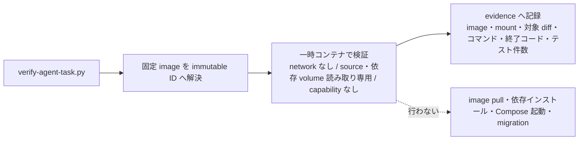

# Agent harness operations

AnimalEkarte 固有の安全境界と完成条件を定義する。汎用ワークフローはユーザースコープの `agent-task-lifecycle` Skill に置き、本書は未導入の環境でも使える作業契約を残す。

## 設定と参照の責務

| スコープ | 維持する内容 |
|---|---|
| ユーザー | モデル、sandbox、承認方式、汎用Hook、外部接続、汎用Skill、機能の実機確認 |
| プロジェクト | clinic/owner/pet/staff隔離、migration禁止、Docker検証、claim、domain Skillと受入仕様 |
| タスク | 受入条件、担当パス、基準diff、検証対象、承認済みの副作用 |

プロジェクトのMCP server一覧は空に保ち、ユーザー設定の接続を利用する。Chrome DevToolsは固定バージョン、isolatedプロファイル、usage statistics/performance CrUX無効を既定とする。既存ブラウザのloopback `http://127.0.0.1:9222` へのattachは対象を明示したユーザー承認がある場合だけ行う。

設定は実効値を確認する。ユーザー設定を優先する設計でも、runtimeがプロジェクト設定を上書き適用する場合がある。権限の重複定義を避け、設定変更後は新規セッションで確認する。

[AGENTS.md](../../AGENTS.md) → [.claude/CLAUDE.md](../../.claude/CLAUDE.md) → 最も近い `CLAUDE.md` と対象Skillの順で必要部分を読む。仕様は [docs索引](../README.md)、API正本は [api.yaml](../../backend/docs/api.yaml)。同名Skillはプロジェクト特有の適応を含むものを優先し、汎用Skillをコピーして増やさない。生成物の正本は `.claude`、生成先は `.agents` / `.codex`。

**生成物は直接編集しない**（`.agents/skills`・`.agents/rules`・`.codex/agents`・`.codex/commands`）。正本（`.claude/skills`・`.claude/commands`・`.claude/rules`）を変更したら `bash .claude/scripts/sync-agents-skills.sh` と `bash .claude/scripts/sync-codex-mirror.sh` で再生成し、`python3 -B .claude/scripts/test_instruction_safety_contracts.py` で一致を確認する。生成物への手編集は hash 所有管理により sync が拒否する（他者 WIP 保護）。例外: `.codex/CODEX.md` は生成対象外の手管理ファイルなので直接編集する。

CLI・ホストアプリ・APIセッションの機能は別々に確認する。2026-09-08 のローカル診断は Codex CLI 0.153.4 の `multi_agent` / Hooks を stable と報告したが、別runtimeでの利用可能性を保証しない。変更時は `codex --version` と機能一覧・現セッションのtool一覧を再確認する。Experimental / Beta / Deprecated / under development は、その実機表示を結果に明記する。機能の固定一覧を各指示ファイルへ複製しない。

## タスクを閉じる手順

1. 要求と受入条件、現在のdiff、担当パスを確認する。実行 SoT の Plane（workspace `baritechllc`）が利用できなければ現在状態はUNKNOWNとし、必要な更新はローカル下書きにする。外部投稿には明示承認が必要だが、**Plane への work item 起票・更新・コメント・状態遷移は [plane-ticket-conventions.md](plane-ticket-conventions.md) の範囲で事前承認済み**とする（一括変更・設定/権限変更・削除は承認対象）。（2026-09-29 訂正: 実行 SoT を Linear としていた → Linear は 2026-09-16 閉鎖、現行は Plane。起票フォーマット・新規起票の権限・状態遷移は同上の規約文書が正本）
2. ledger/packet ID がある場合は [claim規約](../../AGENTS.md#packet-claim-protocol-mandatory)を守る。並列編集は別worktree。調査・レビューはread-onlyで並列化できる。
3. 受入条件の失敗ケースを先に確認し、範囲内の実装と関連テストを行う。docs-onlyや低影響の可逆編集に不要な製品テストを増やさない。
4. 変更した成果物を検証する。独立レビューで見つかった範囲内の不具合を修正し、影響する検証を再実行する。上限・環境障害を成功に変換せず、未完了項目として報告する。
5. 完了報告には動作変更、対象worktree/diff、検証コマンド・終了結果・対象件数、未実行理由、外部状態、残作業を書く。claim解除は [AGENTS.md](../../AGENTS.md) packet claim protocol の作成者別規則に従い、main統合はユーザー操作のまま維持する。main または staging にマージ済みの PR head とクリーンな worktree は、AGENTS.md の Merged PR cleanup に従って整理する。claim/*、未統合成果、作成者や使用状況が不明な通常ブランチは同じ扱いにしない。

## 変更範囲の検証

事前計画は `python3 -B scripts/checks/verify-agent-task.py --base <BASE_REF> --plan`。未コミットも含む対象diffを確認し、明示パスなら `--paths <PATH>...` を使う。`--staged` は手動の局所確認用で、Git pre-commit では使わない（pre-commit は secrets のブロックと 800行超の警告のみ。800行は目安で commit は止めない。scoped lint/test は opt-in の pre-push（`PREPUSH_VERIFY=1` で有効化。デフォルトはスキップし PR の CI に委譲する）。

実行時は既にローカルにある固定imageを `--frontend-image <ID>` / `--backend-image <ID>`、依存volumeを `--frontend-dependency-volume <NAME>` / `--backend-dependency-volume <NAME>` で指定する。Git pre-push からも使う場合は、無視対象 `.claude/verification.local.json` に `frontend_image` / `backend_image` / `frontend_dependency_volume` / `backend_dependency_volume` の4キーだけを保存する。優先順位はCLI、`AGENT_VERIFY_*` 環境変数、ローカル設定の順。image/volumeはマシン固有なのでコミットしない。

runnerはimageをimmutable IDへ解決し、networkなし・source/依存volume読み取り専用・capabilityなしの一時コンテナで実行する。image pull・依存インストール・Compose起動・migrationは行わない。Frontendのmountpoint用に空の `frontend/node_modules` ディレクトリだけを必要時に作る（無視対象かは末尾 `/` 付きの `git check-ignore` でディレクトリとして判定し、未作成でも `node_modules/` のようなディレクトリ限定パターンに正しくマッチする）。Go実行用一時領域とFrontend native config loaderにより、sourceや依存volumeへの書込みを避ける。既存container指定も可能だが同じ隔離条件と対象worktree mountが必要で、通常のComposeは適合しない。

`--evidence <PATH>` には新しい証跡ファイルを指定する。`--staged` 手動実行時はサービス内にunstaged/untracked依存があると停止する。終了コードだけでなく、実行したテスト件数とPASS / FAIL / SKIP / BLOCKEDを読む。対応不能な変更はBLOCKED、docs-onlyのSKIPはruntime PASSではない。

- Go/FrontendはDocker。ホストnpm/goは使わない。既存Composeがmainをマウントしていればcandidateの検証に転用しない。
- image、mount、対象diff、コマンド、終了コード、テスト件数を証跡に結ぶ。ツールやテストがない場合は成功キャッシュを作らない。
- `--passWithNoTests` で検証済みとしない。修正後や対象diff変更後は古い証跡を再利用しない。
- DB依存テストは承認済みのdisposableな環境で実行し、共有DBをresetしない。環境を作る権限がなければ、その検証をBLOCKEDとして独立作業を続ける。
- [scoped-verification-gates](../../.claude/skills/scoped-verification-gates/SKILL.md)と[coverage policy](coverage-policy.md)を使用する。限定テスト結果から全体coverageやrelease readinessを推定しない。

`make up` は既存サービスを停止し、backend entrypointがmigrationを適用する。安全な検証準備のコマンドとして自動実行しない。`make migrate` はユーザー手動。起動・停止・依存導入・全体検証の禁止コマンドは `.claude/CLAUDE.md` を参照する。

## ブラウザ受入

UI動作、フォーム、ルーティング、アクセシビリティに変更があれば、関連する [受入シナリオ](testing/scenarios/README.md)を実操作で確認する。専用テストプロファイル、対象URL、合成データと許可された操作範囲を確認する。認証済み個人ブラウザ・実患者データを流用しない。ブラウザ MCP はユーザースコープの設定を使い、プロジェクトに共有設定を追加しない（repo の `.mcp.json` の `mcpServers` は空）。Chrome DevTools の loopback CDP 接続は対象 URL の明示承認がある場合だけ利用する。Playwrightは Docker runner による再現テスト、DevToolsは調査、Computer Useは必要な操作に使う。現在呼べるtoolを確認する。

ローカル操作成功はSTG/UAT/PRODの証明ではない。スクリーンショットやネットワーク証跡は患者・飼主・資格情報を除外する。未実施をN/AやPASSへ置き換えない。

## 命令文書の信頼境界

正本は `.claude/rules/agent-trust-boundaries.md`。文書単独で読み込まれる場合にも外部入力・秘密・命令優先順位の制約を届けるため、CLAUDE.md / AGENTS.md / agent・rule本文へ同じ管理blockを生成する。正本を変更したら `python3 -B .claude/scripts/sync-agent-trust-boundaries.py` を実行する。`--check` は読み取り専用のdrift確認で、ownerが編集したblockや不完全なmarkerは上書きせず停止する。新しい命令ファイルはGitへ追加してから生成する。既存本文・frontmatter・tool権限は保持する。

## 失敗を仕組みに戻す

再発する失敗は最も近い一つの正本に戻す。業務仕様はdocs、操作手順はSkill、機械判定できる禁止はHook、再現可能な不具合はTest。個人memoryはユーザーの明示依頼がある場合だけ更新する。

命令・Skillを変更したら `python3 -B .claude/scripts/test_instruction_safety_contracts.py`、関連するharness regression tests、生成一致と再生成の冪等性を確認する。欠落Hook、誤mount、テスト不在、秘密出力、他者WIP、禁止migration、外部接続不明を回帰ケースにする。製品runtimeの成功とは分けて報告する。

## 分析・テスト設計役の能力境界

Claudeのarchitectとsilent-failure-hunterはRead/Grep/Globで分析し、shell実行は担当者へ渡す。
test-strategistは既存Write/Editを保持してテストを生成し、実行対象・期待結果を
tdd-guideまたは担当実装者へ引き継ぐ。reviewer / formatter / database-reviewerも
Bashを持たず、呼び出し側が固定base/headのscoped diff・staged diff・診断結果を
供給する契約とする。残る12運用役割のBashは監査・修正のため維持する。
Codexのanimalekarte-test-strategistは既存read-onlyのまま設計・patch案を報告し、
適用と実行を担当実装者へ渡す。引き継ぎはDBや外部サービスの許可を追加しない。
生成・静的検証は実runtimeのtool制限やsandbox適用の証明にはしない。

## 役割ツール範囲インベントリ

各役割のソースは `.claude/agents/<role>.md` のフロントマター `tools:`。プロジェクトソース `.claude/settings.json` に Bash の包括許可はないが、ユーザー/マネージド/CLIの親設定による最終合成は未検証（UNKNOWN）。

| 役割 | 入力 | format/edit | build | scoped test/lint | TDD | Bash |
|------|------|-------------|-------|------------------|-----|------|
| code-simplifier | 呼出/diff | edits + posthooks | 修復なし | 等価性のscoped回帰 | 全サイクルなし | 保有 |
| debugger | 再現手順/diff/ログ | 最小Edit + posthooks | root cause関連のみ | 再現/回帰 | 失敗再現→修正 | 保有 |
| implementer | diff | Edit/Write + posthooks | タスク範囲 | scoped package/spec lint/test | 必要時RED/GREEN | 保有 |
| build-error-resolver | 診断/diff | 最小Edit/Write + posthooks | FE修復（全体コマンドはユーザー実行、root禁止リスト準拠） | 変更ファイルeslint/spec、全体type/build証拠はユーザー | 機能サイクルなし | 保有 |
| go-build-resolver | 診断/diff | 最小Edit/Write + posthooks | Go修復 | scoped vet/lint/package回帰 | 失敗build→成功 | 保有 |
| refactor-cleaner | diff/履歴/参照グラフ | edits + posthooks | 機能build修復なし | 検出+影響回帰（codegenはユーザー実行） | テスト保持しつつrefactor | 保有 |
| tdd-guide | diff | テスト+実装Edit/Write + posthooks | 関連のみ | scoped package/spec/race/coverage | RED/GREEN/REFACTOR | 保有 |
| clinic-isolation-auditor | Go/SQL diff | なし | なし | TestPreloadClinicScope/TestMasterFKWriteInventory + 許可された隔離テスト | 証拠レビュー | 保有 |
| go-reviewer | Go diff | なし | なし | scoped vet/test/race | 証拠レビュー | 保有 |
| react-reviewer | TS/TSX diff | なし | なし | 変更ファイルeslint/spec | 証拠レビュー | 保有 |
| typescript-reviewer | TS/TSX diff | なし | なし | 変更ファイルeslint/specとtype出力 | 証拠レビュー | 保有 |
| security-analyst | 監査範囲/diff | なし | なし | gosec/依存監査は許可されたrunner/network+外部承認が必要、host pnpmなし（gosec導入有無は未確立・プロジェクトskillは未導入と記載。記述は権限条件でありツール利用可否の証明ではない） | なし | 保有 |
| reviewer | 呼出の固定base/head scoped diff | なし | なし | 供給済み結果を読む | なし | 非保有 |
| formatter | 呼出のstaged diff | Read/Edit整形 + posthooks | なし | 呼出/実装者が実行可能なformat/検証 | なし | 非保有 |
| database-reviewer | 呼出diff+コード/スキーマ | なし | なし | 診断は別途承認されたユーザー/実行者 | なし | 非保有 |

横断的事実: Codexマニフェストのread-only役割には今回対象のclinic/database/go/react/security/typescriptの他、animalekarte-planner/healthcare-reviewer/silent-failure-hunter/animalekarte-test-strategistも含まれる（6役割の列挙は網羅ではなく今回対象）。debugger/formatter/reviewerはマニフェスト不在。非read-only役割は親設定を継承し、read-only sandboxはshell/egress非保有の証明ではない。hookフィクスチャが証明するのはexit 2のJSON出力のみで、ホスト側の実効拒否ではない。PostEdit Go hookは`CLAUDE_PROJECT_DIR`/現在cwdからdocker composeでgofmtを起動し`/app`マウントを仮定、TS hookは現在cwdからdockerを起動しfrontendマウントを仮定するが、マウント/ソケット/資格情報/実行時権限はUNKNOWN。設定保護hookはexit 0の警告のみでセキュリティ設定変更は強制境界ではない。Bash必要役割が残る限りscanner債務は解消しない。ランタイム受入の責任はプロジェクト運用者/メンテナ（リポジトリオーナー）に残り、署名済みリスク受容を意味しない。

## Claude backend 起動入口

backend作業も既存worktreeのrootをprimary cwdとして開始する。入口は
`python3 scripts/tools/claude-backend.py`（backend内からは
`python3 ../scripts/tools/claude-backend.py`）。
入口はexec前にroot共有設定とbackend local設定のJSON形状を検証する
（object root、`permissions`の`allow`/`deny`/`ask`文字列配列、`hooks`の
イベント→配列マッピング、`disabledMcpjsonServers`文字列配列）。不正JSON・
不正形状は入力値を含まない汎用メッセージで起動を拒否する。既知のhook無効化・
権限bypassオプション（`--settings`、`--setting-sources`、`--bare`、`--safe-mode`、
`--restricted`、`--dangerously-skip-permissions`、`--allow-dangerously-skip-permissions`、
`--permission-mode bypassPermissions`。分離形・`=`形とも）と
`CLAUDE_CODE_SIMPLE` / `CLAUDE_CODE_SAFE_MODE` のtruthy（`1`/`true`）環境設定も
拒否する。スキャンは`--`以前の全トークンを既知拒否フラグと照合する保守的なもので、
他オプションの値スキップは行わない（`--model --bare` のような値位置のフラグ語も
拒否される。値として使いたい場合は `--opt=value` 形式にするか `--` 以降に書く）。
`--`以降はprompt文として検査対象外で、未知オプションは保証範囲外
（包括的なbypass防止ではなく、既知フラグの保守的検証）。この形状検証は
リポジトリで使用される選択的な構造のみを対象とし、完全なClaudeスキーマ検証や
ランタイム検証ではない。環境やユーザー設定は変更しない。
検証後にrootへ移動し、backendの
`disabledMcpjsonServers`を保持するため、そのローカル設定だけを
`--settings <absolute-path>`で追加する。モデル等のユーザー設定を複製しない。
backendを対象とするprompt/ファイルパスとDockerのscoped検証を使う。

根拠: [設定の読み込みと優先順位](https://code.claude.com/docs/en/settings)、
[CLI --settings](https://code.claude.com/docs/en/cli-reference)。
共有設定はprimary cwdから読む。Git rootへのlocal設定の移動と共有設定の継承は別契約。
開始後は/statusでsetting sourcesを確認する。秘密値やuser/managed設定本文は報告しない。

この入口はmanaged policyではなく、利用者のopt-in起動規約である。
入口経由の既知bypass引数・環境toggleは拒否するが、直起動、/cdによる
primary cwd移動、親プロセスやuser/managed設定からのsettings sources除外・
hooks無効化を防いだとは扱わない。実際の設定合成は未検証。
入口テストはstubのcwd/argvだけを証明し、実Claudeの設定ロードを証明しない。
backend設定へのpermissions/hooksの空追加、根拠なしscanner抑制は行わない。

## device書込の補助ガード

`literal-device-write.js`は、直接指定されたmacOS disk/rdisk、Linux sd/hd/vd/xvd、
NVMe、mmcblk、loop、dm/md、BSD ada/da/nvd、/dev/disk/by-*、/dev/mapperへの
redirect（>、>>、>|、&>、&>>、<>、>&）、tee、dd of=を拒否する。
引用・連結されたliteral pathとdot成分を扱う。単純なenv、command、exec、
literal sh/bash/zsh/dash -cを補助的に扱う。対象pathのread/realpathやcommand実行は行わない。
既存destructive Git/systemチェックとsudo/chmod denyを維持する。
/dev/null、通常のファイル出力、読み取り、通常git操作は追加ガードで拒否しない。
このhook判定はDB/実デバイスへのアクセスを許可するものではない。

入力エンベロープ面はfail-closed化済み: 1MiB byte上限超過・空/空白・不正UTF-8・
不正/切断JSON・非object root・不正container形状・空/非文字列/競合する
commandやイベント名エイリアスは一律汎用拒否（exit 2、reasonに入力値を含めない）。
成功時は無出力exit 0。ただしfail-closedが保証するのはparser入力形状のみ。
変数展開・alias/symlink・FD/proc alias・任意プログラムのopen/write、
複雑なwrapperやshell構文、heredoc、hook未ロード/無効化/タイムアウト時挙動は
未解決（UNKNOWN）。部分tokenizerによる複雑なshell構文の誤拒否もあり得る。
実デバイス書込不能を保証するには、agent実行ユーザー/隔離runtimeがraw deviceに
write権限を持たず、device mountとprivileged accessを持たないことの別確認が必要。
この補助ガードだけで包括的なdevice denyを宣言せず、残存する能力findingの安全性も認定しない。

## 運用者ランタイムチェックリスト

以下は本変更では未検証（全行UNKNOWNでありPASSではない）。運用者/メンテナが受入前に実環境で確認する。

- [ ] ルートlauncher（`claude` 直接起動）で `.claude/settings.json` が実効ソースとして読み込まれること
- [ ] `scripts/tools/claude-backend.py` 経由起動で backend overlay（`disabledMcpjsonServers` 6名）が実効設定に反映されること
- [ ] `backend/` からの直接 `claude` 起動で期待外の設定探索にならないこと（または運用で禁止）
- [ ] 実効設定ソース一覧（project/local/user/managed/CLI）とprecedenceの確認
- [ ] 実効deny / PreToolUse hook がtool呼出で実際に拒否を返すこと（fixtureのexit 2 JSONだけでなくホスト側拒否）
- [ ] 空白を含むパス・worktree cwdでのlauncher動作
- [ ] CLI引数によるソース除外・親overrideによるhook無効化が成立しないこと
- [ ] hookタイムアウト・起動失敗・依存読み込み失敗時の挙動
- [ ] 全agent実行ユーザー・runner・hook context（PostEdit含む）がraw device mount・privileged・write権限を持たないこと
