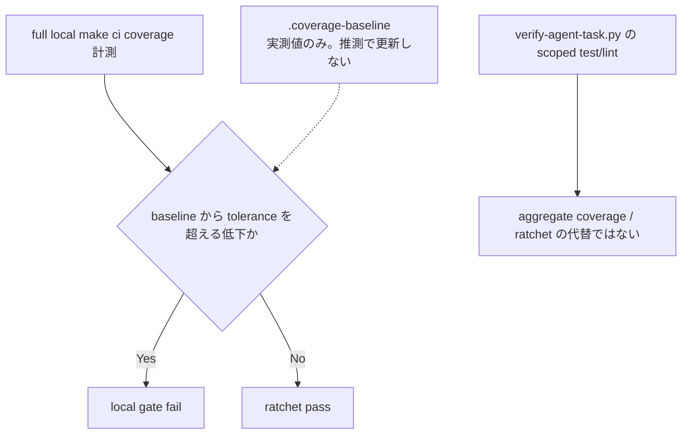

# Coverage Policy — AnimalEkarte

> Coverage 設定の実装正本は `scripts/ci/run-local-ci.sh`（coverage shard 実行と ratchet step）、`backend/cmd/coverage-ratchet`、`backend/.coverage-baseline`、`frontend/.coverage-baseline`、`frontend/vite.config.ts`。remote `ci.yml` は最小構成で coverage を実行しない（[ci-policy.md](./ci-policy.md)）。

## 目標と現在のゲート

共通ガイダンスの80%以上は品質向上の目標であり、現行リポジトリ全体が達成済みという意味ではない。現在のCIゲートは下記の実測に基づくratchet。新規・変更箇所には受入条件と失敗ケースを検証するテストを追加し、既存baselineを推測で引き上げたり引き下げたりしない。限定テストの成功から全体coverageを推定しない。

## 計測と除外

### Backend

- 全 shard が `-coverpkg=./internal/...` を使う。`internal/infra` も現在の母集団に含まれる。
- `cmd/*`（`cmd/lstep-migrate`、`cmd/_archive/seed-old-db` を含む）、`migrations/` はこの母集団の外にある。（2026-09-29 訂正: `lstep-migrate/`・`seed-old-db/` を backend 直下の独立ディレクトリとして記載していた → 現行は `backend/cmd/` 配下へ移動済み。母集団外である結論は変わらない）
- profile の単純連結は禁止する。`scripts/ci/merge_go_coverprofiles.py` が mode/statement 数を検証し、同一 block を統合する。

### Frontend

Vitest の default exclusions に加え、`src/types/generated/**` と `src/testing/**` を除外する。

## Current ratchet baseline

| 対象 | baseline | 根拠 |
|---|---:|---|
| Backend | **87.3%** | `backend/.coverage-baseline`。2026-08-23、CI run 32639276691 の実測で re-arm |
| Frontend statements | **43.78%** | `frontend/.coverage-baseline` |

baseline file のコメントが値、run、変更理由の正本である。Backend の 91.3% は 2026-07-13 の履歴値であり、現行 threshold ではない。2026-08-14 の 88.1% と 2026-08-23 の 87.3% を含む後続履歴も backend baseline file を参照する。推測値で更新しない。

## Phase status

- **Phase 0 — historical/completed**: artifact 可視化のみだった導入段階。
- **Phase 1 — implemented and armed**: backend/frontend とも baseline から tolerance（既定 0.5pp）を超える低下を fail する。aggregate coverage と ratchet の現行実行経路は full local `make ci` の backend/frontend step である。`ci_scope_plan.py` の full/partial・`coverage_ratchet` は計画メタデータであり、実行済みの証拠ではない。`verify-agent-task.py` の scoped test/lint PASS を aggregate coverage や ratchet PASS と扱わない。
- Frontend script の OK/FAIL/baseline 未記録/`--warn-only` の四ケースは一時的な履歴検証として記録されていたが、HEAD に保守される regression test/fixture はない。継続保証とは扱わない。
- **Phase 2 — proposal, not implemented at reviewed baseline `70dc7405`; current checkout must be revalidated**: patch coverage warning。`octocov` / `diff-cover` は未導入。
- **Phase 3 — proposal, not implemented at reviewed baseline `70dc7405`; current checkout must be revalidated**: domain/capability baseline と manifest による gate。manifest は未導入。partial 実行の品質ゲート強化は Phase 3 候補。

## Baseline 更新

1. 実測 coverage artifact を取得する（local `make ci` の backend/frontend coverage step 出力。commit とスコープを記録する。remote `ci.yml` は coverage を実行しない）。
2. 実測値と run/commit、変更理由を review する。
3. 対応する `.coverage-baseline` へ実測値を転記する。
4. local `make ci` の ratchet step が当該 commit で実行されたことを artifact と照合して確認する。

外部 Actions run の保持・到達性はリポジトリから保証できない。必要な証跡は人が確認する。
