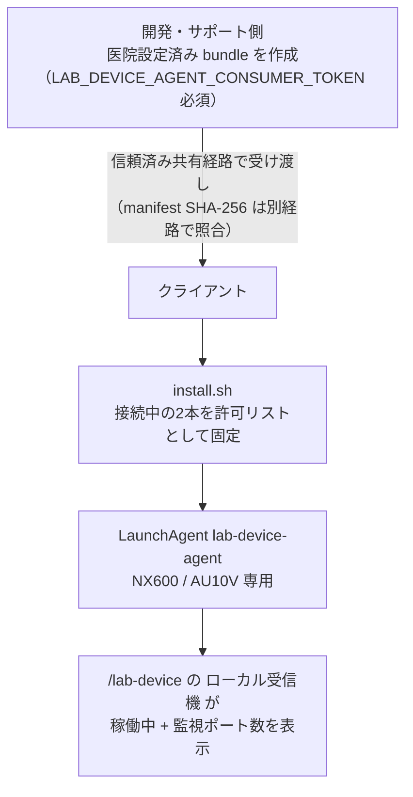

# Mac検査機器ローカル受信機

## 対象

初期版はNX600とAU10V（9600 8N1）を対象とする。PU-4010はデコーダのみを維持し、review済みシリアルprofileがないためagent運用対象外。IDEXXも通常運用対象外。

## インストール



クライアントには医院設定済みbundleを渡す。クライアント側にDocker、Go、リポジトリは不要。

現在のbundleはクライアントUAT用で、Developer ID署名・notarizationは未実施。本番配布前に署名済み成果物を作成し、`codesign --verify --deep --strict`と`spctl --assess`をrelease gateにする。Gatekeeperを無効化する手順は案内しない。

UAT bundleは信頼済みの共有経路で渡し、build時に表示されたmanifest SHA-256を別経路でクライアントへ伝える。同梱`SHA256SUMS`だけでは配送物全体の差し替えを検出できないため、別経路照合なしでは実行しない。

開発・サポート側で bundle を作成する。現行スクリプトは `LAB_DEVICE_AGENT_CONSUMER_TOKEN` が必須（未設定は終了）。この値は workstation bundle と配布先 Go backend が共有する raw 署名 secret（capability 署名用の HMAC key）であり、承認済み secret 経路で環境変数へ供給する。ブラウザへ返る agent-consumer 応答は raw secret ではなく、backend がその secret で署名した clinic 束縛の短命 capability（有効期限 5 分）であり、raw secret 自体はブラウザへ返さない。secret の生成・登録・取得は USER 作業で、コマンド引数・履歴・ログ・Git に実値を残さない。bundle の mode 0600 設定ファイルにも raw secret が入るため、配布物全体を保護して扱う。


**Cloudflare 配布の停止条件(EMR-335):** 供給経路は実装済み。`backend/wrangler.jsonc` の `secrets.required` に `LAB_DEVICE_AGENT_CONSUMER_TOKEN` が名前のみ登録され、`backend/worker/index.ts` の `buildContainerEnvVars` が Worker secret を Container の Go プロセス envVars へ転送する。pinned Wrangler 4.114.0 は required secret が未投入のままの deploy / versions upload を拒否するため、新規 STG デプロイには事前の secret 投入が必須となる。値の生成・登録・取得は USER 作業であり、コマンド引数・履歴・ログ・PR・画面に実値を残さない（この記述は経路の実装のみ。投入・デプロイ・検証は本タスクでは未実施）。

以下のコマンドはすべて人間がリポジトリルートで実行する手順であり、本タスクでエージェントが実行した操作はない。

まず STG Worker secret を投入する。値はコマンド引数に渡さず、対話プロンプトで既存の承認済み secret 供給元から取得した値を入力する。履歴・ログ・PR・スクリーンショットへ実値を記録しない。

```bash
pnpm exec wrangler secret put LAB_DEVICE_AGENT_CONSUMER_TOKEN --config backend/wrangler.jsonc
```

secret 投入と人間の承認がそろったあと、STG backend Worker をデプロイする。

```bash
pnpm exec wrangler deploy --config backend/wrangler.jsonc
```

frontend 側の STG リリースは既存の承認済み経路（`staging` push で起動する `frontend-deploy.yml`。正本は [CI-CD-PIPELINE.md](CI-CD-PIPELINE.md)）を使い、本書固有の frontend デプロイ手順は設けない。

デプロイ後、人間が認証済み `GET /api/v1/lab-device/agent-consumer` を呼び、`200` と応答の `agent_consumer_token` フィールド存在および短命 TTL（`expires_in`）を確認する。capability の実値は記録・転写しない。クライアント実機確認は [検査機器ローカル受信 クライアント実機確認票](../testing/scenarios/LAB_DEVICE_CLIENT_UAT.md) を使う。

**検証状態（本タスク時点）:** STG への secret 投入、STG デプロイ、live `200` 確認、クライアント UAT はすべて **未実施・未検証（UNVERIFIED）** であり、実施済みとして扱ってはいけない。

secret 未投入のままの新規 STG デプロイは required-secret ゲートで拒否される。既存デプロイや env 未設定の local backend では agent-consumer route は引き続き `503` を返す（fail-closed）が、`/lab-device` 画面は汎用サーバーエラーではなく「検査機器エージェントが未設定です」を表示する。local Compose は backend の `.env.local` 経由で供給できるが、現在の値や稼働は本書では確認していない。503 挙動の確認を目的に実 secret を削除する手順は本書に設けない。

```bash
# allowed-origin は配布先frontendの正確な https origin（pathなし）
# LAB_DEVICE_AGENT_CONSUMER_TOKEN は承認済み経路で設定済みであること
./scripts/lab-device/build-lab-device-agent-bundle.sh <医院ID> <https://配布先origin> <新しい出力ディレクトリ>
```

クライアントはbundle内で次を実行する。

```bash
./install.sh
```

開発端末から直接導入する場合だけ、Dockerのbackendコンテナを起動した状態で次を使用できる。

```bash
./scripts/lab-device/install-lab-device-agent.sh <医院ID> <https://配布先origin>
```

インストール後、配布時に指定した frontend origin の `/lab-device`（開発端末は `http://localhost:3003/lab-device`）の「ローカル受信機」が「稼働中」になり、監視ポート数が表示される。USBを選択する操作はない。

インストール時に接続されている2本をNX600/AU10V用の許可リストとして固定する。PU-4010またはIDEXXを接続した状態では実行しない。医院IDが一致しない画面や、同時に開いた別タブはキューを取得できない。

登録後も、その2本のUSBシリアル変換器はNX600/AU10V専用とする。PU-4010、IDEXX、または未確認機器へ差し替えない。配線を変更する場合はagentを停止し、対象機器の通信条件を確認してから再設定する。

## 状態確認

bundle のディレクトリで、生電文やポート識別子を表示しない状態確認:

```bash
./diagnose.sh
```

## 停止

```bash
launchctl bootout "gui/$(id -u)/com.animalekarte.lab-device-agent"
```

## 復旧

- 「停止中」: インストールスクリプトを再実行する。
- 監視ポート数が0: USB接続を確認する。
- 「判定失敗」: 機器の送信を再実行し、解消しない場合はagentを再起動する。生電文をログやチャットへ貼らない。
- API停止中の受信はagentのメモリキューへ残り、画面とAPIの復旧後に再送される。
- 未配送・判定失敗の生電文はメモリ保持のため、Macまたはagentの再起動では消える。再起動をまたぐ永続化は、保持期限・暗号化・回収手順を決める別設計とする。
- クライアント確認は[検査機器ローカル受信 クライアント実機確認票](../testing/scenarios/LAB_DEVICE_CLIENT_UAT.md)を使用する。

## Browser origin / PNA

Bundle作成時に配布先frontendの正確な`https://` originを1つ指定する。schemeは小文字の`https://`だけを受け付ける。hostは次のいずれかに限定する。

- IPv4-mappedではない有効なIPv6
- canonicalな4要素のdotted-decimal IPv4
- ASCIIのDNS hostname。各labelは1〜63文字の英数字またはhyphenで、先頭・末尾hyphenは禁止し、hostname全体は253文字以下とする。punycode labelは使用できる

DNS hostnameは小文字化し、IPv6とportはcanonical化し、HTTPSのdefault portは削除する。空label（先頭・末尾・連続dot）、underscore、numeric terminal label、legacy numeric host、percent escape、WHATWG禁止文字、wildcard、path、query、fragment、credential付きorigin、IPv4-mapped IPv6は拒否する。これはbrowserが受け付ける一部の特殊なdotted hostも意図的に拒否する共有contractである。

agentはlocalhost開発originと、このcontractでcanonical化した完全一致originだけへCORS/PNA応答を返す。requestの`Origin`は再canonical化せず、保存済みcanonical originと完全一致で照合する。
