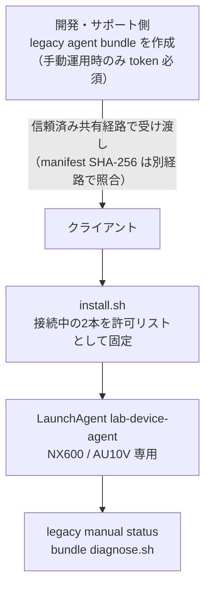

# Mac検査機器ローカル受信機

> **Legacy optional/manual path (EMR-402, 2026-10-14):** This LaunchAgent remains available only for explicitly managed legacy installations. Daily `/lab-device` receive uses browser Web Serial and does not require this agent or `LAB_DEVICE_AGENT_CONSUMER_TOKEN`. Normal deploys do not require the legacy key. Follow the browser UAT in [LAB_DEVICE_CLIENT_UAT.md](../../testing/scenarios/LAB_DEVICE_CLIENT_UAT.md) for the daily path.

## 対象

初期版はNX600とAU10V（9600 8N1）を対象とする。PU-4010はデコーダのみを維持し、review済みシリアルprofileがないためagent運用対象外。IDEXXも通常運用対象外。

## インストール



クライアントには医院設定済みbundleを渡す。クライアント側にDocker、Go、リポジトリは不要。

現在のbundleはクライアントUAT用で、Developer ID署名・notarizationは未実施。本番配布前に署名済み成果物を作成し、`codesign --verify --deep --strict`と`spctl --assess`をrelease gateにする。Gatekeeperを無効化する手順は案内しない。

UAT bundleは信頼済みの共有経路で渡し、build時に表示されたmanifest SHA-256を別経路でクライアントへ伝える。同梱`SHA256SUMS`だけでは配送物全体の差し替えを検出できないため、別経路照合なしでは実行しない。

この段落以降は、既存 LaunchAgent を明示的に継続する場合だけの手動legacy手順。現行bundle builderは`LAB_DEVICE_AGENT_CONSUMER_TOKEN`を要求し、raw署名secretを保護された経路で供給する。secretの生成・登録・取得は人間の作業で、実値をコマンド引数・履歴・ログ・Gitに残さない。bundle設定にもraw secretが入るため、配布物全体を保護して扱う。


**EMR-402の変更:** `LAB_DEVICE_AGENT_CONSUMER_TOKEN`はlegacy agentだけの任意キーで、`backend/wrangler.jsonc`のrequired項目ではなく、通常のSTG deploy前提でもない。Worker転送とconsumer endpointはlegacy経路用に残り、キー未設定時はその経路だけfail-closedとなる。以下のsecret設定例はlegacy agentを手動運用する場合だけの参考であり、ブラウザ直接受信には使わない。secret操作とdeployは承認済みの人間作業とする。

このlegacy手動経路を本番で再開する場合は、別途のsecret供給・承認・検証が必要。通常のブラウザ受信および通常deployには影響しない。

以下のコマンドはすべて人間がリポジトリルートで実行する手順であり、本タスクでエージェントが実行した操作はない。

legacy agentを手動運用する承認がある場合のみ、STG Worker secretを投入する。値はコマンド引数に渡さず、対話プロンプトで承認済みsecret供給元から取得した値を入力する。履歴・ログ・PR・画面へ実値を記録しない。

```bash
pnpm exec wrangler secret put LAB_DEVICE_AGENT_CONSUMER_TOKEN --config backend/wrangler.jsonc
```

以下は旧来の手動legacy運用向けに残す参考手順であり、通常CI deployには使わない。実行は人間が承認した場合に限る。

```bash
(
  set -euo pipefail
  cd backend
  npx --no-install wrangler secret list --config wrangler.jsonc | node ../scripts/checks/check-lab-device-secret.mjs
  npx --no-install wrangler deploy --config wrangler.jsonc
)
```

frontend 側の STG リリースは既存の承認済み経路（`staging` push で起動する `frontend-deploy.yml`。正本は [CI-CD-PIPELINE.md](../CI-CD-PIPELINE.md)）を使い、本書固有の frontend デプロイ手順は設けない。

デプロイ後、人間が認証済み `GET /api/v1/lab-device/agent-consumer` を呼び、`200` と応答の `agent_consumer_token` フィールド存在および短命 TTL（`expires_in`）を確認する。この応答は短命の署名済み capability であり、raw signing key は返さない。capability の実値は記録・転写しない。クライアント実機確認は [検査機器ローカル受信 クライアント実機確認票](../../testing/scenarios/LAB_DEVICE_CLIENT_UAT.md) を使う。

**検証状態:** legacy STG secret投入、deploy、live `200`確認、クライアントUATの実施状態はこの文書からは確認できない。実施済みとして扱わない。

legacy consumer routeはtoken未設定時にfail-closedで無効になる。日常のブラウザ直接受信はこのrouteやsecretに依存しない。実secretを削除して挙動を確認する手順は設けない。

```bash
# allowed-origin は配布先frontendの正確な https origin（pathなし）
# LAB_DEVICE_AGENT_CONSUMER_TOKEN は承認済み経路で設定済みであること
./scripts/lab-device/build-lab-device-agent-bundle.sh <医院ID> <https://配布先origin> <新しい出力ディレクトリ>
```

クライアントはbundle内で次を実行する。

```bash
./install.sh
```

開発端末から直接導入する場合だけ、Dockerのbackendコンテナを起動した状態で次を使用できる。

```bash
./scripts/lab-device/install-lab-device-agent.sh <医院ID> <https://配布先origin>
```

インストール後、bundleの`diagnose.sh`でlegacy agentの状態を確認する。`/lab-device`の日常表示はブラウザ直接受信であり、LaunchAgent状態とは連動しない。legacy agentがシリアルを所有している間は、同じ機器ポートをブラウザ側で開けないため、両方式を同時に使わない。

インストール時に接続されている2本をNX600/AU10V用の許可リストとして固定する。PU-4010またはIDEXXを接続した状態では実行しない。医院IDが一致しない画面や、同時に開いた別タブはキューを取得できない。

登録後も、その2本のUSBシリアル変換器はNX600/AU10V専用とする。PU-4010、IDEXX、または未確認機器へ差し替えない。配線を変更する場合はagentを停止し、対象機器の通信条件を確認してから再設定する。

## 状態確認

bundle のディレクトリで、生電文やポート識別子を表示しない状態確認:

```bash
./diagnose.sh
```

## 停止

```bash
launchctl bootout "gui/$(id -u)/com.animalekarte.lab-device-agent"
```

## 復旧

- agentが起動しない: `diagnose.sh`の固定エラー分類を確認し、必要に応じてlegacyインストールスクリプトを再実行する。
- 監視ポート数が0: USB接続を確認する。
- 「判定失敗」: 機器の送信を再実行し、解消しない場合はagentを再起動する。生電文をログやチャットへ貼らない。
- API停止中の受信はagentのメモリキューへ残り、画面とAPIの復旧後に再送される。
- 未配送・判定失敗の生電文はメモリ保持のため、Macまたはagentの再起動では消える。再起動をまたぐ永続化は、保持期限・暗号化・回収手順を決める別設計とする。
- クライアント確認は[検査機器ローカル受信 クライアント実機確認票](../../testing/scenarios/LAB_DEVICE_CLIENT_UAT.md)を使用する。

## Browser origin / PNA

Bundle作成時に配布先frontendの正確な`https://` originを1つ指定する。schemeは小文字の`https://`だけを受け付ける。hostは次のいずれかに限定する。

- IPv4-mappedではない有効なIPv6
- canonicalな4要素のdotted-decimal IPv4
- ASCIIのDNS hostname。各labelは1〜63文字の英数字またはhyphenで、先頭・末尾hyphenは禁止し、hostname全体は253文字以下とする。punycode labelは使用できる

DNS hostnameは小文字化し、IPv6とportはcanonical化し、HTTPSのdefault portは削除する。空label（先頭・末尾・連続dot）、underscore、numeric terminal label、legacy numeric host、percent escape、WHATWG禁止文字、wildcard、path、query、fragment、credential付きorigin、IPv4-mapped IPv6は拒否する。これはbrowserが受け付ける一部の特殊なdotted hostも意図的に拒否する共有contractである。

agentはlocalhost開発originと、このcontractでcanonical化した完全一致originだけへCORS/PNA応答を返す。requestの`Origin`は再canonical化せず、保存済みcanonical originと完全一致で照合する。
