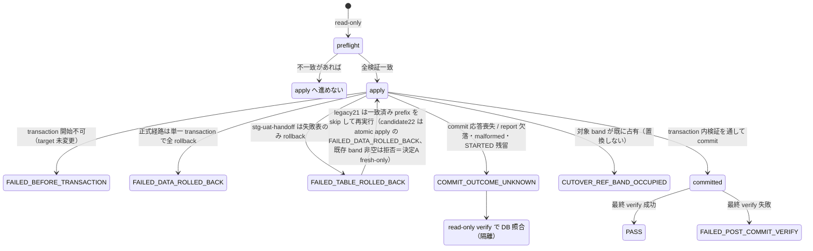

# 医院 CSV カットオーバー投入（F6）

更新日: 2026-07-31

以下は deployed/main の既存21表 consumer に対するF6投入手順の記録です。`old_db` が出力した AnimalEkarte 形状 CSV 21 テーブルを対象とします。`old_db` DB へは接続せず、医院・run 固定の `manifest.json` と CSV ディレクトリだけを読みます。このF6経路は対象DBへのcutoverであり、`backend/migrations/seeds/` のCSVやmanifestは生成・更新しません。

現行 KNJO source は未完全なため、`payments.csv` / `payment_splits.csv` は意図的にheader-onlyです。CSVの形状確認には使えますが、既知の未確定支払候補を持つbillingはproducer側で `needs_review` に隔離され、正式manifestは支払・分割支払がどちらも正件数でなければpreflightで拒否されます。producer契約は `billings.csv` の `completed_at` と completed billingごとのpayment graphに対応済みですが、完全かつ検証済みのKNJO sourceから新しいformal bundleを生成するまでapplyはBLOCKEDです。

> **2026-10-13 切替方式改訂（ユーザー採用、EMR-343）:** 既定 `--cutover-profile legacy-21` は既存21表の正式経路・pin・`estimate_items.medicine_id` 空欄制約を維持する。`--cutover-profile medicines-22-candidate` は明示選択する22表候補で、正式preflight/apply/resume/verifyはactivation gateで拒否する。候補分離の採用はproducer受領や本番切替の承認ではない。現在の実bundleが正式通過するとの主張でもない。

## Issue #250 受け入れ条件との対応（deployed/mainの既存21表consumer）

| AC | consumer 実装 | 状態 |
|---|---|---|
| 全対象 table の source→target mapping | 下表 + `csvimport.CutoverMappingCoverage()` / `CutoverTableSpecs()` | deployed/main版は21表 formal 固定。**業務上の個人責任者名は USER ops が run sheet で確定** |
| dry-run と代表データ照合 | `make csv-import-preflight`（source+target read-only）。DB 書き込みなし | 実装済み。代表データ手動照合は USER |
| clinic/owner/pet/staff 越境・FK・金額 | band 検査、clinic_id isolation、validated FK、payment graph | 実装+unit。実 DB 照合は rehearsal |
| rerun が二重作成しない / 部分 commit なし | 非空 band は `CUTOVER_REF_BAND_OCCUPIED` で fail-closed。単一 transaction | 実装+unit |
| stop/rollback・非PHI audit | report は status/timestamp、manifest digest、clinic/run/target metadata、ID band、aggregate count、6 seed ID、failure stage のみ。エラーは table/行番号/`CUTOVER_REF_*` のみ（CSV cell/氏名等なし） | 実装+unit / F8 rehearsal |
| production cutover | #253/#254/#255 gate 後に USER 実施 | **本 lane では実施しない** |

### deployed/main の21表 source→target mapping（formal cutover v1）

この21表一覧の正本はdeployed/main版の `backend/internal/csvimport.CutoverTableSpecs()`。以下は operator 向け要約（PHI 列値は載せない）。

| # | target table | CSV | clinic 列 | isolation | consumer |
|---:|---|---|---|---|---|
| 1 | staffs | staffs.csv | yes | clinic_id_column | formal_cutover_v1 |
| 2 | procedures | procedures.csv | yes | clinic_id_column | formal_cutover_v1 |
| 3 | merchandise_items | merchandise_items.csv | yes | clinic_id_column | formal_cutover_v1 |
| 4 | owners | owners.csv | yes | clinic_id_column | formal_cutover_v1 |
| 5 | pets | pets.csv | yes | clinic_id_column | formal_cutover_v1 |
| 6 | appointments | appointments.csv | yes | clinic_id_column | formal_cutover_v1 |
| 7 | appointment_trimming_details | appointment_trimming_details.csv | yes | clinic_id_column | formal_cutover_v1 |
| 8 | medical_records | medical_records.csv | yes | clinic_id_column | formal_cutover_v1 |
| 9 | inquiries | inquiries.csv | no | id_band_and_parent_fk | formal_cutover_v1 |
| 10 | clinical_plans | clinical_plans.csv | no | id_band_and_parent_fk | formal_cutover_v1 |
| 11 | vital_records | vital_records.csv | yes | clinic_id_column | formal_cutover_v1 |
| 12 | billings | billings.csv | yes | clinic_id_column | formal_cutover_v1 |
| 13 | billing_items | billing_items.csv | yes | clinic_id_column | formal_cutover_v1 |
| 14 | payments | payments.csv | yes | clinic_id_column | formal_cutover_v1 |
| 15 | payment_splits | payment_splits.csv | yes | clinic_id_column | formal_cutover_v1 |
| 16 | estimates | estimates.csv | yes | clinic_id_column | formal_cutover_v1 |
| 17 | estimate_items | estimate_items.csv | no | id_band_and_parent_fk | formal_cutover_v1 |
| 18 | exams | exams.csv | yes | clinic_id_column | formal_cutover_v1 |
| 19 | exam_results | exam_results.csv | no | id_band_and_parent_fk | formal_cutover_v1 |
| 20 | vaccines | vaccines.csv | yes | clinic_id_column | formal_cutover_v1 |
| 21 | vaccinations | vaccinations.csv | yes | clinic_id_column | formal_cutover_v1 |

（2026-09-29 訂正: `billing_items` の clinic 列を `no` / isolation `id_band_and_parent_fk` と記載していた → 現行 contract は `billing_items.clinic_id` を持ち placeholder `{{CLINIC_ID}}` で bind するため `yes` / `clinic_id_column`。正本 `CutoverTableSpecs()`・`CutoverPlaceholderColumns()` と一致）

### profile の選択と検査

無指定は `legacy-21`。未知profile、21/22表の混在、profileに合わない表構成を拒否し、manifest自己申告・表数・環境変数からprofileを推定しない。CLIのsource preflightで選んだprofileとprovenanceをtarget/apply/resume/verifyへ引き継ぐ。21表の`estimate_items.medicine_id → medicines.id`の既存target FKは保持するが、候補用のmedicines自身の列/FK/sequenceを21表に要求しない。

failure rehearsalとSTG skeletonは既存21表専用のまま。候補profileによる自動拡張を行わない。候補の合成fixture検証は正式採用・実DB COPY/往復・実CSV投入の証跡ではない。

### 22 表候補（EMR-343/345 — producer pin 未合意のドラフト）

`CutoverTableSpecs(CutoverProfileMedicinesCandidate)` に `medicines`（15 列、`procedures` と `merchandise_items` の間）を加えた 22 表 consumer 実装候補がある。同候補は `estimate_items.medicine_id` を medicines CSV 親参照として扱い、`procedures.price` / `medicines.price` / `merchandise_items.unit_price` / `vaccines.price` の 4 マスタ価格列のみ負値・非整数を拒否する（0 は許容。空欄は nullable な procedures / medicines / vaccines の価格のみ許容し、NOT NULL の merchandise_items.unit_price は投入前に拒否する。`billing_items` / `estimate_items` の歴史的負値＝返金・値引は変更なし）。

既定consumerの正式 contract は引き続き 21 表のまま: `cutoverCSVContractSHA256` の compiled pin（`9e02897b…`）と producer bundle は本候補では変更していない。producer 側の 21 表 source hash（`8a466c63…`）は compiled pin と一致しておらず、22 表 producer source は存在しない。したがって合成 22 表 fixture（現行 21 表 source pin 使用）は**構造のみ**を証明し、provider 一致・正式採用を証明しない。正式受入れは producer artifacts / source hash / 再生成 bundle / 一致 receipt が揃う MIG-34・MIG-37・MIG-41 調整の完了まで保留である。

この22表候補では、旧pinを持つ `PASS` / `TRUSTED_CANDIDATE` も formal（未指定modeを含む）も **activation blocked** として source/target preflight・単一transaction apply・table別resume apply・verifyのいずれでもDB取得/Begin/Exec/COPY前に拒否する。pinの更新・producer receiptの採用は別の明示reviewが必要であり、manifest自己申告や環境変数で解除する経路はない。実装候補を検証できるのは候補profileと既存のlocal/staging rehearsal modeを両方明示し、artifactも `REHEARSAL_ONLY` とした場合だけで、hash・22表shape・FK・inventoryの検証は維持する。mapping coverageのconsumer statusは `candidate_22_rehearsal_only` であり正式採用を示さない。旧21表bundleはこの候補では引き続きtable数不一致で拒否され、旧版consumerとの互換性は保証しない。

候補 consumer は EMR-342 設計 3.2/3.4 に従い、`medicines.name` が空欄または空白のみの行を source preflight で拒否する（名称は正規化せず、エラーには列と CSV 行番号のみを出しセル値は出さない）。`estimate_items` の薬剤付け替え行は結合不変条件を守る: `medicine_id` が空欄でない行は `category` が `medicine` で、`consultation_id` / `procedure_id` / `merchandise_item_id` がすべて空欄であること。`category` が `medicine` の行は `medicine_id` が必須。薬剤以外の行と旧21表 profile の挙動は変更しない（旧21表では `medicine_id` の空欄制約を unavailable-parent 参照検査で維持）。
`medicines` の税ペアは live producer 契約に従う（MIG-38: 空欄/1=excluded、2/3=exempt。MIG-34 は MIG-27 の同一式を再利用し、両区分とも `tax_rate` 0.10。producer `030_stage.sql` の CONSTANT と `test-procedure-master-pricing.mjs` の検証一致）。consumer は excluded/exempt＋0.10 のみ受理し、included・未知・空欄と 0.10 以外の率は拒否する（producer契約の変更は別途判断し、正式22表の受領・activation承認とは分ける）。
target の `medicines.tax_rate` 列は 0.10 を丸めず格納できる numeric であることを candidate target preflight が要求する（canonical 001 の無制限 numeric＝precision/scale NULL を受理、境界付きは scale≥1 かつ precision≥scale、scale 0 や precision 不足は拒否）。wrapper の候補 PASS report 再利用は targetHost/targetDatabase に加え `seedIds` の 6 項目（clinicId・animalSpeciesId・examTypeId・trimmingReservationTypeId・cashPaymentMethodId・creditCardPaymentMethodId）が現在の解決値と厳密に一致することも要求し、欠落・非整数・不一致は verify/import 前に fail-closed する。

候補bundleの `medicines.default_quantity` は旧DBに元情報がない固定値 `1.0` とし、数値として厳密に1と同値のdecimal表記（1、1.00、1.0000等）のみ受理する。空欄・0・1.23・その他の値は拒否する。一般の数量helperによる `numeric(10,2)` の無損失格納検査と、候補bundleの固定値検査は別条件であり、helperで格納可能な値でも固定値に一致しなければ拒否する。浮動小数点による判定やNULLの補完は行わない。

- **dry-run**: `make csv-import-preflight` が source digest / 6 seed binding / 空 band / FK catalog を read-only 検証する。apply は別コマンド。
- **idempotency**: apply 後の再 preflight/apply は `CUTOVER_REF_BAND_OCCUPIED` で拒否（既存行の置換・削除なし）。
- **verify 再実行**: `make csv-import-verify` は read-only で何度でも可（非空 band をエラーにしない）。
- **非PHI エラー ID**: `CUTOVER_REF_BAND_OCCUPIED` / `CUTOVER_REF_CLINIC_ISOLATION` / `CUTOVER_REF_ROW_COUNT` と table・CSV 行番号のみ。セル値は出さない。

`REHEARSAL_ONLY` / `PARTIAL` bundleを
`backend/migrations/seeds/_old_db_handoff/<clinic>/` に置くことは、
保管場所であり `cmd/migrate` / `make seed` は読みません。正式 `make csv-import`
preflight はこれを拒否します。共有 STG へ載せる場合は
`STG_UAT_CSV_IMPORT_ALLOW_REHEARSAL=YES_I_UNDERSTAND` と target 確認付きの
`make stg-uat-handoff`（城東・敷島・箱。八王子は対象外。seed ID / manifest SHA は
`scripts/old-db/stg-uat-old-db-handoff.sh` が `_old_db_handoff` と `002_master` から埋め、
接続は同スクリプトの export と gitignored `scripts/old-db/stg-uat-old-db-handoff.local.env`）
を使います。cutover profile は `STG_UAT_CSV_IMPORT_PROFILE`（既定 `legacy-21`、
`medicines-22-candidate` のみ許容。未知値は wrapper が医院処理の前に拒否し、
追加引数では渡せません）から `make stg-uat-import` / `stg-uat-csv-import-*`
両方の `--cutover-profile` に伝播します（環境変数 export と
`make STG_UAT_CSV_IMPORT_PROFILE=...` の command-line override の両方を受理）。
候補 profile の選択は明示 staging（wrapper が `APP_ENV=staging` を強制）＋
`STG_UAT_CSV_IMPORT_ALLOW_REHEARSAL=YES_I_UNDERSTAND` ＋ `REHEARSAL_ONLY`
artifact が前提で、activation gate は formal 経路を拒否し続けます。選択は
producer 受領・本番切替の承認ではありません。importer が受理する code/ordinal/clinic_id は
hachioji=1、jouto=2、shikishima=3、hakobuneco=4 だけです。
apply report が既に `PASS` の医院は wrapper が skip し、残りへ進みます。
ただし候補 profile（`medicines-22-candidate`）では、`status: PASS` とmanifest SHAの一致だけでは省略できません。reportの `targetHost` / `targetDatabase` が現在の選択値と一致することを要求し、同じprofile・対象DB・医院・seed bindingで既存のread-only `make stg-uat-csv-import-verify` を実行します。成功時だけ「report PASS + 現target検証済み」として省略します。検査は既存verifyの件数・医院・FK・sequence等の範囲であり、全行の内容hash一致を保証するものではありません。base候補reportの `manifestSha256` が現在のsource（同一clinic/runでも再生成source）と異なるstale報告は、旧ファイルを改名・削除・上書きせずそのまま残し、以後のこのsourceでは `-medicines-22-candidate-<現在のmanifest SHA>` というdigest別の新規report pathを使います（wrapperが管理する `STG_UAT_CSV_REPORT_SUFFIX` で既存のmake invocationへ渡す）。digest別reportの再利用には同じtarget結合＋現target verify の guard が適用され、失敗時はfail-closedです。直接 `make stg-uat-csv-import-*` / `stg-uat-import` の既定（suffix自動付与）は変わりません。

reportの対象が異なる／対象metadataが欠ける／現targetのverifyが失敗する場合は、importやreportの変更を行わず非ゼロで停止します。既存reportのno-clobber規約を保持し、自動退避・削除・上書きはしません。DB再構築や対象変更後に再投入が必要な場合は、[STG_PLANETSCALE_SEED_RUNBOOK.md](../stg/STG_PLANETSCALE_SEED_RUNBOOK.md) §6.1 の順でreportを退避してから再実行する既存手順が必要です。dry-runはverify/importを実行しません。legacy-21の既存PASS省略は従来どおり維持します。候補の対象確認はproducer受領・本番切替承認ではありません。

wrapperのexit 0は対象3院すべての投入完了を意味しません。manifestがない医院はskipし、legacy21では既存apply reportがPASSの医院も現在のDBを再検証せずskipします（候補profileでは現targetのread-only verify成功がskipの条件）。実施記録には医院ごとの対象・実行・skip理由を残します。必要な医院のmanifest欠落は未完了とし、過去のPASSだけで現在の整合性を判定しません。運用開始前に、承認済み対象・同一manifestで `make stg-uat-handoff-verify` の結果を医院ごとに確認します。

低レベル fallback は `make stg-uat-import`。医院別の配置コマンドは
`make old-db-handoff-stage`（手順:
[OLD_DB_HANDOFF_LOCAL.md](OLD_DB_HANDOFF_LOCAL.md)）。
21 CSVを `003_demo` へ直接コピーしてseedとして扱うことは禁止します。実行可能seedへの
変換は現行コードでは未実装です。[SEED_MIGRATION_OPERATIONS.md](SEED_MIGRATION_OPERATIONS.md)
のBLOCKED境界に従い、21表専用adapterを実装・検証するまでは migrate seed にはしません。

STG候補のapplyレポートは `-stg-uat-apply-medicines-22-candidate.json` としてlegacyのレポートから分離する。handoffの候補PASS再利用には現在のmanifest SHA-256との一致も必要。接続用local.envは明示選択したprofileを変更しない。wrapperのmock契約は `python3 scripts/old-db/stg-uat-profile.test.py` で確認できる（実DB・CSV投入は行わない）。


<a id="formal-import-safety-boundaries"></a>
## 安全境界（以下はdeployed/mainの既存21表手順）

- source は絶対パスを `/migration-input:ro` で read-only mount する。
- one-shot containerへ渡すsecretはDB接続用環境変数だけに限定し、`.env.local` 全体をcontainerへ注入しない。
- `clinic-migration-run-report.json` に記録された manifest SHA-256 を別経路で受領し、source directory 内から自己申告値を拾わない。
- manifest は `PASS`、`animalekarte_stage`、医院 code/ordinal、run ID、10M ID band、21 テーブル固定順、各 CSV SHA-256 が完全一致する場合だけ受理する。さらに manifest schema version、承認済みstage mapping bundle（`020_canonical.sql` + `030_stage.sql`）/CSV contract SHA-256、`TRUSTED_CANDIDATE`、完全性 `PASS`、検証済み source identity、明示的な空の不完全table一覧、stage build UUID、DB1/DB2/DB3 summary digestと生成順、base-load/KNJO evidence digest、支払・分割支払の正件数を固定構造で検証し、未知fieldも拒否する。
- source directory は 0700、manifest/CSV は 0600、symlink は不可。
- parserのメモリ/時間上限としてmanifestは4MiB、各CSVは512MiB、payment親は100万件、splitは親あたり最大2件を上限とし、超過時はfail-closedする。
- target seed ID は6つとも明示する。予約種別・支払方法を表示名や先頭行から暗黙解決しない。
- apply は対象 band が21表すべて空の場合だけ実行し、既存行を削除・置換しない。
- apply は単一 transaction、advisory lock、table lockを使う。CSV が preflight 後に変わった場合は再 SHA-256 検証で全 rollback する。legacy21 の `make stg-uat-handoff` は PlanetScale が長時間の未コミット INSERT で接続を切るため、表ごとに commit する。成功済み prefix（件数・clinic isolation が manifest と一致）は再実行で skip し、一致しない非空 band は fail-closed のまま上書きしない。ただし candidate22（`medicines-22-candidate`）では 2026-10-14 ユーザー決定 A（fresh-only）により既存 prefix resume は廃止: apply は advisory lock／target 検査の直後に clinic band 全空を要求し、正当な candidate 途中 prefix でも `CUTOVER_REF_BAND_OCCUPIED` で最初の Begin/COPY 前に拒否する。candidate22 は既存atomic apply経路で全22表を同じtransactionに載せ、後段の名称衝突等で先行表のcommitを残さない。全表lockとtransaction内のband空再検査を同じ接続で行う。legacy21 の prefix skip は従来どおり維持。医院単位では apply report が `PASS` なら wrapper がその医院の `make stg-uat-import` を skip する。`STARTED` / 失敗 report は no-clobber のため、再実行前に失敗日時付きへリネームする。
- CSV/manifest は PHI を含み得る。行値をログ・report・Git・チャットへ出さない。report は status/timestamp、manifest digest、clinic/run/target metadata、ID band、aggregate count、再検証に必要な非PHIの6 seed ID、failure stage を記録し、CSV cell値は記録せず、固定mount `/migration-reports` 直下へ0600/no-clobberで作成する。

## 事前準備

1. target DB の検証済み full backup を取得し、復元手順と担当者を確定する。
2. 対象を、この HEAD の現行 `backend/migrations/*.sql`（現在は統合済み `001_init.sql`）で再構築済みであることを確認する。異なる内容の001が適用済みのDBはchecksum mismatchになるため `DB_RESET=true` 相当の承認済み再構築が必須で、手書きSQLによる差分適用は使わない。STG PlanetScaleの実行順は[STG_PLANETSCALE_SEED_RUNBOOK.md](../stg/STG_PLANETSCALE_SEED_RUNBOOK.md) §6。001内の通常の `CREATE INDEX` は対象テーブルへの書き込みを待たせ得るため、事前リハーサルで所要時間を測り、maintenance window内で適用する。
3. target DB を既存の運用経路で起動・疎通確認する。CSV Make targets は `--no-deps` で実行し、target container/service を作成・再作成しない。
4. 次の target seed ID を対象医院で確認する。
   - active clinic
   - active system-wide animal species fallback
   - 対象 clinic の active/non-deleted `exam_types.name='検査'`
   - 対象 clinic の active/non-deleted `reservation_types.category='trimming'`
   - 対象 clinic の active/non-deleted `payment_methods.system_key='cash'`（同一clinic/keyで1件）
   - 対象 clinic の active/non-deleted `payment_methods.system_key='credit_card'`（同一clinic/keyで1件）
5. producer run report と bundle を照合し、manifest SHA-256 を安全な作業票へ転記する。

共通変数の例:

```sh
export CSV_IMPORT_SOURCE_DIR=/absolute/path/to/animalekarte-csv-export/<clinic>/<run>
export CSV_MANIFEST_SHA256=<64-hex>
export CLINIC_CODE=<clinic-slug>
export CLINIC_ORDINAL=<1..50>
export MIGRATION_RUN_ID=<run-id>
export TARGET_CLINIC_ID=<id>
export FALLBACK_ANIMAL_SPECIES_ID=<id>
export FALLBACK_EXAM_TYPE_ID=<id>
export TRIMMING_RESERVATION_TYPE_ID=<id>
export PAYMENT_METHOD_CASH_ID=<id>
export PAYMENT_METHOD_CREDIT_CARD_ID=<id>
```

## Preflight（read-only）

```sh
make csv-import-preflight
```

source 契約（completed billingの`completed_at`、payment親子、billing completionとpayment/split timestampの完全一致、non-completed billingへのpayment禁止、method placeholder、split算術、billing/payment total一致、保険比率0〜1、保険額の符号、割引額の非負を含む）に加えて、target の6 seed binding、全 migrated ID/FK 列の BIGINT、21 sequence、会計FK、`payments.billing_id` UNIQUE、`payment_methods(clinic_id, system_key)` partial UNIQUE、`payment_splits(billing_id)` index、対象 band が空であることを検証します。completed billingにpayment 1件とsplit 1〜2件が揃わない場合を含め、1件でも不一致なら apply へ進みません。

## Apply

`TARGET_DB_NAME` は `.env.local` / 実行環境の `DB_NAME` と完全一致する値を明示します。

```sh
make csv-import TARGET_DB_NAME=<exact-db-name>
```

Make target は次の確認を CLI へ渡します。

run sheet上でbackup取得・復元手順・担当者を再確認したoperatorだけがこのtargetを実行し、target実行そのものを次の明示確認として扱います。

- target write を承認済み
- 復元確認済み backup が存在
- target host が `DB_HOST` と完全一致
- target database が `DB_NAME` と完全一致
- status/timestamp、manifest digest、clinic/run/target metadata、ID band、aggregate count、6 seed ID、failure stage だけを含みCSV cell値を含まないreportの新規パス（既存 report を上書きしない）

apply 後、各 table の件数・clinic isolation・会計親子/支払方法/分割金額の整合・completed timestamp・sequence floor/max ID を transaction 内で検証してから commit します。21 sequence は既存値を下げず、次回 application ID が `1,000,000,000` 以上かつ現行`max(id)`超になるよう進めます。

PostgreSQL は RLS 有効テーブルへの `COPY FROM` を、superuser / `BYPASSRLS` / （FORCE RLS なしの）table owner 以外に拒否します（SQLSTATE `0A000`）。`app.bypass_rls` は `has_clinic_access()` 用 GUC であり、この COPY 制限は解除しません。importer は RLS で COPY が拒否される role では、transaction 内 TEMP テーブルへ COPY したあと `INSERT ... SELECT` を ctid バッチで本表へ載せます。legacy21 の STG UAT はさらに表ごとに commit し、PlanetScale が数百万行の未コミット transaction で backend を切断するのを避けます。table owner による正式 cutover（ローカル docker）は従来どおり本表へ直接 COPY し、21 表を単一 transaction で commit します。candidate22 rehearsalも単一transactionを使いますが、長時間・実規模での成功は未検証です。

## Verify（read-only）

```sh
make csv-import-verify
```

単一の REPEATABLE READ snapshot内で、manifest 件数、医院割当、6 seed binding、BIGINT/sequence契約、`payments.billing_id`を親キーとするpayment_splits論理親子、method seed binding、payment金額、completed billing/payment対応、split合計/received/changeを再検証します。seedの並行変更を防ぐ`FOR SHARE`を使うためPostgreSQL transaction自体は`READ ONLY`指定にしませんが、このverify経路はtarget dataを変更しません。preflight/apply/verify はCSV列が依存する全FKについてtarget上にvalidated制約が存在することも検証し、その制約をCOPY時にPostgreSQLが適用するため、orphanが1件でもあればapply transactionはcommitされません。

## 失敗・rollback

- transaction を開始できなかった場合、target data は未変更でreportは `FAILED_BEFORE_TRANSACTION` になります。接続・DB状態を確認し、原因を解消して新しい作業確認を取るまで再実行しません。
- 正式 `make csv-import` の transaction 内失敗はデータ行を自動 rollback し、report は `FAILED_DATA_ROLLED_BACK` になります。legacy21 の `make stg-uat-handoff` は表ごと commit するため、失敗した表だけ rollback し report は `FAILED_TABLE_ROLLED_BACK` です。candidate22 rehearsalのtransaction内失敗は全データ行をrollbackし、reportは `FAILED_DATA_ROLLED_BACK` になります。commit応答不明は `COMMIT_OUTCOME_UNKNOWN` のままread-only verifyで照合し、rollback済みとは記録しません。legacy21 の成功済みの表は残るので、原因解消後に同じ command を再実行すると一致した prefix を skip します（legacy21。candidate22 では 2026-10-14 ユーザー決定 A により band 全空でない target は `CUTOVER_REF_BAND_OCCUPIED` で拒否され、自動的な削除・rollback・reset は行わない。候補のやり直しは別途用意した空の隔離 target と承認済み手順で実施する）。一致しない非空 band は上書きしません。PostgreSQL sequence は transaction rollback 対象外ですが、処理は値を下げず application 予約域へ進めるだけなので、失敗時に残り得るのは安全な番号飛びだけです。report は no-clobber のため、失敗後の再実行前に `sensitive-local/csv-import-reports/<clinic>-<run>-stg-uat-apply.json`（または formal の `*-apply.json`）を失敗日時付きへリネームします。
- commit応答が失われた場合は、commit済みかrollback済みかを断定せずreportを `COMMIT_OUTCOME_UNKNOWN` とします。再実行・backup restore・運用開始をすべて止め、同じmanifest/seedでread-onlyの `make csv-import-verify` を実行してDB管理者が結果を照合するまで状態変更を行いません。
- process crashや強制終了後にapply reportがmissing、malformed、または `STARTED` のままの場合もcommit結果を証明できないため、`COMMIT_OUTCOME_UNKNOWN` と同じ未確定状態として扱います。reportを作り直す再実行やbackup restoreへ進まず、targetを隔離してread-only verifyとDB照合を先に行います。
- one-shot STG UAT importのreportが `PASS` になるのは、apply後の最終verify成功時だけです。commit済みapplyの最終verifyが失敗した場合は `FAILED_POST_COMMIT_VERIFY` / failure stage `verify` とし、targetを隔離して原因を照合します。
- commit 後の rollback は、後続 application row を cascade delete する危険があるため importer に削除コマンドを持たせません。メンテナンス状態を維持し、事前に検証した full backup を復元します。
- band が既に占有されている場合、`make csv-import` は置換せず fail-closed します。手書き DELETE や別経路への迂回はしません。

**apply report の状態遷移**:



## Scoped verification

```sh
docker compose exec backend go test ./internal/csvimport -count=1
docker compose exec backend go test ./cmd/csv-import -count=1
docker compose exec backend go test ./cmd/migrate -count=1
```

実PostgreSQL上のcatalog/payment SQL構文と実行計画は、共有DBの排他leaseを取得した独立セッションで `CSVIMPORT_DB_INTEGRATION=1` を付け、`go test ./internal/csvimport -run TestCutoverPaymentTargetSQLAgainstPostgres -count=1 -p 1` を実行します。このテストはtransaction-localな一時テーブルに正常/敵対fixtureを作成し、必ずrollbackします。

実 DB apply、DB reset、STG/PROD 操作はこのテスト手順に含みません。

F8 の失敗側リハーサルは、通常 importer に fault injection を追加せず、専用の
[F8 G4 synthetic failure rehearsal](../rehearsals/F8_G4_FAILURE_REHEARSAL.md) を使用します。

## rehearsal 前提（#250 / BRT-42 · 2026-08-20）

**cutover 実行と架空 COMPLETE bundle は禁止。** 本節は手順の不足を埋めるだけ。

| 前提 | 状態 | 根拠 |
|---|---|---|
| formal COMPLETE producer bundle 受領 | **未記入**（受領記録なし） | Plane EMR-46（旧 Linear BRT-42）/ GitHub #250。KNJO source 未完全のため apply は本文どおり BLOCKED（2026-09-29 訂正: 追跡先を Linear BRT-42 としていた → Linear は 2026-09-16 閉鎖、BRT-42 は EMR-46 へ移行済み） |
| `payments.csv` / `payment_splits.csv` が正件数 | 現行 KNJO は header-only（本文） | 正件数になるまで preflight 拒否 |
| F8 G4 synthetic failure rehearsal | 手順あり（専用 compose。本番 CSV 不可） | [F8_G4_FAILURE_REHEARSAL.md](../rehearsals/F8_G4_FAILURE_REHEARSAL.md) |
| 代表データ手動照合 | **未記入** | USER |
| production cutover | **しない** | #253/#254/#255 gate 後の USER |

COMPLETE 受領後の rehearsal 順（実行は USER。本セッションでは走らせない）:

1. bundle を repo 外に置き、PHI を git / Issue に載せない
2. `make csv-import-preflight`（write 0）
3. 隔離 DB での F8 G4（本番 CSV を渡さない）
4. 隔離 rehearsal apply（共有 STG/PROD は承認後のみ）
5. `make csv-import-verify`（read-only）
6. production cutover は gate 後の別作業

## EMR-349 受入 intake 現況（2026-10-13 時点）

本節は 2026-10-13 時点の receipt・intake・人手移行ゲートの状態記録である。新規生成・配置・preflight・apply の実行や PASS の製造を意味せず、本追記では移行データの配置・再生成、DB書込み、STG importを実行していない。

### 受領候補の照合（2026-10-13 JST。producer receiptは旧runの履歴）

consumer（現行 HEAD 観測値）の契約 digest:

- CSV contract SHA-256: `9e02897b86c742f94162ddfd4171067b3036a3ac4f055c6d3fd4a614e0fb37c9`
- stage mapping SHA-256: `bf8c262e136d4d5e74751508286710035b27bd1e7ed927ce4f47320dd4e9152b`
- producer CSV source（現行統合 source）SHA-256: `8a466c63b26d8a52fda7696f5e1f169544c67ce2322fb7d399bee4e12163aa7f`

| clinic | source run | stage build | manifest SHA-256 | 状態 |
|---|---|---|---|---|
| hachioji | hachioji-intake-20260921-01 | 42d2066b-6d0c-4b50-91fb-ac4275253cb0 | `4c9e54cbe0e5f059d1bfb5cbf20b61164fb1461cedba6676521068c467f01314` | REHEARSAL_ONLY（21 表・全 CSV hash 一致・source completeness PARTIAL） |
| jouto | jouto-intake-20260822-01 | 2fb79de2-621a-4fcb-ad28-e4a03ddbb11a | `8965f95a3fed62baa07d384289e01d74a9cfd393343ba86a19520becf56e67df` | REHEARSAL_ONLY（21 表・全 CSV hash 一致・source completeness PASS） |
| shikishima | — | — | — | 生成 BLOCKED（再構築前 checkpoint 検証で停止。canonical 書込・CSV export 未到達） |
| hakobuneco | — | — | — | NOT_RUN |

- 両 bundle の manifest が記録する stage mapping SHA-256 は `686ca13db6b6b5f9cfa90be76292530197cba43875066c8d6c87b7ec5df99091`（上記 consumer 現行値とは別の観測値として記録）。
- 履歴 producer receipt digest: hachioji 保全 `8caf3709a88866d0054fd21c6aa5c61d4ce5cea175d3f7896517a702d64401eb`、jouto 検証 `17f7c084c8f26b15ea7bae2c86feb47c56cf1f5966c558d9952720df15c14e1d`。当時の記録であり新規 run の証拠ではない。履歴 receipt は最新 candidate の有効性を証明しない。
- 対象表セットは本文「21 表 source→target mapping（formal cutover v1）」の 21 表そのもの。

### PASS / BLOCKED の区別（混同禁止）

- 今回のread-only照合は、旧候補2院のmanifest digest・21CSVのbyte hashと表名/順序の一致のみ確認した。配置後のlayout check・source+target preflightは未実行で、placementはBLOCKED（source/pins/target/seed receipt 未完の歴史 snapshot）。
- source+target の cutover preflight（`make csv-import-preflight` / `make stg-uat-csv-import-preflight`）は **NOT_RUN**。観測 receipt を実行済みに読み替えない。
- 正式 `make csv-import` は REHEARSAL_ONLY を拒否する。STG UAT 経路が sentinel 付きで REHEARSAL_ONLY bundle をリハーサルとして許容しても、pin 許容の承認は業務意味の受入証明にならない。
- PR #627 の merge（2026-10-11）と MIG-38 研究の INPUT_READY は、生成 candidate や producer/consumer 受入を示さない。
- producer source は old_db main `985a7a57486403936d809e4448ed9fb48065694d` への統合後の HEAD が現行。f59 系列の旧 candidate profile は受理しない。

<a id="formal-import-producer-resume-gate"></a>
### 再開条件（順序）

1. **MIG-41 が唯一の producer**。同一 candidate source/run/build/hash で全 21 CSV・manifest・producer 検証を生成し、表・列・順序・placeholder・bytes を含む完全 receipt で受領する。
2. profile は baseline 21 表。薬剤を含む 22 表は MIG-34 / EMR-343 が同一承認 profile に到達した場合のみ。未知・片側未対応 profile は Blocked。21 表 PASS を 22 表へ転用しない。
3. EMR-345（NULL vs 0・source pins・consumer pins の apply）、EMR-364（税率契約）、EMR-365（decimal 契約）が未解決のまま正式受入へ進まない。
4. clinic/band/consumer release/target/6 seed ID（「事前準備」4 項の 6 binding）を固定した完全 profile で、承認済み read-only preflight を実行する。target 不明のまま推測で進めない。リハーサル資格（REHEARSAL_ONLY 経路）は profile 固定まで維持する。

<a id="producer-work-ownership-and-runtime-binding"></a>
#### producer作業責務と実行binding（2026-10-23補足）

上記「MIG-41 が唯一の producer」は既存formal手順のproducer作業責務・唯一窓口を示す。old_db HAC-CSV-1/HAC-PIPELINE-1のproducer責務とAnimalEkarteの現行csvimport/script経路を、作業票番号そのものや実際の操作者と同一視しない。各runの実行bindingは承認profile・producer/consumerの固定SHA・source/run/build/hash・mapping・完全receiptで照合する既存gateを維持し、別producerや未承認profileの許可へ読み替えない。

[EMR-547のevidence-only保存設計](../../../design/domains/accounting/legacy-finance-evidence.md)と[221の引渡し案](../../../work/emr/emr-221-import-contract-design/DESIGN.md#legacy-finance-evidence-handoff)への対応は候補で、現行producer main `a38e71f904460ba3d33194e817bafcbb78886d0c`と静的mapping報告は設計入力として受領済みだが、新sidecarのclosed mapping/実artifact binding/実行receiptは未受領。本runbookの既存経路は新保存経路の接続済み・実行済みを確定しない。formalの安全gate、fresh-only/band保護、人手実行許可は変更せず、新evidence-onlyの利用を許可しない。

### 配置の現行形態（旧票記載との差異）

現行コードの配置先は Git/Git LFS ではなく git-ignore 済みローカル PHI quarantine である（EMR-349 票の「Git LFS」表記は現行手順と異なる旧表現。現行 script と本書は PHI の Git 登録を禁止している）。

- `make old-db-handoff-stage`（`scripts/old-db/stage-old-db-handoff.sh`）が `backend/migrations/seeds/_old_db_handoff/<clinic>/` へ 20 clinical CSV + manifest.json を、`backend/migrations/seeds/002_master/accounts/_old_db_handoff/<clinic>/staffs.csv` へアカウント CSV を分離配置する（0700/0600、`git check-ignore` を強制確認）。
- `make old-db-handoff-check` は 20 clinical CSV + manifest + account 配置の layout のみを検査し、import も STG 接続も行わない。
- consumer は `csvimport` の account source 解決で central account path の `staffs.csv` を読む。`make seed` / `cmd/migrate` はこれらを読まない。
- 配置に関する PR は receipt（hash・件数・status のみ）を載せ、CSV データそのものは絶対に含めない。

### 人手実行ゲート

- STG への import・backup restore は承認済み操作者（USER）のみが実行する。
- `make stg-uat-handoff`（`scripts/old-db/stg-uat-old-db-handoff.sh`）は jouto・shikishima・hakobuneco 固定で hachioji は対象外。wrapper の八王子除外や非空 band 保護（apply report `PASS` skip / `CUTOVER_REF_BAND_OCCUPIED`）を迂回しない。
- import 実行 receipt と EMR-361（backup/restore/rollback・画面確認）の receipt は同一 execution ID で受け渡す。同一 import を別実装で重複実行しない。
- 本節は即実行可能な DB 接続値・パラメータを提供しない。preflight/apply/verify は上記「Preflight（read-only）」「Apply」「Verify（read-only）」節の既存手順に従う。

#### 薬剤数量とtarget整合性（22表候補）

既存設計のproducer固定値 `default_quantity=1.0` に沿い、数値として厳密に1と同値の表記のみ受理する。空欄・0・1以外の小数・丸め・overflow・非有限値は拒否。targetは `numeric(10,2)` の型・precision・scaleを検査する。`medicines.inventory_id → inventory_items.id` のvalidated FKも必要で、CSVのinventory_id空必須は維持する。model/APIのnullable化やmigrationは今回行わない。

## 既存契約の照合票と実機runの分離（REM-OPS-06〜08）

この節は資料受領・照合の具体手順であり、preflight/apply/verifyの実行承認を増やさない。既存の最新receiptを先に確認し、以下を同一candidate単位で結び付ける。PHI CSV・接続値・秘密はGitへ置かない。

1. producerからsource revision、run/build、profile、clinic、CSV/manifestのdigest・件数・検証結果を受領し、MIG-41の唯一producerと照合する。旧2院のreceiptやINPUT_READYを新candidateへ転用しない。
2. 21表baselineと22表薬剤候補を分け、表・列・順序・placeholder・bytesを照合する。22表はMIG-34/EMR-343が同一承認profileへ到達した証跡を必要とする。
3. MIG-34/37/41・EMR-343/345/364/365に関する最新承認の所在、値の意味、producer変換、consumer受理を横一行で対応付ける。税率・decimal・NULL/0・薬剤数量について、両側の同一profile・承認版が不明ならHOLD。値を推定補完せず、差分の列名・原値の非機密分類・変換候補・影響を責任者へ示す。
4. clinic/band、consumer ref、target識別子、既存6seed bindingを同じ照合票へ固定する。unknown/片側未対応profileやtarget不明では先へ進めない。ここまでの資料照合をDB適用成功と呼ばない。

| 実機case（別承認の隔離targetのみ） | 操作・判定 | 必要証跡と復旧 |
|:--|:--|:--|
| 実規模・長時間 | 同一candidateとfresh targetで既存rehearsal経路を実行。profile別のtransaction契約で件数・整合・完了時間を確認 | execution ID、profile、両ref、target、manifest、所要時間、verify結果。21表表別commitの成功を22表単一transactionへ転用しない |
| timeout/切断/COMMIT応答消失 | 同一execution IDの実結果を照会し、STARTED/COMMIT_OUTCOME_UNKNOWNを未実施・rollback済みへ分類しない | 結果照会とtarget側確認の対応。確定まで別execution IDで再importしない |
| verify失敗・process crash | 失敗位置、既存契約上の原子性、再開可否を確認して停止 | 同じexecution IDでbackup/restore/rollbackと画面照合のreceiptを接続。自動再実行・target清掃を追加しない |

実機runの完了は、件数・duration・対象・適用profile・結果照会・復旧/cleanupが同じrunとして揃った時だけ判定する。資料照合だけなら「静的照合済み／実機未検証」を維持する。
