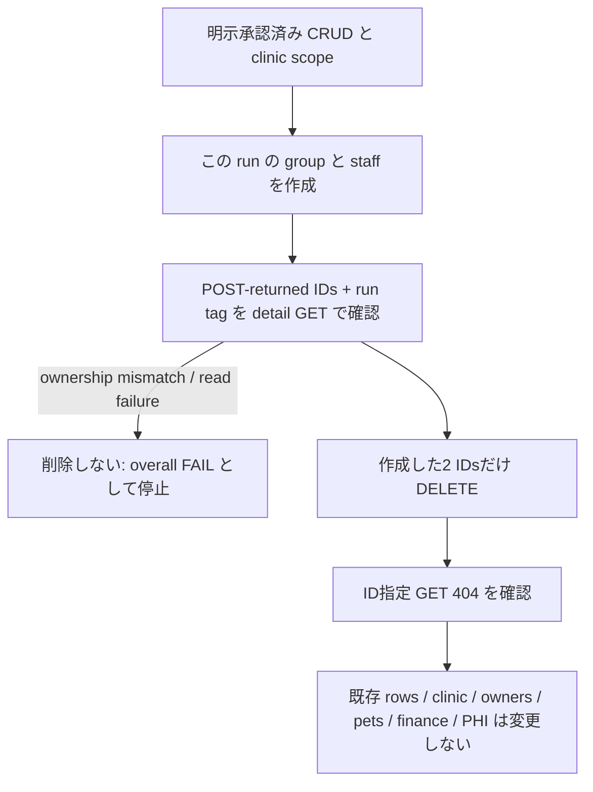

# STG データライフサイクル

> **目的**: master seed、運用アカウント、smoke/investigation dataの作成・cleanup境界を定義する。
> **現行contract**: 全 `APP_ENV` でseed bundleは `002_master` のみ。`003_demo` / `004_staging` は退役済み。

## 1. 分類

| category | source | retention |
|---|---|---|
| Master seed | `backend/migrations/seeds/002_master/` | environment lifetime。通常cleanupしない |
| Synthetic demo login | migrate フェーズ3 `internal/seedlogin` と LoginForm の固定合成 identity。共通パスワードは STG では `SEEDLOGIN_DEMO_PASSWORD`（未設定ならログインロック。local/dev/test のみコード定数）。STG frontend build は同じ secret を `VITE_DEMO_LOGIN_PASSWORD` として使用し、必須 deploy auth smoke も同じ値を使う。identity/password は reports/logs に出さない。`STG_DEMO_PASSWORD` は legacy admin smoke 専用であり、この作業では削除・変更しない。production では define が `""` を焼き込み fail-closed | environment lifetime |
| Operation-provisioned account | [STAFF_ACCOUNT_PROVISIONING.md](../accounts/STAFF_ACCOUNT_PROVISIONING.md) | owner/expiryをrun sheetに記録 |
| Operator system-admin bootstrap | migrate フェーズ3の `SEEDLOGIN_OPERATOR_*`（CSV/LoginForm には載せない） | environment lifetime |
| Smoke data | [CRUD-SMOKE-TEST.md](../rehearsals/CRUD-SMOKE-TEST.md) | 同じrunでcleanup |
| Investigation data | approved task/run sheet | ownerと期限を固定し、終了時cleanup |

`002_master` は医院骨格と参照masterを提供する。現在のclinic CSVにはID 1–4があり、clinic-scoped permission groupsが含まれる。ID 1やgroup名を「system adminとして削除不可」と扱わない。CSV に privileged demo accountは載せない。`002_master` に `accounts.csv` は置かない。STG/local の画面デモログインはフェーズ3が合成アカウントを upsert する（医院ごとに執行1・一般9。林 文明は catalog 4医院すべてに執行所属）。実オペレータのシステム管理者は `SEEDLOGIN_OPERATOR_*` で migrate が upsert する（氏名・email・パスワードは git に書かない）。

ローカルを含む全environmentで `BundleOrderForEnv(APP_ENV)` は現在 `002_master` だけを返す。臨床/demo dataはseed bundleへ復元せず、ローカルは `_old_db_handoff`、STG cutover/UATは承認済みF6経路を使う。

## 2. 作成ルール

- master seedは`cmd/migrate`の同じ経路だけで適用する。CSVや`schema_migrations`を手編集しない。
- operation accountはapproved provisioningで作る。既知passwordをseedや文書へ置かない。
- smoke/investigation dataはclinic scopeとownerを決める。smoke harnessでは作成ID、run tag、要求clinic scopeをメモリ内だけで保持する。
- cookieはbrowserのHttpOnly sessionまたは権限0600のcookie jarで扱う。header/cookie/token値を文書へ貼らない。
- permission-group handlerで必須となるaudit transactionは既存integration testsで検証される。API successをすべてのresourceのaudit sink確認と一般化しない。live audit-table queryはこの作業では行わない。[CRUD-SMOKE-TEST.md](../rehearsals/CRUD-SMOKE-TEST.md) のroute matrixに従う。

## 3. Smoke cleanup

通常の deploy 後 smoke と `cf:smoke` alias は `cf-demo-smoke.py --auth` のみで、fixed synthetic executive identity の login、`/me`、direct logout を確認する。read-only は業務レコードを変更しない意味であり、login/logout は通常の認証 session/audit 更新を行う。CRUD は明示承認済みの manual `--crud` のみに限定し、clinic scope と run tag を付けた新規 test permission-group 一件・test staff 一件だけを扱う。既存行、clinic、owner/pet、financial data、PHI は変更しない。親タスクの実行・確認前に real smoke PASS として扱わない。

1. 作成IDと要求clinic scopeはメモリ内だけで扱い、run tagもメモリ内に保持する。開始時は復旧用にrun tagとclinic IDだけをprogress JSONへ出力する。全 masters request に同じ `X-Clinic-ID` を付ける。
2. detail GET でIDとrun tagの所有を確認する。staff DTOはAPI responseに`clinic_id`を露出しないため、responseによる独立したclinic scope検証を主張しない。所有が確認できないIDは削除せず、停止して調査する。
3. このrunの新規 permission-group と staff だけを、それぞれID指定で削除し、後続GETの404を確認する。DELETE failure や ownership mismatch は失敗として残し、人が対応する。
4. cleanup後も既存 clinic/master、owners/pets、billing/accounting、financial data、PHIには触れない。legacy accounting smokeは`NOT_RUN`であり、新master CRUDを全financial acceptanceとして扱わない。smoke出力にresponse bodyやcredential/cookieを記録しない。

cleanup 順序と停止条件:

依存関係が異なるcaseではAPIの`409`を正として停止し、順序を推測してdirect SQLへ切り替えない。

## 4. Direct DB operation

通常cleanupでは禁止する。API全断などのincidentで承認された場合だけ、次を事前に固定する。

- target environment/databaseとclinic scope
- exact IDsとdependency graph
- verified backup/restoreとrollback条件
- single transactionとpost-check
- operator、時刻、incident/change ID

manual SQLの後にapplication由来を装う`audit_logs` rowをINSERTしない。incident evidenceとして別に実施記録を残す。

## 5. 残置判定

Smoke dataは原則残置しない。investigation dataを一時保持する場合はowner、purpose、clinic scope、expiry、cleanup APIがすべて明示され、通常UI/operationを妨げないことを確認する。tenant isolation違反、visibleな不要data、次回smokeを妨げる重複はrelease stopとする。

## 6. DB再構築境界

`DB_RESET=true` は `public` schemaを破棄する。通常deployやcleanupの手段ではない。

- local disposable DB: [LOCAL_DB_RESET.md](../seeds/LOCAL_DB_RESET.md) のuser-owned destructive stepだけを使う。
- shared STG/production: data owner、backup/restore、downtime、target、approvalが確定するまで実行しない。
- current Cloudflare workflowに`db_reset` inputはない。AWSは退役済みでrollback/reset先ではない。承認済みSTG再構築の実行順は[STG_PLANETSCALE_SEED_RUNBOOK.md](STG_PLANETSCALE_SEED_RUNBOOK.md) §6。
- 再構築後も適用する CSV seedは `BundleOrderForEnv(APP_ENV)`、現在は `002_master` のみ。デモログインは development/staging の migrate フェーズ3で upsert する。臨床21表は `cmd/migrate` の外の `make stg-uat-handoff`。

health `200` はlivenessだけを示す。運用account、permissions、必要なhandoff/import、corrected CRUD casesを別に確認する。

## 7. Historical note

過去に提案された `stg-smoke-cleanup.yml` / `stg-cleanup-smoke-test-data.sh` は実装されていないhistorical proposalであり、実行手順ではない。存在しないautomationをrelease gateにしない。cleanupは本書とcorrected CRUD runbookのmanual API procedureを使う。

## 参考

- [CRUD smoke](../rehearsals/CRUD-SMOKE-TEST.md)
- [Seed/migration operations](../seeds/SEED_MIGRATION_OPERATIONS.md)
- [STG seed runbook](STG_PLANETSCALE_SEED_RUNBOOK.md)
- [Release readiness](../runbooks/STG_PRE_DEPLOY_READINESS_CHECK.md)
