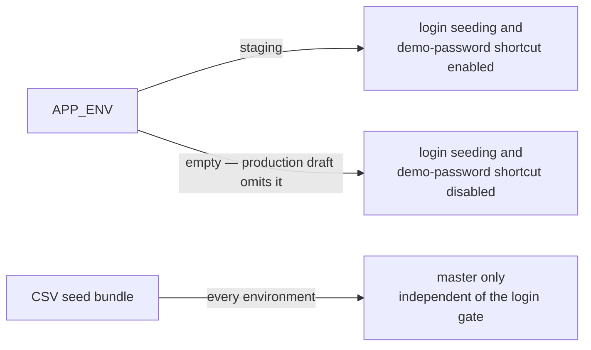

# Production Cloudflare setup contract

> Human-operated checklist for the planned Cloudflare Workers + Containers / PlanetScale production environment. **Do not execute from this document until the currently approved go-live date and Plane delivery item are confirmed.** No external runtime/account/billing state was verified during this update.
>
> **2026-10-06 追記（EMR-298/302）: 本番構築は新しい専用 Cloudflare アカウントの殻（EMR-302 の G3 成果物: 空 prod-images・cron 停止の prod Worker 殻・本番 token 結線）の上で行う。共有アカウントへの本番構築は禁止**（計画: `docs/ops/infra/cloudflare-account-separation.md` §4/§5）。着手条件: 新アカウント STG 予行合格・STG cron 単一武装・本番殻作成の後。以下の "target account" は新専用アカウントを指す。
>
> （2026-09-29 訂正: 実行状態の正本は Linear から Plane（workspace `baritechllc` / Project `EMR`）へ移行済み。Linear は 2026-09-16 に閉鎖され履歴参照のみ。本書の "Linear" 記述はすべて Plane と読み替える）

Checked-in `backend/wrangler.production.jsonc` and `infra/cloudflare/production/` are drafts. Their presence does not prove that GitHub Environment protection, billing, PlanetScale, Cloudflare, DNS, R2, or Vercel production configuration exists.

## 1. Fail-closed preconditions

A human owner must record dated evidence for all items before deployment:

- target account/zone/project and billing are approved;
- production database, role, backup/restore owner, R2, DNS, and certificate are verified;
- a GitHub Environment with required reviewers exists and its exact case-sensitive name matches the workflows (`frontend-deploy.yml` and `backend-deploy.yml` job `deploy-production` both bind `Production`);
- production secrets are environment-scoped and staging values are not reused unless explicitly approved;
- frontend production settings are verified. `frontend-deploy.yml` binds `Production` and rejects production dispatch from non-production refs. `APP_ENV=production` selects `frontend/wrangler.production.jsonc` (`animalekarte-prod-frontend`, EMR-255); `/api/*` is proxied same-origin via service binding so no absolute API URL is baked into the bundle. Verify the deployed target and the external Environment reviewers;
- workflow/config tests and `actionlint` are green on the reviewed change;
- current Plane delivery state and go-live date are confirmed externally.

Stop if any item is unknown. Do not infer runtime state from this draft.

## 2. Required production secret **names**

The inventory source is `backend/wrangler.production.jsonc` `secrets.required`. Never put values in docs, shell history, logs, Terraform state, or tickets.

| Category | Required names |
|---|---|
| Database | `DB_HOST`, `DB_USER`, `DB_PASSWORD` |
| R2/S3 binding | `AWS_ACCESS_KEY_ID`, `AWS_SECRET_ACCESS_KEY` |
| Migration | `MIGRATE_RUN_SECRET` |
| Scheduler | `SCHEDULER_OPS_SECRET`, `SCHEDULER_INTERNAL_TOKEN`, `SCHEDULER_ACCESS_TEAM_DOMAIN`, `SCHEDULER_ACCESS_AUDIENCE`, `SCHEDULER_ALERT_ALLOWED_HOST`, `SCHEDULER_ALERT_WEBHOOK_URL`, `SCHEDULER_ALERT_WEBHOOK_SECRET` |
| Application | `JWT_SECRET`, `INTEGRATION_ENCRYPTION_KEY` |
| SMTP | `SMTP_HOST`, `SMTP_USER`, `SMTP_PASS` |

Secret names must be checked against the config again at execution time. For each name, use the protected operator channel from `backend/`:

```bash
npx wrangler secret put <NAME> -c wrangler.production.jsonc
```

Do not use `pnpm exec wrangler`; the effective working directory previously caused a wrong-Worker deployment. For scheduler rollout, create and validate `SCHEDULER_INTERNAL_TOKEN` and its access/alert dependencies **before** the first deploy. Deploy last. Missing scheduler secrets must fail closed.

## 3. R2 credentials

The old generic-token API and “SHA-256 of `result.value`” recipe is removed. Before credential creation, verify the current official Cloudflare R2 S3 credential documentation and use its supported UI/API flow. Confirm the repository is allowed to expose any account identifier; otherwise use `<CLOUDFLARE_ACCOUNT_ID>` from the protected operator store. Do not run copied `curl` commands blindly.

## 4. Seed contract

In the current checkout, only `backend/migrations/seeds/002_master` exists. `seedbundle.BundleOrderForEnv` returns master-only for every environment. `003_demo`, `004_staging`, “seed +3”, and environment-specific demo cleanup are historical behavior and must not be used.

`APP_ENV` is passed through the Worker to the Container and migrate runner. STG config sets `staging`; the production draft currently omits it, so login seeding and the shared demo-password shortcut remain disabled by the empty-value gate. Production configuration must not set a development/test/staging value. CSV master-only selection is independent of this login gate. Production synthetic users require separate approved provisioning with owner, expiry, and cleanup.



### 4.1 Initial masters on a fresh production database

Decided in EMR-341 (2026-10-11). What a clinic sees right after the first production `cmd/migrate`, and who fills the rest:

| Master | State after the first migrate | Who fills it |
|---|---|---|
| Clinics, company, clinic settings, animal species, exam types, payment methods, permission groups and rules, L-step tag prefixes/mappings | Present — loaded from `002_master` | — |
| Reservation types | Only the trimming type, one row per clinic. The five standard types (診察・お手入れ・ワクチン・健診・ホテル) are **not** in the bundle | Apply the one-shot SQL in §4.2 |
| Trimming course types / courses / options | Empty — no seed CSV | The clinic registers them from its own record (see below) |
| Procedures, merchandise, vaccines | Empty — not in `002_master` | The cutover import fills them (what is imported is decided in MIG-25 / EMR-338); anything left over is registered by the clinic |
| Medicines | Empty — not in `002_master` and not in the 21 cutover tables | Open decision of EMR-338 (import from the old procedure master, or the clinic registers) |
| Anything a clinic registered on STG | **Not carried over** — STG and production are separate databases | The clinic registers it again in production |

Staff screens and the master screens become usable only after the first system administrator is issued ([FIRST_SYSTEM_ADMIN.md](../../deploy/FIRST_SYSTEM_ADMIN.md)). Before that day, ask each clinic to keep a record of what it registered on STG — name, duration, price and LINE-publication setting of its reservation types and trimming courses; a screenshot is enough — because this is the only source for re-registration. The request goes to the clinic through the list maintained in EMR-338.

### 4.2 Standard reservation types

Decided in EMR-341 (Q1 = apply): the five standard reservation types are part of the first-build procedure. Background: on STG a clinic could pick only the trimming type when creating a reservation (EMR-193).

- The SQL is `backend/migrations/seeds/live_insert_standard_reservation_types.sql`. It is **not** part of `cmd/migrate` and the repository or CI never runs it. A human runs it from an approved runbook, once per environment, **after** the first migrate has loaded the clinics (on a database without clinics it fails by design).
- The pre-check, the apply command, the post-check query and the failure handling are in [EMR-321_HOTEL_RESERVATION.md](../../deploy/EMR-321_HOTEL_RESERVATION.md). Follow that document as written; do not copy the SQL into this file.
- Applying the SQL does not update `002_master/reservation_types.csv` ([EMR-321_HOTEL_RESERVATION.md](../../deploy/EMR-321_HOTEL_RESERVATION.md) 「fresh DB と失敗時の扱い」). Do not edit the CSV or the manifest by hand.
- Record the target environment, operator, time, per-clinic result and the post-check result as non-secret evidence on **EMR-348** (the execution record for this operation); EMR-321 stays the canonical procedure and its evidence thread may be linked.

#### Readiness chain for this operation (EMR-348)

`Ready` on EMR-348 means a human can start preparing; it is not execution approval. Every predecessor must have its own dated, non-secret receipt — a scheduled date or another ticket's plan does not establish readiness. Observed states (2026-10-12 UTC / 2026-10-13 JST): EMR-310 is `Backlog` and EMR-139 is `Blocked`; the execution receipts below are **not confirmed** in the observed evidence — this is not a claim that the underlying provider work does not exist. The planned 10/20 date covers initial construction, not clinic cutover.

1. The approved new dedicated Cloudflare account shell and STG prerequisites ([cloudflare-account-separation.md](../cloudflare-account-separation.md) §4/§5).
2. EMR-256 / EMR-148: actual production construction verified with DB-backed checks — migrations applied and the master clinics committed in the production database. `/health` alone does not prove database access.
3. EMR-139 preflight → EMR-140: actual first-administrator receipt plus a normal login. EMR-141 tracks the mail path as a separate follow-up; its receipt is not an additional prerequisite for this standard-SQL operation. Exactly one first administrator: an existing staff row with an active main membership, and no existing `is_system_admin` account including inactive or deleted ones; never reuse demo or shared credentials. The procedure is [FIRST_SYSTEM_ADMIN.md](../../deploy/FIRST_SYSTEM_ADMIN.md); keep secrets, personal names and email addresses out of this document and tickets.
4. The standard-SQL human operation in [EMR-321_HOTEL_RESERVATION.md](../../deploy/EMR-321_HOTEL_RESERVATION.md) with the all-five post-check green.
5. Clinics then register their manual masters from their own STG records (the EMR-338 list).

Before step 4, require verified receipts for steps 1–3 (environment, migration/clinics, and administrator/normal login), plus the operation-specific approval and pre-check in the linked procedure. Missing or unverified prerequisites mean stop. Record step 4's result before handing off step 5; their receipts are produced by those steps. Re-verify external state at execution time rather than using historical provider claims as current facts.

## 5. IaC and resource verification

Terraform plan must be reviewed by a human before apply. It currently covers only the checked-in resources; Hyperdrive is comment/tombstone-only in both environments, `infra/cloudflare/production/notifications.tf` is comment-only (no resource), and the STG notification policy is defined in `infra/cloudflare/notifications.tf` but its apply/delivery state requires external verification. Apply/destroy, database creation, credential changes, shared environment writes, billing, and DNS changes are human-only external operations.

## 6. Deployment workflow acceptance criteria

Do not copy an embedded patch from docs. Modify and review the workflow against current HEAD. Production activation is acceptable only when:

1. production trigger is enabled **after** Environment protection exists;
2. production job binds the exact protected GitHub Environment;
3. staging uses `npx wrangler deploy`;
4. production uses `npx wrangler deploy -c wrangler.production.jsonc`;
5. environment-specific Worker URL and secret scope are selected explicitly;
6. workflow tests and `actionlint` pass;
7. execution order is **deploy → migrate → `/health` → optional smoke**.

At EMR-148, `backend-deploy.yml` contains a `deploy-production` job: it triggers on push to `production` with the same path filter, or on `workflow_dispatch` with `target=production`; it binds the `Production` Environment; its first step rejects refs other than `refs/heads/production`; it checks `PROD_CLOUDFLARE_API_TOKEN`/`PROD_MIGRATE_RUN_SECRET` before deploy; it deploys with `npx wrangler deploy -c wrangler.production.jsonc`; it targets `WORKER_URL=https://api.noah-karte.com`; and it runs deploy → migrate → `/health`. Production smoke is intentionally manual (§7).

Mapping to the criteria above: items 2, 3, 4, 5, and 7 are implemented in the YAML. Item 1 is a human precondition — the trigger is checked in but must not be exercised (no push to `production`, no production dispatch) until `Production` has required reviewers and a deployment-branch rule limited to `production`. For item 6, the workflow contract test (`scripts/ci/check-workflow-contracts.test.mjs`) covers the new job; `actionlint` must be green in PR CI (local actionlint run: BLOCKED — `rhysd/actionlint:latest` image not present locally and not pulled). A production invocation remains **not runnable** until this change is merged and all §8 items are verified.

### 6.1 GitHub Actions secrets for `deploy-production`

The job reads two Actions secrets:

- `PROD_CLOUDFLARE_API_TOKEN` — Cloudflare API token for `wrangler whoami` and `wrangler deploy`;
- `PROD_MIGRATE_RUN_SECRET` — bearer for `POST /_internal/migrate` via `infra/scripts/cf-run-migrate.sh`.

Store both only as `Production` Environment secrets, never repository-level. The distinct `PROD_` names prevent fallback to STG repository secrets. `PROD_MIGRATE_RUN_SECRET` must equal the Worker `MIGRATE_RUN_SECRET` set with `wrangler secret put MIGRATE_RUN_SECRET -c wrangler.production.jsonc` (§2). If either is missing, the job fails before deploy — this also fails closed if the Environment were auto-created without configuration.

## 7. Go-live verification

- verify workflow run `headSha`, environment approval, Worker name, route, and config file;
- verify `/health`, then DB-backed behavior separately because `/health` does not query the DB;
- verify frontend production API target from deployed output, not from branch name;
- use only explicitly provisioned synthetic credentials with lifecycle ownership for CRUD smoke;
- verify that every clinic has the five standard reservation types (§4.2): the post-check query in [EMR-321_HOTEL_RESERVATION.md](../../deploy/EMR-321_HOTEL_RESERVATION.md) returns 0 rows;
- record non-secret evidence and rollback owner.

## 8. Remaining provider / human work (not done by the repository)

- [ ] contract/billing approval;
- [ ] Cloudflare account/zone, DNS `api.noah-karte.com`, and certificate;
- [ ] PlanetScale production database and role;
- [ ] R2 bucket, S3 credentials, and `S3_PUBLIC_BASE_URL`;
- [ ] `production` branch protection の required checks 整合 — 2026-10-11 観測の不整合は [docs/ops/ci-policy.md](../../ci-policy.md)「ブランチ保護」を正本とする。merge 可否は head の check/status と保護設定の照合で判断し、release 前に人間が GitHub 側で現行 check 名へ整合させる（docs からの設定変更・回避はしない）;
- [ ] GitHub Environment `Production`: required reviewers, a deployment-branch rule limited to `production`, and the two §6.1 secrets;
- [ ] Worker secrets from §2 set via `wrangler secret put ... -c wrangler.production.jsonc`;
- [ ] `TRUSTED_PROXY_CIDR` post-deploy measurement and confirmation;
- [ ] backup acquisition and isolated restore rehearsal with measured timings ([runbook §4](runbook.md));
- [ ] PR CI `actionlint` green;
- [ ] standard reservation types applied and verified per §4.2 (human-run SQL, after the first migrate);
- [ ] each clinic has kept a record of the masters it registered on STG (§4.1), requested through EMR-338;
- [ ] go-live date and delivery state confirmed in Plane.

All checkboxes are requirements, not claims of current external state.
