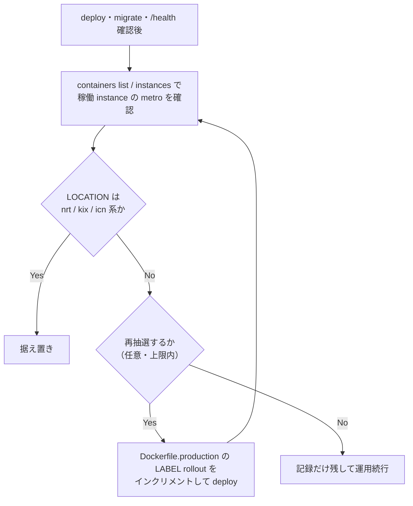

# STG 運用 Runbook（Cloudflare）

> External state is verification-required. この文書は HEAD の workflow/config contract のみを説明する。

## Deploy

- 自動: `staging` pushで`backend/**`、`.github/workflows/backend-deploy.yml`、root `package.json`、root `pnpm-lock.yaml`のいずれかが変わった場合。`infra/cloudflare/**`単独ではtriggerされず、Terraformは別の承認済みplan/apply手順で扱う。
- 順序: **deploy → migrate → `/health` → required read-only demo auth smoke**。画面 demo login と deploy smoke は共通の `SEEDLOGIN_DEMO_PASSWORD` を使い、固定の合成 `執行` identity で login、`/me`、logout を確認する。失敗は deploy job を fail させる。
- 通常の `cf:smoke` alias は `python3 infra/scripts/cf-demo-smoke.py --auth` に固定し、auth-only である。CRUD は `stg-demo-smoke.yml` の明示 `crud` mode と承認済み clinic scope に限る。新規 test permission-group / staff のみを作成し、POST-returned ID と合成 run tag の所有を確認した場合だけ cleanup する。financial、owner/pet、既存行、PHI は変更しない。親タスクが real smoke を実行・確認する前に PASS と報告しない。
- 手動 dispatch も存在する。実行は人が対象 ref、approval、secret scope を確認して行う。

## DB and seed

- migrate は `POST /_internal/migrate` と `MIGRATE_RUN_SECRET` を使う workflow contract。
- `MIGRATE_RUN_SECRET` のローカル管理ファイルは `infra/cloudflare/.env`（gitignore 済み）。Worker secret・GitHub secret（deploy workflow 用）と3箇所で同値を維持し、ローテーション時は3つ同時更新する。値は write-only で取り出せないため、紛失時はローテーションのみが回復手段。
- 現行 `BundleOrderForEnv` は全環境で `002_master` のみ。`003_demo` / `004_staging` や full-demo CSV 再投入を前提にしない。画面デモログインは migrate フェーズ3で合成 `一般` アカウントを upsert し、開発/STG は共通デモパスワードで認証する。UAT/clinical data は承認済みの明示 import と lifecycle owner を別途定義する。
- 過去の「public schema 109 objects」「REASSIGN が唯一解」は dated incident observation であり current fact ではない。schema owner と provider-supported remediation を PlanetScale/runtime で再検証してから ALTER migration を行う。
- credential rotation、DB access、shared STG operation は人による明示承認が必要。

## GitHub Secrets の staging Environment 分離（EMR-291・人間専用）

対象は repository Secrets の次の7名称を GitHub Environment `staging` へ移し、旧保存先を消す作業。値の取得・登録・削除・発行は人間のみが行い、エージェントは実行しない。

対象7名称: `CLOUDFLARE_API_TOKEN` / `MIGRATE_RUN_SECRET` / `STG_DB_USER` / `STG_DB_PASSWORD` / `STG_DEMO_EMAIL` / `STG_DEMO_PASSWORD` / `SEEDLOGIN_DEMO_PASSWORD`

HEAD の consumer（workflow contract）:

| Secret | Consumer（.github/workflows） |
|---|---|
| `CLOUDFLARE_API_TOKEN` | `backend-deploy.yml` `deploy`（environment: `staging`）、`frontend-deploy.yml` `deploy` の staging 経路、`worker-secret-sync.yml` |
| `MIGRATE_RUN_SECRET` | `backend-deploy.yml` `deploy` の migrate ステップ |
| `STG_DB_USER` / `STG_DB_PASSWORD` | `stg-migrate-direct.yml`、`worker-secret-sync.yml`（いずれも environment: `staging`） |
| `STG_DEMO_EMAIL` / `STG_DEMO_PASSWORD` | legacy `cf-crud-smoke.sh` のみ。自動 smoke では消費しない |
| `SEEDLOGIN_DEMO_PASSWORD` | `frontend-deploy.yml` staging build と `backend-deploy.yml` 必須 read-only login smoke |

`STG_DEMO_EMAIL` / `STG_DEMO_PASSWORD` は legacy 専用として保持し、この作業では削除・変更しない。画面 demo と `cf-demo-smoke.py --auth` は同じ `SEEDLOGIN_DEMO_PASSWORD` を使う。自動 deploy smoke は auth-only。fixture CRUD は明示承認済みの manual dispatch のみで、指定clinic内に作った二つの新規 fixtureだけを扱う。

**共有名の注意**: `frontend-deploy.yml` は Production 経路の job でも同名 `secrets.CLOUDFLARE_API_TOKEN` を env へ読み込む（実 deploy token としては `Production` Environment の `PROD_CLOUDFLARE_API_TOKEN` を選択する）。repository の同名 secret を削除する前に、他の Environment・consumer が repository 側同名への fallback に依存していないことを人が確認する。未確認なら削除しない（STOP）。

手順（順序固定。delete-first 禁止、結果不明な変更の retry 禁止）:

1. 7名称それぞれについて、既存値を取得できる保護された回復可能な保管先を確認する。GitHub は secret 値の readback を提供しないため、保管先を確認できなければここで停止する。値を推測・再発行・自動生成せず、Plane・チャット・ログへ値を出さない。
2. GitHub Environment `staging` への登録権限と承認構成（required reviewers 等）を確認し、現在の deploy 対象・アカウント・Worker が [cloudflare-account-separation.md](../cloudflare-account-separation.md) §4/§5 の前提と一致することを照合する。
3. 7名称を Environment `staging` へ登録する（register）。
4. Environment 側の登録を名称ごとに確認し、別途承認された関連する runtime 確認を実施する。
5. 全名称の確認が成功した場合に限り、同名の repository Secrets を削除する。
6. 最終確認: repository Secrets に該当名称が残っていないこと、Environment `staging` に名称が維持されていること、上表の consumer job が引き続き動作すること。

停止条件: 保管先・権限・承認の欠落、scope/Worker/account の不一致、確認の失敗または結果不明は、削除前に停止する。

記録: 非機密の対象・名称一覧・実行者と日時・承認参照・確認に使った Actions run ID と結果を運用記録へ残す。値や資格の詳細は記録しない。

残件・境界:

- deploy 用 token と secret 書込み権限の分離は未完了のまま維持する。承認済みの新 token 発行と最小権限の検証が済むまで分離完了としない。
- EMR-302 の完了を本 staging 移行の必須依存とはしない（投入先の整合確認は行う）。
- 移行確認だけを目的に deploy/migrate/secret-write の副作用を持つ workflow（`backend-deploy.yml`、`stg-migrate-direct.yml`、`worker-secret-sync.yml`）を dispatch しない。これらは人間が対象 ref/head/Environment/scope を承認した実行のみ許容される。
- `backend-deploy.yml` の read-only auth smoke は必須であり、secret 未設定・login・identity・logout の失敗は job failure になる。health や source-only checks は real smoke PASS を証明しない。

## Incident triage

1. workers.dev path と configured domain の `/health` を比較する。
2. deploy直後の rolling update を考慮する。
3. DB connection error は pool/slot metrics を確認する。過去事例を current diagnosis とみなさない。
4. provider status を確認する。
5. AWS rollback target は repository decision 上存在しない。Cloudflare 側の修正または検証済み backup + IaC restore contract を使う。
6. **ブート時 migrate デッドロック（seed checksum mismatch）**: コンテナ CMD は `/app/migrate && exec /app/api` のため、migrate が fail すると api も起きず全インスタンスが crash loop（`/health` 500、"container crashed while checking for ports"/"just exited"）になる。適用済み DB で seed bundle CSV が変更されると schema_migrations 記録 checksum と乖離し fail-closed で発生する（009 コメント・2026-09-24/2026-10-03 の発生実績）。コンテナが起きないので `/_internal/migrate` exec 経路も使えない。**復旧手順**: 新規 `0NN_reconcile_002_master_seed_checksum.sql`（009/020 と同型・既知の旧 checksum 限定 UPDATE・データ差分は別 migration で担保）を用意し、workflow `STG Migrate Direct`（dispatch。実行は GitHub Environment `staging` のレビュアー承認待ち）で GitHub Actions から STG PlanetScale へ直接 cmd/migrate を実行して適用する（`.env.staging` の DB_HOST は陳腐化しており直接接続は不可。ホストは public `ap-northeast-2.pg.psdb.cloud`、user は `user.branch` 形式の `STG_DB_USER` secret）。適用後はコンテナが普通に起動する。恒久対策として deploy のイメージにも同ファイルを含めること。

runtime、DB 内容、credential、provider status は本更新では確認していない。

## Container placement（配置の再抽選）

STG Container の稼働 instance は deploy・instance 入替のたびに再配置され、配置は認証系 API の遅延に直接効く。deploy 後に実配置を確認し、発動条件を満たせば任意で再抽選する。`constraints.regions=["APAC"]` の中での抽選が現行アカウントのケイパビリティ上限であり（下記「確定した仕様」）、`maa01`/`bom`/`sin` への着地も許容する。

### 確認と再抽選の手順

1. `cd backend && npx wrangler containers list` で app・version・state を確認する。
2. `npx wrangler containers instances <container-id>` で稼働 instance の配置コード（例 `maa01`）を確認し、`npx wrangler containers info <container-id>` で `scheduling_policy`・`constraints`・instance 状態を照合する。
3. 期待との乖離を記録する。ingress は KIX 系、DB は PlanetScale `ap-northeast-2` のため、`maa01`/`bom09`/`sin14` 系への着地は `container_fetch` を悪化させる。2026-09-23 の観測では `container_fetch` 866–3848ms が client 遅延の支配成分だった（証拠は `reports/perf-e5-residual-20260923/cf-events/`。gitignore 非配布証跡のため clone 環境には存在しない。再利用は保管者に所在と取得方法を確認）。
4. 配置が不利で再抽選すると判断した場合は、`backend/Dockerfile.production` の `LABEL rollout="N"`（:38、再ビルド強制用ダミーラベル）をインクリメントして deploy する。新 image digest → 新 version → instance 入替で再抽選が起き、コード差分は不要。再抽選は任意で、実施しない場合も記録だけ残して運用を続行してよい。

### 運用ルール（発動条件・上限・記録）

- **発動条件**: deploy・migrate・`/health` 確認の後、手順 2 の稼働 instance LOCATION が `nrt`/`kix`/`icn` 系以外（例 `maa`/`bom`/`sin`）なら再抽選を実施してよい（任意運用。必須ではない）。近接 metro 着地なら据え置く。`maa01`/`bom`/`sin` 着地は APAC 制約内の許容範囲であり、それ自体を障害として扱わない。
- **上限**: 再抽選は 1 回の deploy イベントあたり最大 2 回を目安とする。APAC 内抽選である以上追いすぎず、連続して不利なら記録だけ残して運用を続行する。
- **自発再配置の注意**: scheduler が deploy なしに稼働 instance を再作成して配置が変わる事象を観測済み（2026-09-23 `maa01`→`sin14`、v70→v71、観測窓内）。判断は必ず直前に取得した最新の `containers instances` に対して行い、過去の観測値を固定視しない。
- **記録**: 実施時は着地 metro・container version・再抽選回数・観測時刻を作業記録（reports/ または Plane チケット）に残す。
- deploy 後は `containers info` の実値を照合し、config 値を実配備の状態とみなさない。

### 確定した仕様・ケイパビリティ上限（2026-09-23 切り分け・2026-09-28 EMR-202 で確定）

- `constraints.regions: ["APAC"]`（wrangler.jsonc:150-151）は下限であって保証ではない。APAC 内のどの metro に着地するかは scheduler 次第で、KIX ingress・ap-northeast-2 DB の構成で `maa01`/`sin14`/`bom09`/`sin07` へ着地した実績がある（v72 の `maa01`/`bom09` は 2026-09-24 再観測 — `reports/perf-lane-all-20260924/placement/`。gitignore 非配布証跡。再利用は保管者に所在と取得方法を確認 — 、`sin07` は EMR-213 復旧後の性能台帳 E8）。これらの着地は許容する。
- `constraints.cities`（metro ピン留め）はアカウントに `CITIES_CONSTRAINT` ケイパビリティが無く、deploy が `VALIDATE_INPUT` で失敗する（run 35749806541）。選択肢は regions 粒度まで。
- `scheduling_policy` は **`default` 固定**（wrangler.jsonc:141）。`regional` はこのアカウントでは非対応で、EMR-213 の application 再作成時に create が `VALIDATE_INPUT` で拒否されることを確認済み（許可値は `default`/`fill_metals` のみ）。以前の config=`regional` / deployed=`default` の乖離は、EMR-213 で config を `default` に揃えたことで解消済み。
  - 経緯（2026-09-23 切り分け）: `regional` を宣言していた当時、wrangler は deploy 毎に `PATCH /accounts/{account}/containers/applications/{id}` へ `scheduling_policy: "regional"` を送信し、CI log（run 35765616070・35817156409・35821335301）は `default → regional` の差分と `SUCCESS Modified application` を示したが、`containers info`（GET）は `default` を返し続けた（v69/70/71/72 で再現）。既存 application への PATCH は受理されるだけで永続化されない。
- **まとめ: `constraints.regions=["APAC"]` の中での抽選が現行アカウントのケイパビリティ上限（2026-09-28 確定）。** Japan 着地の再現性を上げる手段（cities 指定・`regional` policy）はいずれもアカウントのケイパビリティ外で、application 再作成でも `regional` は使えない。改善には Cloudflare 側のケイパビリティ付与が必要。再抽選（`LABEL rollout` bump + 再デプロイ）は上記発動条件を満たしたときの任意運用にとどめる。
