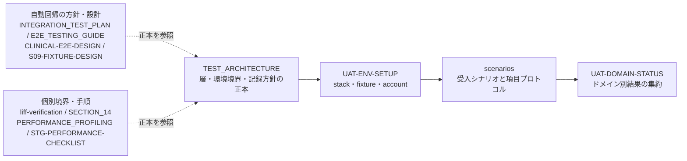

# testing/ — テスト・品質保証

> **目的**: テスト戦略・検証手順・品質記録の索引を提供する。

編集規則は [CLAUDE.md](CLAUDE.md) を参照する。

## 索引

| ドキュメント | 内容 | いつ読むか |
|:---|:---|:---|
| **[TEST_ARCHITECTURE.md](TEST_ARCHITECTURE.md)** | **L0–L5、証跡、環境境界** | **最初** |
| [UAT-ENV-SETUP.md](UAT-ENV-SETUP.md) | stack と明示的な fixture/account provisioning | scenarios 実行前 |
| [scenarios/](scenarios/README.md) | S01–S40、V01–V05、UAT-254 close、項目単位 F | 納品前・大きなリリース前 |
| [scenarios/FIELD-LEVEL-PROTOCOL.md](scenarios/FIELD-LEVEL-PROTOCOL.md) | フォーム項目単位 F0–F6 | V シリーズ実施時 |
| [scenarios/FORM-FIELD-INVENTORY.md](scenarios/FORM-FIELD-INVENTORY.md) | 宣言済みフォーム群・項目。wildcard/実測待ちを含む | カバー範囲確認 |
| [INTEGRATION_TEST_PLAN.md](INTEGRATION_TEST_PLAN.md) | Unit/API/E2E と負荷試験の現状 | 自動テスト方針 |
| [E2E_TESTING_GUIDE.md](E2E_TESTING_GUIDE.md) | 実装済み Playwright coverage と runner | L3 回帰 |
| [liff-verification.md](liff-verification.md) | LIFF の mock/実 LINE と秘密管理境界 | LIFF/LINE 検証 |
| [SECTION_14_MANUAL_TEST_GUIDE.md](SECTION_14_MANUAL_TEST_GUIDE.md) | L5 の focused exploratory supplement | 補完確認 |
| [UAT-DOMAIN-STATUS.md](UAT-DOMAIN-STATUS.md) | ドメイン別受け入れステータス（日付付き実行結果の記録。現在の受入・リリース状態は Plane。最新の release signoff ではない） | 納品前・進捗確認 |
| [CLINICAL-E2E-DESIGN.md](CLINICAL-E2E-DESIGN.md) | `--clinical` fixture/allowlist と未実施境界 | clinical 自動回帰の準備 |
| [S09-FIXTURE-DESIGN.md](S09-FIXTURE-DESIGN.md) | 完了時刻 fixture の package 実装と未実装の UAT 接続 | S09 BLOCKED の解消設計 |
| [PERFORMANCE_PROFILING.md](PERFORMANCE_PROFILING.md) | Lighthouse、k6、SQL 分析、現行 profiler の制約 | 性能調査 |
| [STG-PERFORMANCE-CHECKLIST.md](STG-PERFORMANCE-CHECKLIST.md) | STG性能測定の準備・承認・画面/API計測・中止条件・比較記録 | STG性能測定の計画・実施時 |
| [scripts/](scripts/) | 受入検証補助スクリプト3本。`check-scenarios-coverage.sh`: scenarios 索引↔ファイル整合・テンプレート準拠・inventory × reports の F 結果差分ゲート。`check-uat-env.sh`: UAT 環境の readiness チェック（secret を表示しない）。`run-uat-e2e.sh`: `.env.local` の `E2E_LOGIN_*` を値を表示せず読み込み `frontend/scripts/run-e2e.sh` へ委譲 | scenarios 機械チェック・UAT E2E 実行前 |

受入タスクの読み進め方と各文書の位置づけ:

## 重要な現状

- CSV seed bundle は `002_master` のみ。migrate の別 phase `003_login` は non-production の許可環境で合成ログインを upsert する。臨床 fixture と受入用権限は別途準備する（[UAT-ENV-SETUP.md](UAT-ENV-SETUP.md)）。
- E2E workflow `e2e.yml` は manual・non-gating の workflow_dispatch のまま。2026-09-28 に `inputs.suite`（auth-smoke / clinical / v04）振り分けが配線済み（EMR-128）。`--clinical` のローカル実行は 2026-09-23 に 1 回（33 PASS / 7 FAIL、spec drift・green 未達）。Actions 実行成功・全 suite coverage は未確認。（2026-09-29 訂正: 旧記述は「auth smoke のみ配線・`--clinical` 未実行」）
- performance workflow は `APP_ENV=test` と `LOAD_TEST_LOGIN_*` を配線済み。実 Actions/fresh DB/k6 の結果は UNREPORTED/UNKNOWN。
- unique form総数はinventory再構築完了まで算定保留。exact key未収録や動的定義が残る間は「全fieldを網羅」と言わない。
- カバレッジ基準は [../coverage-policy.md](../coverage-policy.md)。確認済み UAT FAIL は `todo.md#product-bugs` で重複確認・記録後に Plane で追跡する。その他の新規 defect は通常の Plane intake に従う（2026-09-29 訂正: 旧記述は Linear。Linear は 2026-09-16 閉鎖・実行状態の正本は Plane）。

## ui-design-compliance 監査証跡（2026-10-07 spec/ から移設）

> 出典: [docs/spec/ui-design-compliance.md](../../spec/ui-design-compliance.md) の監査履歴・テスト証跡（runtime 監査履歴、synthetic-API write safety、targeted coverage、E2E inventory gap、C15〜C19 監査値の履歴注記）を spec から運用側へ移設したもの。C1〜C24 ルール定義とページ別対応状況表（route table）の正本は引き続き spec 側 ui-design-compliance.md。以下は移設時点（2026-10-07）の原文。

**既知の E2E inventory gap**: `frontend/e2e/ui-design-compliance-readonly.spec.ts` は 85 route template（public 3 + protected 82）しか持たず、実在する `/examinations/new` と `/settings/bug-reports`、`/settings/chat-history` を欠く（2026-09-29 訂正: `/settings/bug-reports` の欠落を追記。2026-10-02 訂正: `/settings/chat-history` の欠落を追記。旧主張は「85 製品 route で `/examinations/new` のみ欠落」）。`/identity-links` は現行 E2E source に含まれるが、追加後の route 単位 runtime 証跡が本書に記録されていない。これら route の runtime は **pending**。欠落 route の E2E source と期待件数の修正・scoped rerun は別 task とし、本 docs-only 変更では行わない。2026-07-23 の 83 製品ページ aggregate run は履歴情報としてのみ残し、現在の 88 route へ拡張解釈しない。

- runtime 履歴: 2026-07-23 の aggregate は 83 製品ページを対象とした。現行 88 route の route-level runtime 証跡ではない。現行 E2E inventory は 85 route template（protected 82）で `/examinations/new`・`/settings/bug-reports`・`/settings/chat-history` が欠落し、scoped rerun も未実施。旧 92/92 や「expected pass」件数は現在の完了結果として使わない。
- write safety: synthetic non-GETは完全一致allowlistの `POST /api/v1/reservations` と `POST /api/v1/medical-records` だけをlocal fulfillし、それ以外のbusiness non-GETはabortする。same-origin、sentinel `X-Clinic-ID`、non-GETの`X-Requested-With`も検証し、`frontend/e2e/helpers/synthetic-api.spec.ts` 2件と `frontend/e2e/medical-records-create.spec.ts` 1件は **3/3 PASS**、continued-to-backend 0。
- targeted coverage: 明示したproduct logic 18 source / 17 test file / 138 testで statements **84.58%**、lines **87.38%**、branches **75.89%**、functions **83.10%**。`.coverage-baseline` は変更していない。
- C15〜C19 の 2026-07-24 の監査値は履歴であり、現行 88 route の再実行結果ではない。新規 route を含む静的 gate は `docker compose exec frontend pnpm design-audit` の scoped operational execution で別途確認する。
