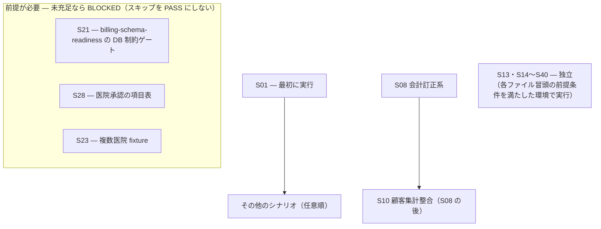

# scenarios/ — 納品前受け入れテストシナリオ

> **目的**: 納品前に主要業務が実データ相当環境で通ることを証明する受け入れシナリオの索引を提供する。
> **読者**: 検証実施者（AI エージェント / 人間どちらでも実行可能）・PO。
> **タイミング**: 納品前検証・大きなリリース前。
> **アーキテクチャ正本**: [../TEST_ARCHITECTURE.md](../TEST_ARCHITECTURE.md)（L4 受入層）

## 既存テストとの分担（重複させない）

| 領域 | 正本 |
|:---|:---|
| テスト層・実行優先・記録 | [../TEST_ARCHITECTURE.md](../TEST_ARCHITECTURE.md) |
| 受入環境準備 | [../UAT-ENV-SETUP.md](../UAT-ENV-SETUP.md) |
| 外来1件サイクル・会計計算・CRM タグ（重点手動） | [../SECTION_14_MANUAL_TEST_GUIDE.md](../SECTION_14_MANUAL_TEST_GUIDE.md) |
| 画面表示・遷移・検索・マスタ CRUD の回帰 | Playwright E2E（`frontend/e2e/`） |
| **上記が覆わないギャップ（臨床安全・LIFF・入院・フォーム項目単位）** | **本ディレクトリ** |

## シナリオ索引（S01 から順に実行）

| ID | シナリオ | 分類 | 深度 |
|:---|:---|:---|:---|
| [S01](S01-deceased-pet-guard.md) | 死亡ペット誤操作の物理ブロック | 臨床安全 | 深い |
| [S02](S02-exam-abnormal-highlight-lock.md) | 検査異常値ハイライトと確定ロック | 臨床安全 | 深い |
| [S03](S03-vaccination-next-due-autocalc.md) | 予防接種の種類別設定・手入力と後日入力の日付保護 | 臨床安全 | 深い |
| [S04](S04-liff-reservation-journey.md) | LIFF 飼主予約ジャーニー通し | 顧客体験 | 薄い+境界 |
| [S05](S05-hospitalization-cycle.md) | 入院サイクル（ケア記録→退院会計） | 入院 | 深い |
| [S06](S06-record-lock-audit-trail.md) | カルテ確定 Lock と監査証跡 | 臨床安全 | 深い |
| [S07](S07-estimate-status-control.md) | 見積ステータス制御 | 会計 | 深い |
| [S08](S08-accounting-corrections.md) | 会計訂正系（クレジット訂正・未収金） | 会計 | 深い |
| [S09](S09-closing-time-boundaries.md) | 締め境界（AM/PM/EMG・越日） | 会計 | 深い |
| [S10](S10-customer-aggregation-consistency.md) | 顧客集計ダッシュボード整合 | 経営 | 薄い |
| [S11](S11-trimming-combined-accounting.md) | トリミング業務と診察併用精算 | 会計/トリミング | 深い |
| [S12](S12-liff-pet-health.md) | LIFF ペットヘルスとアカウント連携 | 顧客体験 | 薄い |
| [S13](S13-identity-links-manual-correction.md) | 同一飼主・ペット連携 — 手動訂正 | 顧客/組織 | 中 |
| [S14](S14-search-and-multi-word.md) | 飼主・ペット検索 — 複数語 AND と医院スコープ | 顧客/検索 | 中 |
| [S15](S15-insurance-rate-preservation.md) | 会計保険負担割合 — 新規 50/70 と既存 90/100 の保持 | 会計 | 中 |
| [S16](S16-interview-history-navigation.md) | 問診抜粋 → カルテ詳細への履歴導線 | 臨床 | 薄い |
| [S17](S17-treatment-quantity-commit.md) | 治療数量入力 — Enter 2 回・Blur・Escape・IME の確定操作 | 臨床 | 深い |
| [S18](S18-treatment-search-dialog-height.md) | 治療項目検索ダイアログ — 一覧の可視範囲と操作到達 | 臨床/UI | 薄い |
| [S19](S19-medical-record-viewport-fit.md) | カルテ編集画面 — 1366×625 での全タブ表示適合 | 臨床/UI | 中 |
| [S20](S20-master-to-accounting-path.md) | マスタ登録 → 会計明細への経路（価格・税区分・請求不能） | 会計/マスタ | 深い |
| [S21](S21-accounting-concurrency-idempotency.md) | 会計確定の並行更新 — 冪等リプレイ・409・確定後保護 | 会計 | 深い |
| [S22](S22-reservation-conflict-and-staff.md) | 予約作成 — 409 理由の表示と担当者候補のフェイルクローズ | 予約 | 中 |
| [S23](S23-multi-clinic-scope.md) | 複数医院所属 — 医院スコープと他院操作の境界 | 組織/認可 | 深い |
| [S24](S24-vital-signs-latest-chips.md) | カルテヘッダーのバイタルサイン — 最新値のみ・バックフィルなし | 臨床 | 薄い |
| [S25](S25-microchip-header-display.md) | 患者ヘッダーのマイクロチップ番号表示 | 臨床 | 薄い |
| [S26](S26-medical-record-image-capture.md) | カルテ画像 — 撮影・アップロード入力と同一ファイル再選択 | 臨床 | 薄い |
| [S27](S27-chief-complaint-blank-persistence.md) | 主訴 — 区分空欄許可・本文保持・意図的解除 | 臨床 | 中 |
| [S28](S28-manual-urine-examination.md) | 手動尿検査 — 手入力項目・文字列保持・機器結果との非混在 | 臨床(検査) | 中 |
| [S29](S29-same-day-multiple-vaccinations.md) | 同一ペット同日の複数予防接種登録 | 臨床(予防) | 中 |
| [S30](S30-shift-occupation-filter.md) | シフトカレンダー — 職種フィルタと未設定スタッフ | 組織 | 薄い |
| [S31](S31-detail-route-direct-access.md) | 詳細画面への直接到達（会計・入院・在庫） | 回帰 | 薄い |
| [S32](S32-owner-search-modal-fit.md) | 飼主検索モーダル — 多数候補の可視範囲と操作到達 | 顧客/UI | 薄い |
| [S33](S33-receipt-print-pdf.md) | 明細兼領収書 — プレビュー → 印刷 → PDF 保存 | 会計 | 中 |
| [S34](S34-overlay-stack-fit.md) | オーバーレイの積層 — モーダル内ポップアップ・入れ子ダイアログ・トースト | UI | 中 |
| [S35](S35-extreme-content-fit.md) | 極端コンテンツ — 長文・空・NULL・大桁数・全角/絵文字の表示適合 | UI | 中 |
| [S36](S36-table-kanban-horizontal-fit.md) | 一覧テーブル・カンバン — 横方向の収まりと操作到達 | UI | 中 |
| [S37](S37-print-documents-layout.md) | 印刷帳票のレイアウト — 領収書以外の印刷面 | UI/帳票 | 中 |
| [S38](S38-liff-mobile-viewport.md) | LIFF モバイル画面 — スマホ viewport での表示適合 | UI/LIFF | 中 |
| [S39](S39-state-feedback-visibility.md) | 状態フィードバック — loading・空・エラー・disabled・フォーカスの可視性 | UI/a11y | 中 |
| [S40](S40-reception-return-navigation.md) | 受付ボード → 別ページ → 戻る で選択日ボードへ復帰 | 回帰/遷移 | 中 |

実行順の制約: S01 を最初に、S10 は S08 の後。S13・S14〜S40 は独立。それ以外は任意順。S21 は `billing-schema-readiness` の DB 制約ゲート、S28 は医院承認の項目表、S23 は複数医院 fixture が前提 — 前提未充足のシナリオは BLOCKED として扱い、スキップを PASS にしない。



機器クライアントの独立確認票: [LAB_DEVICE_CLIENT_UAT.md](LAB_DEVICE_CLIENT_UAT.md)（NX600/AU10V。未確定機器を PASS にしない）。

**#254 close 条件の再配置（結果は書かない）**: [UAT-254-CLOSE-CHECKLIST.md](UAT-254-CLOSE-CHECKLIST.md)。local PASS では close しない。実施レーンは BRT-68（Plane `EMR-22` — 2026-09-29 訂正: 旧 Linear 別名に正規 Plane ID を併記。`docs/work/plane/plane-md-migration-20260923-receipt.md` の対応表）。

## V シリーズ — フォーム検証（入力・更新・DB 整合 + **項目単位**）

業務フロー横断の S シリーズと別軸で、inventory に exact field key が収録された永続化フォームの入力・更新・DB 整合を検証する。inventory 再構築完了までは「全フォーム」を主張しない。

| 文書 | 役割 |
|:--|:--|
| [FIELD-LEVEL-PROTOCOL.md](FIELD-LEVEL-PROTOCOL.md) | **項目単位**チェック F0–F6 の定義（必須） |
| [FORM-FIELD-INVENTORY.md](FORM-FIELD-INVENTORY.md) | フォーム× fieldKey の棚卸し（カバー範囲） |
| V01〜V05 | フォーム単位の手順・業務固有チェック・C1〜C3 |

各 V ファイル冒頭の「共通チェック手順」（C1 / C2 / C3）に加え、**inventory の全項目に F プロトコルを適用**して完了とする。代表 1 項目だけの C1 では受入完了とみなさない。

| ID | ファイル | 対象ドメイン | フォーム数 |
|:---|:---|:---|:---|
| [V01](V01-clinical-forms.md) | 臨床系 | 臨床 | **算定保留** |
| [V02](V02-accounting-reservation-forms.md) | 会計・予約・受付・シフト・**在庫** | 会計/予約/在庫 | **算定保留** |
| [V03](V03-owner-pet-staff-forms.md) | 飼主・ペット・スタッフ・権限・医院 | 顧客/組織 | **算定保留** |
| [V04](V04-settings-master-forms.md) | /settings マスタ | マスタ | **算定保留** |
| [V05](V05-auth-line-forms.md) | 認証・LIFF・LINE・Lステップ | 認証/LINE | **算定保留** |
| **合計** | | | **算定保留** |

フォーム inventory は再構築中であり、全フォーム・全項目の完了や一意フォーム総数はまだ主張できない。route inventory の 86 product pages はフォーム数とは別の指標。

## 移設済み画面の互換パスと受入入口（未実行）

以下の旧画面仕様は移動先を示す互換案内であり、業務正本は「現正本」列である。既存S／Vと具体的な確認操作を接続する索引として扱い、画面仕様を互換ページへ複製しない。各操作には実行と証跡が別途必要で、リンクの存在や文書チェック成功から画面受入の完了を導かない。S08／V02等の更新前の実装観察は、現在の合格条件にそのまま流用せず、下記の現正本・S06の現行目標に従って読み替える。

| 互換パス → 現正本 | 既存の受入入口 | 追加照合する操作 → 期待結果 | 未網羅範囲・読み替え |
|:--|:--|:--|:--|
| [01-reception](../../../spec/screens/01-reception.md) → [受付ボード](../../../spec/domains/reception/pages/reception-board.md) | [S40手順1〜8](S40-reception-return-navigation.md)、[V02受付・カード§8/9](V02-accounting-reservation-forms.md)、[S06現行目標](S06-record-lock-audit-trail.md) | 当日以外を選び詳細・カルテを開いて戻り、予約の編集保存と診療開始／終了を各grantで確認する → 選択日へ復帰し保存値を保持。終了は会計待ちへ移し医師確認は別軸、終了だけで請求確定・入金しない | S40は復帰導線が中心。全カード分類・通信失敗・全ACの確認を代替しない |
| [02-reservations](../../../spec/screens/02-reservations.md) → [予約管理](../../../spec/domains/reservations/pages/reservation-management.md) | [S22手順1〜6](S22-reservation-conflict-and-staff.md)、[V02予約§7](V02-accounting-reservation-forms.md) | 適格な院内予約の同一担当者重複を警告確認後に登録し、非勤務等の登録不可条件は適格値へ直して再保存する → 入力を保持し最新適格性を再検査、候補情報未確定は許可しない | 院内例外をLINEの厳格条件へ展開しない。多頭予約・LINE再診問診・全変更条件／全項目は別照合 |
| [05-medical-records-list](../../../spec/screens/05-medical-records-list.md) → [カルテ一覧](../../../spec/domains/medical-records/pages/medical-record-list.md) | [S23 T1/T4/T5](S23-multi-clinic-scope.md)、[S14検索境界](S14-search-and-multi-word.md)、現正本AC-medical-records-accounting-link-visibility | 同じfixture・日付検索でAのみ／Bのみ／A+Bの行ID・件数を比較し、関連会計あり／なしを確認する。詳細復帰と行のペット絞込みも行う → 会計ありは導線、なしは「—」。復帰時は条件保持、行ペット操作は日付解除・全期間とし医院条件を保持 | S23は医院帰属・絞込み、S14は検索境界の部分確認。全ソート・一覧全項目の保証ではない |
| [06-medical-records-form](../../../spec/screens/06-medical-records-form.md) → [カルテ作成・編集](../../../spec/domains/medical-records/pages/medical-record-form.md) | [S06現行目標・編集8AC](S06-record-lock-audit-trail.md)、[S16 T1](S16-interview-history-navigation.md)、[V01冒頭差分・§1](V01-clinical-forms.md) | 明示的に編集開始しスタッフの治療プランを保存、同一カルテ内タブ移動・離脱・再読込・履歴選択コピーを各手順で確認する → 既存自動／即時保存との接続を維持し飼主原文は別欄、コピー元履歴は不変。保存結果を確認して離脱し、失権・結果不明は自動再送しない | 旧finalizedロックや問診別タブを最新合否へ転用しない。V01旧本文は冒頭の最新差分を適用。全項目・全競合条件は別照合 |
| [10-accounting-list](../../../spec/screens/10-accounting-list.md) → [会計一覧](../../../spec/domains/accounting/pages/accounting-list.md) | [S08手順4/7/9の旧観察](S08-accounting-corrections.md)、[S09締め](S09-closing-time-boundaries.md)、[共通一覧条件](../../../spec/shared/ui-contracts.md#list-filter-contract-20261017) | 訂正済みの行の金額・支払・状態を元会計と照合し、メニューから開く／詳細から戻る／行のペット絞込みを実施する → 現在の訂正後値と一致。メニューは当日、詳細復帰は検索条件保持、行ペットは全期間・医院条件保持 | S08旧支払挙動は現正本で読み替える。締め集計はS09へ、全帳票・全一覧項目は別受入 |
| [11-accounting-detail](../../../spec/screens/11-accounting-detail.md) → [会計精算](../../../spec/domains/accounting/pages/accounting-settlement.md) | [S06現行会計目標](S06-record-lock-audit-trail.md)、[S08旧観察](S08-accounting-corrections.md)、[S21](S21-accounting-concurrency-idempotency.md)、[V02 §1〜4](V02-accounting-reservation-forms.md)、[S31手順1/5/6](S31-detail-route-direct-access.md) | 医師確認前の準備と確認後の確定を分け、確認後の金額のみ変更／薬剤・処置の追加削除・数量変更を別々に確認。訂正・直接到達・再送は各専用手順へ → 確認前は医師確認待ち・金額未確定、金額のみは警告了承で可、臨床内容変更は医師再確認まで確定・精算停止。版・二重請求・訂正保護を維持 | V02旧部分入金拒否・医療由来明細の一律編集不可を最新目標へ昇格しない。全金銭AC・全項目は別照合 |
| [30-unpaid-list](../../../spec/screens/30-unpaid-list.md) → [未納者一覧（売掛管理）](../../../spec/domains/accounting/pages/unpaid-list.md) | [S08手順7〜9の旧観察](S08-accounting-corrections.md)、現正本AC-unpaid-source-reconcile、[最新会計ライフサイクル](../../../spec/domains/accounting/lifecycle.md) | 合成fixtureの前月末残10,000＋当月未払5,000－実入金4,000－預り充当2,000－減額1,000を当月・翌月で元請求／詳細と照合する → 繰越8,000、実入金欄4,000、非入金調整は別掲、翌月前月末残8,000。調整なしの通常4列と繰越未納表示を維持 | 当日初期化を繰越未納へ適用しない。S08の当月API・部分入金拒否は旧観察。返金等の全取引・全項目・出力完了をこの例で保証しない |

## 実行と記録のルール

- **環境**: 自動投入されるのは `002_master` の参照マスタだけ。各シナリオに記載した合成 fixture を、承認済み UAT skeleton/import 手順でローカルの使い捨て clinic に作成する。手順の正本が `../UAT-ENV-SETUP.md` で修正済みであることを実行前に確認する。共有 STG、既存患者・飼主、固定 ID は使用しない。
- **実行記録はシナリオファイルに書かない**。証跡は gitignore の `reports/uat-YYYY-MM-DD/`（results は `formId.fieldKey.Fx` 推奨）。
- **製品 FAIL は `todo.md#product-bugs` 必須**（確認済みのみ · 見出し重複禁止 · env/権限 BLOCKED は書かない）。PARTIAL は todo.md#product-bugs にしない。Plane item 化は後続レーン（2026-09-29 訂正: Linear Issue 化 → Plane item 化。Linear は 2026-09-16 に閉鎖済みで実行 SoT は Plane `baritechllc`/`EMR`）。
- **S シリーズは core 受入**: local では S01→S40 を実施し FINAL を書く。V シリーズは項目単位の別軸（inventory 全 fieldKey）。「全て実施」は少なくとも core S の実行完了を指し、FAIL/PARTIAL/BLOCKED が残る場合は「全て PASS」と言わない。S14〜S40 は各ファイル冒頭の前提条件（fixture・権限・ゲート）を満たした環境でのみ実行する。
- **AI 実行**: browser-test + Chrome DevTools MCP（harness 側で明示設定されている場合。repo の `.mcp.json` は未設定）、または Playwright MCP / 再現スクリプト。
- **【要実測】**: 観測結果を実装/テスト/承認済み仕様と照合する。観測だけで期待結果へ昇格せず、仕様判断が残る場合は PARTIAL/BLOCKED。
- **クレデンシャル禁止**: パスワード・トークンを本ディレクトリに書かない。アカウントはロール名。認証は `E2E_LOGIN_*`。
- **機械チェック**: 文書整合（索引 ↔ ファイル・テンプレート・実行記録混入・リンク）と inventory × reports の F 結果差分は `../scripts/check-scenarios-coverage.sh` で確認する。スクリプト PASS は列挙済み項目の記録整合のみを意味し、実行完了・全フォーム網羅・製品品質を証明しない。

## シナリオの構造（S テンプレート）

```markdown
# S{NN}: <業務フロー名>
> **目的** / **所要目安** / **深度** / **仕様正本**
## 前提条件
## 手順と期待結果
## 確認観点
## 異常系（深度=深いのみ）
```
