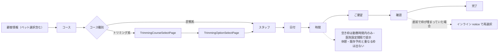

# S04: LIFF 飼主予約ジャーニー通し

> **目的**: 飼主が LINE（LIFF）から予約を完結でき、空き枠計算がシフト・休憩・既存予約を正しく反映し、予約・取消状態が病院側の取得契約へ反映され、通知は設定済み宛先へのbest-effortとして扱われることを納品前に証明する。
> **所要目安**: 25分 / **深度**: 薄い+境界
> **仕様正本**: [screens/37-line-reserve-owner-flow.md](../../../spec/screens/37-line-reserve-owner-flow.md)（画面・Vite rewrite・maintenance）。エンジン補助は [line/reservation-spec.md](../../../spec/line/reservation-spec.md)

## 前提条件

- ローカル専用 mock lane を使う。`VITE_LIFF_MOCK=true` / `LIFF_MOCK=true` は release mode では使用しない。実 LINE 通知の受信はこの lane の合格条件に含めない。
- 使い捨て clinic に LINE 予約受付中設定、公開診察コース、公開トリミングコース/オプション、担当スタッフ、対象日の勤務・休憩・既存予約境界、合成 owner/pet を承認済み fixture/import 手順で作成する。
- 病院側確認用 attached account に reception/reservations の必要権限だけを付与する。S01 のペットは使用しない。
- 実 LINE/STG lane は USER の別受入として、指定された合成 fixture と cleanup 手順がある場合だけ実施する。
- 依存シナリオ: なし。

本手順は最新業務正本への目標受入で、旧実装との突合記録は末尾の過去事実として保持する。ホテル全期間上限・担当未定保存・複数頭のペット別事前問診はLINE正本と予約管理の該当ACも確認し、本シナリオ単独で全LINE仕様を網羅したとしない。今回の改訂では実行していない。

## 手順と期待結果

| # | 操作 | 期待結果 |
|:--|:--|:--|
| 1 | LIFF 予約アプリを `/line-reserve/{clinicId}/`（末尾スラッシュ付き）で開き、新規予約を開始する | トップ（新規予約 / 予約確認）が出る。Vite rewrite が無いと `/line-reserve/{clinicId}/src/main.tsx` が 503 で白紙（BUG-402）。フローは **顧客情報→コース→[トリミング時: コース/オプション]→スタッフ→日付→時間→ご要望→確認→完了** |
| 2 | コース選択で診察系コースを選択する | マスタで公開設定された予約区分のみが表示される（`GET /api/liff/:clinicId/courses` — §2-1） |
| 3 | スタッフ選択で前提条件のスタッフを指名する | 担当医の指名、または「指名なし」（`settings.show_no_staff_option` 時）が選択できる（§2-2） |
| 4 | 日付→時間選択で当該スタッフの日を開く | 空きスロットが医院設定の間隔（既定 15 分）で表示され、勤務時間内のみ提示される（§2-3・§4 Positive。API: `available-dates` / `available-times`） |
| 5 | **境界**: スタッフの休憩時間帯の前後を確認する | 休憩時間と重なる・またがる枠が表示されない（§4 Negative）。既存予約と重なる枠も表示されない（§4 Conflict） |
| 6 | ご要望 → 予約確定（ペットは先頭 CustomerInfo で選択済み） | 予約が完了する（§2-4/§2-5）。完了メッセージ・病院受付通知は既存設定と宛先条件を満たす場合のbest-effort（§5）。通知失敗でも保存済み予約を保持し、結果不明は照合まで盲目的に再送しない。予約と通知の結果を別に示す（モック時は送信境界まで・受信確認は別STG受入。枠競合時はインラインnoticeで再選択） |
| 7 | 病院側: 予約管理のソースフィルタで「LINE予約」（value=`line`）を選ぶ | 当該予約が抽出できる（UI ラベルは「LINE予約」。§3「予約の俯瞰」） |
| 8 | 病院側: 受付カンバン（ホーム）の当日ボードを確認する | 当該予約が source=line として「受付予約」列に自動反映されている（§1・[reception-board.md](../../../spec/domains/reception/pages/reception-board.md)） |
| 9 | LIFF のマイ予約（予約確認）を開く | 手順 6 の予約が表示される（`GET /api/liff/:clinicId/my-reservations`） |
| 10 | 本人のマイ予約から来院受付前の予約を当日も含めてキャンセルし、受付後とも比較する | [受付前取消](../../../spec/line/reservation-spec.md#requirement-fr-line-reservations-owner-cancel)に従い受付前は取消可、受付後は不可。履歴と作成済み記録を保持する。旧confirmed限定UIだけで全境界対応済みとしない。通知は設定・宛先等の既存条件を満たす場合のbest-effortで、到達を取消commitの条件にしない |
| 11 | 再度日時選択を開き、手順 6 で確保していた枠を確認する | キャンセルにより枠が解放され、同じ枠が空きとして再表示される（§4 Conflict の除外要素が消えるため） |
| 12 | 新規予約でトリミング系コースを選択する | トリミング時は `TrimmingCourseSelectPage` → `TrimmingOptionSelectPage` が挿入され、コース・オプション後にスタッフへ進む（`GET …/trimming-courses` / `trimming-options`）。mock lane では認証付き API が成功し、画面遷移を継続できる |

## 確認観点

- 予約の「変更」機能と前日リマインドは未実装 — 変更導線が無いことは欠陥ではない。
- settings が `stopped` または取得エラーになった後も LIFF 初期化で Top へ戻らず、`MaintenancePage` が sticky に維持されることを回帰確認する。
- 空き枠計算はバックエンド `timeslot_engine.go`（§4 の 3 要素合算）。LIFF 認証モックは `backend/internal/middleware/liff_auth.go`。release モードでは `LIFF_MOCK=true` だと起動拒否（`backend/internal/config/config.go`: `LIFF_MOCK must not be set in release mode`）。
- FE モックフラグは `VITE_LIFF_MOCK=true`（`frontend/line-reserve/src/lib/liff-config.ts` の `LIFF_MOCK`）。ローカル `.env` と compose で BE/FE 両方を揃える。
- URL パスの clinicId と、病院側で予約が現れる医院が一致すること（clinic_id 隔離）。
- 予約確定時に枠が直前で埋まっていた場合は競合 notice が表示され再選択に戻ること（alert ではなくインライン — 異常時の無音失敗がないこと）。
- [分類別・担当者別開始時刻](../../../spec/line/reservation-spec.md#requirement-fr-line-reservations-business-start-times)を別ケースで確認する。通常診療は営業時間から自動生成し担当者別設定を反映する。トリミングは対象担当者の登録時刻だけを候補とし、勤務等が適格でも未登録時刻を営業時間由来で加算しない。設定変更後の確定時再検証・既存予約保持も正本のACへtraceする。旧加算方式は現行実装差の観察であり、目標仕様の合格条件としない。

---

## 実装突合

- 変更サマリ:
  - フローを日付/時間分割・トリミング step2b/2c を含む現行 `App.tsx` 順に更新
  - 病院側ソースフィルタ UI ラベルを「LINE予約」（value=`line`）に修正（「のみ」は無し）
  - 401 メッセージ全文・`VITE_LIFF_MOCK`/`LIFF_MOCK` release guard を明記
