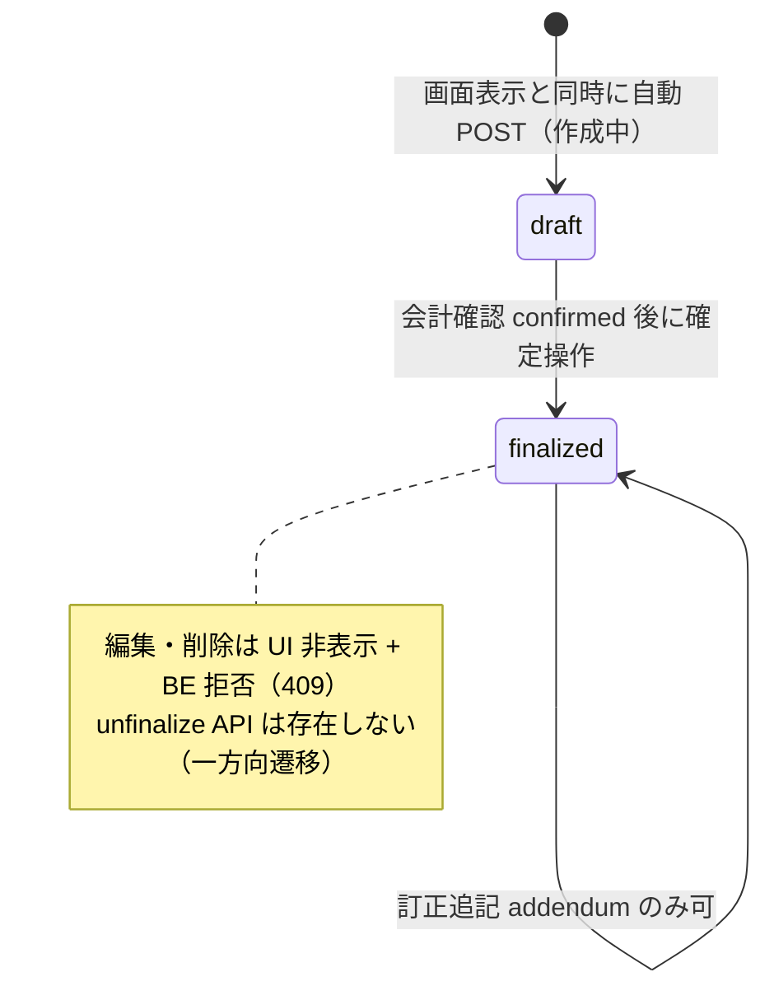

# S06: カルテ確定 Lock と監査証跡

## 現行目標の受入（2026-10-18追加合意を含む）

正本は[D03自動保存・通常編集・復元](../../../spec/domains/medical-records/lifecycle.md#medical-record-agreement-autosave-20261015)、[問診統合](../../../spec/domains/medical-records/lifecycle.md#integrated-plan-20261017)、[医師確認と会計](../../../spec/domains/accounting/lifecycle.md#doctor-review-sync-billing-20261017)。旧医師確定Lockと終了後の通常編集禁止を受入目標にしない。同一カルテの端末間同時編集禁止・ヘッダー状態・強制取得可は別の[最新編集権契約](../../../spec/domains/medical-records/lifecycle.md#medical-record-edit-exclusivity-20261018)を適用する。

| 条件 | 期待結果 |
|:---|:---|
| 問診・主訴・所見等を入力 | 治療プランへ統合したスタッフ区画で入力し、飼主事前問診は別データ・別欄で参照する。統合だけで一括保存方式へ変えず既存hybrid保存を維持 |
| 診療終了後／旧finalizedの通常カルテを通常編集 | 旧finalizedだけを理由に拒否せず、現在認可・患者／医院・現在版と必要履歴を確認して保存。以前の保存版・追記・監査を保持 |
| タブ入力クリア／履歴複製取消 | 前者はタブ開始時、後者は対象複製直前へ履歴付きで復元。飼主回答原文・他タブ・他者変更・別owner副作用を巻き込まない |
| 未実施プランがある状態で診療終了 | 警告確認後に終了可。受付は会計待ちへ、医師確認済み表示はカード上の別軸。終了だけで実施済み・請求確定・入金済みへ変えない |
| 医師確認前の会計準備 | ページを用意し「医師確認待ち・金額未確定」。請求確定・精算は確認後 |
| 医師確認後の会計変更 | 金額のみは警告了承で保存可・再確認不要。薬剤／処置の追加削除・数量変更は医師再確認まで確定・精算停止。治療プランを自動逆書換えしない |
| 検査確定・提示済見積・確定請求・実在庫 | 各ownerの独自保護を維持。通常カルテ編集可を全子記録の無制限上書きや取消許可へ一般化しない |

削除・患者取違え訂正・必要監査の対象と原子性はD03/C05の個別契約に従う。全CUD一律監査や法令適合をこのシナリオだけで宣言しない。

## 編集権の追加8条件（04:38 UTC本人承認・実機未実施）

[取得・離脱・切断・復元の正本](../../../spec/domains/medical-records/lifecycle.md#record-edit-right-lifecycle-20261018)を適用する。取得前の閲覧、他端末の保持、未送信・送信中・結果不明・保存失敗、強制取得、再読み込みを分けて試験する。以下は実行予定条件であり合格記録ではない。

| 条件ID | 操作 | 確認する結果 |
|:---|:---|:---|
| AC-medical-records-editor-view-no-acquire | 認可された同一カルテを開き閲覧する | 開くだけでは編集権を取得しない。閲覧権限だけで編集可能にしない |
| AC-medical-records-editor-explicit-start | 当該カルテ編集権限を持つ端末で「編集を開始」を操作する | 編集権の取得成立後に編集できる。他端末保持中は既存の確認付き強制取得条件を満たし、同時取得を認めない |
| AC-medical-records-editor-tab-and-idle | 編集権を持ち同じカルテのタブを移動し、単に無操作となる | 同一カルテのタブ移動と単なる無操作では編集権を解放しない。既存hybrid保存を維持する |
| AC-medical-records-editor-leave-result | 編集権を持つカルテから別画面へ移動する | 保存結果を確認してから編集権を解放する。失敗・結果不明を成功表示せず、入力保持と既存の結果照合を行う |
| AC-medical-records-editor-disconnect-stop | 未保存入力又は送信中操作のある端末が通信切断する | 入力を保持し編集・送信を停止する。切断中の遅延送信や旧端末の入力を無断適用しない |
| AC-medical-records-editor-reconnect-check | 通信切断した端末が再接続する | 現在の編集権と直前の保存結果を照合する。再接続だけで再送・編集再開せず、失権時は既存の停止・移転表示を維持する |
| AC-medical-records-editor-reload-recover | 未保存入力を保持するカルテを再読み込みする | 未保存入力を復元可能とし、現在の保存内容と区別する。再読み込みだけで自動上書き又は自動破棄しない |
| AC-medical-records-editor-reacquire-select | 未保存入力を保持した端末が編集権を再取得する | 最新の保存内容と比較し、必要な入力を明示的に選んで適用する。取得だけで自動再送・一括上書き・破棄せず、既存版競合・owner保護を維持する |

## 旧実装に対する手順・観察の記録（現行目標の受入には使用しない）

以下は変更前の実装観察と当時の手順を保持したもの。期待結果が上記の現行目標と異なる場合、上記の目標とリンク先正本を優先する。旧期待を満たすことを現行目標の合格に数えず、実装差として記録する。実行・実機合格は今回判定していない。

> **目的**: 確定（Lock）したカルテが編集・削除不可となり法的記録としての真正性が守られること、および一連の CRUD 操作が `audit_logs` に操作者・時刻付きで追跡されることを納品前に証明する。
> **所要目安**: 20分 / **深度**: 深い
> **仕様正本**: [specification.md §2.1](../../../spec/specification.md)・[domains/medical-records/pages/medical-record-list.md](../../../spec/domains/medical-records/pages/medical-record-list.md)・[domains/medical-records/pages/medical-record-form.md](../../../spec/domains/medical-records/pages/medical-record-form.md)

## 前提条件

- ローカルの使い捨て clinic に、medical-records create/edit と会計(医師確認)に必要な権限を持つ attached account、生存ペットを作成する。
- `audit_logs` の直接確認は USER が承認済み read-only 手順でローカル環境だけに対して実施する。資格情報や行内容をシナリオへ転記しない。
- 試験後に専用 fixture を削除する。
- 依存シナリオ: なし。

## 手順と期待結果

| # | 操作 | 期待結果 |
|:--|:--|:--|
| 1 | `/medical-records/new?petId=` を開く → 問診タブで主訴、診察/治療プランタブで所見・診断名を保存 | 表示と同時に draft が自動 `POST` され URL が `/medical-records/:id` に昇格する。保存はタブ別（問診=`/inquiries`、診察=`/clinical-plan`）。一覧に「作成中」で出る |
| 2 | 「治療」タブで処置明細を 1 件追加する | 明細は行単位で即時保存される（[06 §2.2](../../../spec/domains/medical-records/pages/medical-record-form.md)） |
| 3 | カルテ本体（主訴等）を変更して再保存する。続けてヘッダーの来院種別を保存ボタンなしで変更し再読込する | タブ保存は成功する。来院種別は即時 PATCH + 詳細キャッシュ invalidate で再読込後も残る。appointment 紐付き通常カルテの診療日変更は BE Conflict |
| 4 | 会計確認前に「確定する」を確認し、その後「会計(医師確認)」を完了してから確定（Lock）する | 会計確認の loading/error/未確認時は fail-closed で disabled、title は「会計確認が未完了です」。会計確認が `confirmed` になった後だけ確定ダイアログを開ける。確定後はステータスが `finalized`、確定済みバナーが表示され、ボタンは消える |
| 5 | 確定済みカルテを開き、属性を変更して保存を試行する | 主要タブは fieldset 一括無効（`isFinalized` または `!canSubmit` — [06 §2.3](../../../spec/domains/medical-records/pages/medical-record-form.md)）。保存ボタンも disabled。直接 API 更新は 409: 「確定済みカルテは編集できません。訂正追記 (addendum) を使用してください」（`medical_record_crud.go`） |
| 6 | 確定済みカルテの削除導線を確認する | **詳細**: `canDelete={canDelete && !isFinalized}` のためフローティング「削除」は出ない。**一覧**: 現行 UI は確定済でも canDelete なら「削除」メニューが出うる — 実行時 BE が拒否する（draft 以外は削除不可）。直接 API: 「確定済みまたは下書き以外のカルテは削除できません」（[05 §3.1](../../../spec/domains/medical-records/pages/medical-record-list.md)） |
| 7 | 確定済みカルテの各タブ下部「追記する」から訂正追記（addendum）を行う（修正内容・修正理由が必須 — `AddendumModal`） | 保存後、時刻・スタッフ ID 付きの時系列リストとして表示され、リロード後も永続する。バリデーション失敗後も入力済み側は消えない（controlled）。未確定カルテでは追記セクション自体が非表示 |
| 8 | 確定の解除（確定済 → 作成中へ戻す）を試行する | 解除（unfinalize）API はバックエンドに存在しない（`medical_record_crud.go` に該当メソッドなし）。確定は一方向遷移であり、確定後の修正経路は訂正追記（addendum）のみ。解除機能が必要な場合は GAP-1 とは別に要件を起票する |
| 9 | 手順 1〜4 の操作について `audit_logs` を DB で確認する（**USER 実施**。例: resource がカルテ関連の行を時刻降順で参照） | 確定（finalize）は本体と同一 TX で fail-closed に残る。作成・通常更新は best-effort（欠落しても本体成功を失敗にしない）。全テーブル自動監査ではない（[specification.md §2.1](../../../spec/specification.md)） |

**カルテの状態遷移**（手順 4〜8 と確認観点の概要）:

## 確認観点

- 確定ロックは DB 制約ではなくサービス層のガード（`backend/internal/medicalrecord/medical_record_crud.go` — [05 §3.1](../../../spec/domains/medical-records/pages/medical-record-list.md)）。UI ステータス: 作成中=`draft` / 確定済=`finalized`。
- 所見・診断（clinical-plan）の Update/Delete は確定と同じ親行ロックを使い、監査失敗時は同じ transaction で rollback する。`clinical_plan_finalize_concurrency_test.go` は独立 PostgreSQL transaction の child-first / finalize-first を検証する。ブラウザの逐次操作だけで競合を再現済みとはしない。
- 子エンティティ（治療・検査・バイタル等）の書込と確定処理は行ロックで直列化される（`LockByIDForUpdate`。確定と同時書込のレースで確定済みカルテに子データが混入しないこと）。
- カルテ確定（finalize）・訂正追記（addendum）の監査は本体操作と同一トランザクションで fail-closed に記録され、監査失敗時は本体操作もロールバックされる。カルテ作成（create）・通常更新（update）の監査は臨床継続性のため best-effort を維持する（`medical_record_crud.go`・`medical_record_addendum_service.go`）。削除監査も best-effort。
- 会計完了によるカルテの自動確定は存在しない（[06 §2.3](../../../spec/domains/medical-records/pages/medical-record-form.md)）— 確定は明示操作のみ。
- カルテ一覧のステータスフィルタ（作成中/確定済）で確定後の当該カルテが抽出できること（[05 §1.1](../../../spec/domains/medical-records/pages/medical-record-list.md)）。
- フローティング「削除」は問診タブかつ未確定時のみ（詳細）。一覧の削除メニューは確定状態で隠していない点に注意（BE が最終防衛）。

## 異常系

| # | 操作 | 期待結果 |
|:--|:--|:--|
| A1 | 確定済みカルテの「治療」タブで明細の追加・削除を試行する | UI 上は `<fieldset disabled>` によりタブ内の追加/削除ボタンが無効化され操作できない（[06 §2.3](../../../spec/domains/medical-records/pages/medical-record-form.md)）。直接 API を叩いた場合、治療（`treatment_service.go`）・検査・バイタル・処方・健診・画像の各子リソースはバックエンド側でも確定済み親カルテへの書込を拒否する |
| A2 | medical-records の edit 権限を持たないロールで確定済み/作成中カルテを開く | 保存操作が権限制御で不可（[06 概要](../../../spec/domains/medical-records/pages/medical-record-form.md): 保存可否はコンポーネント内の権限制御）。fieldset は `!canSubmit` でも disabled |

---

## 実装突合

- 変更サマリ:
  - 確定ダイアログ文言を実装全文に更新
  - 編集拒否メッセージに addendum 誘導句を追加（409）
  - 削除拒否メッセージを「確定済みまたは下書き以外のカルテは削除できません」に修正
  - 一覧は確定済でも削除メニューが出うる / 詳細は非表示、と UI 差を明記

## 同一カルテ編集権の追加受入

業務正本の16AC（従来8AC＋04:38 UTC承認8AC）に従い、他端末同時編集拒否とヘッダー、閲覧/別カルテへの非拡張、編集権側のhybrid保存、強制取得可を確認する。強制取得後の編集/保存停止・権利移動表示・未保存入力保持/自動上書き禁止と旧端末遅延保存の拒否も確認する。当該カルテ編集権限を持つ一般スタッフの確認付き取得、閲覧のみ/認可外の拒否、確認取消時に非取得で元端末を止めないことも確認する。取得契機・通常解除・切断時停止と復帰照合・再読み込み復元・再取得後の比較選択適用は上記04:38 UTC承認を適用する。API・失効方式・保持方式/場所/期限・比較選択UIなどの技術方式は未選定であり、旧finalized試験やブラウザの逐次操作を編集権試験の合格へ流用しない。実機未実施。
