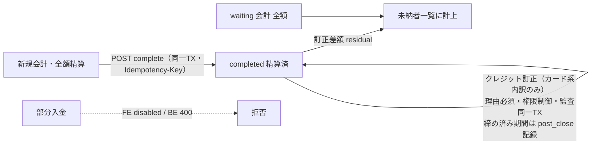

# S08: 会計訂正系（クレジット訂正・未収金）

> **目的**: 確定後のカード金額訂正が理由必須・権限制御・監査記録つきで機能すること、および未納が waiting 全額とクレジット訂正 residual の両方から把握できることを証明する。部分入金 UI は現行では拒否される。
> **所要目安**: 25分 / **深度**: 深い
> **仕様正本**: [会計一覧](../../../spec/domains/accounting/pages/accounting-list.md) / [会計精算](../../../spec/domains/accounting/pages/accounting-settlement.md) / [未納者一覧](../../../spec/domains/accounting/pages/unpaid-list.md) / [レジ締め業務](../../../spec/cash-register.md)

## 前提条件

- ローカルの使い捨て clinic に合成 owner/pet と attached account を 2 つ作成する。正例アカウントは accounting 操作、`accounting-post-close-edit:edit`、cash-register-close を持ち、負例アカウントは post-close edit を持たない。
- 本シナリオで作成する全会計を同じ合成 owner に紐付ける。自動 seed の役割名・会計データを仮定しない。
- append-only 会計/締め記録を含むため、専用 clinic/date と cleanup/破棄手順が確認できない環境では BLOCKED とする。

## 手順と期待結果

| # | 操作 | 期待結果 |
|:--|:---|:---|
| 1 | 「新規会計登録」から検証用飼主の会計（1 件目）を作成し、手動項目を追加して支払方法「クレジットカード」で全額精算・確定 | 会計一覧でステータス「精算済」（`ACCOUNTING_STATUS_LABELS.completed`）、支払方法にカードが表示される。新規確定は `POST /api/v1/accountings/complete`（BUG-018 原子 complete・Idempotency-Key 付き） |
| 2 | 当該会計の詳細 `/accounting/:id` でクレジット訂正の導線を開き、訂正理由を空のまま実行 | 「訂正理由を入力してください」と表示され、訂正は実行されない（`CreditCorrectionDialog`） |
| 3 | 訂正理由を入力し、カード金額を変更して訂正を実行 | 訂正後の金額が会計に反映される。ダイアログに「訂正理由は監査ログに記録されます」の説明があること。API は `POST /api/v1/accountings/:id/credit-correction` |
| 4 | 会計一覧へ戻り、1 件目の行を確認 | 訂正後の金額・支払方法（カード）で表示され、ステータスは「精算済」のまま |
| 5 | 権限グループ「一般」のスタッフでログインし直し、同じ会計詳細を開く | クレジット訂正の導線が表示されない |
| 6 | 「執行」で再ログインし、同じ飼主の会計（2 件目）を作成。請求額より少ない現金額のみ入力して保存（部分入金） | **部分入金は現行 UI/BE とも拒否**: `PaymentCard` は `remaining !== 0` で確定 disabled。すり抜けても BE が合計不一致で 400 |
| 7 | 会計一覧の「未納者一覧」タブ（`?tab=unpaid`）を開く | 期間未指定でも JST 当月で API が発火する（空のまま「未納者はいません」にしない）。手順 3 のクレジット訂正 residual が未納として載る（`unpaidAmountSQL > 0`。waiting 全額 + completed の訂正差額） |
| 8 | 検証用飼主の 1 件目の会計詳細を開く | クレジット訂正 residual がある場合、未納残高カードと未納者一覧の金額が一致する |
| 9 | 未納者一覧から 1 件目へ遷移する | 詳細が開き、訂正後の残額を確認できる。部分入金で作った 2 件目は存在しない |
| 10 | 対象日の該当区分（1 件目の完了時刻が属する区分）のレジ締めを確定した後、1 件目のクレジット訂正を理由つきで再実行 | 訂正は成功し、締め済み期間への訂正（締め後訂正）として区別記録される（確認観点参照） |

**訂正と未収金の構成**（手順 1〜10 と確認観点「未収金の定義」の概要）:

## 確認観点

- **監査証跡（fail-closed）**: クレジット訂正は監査ログと同一トランザクションで記録され、監査記録に失敗すると訂正ごとロールバックされる（`backend/internal/billing/accounting_service_correction.go` / SOLO-03）。#10 の締め後訂正は監査メタデータに `post_close: true` と対象日が記録される（#189）。
- **訂正対象の限定**: 訂正できるのはカード系（`credit_card`・`electronic_money`）の内訳のみ。現金の誤りは別フロー（お釣り上書き #188）の管轄で、本訂正機能の対象外。
- **権限の分離**: 訂正導線は「確定済み（completed）かつ accounting-post-close-edit の edit 保有」でのみ表示される（BE: `POST /accountings/:id/credit-correction` が同権限を要求）。
- **未収金の定義**: waiting 全額に加え、クレジット訂正由来の completed 差額（residual）も含む。部分入金 UI は無いが、#3 の訂正後に未納タブで突合できる。
- **精算済み再保存**: 詳細は「精算済みの会計を修正します」ConfirmDialog を出してから保存する。締め済み日の新規 `POST /accountings/complete` は `post_close_reason` を FK より先に見る。
- **医院横断時の訂正対象**: 訂正リクエストはグローバル選択医院ではなく会計自体の医院に対して送られる（`frontend/src/features/accounting/api/correct-credit-payment.ts`、X-Clinic-ID 明示指定）。医院横断で開いた会計でも誤テナントへ書き込まれないこと。
- **原子 complete（BUG-018）**: 新規精算は `completeAccounting` → `POST /v1/accountings/complete`。明細・支払・監査を同一 TX で確定し、Idempotency-Key で再送を安全化する。#1 の成功時に一覧が「精算済」になること。
- **支払方法 rename 回帰（#197）**: 標準行は表示名を変更しても `system_key` で解決され、精算・現金集計から消えないこと（V04 支払方法マスタと連携）。#6〜#9 の部分入金統合経路は現行 UI では実行できない。

## 異常系

- **理由なし訂正**: #2 で検証（クライアント側の必須制御に加え、API も理由必須のためすり抜け不可）。
- **締め済み期間の通常編集**: 締め済み期間の会計を通常の編集で再保存する場合も修正理由（`post_close_reason`）の入力（必須）が要求され、監査ログに記録される（仕様正本 11 §2.1・#115）。警告表示の検証は S09 #8 で行う。

## 実装突合
- 変更:
  - 精算経路を `POST /accountings/complete`（BUG-018 原子 complete）として明記
  - 部分入金拒否を FE `remaining !== 0` + BE `validatePaymentSplits` で再確認
  - クレジット訂正 API パス・カード系 method・未納定義（waiting）を現行実装に合わせて整理
  - 監査 fail-closed / X-Clinic-ID 医院横断は変更なし

## 現目標への手順別接続（2026-10-19・未実行）

上の目的・図・手順・実装突合は旧実装の観測を含む。現在の業務合格条件は[会計ライフサイクル](../../../spec/domains/accounting/lifecycle.md)と[現目標のAC実行準備](../../../design/domains/accounting/technical-spec.md#finance-ac-execution-trace-20261019)へ従う。部分入金拒否、completedだけの完済判定、名称「一般/執行」を現在の権限として決め打つこと、取消と実返金の一体化を合格条件にしない。旧回帰として確認した結果と、以下の新契約への適合結果を別記する。本節は実施結果ではない。

| 旧手順 | 現目標として追加する操作・fixture | 対応する既存AC短名・検査先 | 必要な証跡/停止 |
|:--|:--|:--|:--|
| #1 | 全額カードは対照例。10,000請求で未納/3,000部分入金、実明細あり0円、空明細を別に作る。医師未確認/確認済みを分ける | unpaid-finalize / partial-finalize / zero-no-fake-payment / empty-invoice-blocked / before-doctor-review、V02 §1 | 請求状態・支払状態・明細・実受領・残・医師確認/確定履歴。API未対応ならBLOCKED |
| #2 | 理由なし/現在grantなし/失効/他医院の訂正・取消・返金を各検査 | correction-authorization、C04現在認可、V02 §3–4 | 元値不変・拒否結果。監査失敗rollbackは承認済み実API/DB試験で別証跡 |
| #3 | 金銭を動かさない方法誤記、請求10,000→9,000訂正、実返金を別操作で確認 | payment-method-correction-no-money / paid-reduction-refund-pending / paid-reduction-actual-refund | 元請求・元受領・方法/実日付・履歴・未払/返金必要/実返金を別に照合 |
| #4 | 訂正後の一覧/詳細を同対象版で再取得し、精算済labelだけで完済扱いしない | partial-paid-reduction / correction-history / finalization-undo-preserved | 請求/支払/残額/返金必要/確定歴の別軸、旧応答の遅延不採用 |
| #5 | 実対象操作grantあり/なし、開始後失効、別clinicを分離して操作 | correction-authorization、C04現在認可 | 職種名で代用しない。UI非表示とserver拒否を別記 |
| #6 | 現金5,000/請求8,000→入金5,000/残3,000、後日回収。部分入金拒否は旧観測としてだけ保持 | partial-finalize / later-payment / manual-change-preserves-partial-and-noncash | 部分受領/配分/残と確定履歴、架空0円入金なし。未対応は実装差 |
| #7 | 今月売上なしの繰越未納、期間未指定、対象月/基準日、非入金調整を表示 | aged-debt-without-current-sales / unpaid-default-period、AC-unpaid-source-month/reconcile | API発火だけで完了にせず、同scope全ページ・cutoff・4列/調整・次月連続性を確認 |
| #8 | 同じ元請求・医院/owner範囲で一覧/残高カード/詳細を突合 | owner-unpaid-summary / refund-received-cap | 未払と返金必要を区別し、失敗/不完全を0件0円としない |
| #9 | 元会計への遷移と検索条件復帰。作成した部分入金会計へ到達 | partial-finalize / old-bill-collection、一覧/詳細契約 | 旧「部分入金会計不存在」を現目標へ流用しない |
| #10 | AMのみ締め/PM未締め、対象区分訂正、同操作再送、実返金を独立確認 | post-close-preserve / correction-no-cash-movement / original-bill-and-movement-date、S09/S21 | 原close不変・差分・実日付・同一receipt、確定済会計の訂正理由は区分とは別検査 |

AC短名は`AC-accounting-`に続く既存識別子。異常系は上表各操作の必須理由、現在認可、監査失敗、期待版競合、同key別内容、初回commit後応答消失、未検出中遅延commitを個別記録する。支払方法rename/停止は安定識別と元履歴を保ち、新受領だけを停止する。医院横断で開いた元会計の医院を使い、画面のグローバル選択で書込先を付替えない。
