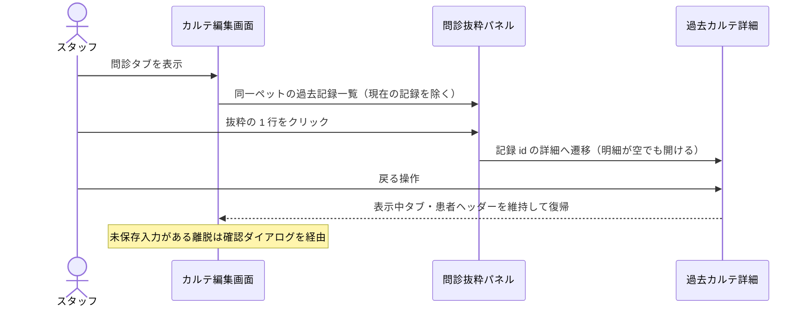

# S16: 問診抜粋 → カルテ詳細への履歴導線

> **目的**: カルテ編集画面の治療プラン内の過去履歴欄から同一ペットの過去カルテ詳細へ遷移し、戻っても文脈が失われないこと、および処置が未移行の古い記録でも詳細を開けることを納品前に証明する。
> **所要目安**: 10分 / **深度**: 薄い
> **仕様正本**: [domains/medical-records/pages/medical-record-form.md](../../../spec/domains/medical-records/pages/medical-record-form.md)・[domains/medical-records/pages/medical-record-list.md](../../../spec/domains/medical-records/pages/medical-record-list.md)。検証キュー: `UAT-Q2-HISTORY-NAV`（[todo-verification.md](../../../../todo.md#verification-ledger)）。

## 前提条件

- ローカルの使い捨て clinic、または承認済みの専用 UAT tenant。
- 同一ペットに複数件のカルテ（少なくとも 2 件、うち 1 件は治療明細が空または未移行の記録）を持つ fixture。固定 ID は仮定しない。
- actor は medical-records の参照権限を持つ attached account。
- 依存シナリオ: なし。問診の保存自体は S27（主訴）・V01 を参照する。

## 現行目標の受入手順（2026-10-19 文書接続・未実行）

[統合の既決正本](../../../spec/domains/medical-records/lifecycle.md#integrated-plan-20261017)に従い、問診と既存右側の過去カルテ履歴欄は治療プランへ統合する。独立した問診タブの維持を合格条件にしない。以下は目標受入であり、統合の実装完了・今回の実機PASSを示さない。

| # | 操作 | 期待結果 |
|:--|:--|:--|
| T1 | 対象ペットのカルテ編集で治療プランを開き、入力しながら過去履歴を参照する | 同一ペットの履歴を同時参照でき、別タブへの切替を要求しない。選択コピーと既存のコピー安全条件を維持する |
| T2 | 過去履歴の行から詳細を開き、戻る。明細未移行・空の記録でも繰り返す | 同一ペットの対象記録へ遷移し、元の入力文脈・患者ヘッダーを失わず復帰する。未移行明細だけで詳細が開けなくならない |
| T3 | 入力中の離脱・コピー取消を確認する | [D03入力保護の正本](../../../spec/domains/medical-records/lifecycle.md#medical-record-agreement-autosave-20261015)に従う。保存中・失敗・結果不明を成功とせず、飼主原文や他者版をスタッフのクリア・履歴複製へ巻き込まない |

## 旧実装の照合手順と期待結果（変更前の観測記録）

以下の問診タブ・コンポーネント・図は当時の実装観測を保持したもの。旧版との回帰比較に使う場合は対象refを実行記録へ残し、上の統合目標の受入とは別に記録する。過去のPASSを統合後UIのPASSへ読み替えない。

| # | 操作 | 期待結果 |
|:--|:--|:--|
| 1 | 対象ペットのカルテ編集を開き、問診タブを表示する | 右パネル等に「問診抜粋」として同一ペットの過去記録一覧が出る（現在の記録を除く） |
| 2 | 抜粋の 1 行をクリックする | その記録のカルテ詳細/編集へ遷移する（`InterviewHistory` の `paths.medicalRecords.detail.getHref(item.id)`）。別ペット・別記録へ飛ばない |
| 3 | ブラウザの戻る、または画面内の戻る操作で戻る | 元のカルテ編集画面へ戻り、表示中のタブ・患者ヘッダーが維持される。未保存入力があれば `NavigationBlocker` が離脱確認を出す |
| 4 | 治療明細が空（または未移行）の過去記録の抜粋行をクリックする | 明細が空でも詳細画面は開け、エラー・真っ白画面にならない。空の治療タブは空状態として表示される |
| 5 | 別のペットのカルテで同じ操作をする | そのペット自身の履歴だけが抜粋に出る。他人・他ペットの記録が混ざらない |

履歴導線の往復:

## 旧実装の確認観点（履歴）

- `InterviewHistory`（`frontend/src/features/medical-records/components/`）の各行は `paths.medicalRecords.detail.getHref` で詳細へリンクする。履歴パネルの見出しは「問診抜粋」。
- 処置未移行の記録でも詳細が開けることは `UAT-Q2-HISTORY-NAV` の必須条件。治療明細の移行完了を意味しない（旧列→canonical 移行は `UAT-Q2-TREATMENTS-IMPORT` の別ゲート）。
- 戻る操作で未保存変更を捨てさせないことは [13 §2.3](../../../spec/screens/13-examinations-form.md) と同じ `NavigationBlocker` パターン。dirty 状態での離脱は確認ダイアログを経由する。
- 他人のカルテが履歴に混ざる場合は FAIL（`todo.md#product-bugs` で重複確認のうえ Plane 追跡。2026-09-29 訂正: Linear 追跡 → Plane 追跡。Linear は 2026-09-16 に閉鎖済みで実行 SoT は Plane `baritechllc`/`EMR`）。行が空で出ないだけなら fixture 不足の可能性を先に切り分ける。

## 旧実装突合（履歴・今回再実行なし）

- 変更サマリ:
  - `InterviewHistory` のリンク先 `paths.medicalRecords.detail.getHref` と「問診抜粋」見出しを現行コードと突合
  - `UAT-Q2-HISTORY-NAV` の「同一ペット行→詳細→戻る」「処置未移行でも開ける」を手順 2–4 に対応づけ
  - 未保存保護（`NavigationBlocker`）を手順 3 に組み込み、履歴導線と編集保護の併存を確認する形にした
  - 2026-09-29 訂正: 確認観点の「Linear 追跡」→ Plane 追跡（Linear 閉鎖済み）
