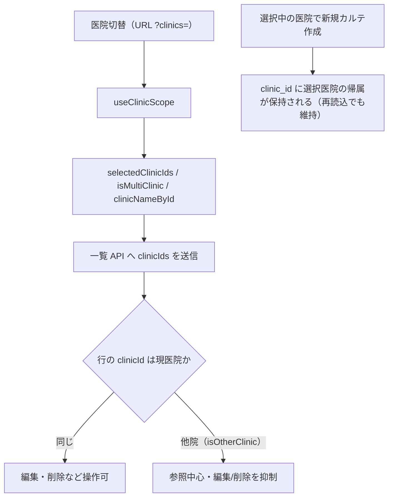

# S23: 複数医院所属 — 医院スコープと他院操作の境界

> **目的**: 複数医院に所属する actor が医院切替（`?clinics=`）で一覧を正しく絞り込み、認可された共通患者の自院利用と院別記録の操作認可を分け、非第一所属の医院で作成したカルテの帰属（`entered_by_clinic`）が正しく記録されることを納品前に証明する。
> **所要目安**: 20分 / **深度**: 深い
> **仕様正本**: [specification.md §1.1](../../../spec/specification.md)・[screens/03-owners-list.md](../../../spec/screens/03-owners-list.md)・[domains/medical-records/pages/medical-record-list.md](../../../spec/domains/medical-records/pages/medical-record-list.md)。関連 tracker: `BUG2-MR-ENTERED-BY-CLINIC`・`SLACK-CROSS-CLINIC`（旧裁定待ち表記は下記の既決／設計残件へ訂正）・Plane 他院検索調査。

## 前提条件

- ローカルの使い捨て環境で、actor が所属する **2 つ以上の clinic**（A = 第一所属、B = 別所属）と、actor が**所属しない** clinic C を用意する。
- clinic A/B にそれぞれ owner/pet/カルテのfixtureを用意し、同じ日付・検索条件でAのみ／Bのみ／A+Bの期待する行ID・件数・医院名を先に整理する。固定ID・汎用seedは仮定しない。
- actor は両医院で必要な権限（ownersの参照、自院利用・受付、medical-recordsの参照・作成等）を持つattached account。作成時の入力者は作成先医院Bで有効な所属を持つ。変更・拒否の確認には操作に対応する既存権限と医院・患者認可を適用する。
- 他院既存患者の自院利用は下記の正本で採用済み。旧手順は当時の医院スコープ実装の観測であり、未決の業務仕様として扱わない。
- 試験後に作成した fixture を削除する。
- 依存シナリオ: S14（検索 AND と医院スコープ）・S13（identity-links）。

## 手順と期待結果

### 現行目標・既決と設計残件（2026-10-19 文書接続・未実行）

- [共通患者の既決正本](../../../spec/domains/owners-pets/lifecycle.md#common-owner-pet-20261017)：他院の既存患者を選び「自院でも利用する」操作で自院の受付・カルテ作成へ進める。自院利用のための飼主重複登録を要求しない。基本情報は共通最新、院別診療記録・請求・預り金の帰属は独立保持する。
- [一覧初期値の正本](../../../spec/shared/ui-contracts.md#list-filter-contract-20261017)：飼主・ペット一覧とカルテ履歴の初期値は閲覧権限内全医院、選択を次回保持し、権限喪失医院を保存済み選択から除外する。空・不正なURL条件を認可外表示につなげず、現医院限定を新目標の一律初期値にしない。
- 所属医院・操作権限・対象患者認可を維持し、未認可医院の診療記録を公開しない。認可された共通患者の自院利用を、旧「他院行一律操作禁止」で阻害しない。院別記録の閲覧・変更認可と自院利用は別に検証する。
- 残るのは共通基本情報／院別利用の内部ID対応、既存重複の移行、共有ID方式、手動link/unlink等の技術設計・移行検証。物理統合や過去請求移管を独断で採用せず、採用済みの自院利用を「PO裁定待ち」へ戻さない。

| # | 目標の確認 | 期待結果 |
|:--|:--|:--|
| T1 | 選択未保存で飼主・ペット一覧／カルテ履歴を開き、次に医院を選択して再度開く | 初回は閲覧権限内全医院、次回は保存済みの権限内選択。未認可医院は出ない |
| T2 | 他院の既存患者を選び、自院利用から受付・カルテ作成へ進める | 重複登録せず自院の記録を作成でき、各院の診療・金銭の帰属は保持される。共通基本情報変更で過去原本を自動書換えしない |
| T3 | 権限喪失や認可外医院のURL指定、操作認可のない他院記録への変更を試みる | 保存済み選択からも権限喪失医院を除外し、対象医院・患者・操作の既存認可で拒否する。自院利用の成功を他院記録の自由編集へ拡張しない |
| T4 | カルテ一覧で日付・検索条件を同じに保ち、Aのみ→Bのみ→A+Bへ切り替える | AのみではAの行、BのみではBの行、A+Bでは両院の行が、準備したfixtureの行ID・期待件数どおりに表示される。各行の医院を区別でき、選択の記憶だけで表示検証を完了しない |
| T5 | 非第一所属のBを作成先として明示選択し、Bで新規カルテを作成して再読込する | `clinic_id`はBのままで第一所属Aへ上書きされず、`entered_by`はBで所属検証された入力者を示す。再読込後も帰属・入力者を保持し、T2の自院利用を作成先が曖昧な確認で済ませない |

上記は目標受入であり、内部ID方式の選定・実装・今回の実機合格は未確認。以下の旧実装観測・過去結果とは分離する。

### 旧実装の手順と期待結果（変更前の観測記録）

当時の「現医院」初期値・他院行抑制を保持する。旧版の回帰比較に使う場合は対象refと医院条件を実行記録へ残し、現行目標の受入へ流用しない。

| # | 操作 | 期待結果 |
|:--|:--|:--|
| 1 | カルテ一覧を開き、医院を clinic A のみにする | clinic A のカルテだけが出る。URL は `?clinics=` を反映し、単一の現在医院選択では `clinicIds` を送らない（`useClinicScope` 既定） |
| 2 | 医院トグルで clinic B（非第一所属だが所属はある）を選択する | URL が `?clinics=clinicB` に変わり、その `clinicIds` が API へ送られて B のカルテだけが出る |
| 3 | clinic B のカルテ行を開く | 他医院行は `isOtherClinic` で編集・レポート・削除が抑制され、参照中心になる。行の `clinicId` が医院名で表示される（`clinicNameById`） |
| 4 | clinic B を選択した状態で新規カルテを作成する | 所属が確認された医院 B でカルテが作られ、レコードの `clinic_id` が現医院 A に置き換わらず B のまま記録される（`BUG2-MR-ENTERED-BY-CLINIC` の修正後挙動）。`entered_by` は B でのスタッフ所属が検証される（`AssertEnteredByActor`）。再読込で帰属が保持される |
| 5 | 医院を複数（A+B）選択する | `isMultiClinic` で両医院のデータが出る。各行の医院が区別できる |
| 6 | 飼主一覧・他の一覧でも同じ `?clinics=` スコープが効くことを確認する | 医院スコープは `useClinicScope` 経由で画面横断。画面ごとに勝手な絞り込みにならない |

医院スコープの経路と他院行の扱い:

## 確認観点

### 現行目標（未実行）

- T1の初期値・選択保持、T4の返却行・件数・医院表示、T5の保存後帰属・入力者を別々に確認する。URLや選択UIが変わっただけでAPIの医院絞込・保存が正しいとは判定しない。
- 自院利用で共通基本情報を使えることと、院別の診療・金銭記録の認可を分離する。旧他院行一律禁止を新目標に戻さず、対象医院・患者・操作の認可外変更は拒否する。
- 最新目標は未実行である。旧実装照合や過去PASSを今回の受入へ転用せず、実行時は対象ref・医院条件・期待件数・保存後再読込の結果を別途記録する。

### 旧実装の確認観点（履歴）

- 医院スコープは `useClinicScope`（`frontend/src/hooks/`）が `?clinics=` → `selectedClinicIds`・`isMultiClinic`・`assignedClinics`・`clinicNameById` を提供する。クライアント側フィルタだけで他医院を隠す設計ではない。
- 他院行の操作抑制は `MedicalRecordsListPanels` の `isOtherClinic`（record.clinicId ≠ currentClinicId）で編集/削除等を抑止する。参照は許容、変更は現医院のみという現行仕様。
- カルテの `clinic_id` 帰属の保持は `BUG2-MR-ENTERED-BY-CLINIC` の修正対象。`entered_by` はスタッフ ID（FK）で、`AssertEnteredByActor` がそのレコードの医院でのスタッフ所属を検証する。非第一所属で作成しても帰属が現医院に上書きされないことを再読込で確認する。
- 当時の `SLACK-CROSS-CLINIC` はPO裁定待ちと記録されていた。現在は上記の自院利用・認可維持が既決であり、旧版観測と残るID／移行設計を分ける。
- API 直叩きで所属外の `clinic_ids` を送った場合の拒否は L2 認可の範囲。ここでは UI 経路のスコープと帰属を主対象とする。

## 異常系

### 現行目標（未実行）

| # | 操作 | 期待結果 |
|:--|:--|:--|
| T-A1 | 未所属／未認可のCをURLへ指定する、または保存済み選択の権限を失った状態で開く | Cや権限喪失医院のデータを返さず、選択保持による認可の迂回を許さない。API拒否の証跡はUI非表示と分ける |
| T-A2 | 共通患者を自院利用した後、操作認可のない他院診療記録の編集・削除を試す | 自院利用の成立にかかわらず既存認可で拒否し、元記録を変更しない |
| T-A3 | Bを作成先として入力中に医院をAへ切り替える | 対象医院・患者・入力者・編集権と保存結果を照合し、Bの入力をAへ黙って再送・保存しない。未保存・保存中・失敗・結果不明を区別し、入力を無断で失わせない |
| T-A4 | 医院URL条件を空・不正値にして開く | 未認可医院を公開せず、上記の正本と権限内の保存済み選択・初期値へ従う。旧「常に現医院へ」の期待を流用しない |

### 旧実装の異常系（履歴）

| # | 操作 | 期待結果 |
|:--|:--|:--|
| A1 | URL の `?clinics=` に所属しない clinic C の ID を直接入れて開く | clinic C のデータは返らない/表示されない（サーバー側で所属を検証）。UI が勝手に他院を見せない |
| A2 | 他医院行で編集・削除を試みる（ボタンが出ていれば押す） | 抑止される（非活性または拒否）。他院データを変更できない |
| A3 | clinic B でカルテ作成中に医院を A に切り替える | 編集中のデータを失わない（`NavigationBlocker` 等）か、明確に破棄される。半端な帰属のカルテが残らない |
| A4 | `?clinics=` を空・不正値にして開く | デフォルト（現医院）へ安全にフォールバックし、全医院が見える状態にしない |

## 旧実装突合（履歴・今回再実行なし）

- 変更サマリ:
  - `useClinicScope` の `?clinics=` / `selectedClinicIds` / `isMultiClinic` / `assignedClinics` / `clinicNameById` を現行コードと突合
  - `MedicalRecordsListPanels` の `isOtherClinic` による他院行抑制と、単一非現在医院選択時の `clinicIds` 送信を現行コード・テストと突合
  - `BUG2-MR-ENTERED-BY-CLINIC` の帰属保持（`clinic_id` + `entered_by` 所属検証 `AssertEnteredByActor`）を手順 4、`SLACK-CROSS-CLINIC` の当時の PO 裁定待ちを記録（現在の既決と設計残件は冒頭で分離）
