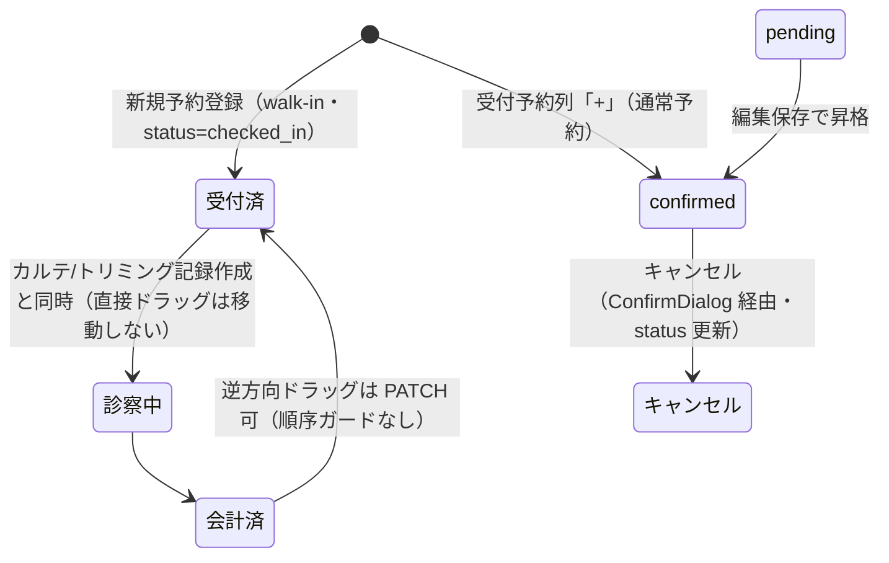

# V02: 会計・予約・受付・在庫系フォーム検証（入力・更新・DB整合）

> **目的**: 会計精算・明細追加・クレジット訂正・返金・レジ締め・見積・予約・受付・シフト・休診日・**在庫**の各入力フォームについて、入力検証（必須・形式・境界）・更新の永続化・DB 整合（FK 選択肢・一意制約）が実機ブラウザ経由で正しく機能することを納品前に証明する。
> **所要目安**: 110分 / **深度**: フォーム検証 + **項目単位 F プロトコル**
> **フォーム数**: inventory 再構築中のため算定保留。全フォーム完了はまだ主張しない。
> **項目単位**: [FIELD-LEVEL-PROTOCOL.md](FIELD-LEVEL-PROTOCOL.md) + [FORM-FIELD-INVENTORY.md](FORM-FIELD-INVENTORY.md) §V02。C1 は入口に過ぎず、**inventory の全 fieldKey に F0–F6 を適用**して完了とする。
> **仕様正本**: [domains/accounting/pages/accounting-settlement.md](../../../spec/domains/accounting/pages/accounting-settlement.md)・[screens/29-closing-aggregation.md](../../../spec/screens/29-closing-aggregation.md)・[screens/23-estimate-form.md](../../../spec/screens/23-estimate-form.md)・[domains/reservations/pages/reservation-management.md](../../../spec/domains/reservations/pages/reservation-management.md)・[domains/reception/pages/reception-board.md](../../../spec/domains/reception/pages/reception-board.md)・[screens/24-shift-calendar.md](../../../spec/screens/24-shift-calendar.md)・在庫は `frontend/src/features/inventory`

## 前提条件

- ローカルの使い捨て clinic に、accounting/post-close-edit/estimates/reservations/shifts/inventory の必要権限を持つ attached account と合成 owner/pet/master を作成する。
- 作成データは `V02` 接頭辞を使う。レジ締めは append-only のため、専用 clinic/date、hostname/environment fail-closed check、破棄手順が揃わなければ BLOCKED。共有 STG では実施しない。
- settings マスタフォームは V04 の対象。本シナリオでは FK fixture の供給元としてのみ扱う。

## 共通チェック手順

各フォームのセクションで (C1)(C2)(C3) を参照する。加えて **[FIELD-LEVEL-PROTOCOL.md](FIELD-LEVEL-PROTOCOL.md) の F0–F6 を inventory 全項目に適用**する。フィールド・境界値・一意制約は各セクションおよび inventory の指定に従う。

**C1 入力チェック**

| # | 操作 | 期待結果 |
|:--|:--|:--|
| C1-1 | 必須欄を空のまま保存 | 保存されず、エラーが表示される |
| C1-2 | 代表的な形式違反（型/文字数/日付/金額）を入力して保存 | 拒否され、保存されない |
| C1-3 | 境界値 1 件（各セクション指定） | 境界内は受理、境界外は拒否 |

**C2 更新チェック**

| # | 操作 | 期待結果 |
|:--|:--|:--|
| C2-1 | 既存レコードを編集して保存 | 詳細・一覧に変更が反映される |
| C2-2 | ページを再読込（ブラウザ再読込。F4 の確認手順） | 変更が永続している |
| C2-3 | 編集フォームを再オープン | 保存した値が初期表示される |

**C3 DB 存在チェック**

| # | 操作 | 期待結果 |
|:--|:--|:--|
| C3-1 | FK 選択肢の元マスタに新規レコードを追加し、フォームを開き直す | 追加したレコードが選択肢に現れる（選択肢がマスタ実データ由来） |
| C3-2 | 一意制約に重複する値で登録 | 拒否され、保存されない |
| C3-3 | 存在しない ID の URL を直叩き | 404/エラー画面が表示される（白画面・無限ロードにならない） |

**代表確認（各 1 フォームのみ — BE テストで網羅済みのため）**

- PATCH 部分更新が他フィールドを消さないこと → §6 estimate-form でのみ確認。
- 削除済みマスタを参照するレコードの挙動 → §7 reservation-form-modal（予約区分マスタ）でのみ確認。

## 1. 会計精算フォーム (accounting-settlement-form)

- ルート: `/accounting/new`・`/accounting/:id`。実装: `AccountingDetail`（支払 splits・明細・締め後理由が同一 form action に同居）。

| # | 操作 | 期待結果 |
|:--|:--|:--|
| 1 | (C1-1) 支払方法別金額の合計が請求金額に満たないまま精算確定 | 確定できない（残額 ≠ 0 では Submit 不可 — FE/BE とも合計=請求金額一致を検証） |
| 2 | (C1-2) 現金選択でお預かり金額を請求金額未満にして確定 | 拒否される（現金は お預かり ≥ 金額。BE も預り不足を拒否） |
| 3 | (C1-3) お釣りを手動上書きし -1 → 確定、0 → 確定 | -1 は拒否、0 は受理（#188 上書き時の下限は 0 のみ） |
| 4 | 支払 split の 1 手段に金額 0 を入れて確定。別ケースで同一支払手段を 2 行に分けて確定 | 金額 0 は拒否（BE validatePaymentSplits: 各 split 金額 1 円以上）。同一手段の重複 split も拒否（`支払い手段 {method} が重複しています` — method 単位の一意。支払方法マスタの名称一意は V04 §1） |
| 5 | (C2) 未精算会計で明細・支払方法を変更して保存 → 一覧/詳細反映 → 再読込 → 再オープン | C2-1〜C2-3 のとおり永続・初期表示される |
| 6 | (C3-2) 既に会計が存在するカルテから 2 件目の会計を作成しようとする | DB partial UNIQUE → Create は HTTP **409**。FE 主 UI は `medical_record_id` 未送信のため UNIQUE に届かない。同一 medical_record 2 件目 fixture が無い環境は API 直のみ（BLOCKEDとして記録し完了扱いにしない） |
| 7 | (C3-3) `/accounting/<存在しない ID>` を直叩き | エラー画面が表示される |
| 8 | (C2) 未精算会計の明細行で項目名を編集して保存 → 再読込 → 再オープン | PATCH `/v1/billing-items/{id}` で永続・初期表示される（EMR-229） |
| 9 | `source = manual` 明細行で数量・金額を編集して保存 → 再読込 | 永続。金額入力は `unit_price = (amount + discount_amount) / quantity` に換算。医療・トリミング由来行は編集不可（EMR-230） |
| 10 | 締め済み期間の会計を修正理由なしで保存 → 理由入力して保存 | 理由なしは拒否（#115 post_close_reason 必須）、入力後は保存成功。精算済み (completed) の修正は ConfirmDialog を経由する |
| 11 | 部分入金: 請求額より少ない入金での保存を試みる | `/accounting/:id` で請求>0・支払未入力時に『**残り ¥… 未入力**』+ 確定 disabled を観測。部分入金 UI 経路なし・BE 合計≠請求 400。会計待ちのまま部分保存する UI は存在しない（S08 同趣旨） |
| 12 | 会計一覧の未納タブを期間未指定で開く | JST 当月で API が発火する（BUG-002）。空のまま「未納者はいません」にしない |
| 13 | 締め済み日に新規会計を確定する | 理由欄が出る。空は物理ブロック。権限なしは確定不可。`POST /accountings/complete` は `post_close_reason` を FK より先に見る（汎用 FK エラーにしない） |

## 2. 会計明細追加ダイアログ (accounting-item-add-dialog)

- 起動: `/accounting/:id`・`/accounting/new` の明細カード（`ItemListCard`）。マスタ選択/手動入力の 2 タブ。

| # | 操作 | 期待結果 |
|:--|:--|:--|
| 1 | (C1-1) 手動入力タブで品目名を空にして追加 | 拒否される（BE: 商品名必須） |
| 2 | (C1-3) 単価に -1 → 追加、0 → 追加。数量に 0 → 追加 | 単価 -1 は拒否・0 は受理（単価 0 以上）。数量 0 は拒否（正の値のみ） |
| 3 | (C3-1) 設定の物販・フードマスタ（`/settings/merchandise-items`）に「V02物販」を有効状態で追加 → マスタ選択タブを開き直す | 「V02物販」が選択肢に現れる（merchandise_items 実データ由来・有効のみ表示） |
| 4 | (C2) 既存会計（id あり）で明細を追加 → 再読込 | 即時 API で永続化されており、再読込後も明細が残る。新規会計（`/accounting/new`）ではローカル保持され、確定時に一括作成される |
| 5 | マスタ選択タブで food/goods/other の各カテゴリに属する有効マスタを 1 件ずつ追加し、手動入力も 1 件追加 | マスタ品は `merchandise_item_id` が保存され、表示カテゴリはマスタ由来になる。手動入力は12分類からカテゴリを必須選択（デフォルトなし）し、選択した `category` が保存される（other 選択時は other_reason 必須）。各明細の税率も保存できる |

## 3. クレジット訂正ダイアログ (credit-correction-dialog)

- 起動: `/accounting/:id`（確定済み会計 + accounting-post-close-edit 権限 + カード/電子マネー支払がある場合のみ導線表示）。業務フロー正本は [S08](S08-accounting-corrections.md)。

| # | 操作 | 期待結果 |
|:--|:--|:--|
| 1 | (C1-1) 訂正理由を空のまま実行 | エラーが表示され保存されない（FE/BE とも理由必須） |
| 2 | (C1-3) 訂正後の金額に 0 → 実行、1 → 実行 | 0 は拒否、1 円は受理（1 円以上） |
| 3 | 導線確認: 現金のみで精算した確定済み会計を開く | クレジット訂正の導線が表示されない（対象はカード/電子マネー内訳のみ） |
| 4 | (C2) 有効値で訂正実行 → 支払内訳へ反映 → 再読込 | 訂正後金額が永続している。レジ締め済み期間の場合は実行前に警告が表示される（#189） |

## 4. 返金ダイアログ (refund-dialog)

- 起動: `/accounting/:id`（精算済み会計の返金管理カード）。

| # | 操作 | 期待結果 |
|:--|:--|:--|
| 1 | (C1-1) 返金額 0 のまま実行を試みる | 実行ボタンが不活性で送信できない。返金理由は任意（空で実行可能 — Label 明記） |
| 2 | (C1-3) 返金可能残額ちょうど → 実行、残額+1 円 → 実行 | 残額ちょうどは受理、超過は拒否され保存されない（BE も請求残高超過を拒否） |
| 3 | (C3-1 相当) 支払方法の選択肢を確認 | この会計で実際に使われた支払方法のみが並ぶ（#60） |
| 4 | (C2) 一部返金を実行 → 再読込 | 返金履歴と残額が永続反映される。残額 0 になった会計では返金導線が不活性になる |

## 5. レジ締めフォーム (cash-register-close-form)

- ルート: `/accounting/close`。プレビュー実行後のみ締めフォームが表示される。**取り消し不可の操作** — 対象日・区分は締め未実施のものを選ぶ。

| # | 操作 | 期待結果 |
|:--|:--|:--|
| 1 | 対象日・区分（am/pm/emg）を指定してプレビュー実行 | 対象期間の会計集計と締めフォーム（実際のレジ現金）が表示される。休診日・締め済みの日はバナー表示となりフォームは出ない |
| 2 | (C1-1) 実際のレジ現金を空のまま送信 | 拒否される（required） |
| 3 | (C1-3) 実際のレジ現金に -1 → 送信、0 → 送信 | -1 は拒否（FE min=0 および BE actual_cash>=0）、0 は受理。送信は確認ダイアログ（AlertDialog）を経由する |
| 4 | (C2) 締めを実行 → `/accounting/close/history` を確認 → 再読込 | 締め結果（現金過不足 = 実査 - 理論値は BE 算出）が履歴に永続表示される |
| 5 | (C3-2) 同一日・同一区分で再度プレビューを実行 | 「締め済み」バナーが表示され締めフォームが出ない（`(clinic_id, close_date, period)` UNIQUE。API 直の二重締めは 409『この日時はすでに締め済みです』） |

- 区分 am/pm/emg 以外は UI 上選択不能（BE validatePeriod は BE テスト正本）。時間帯境界の検証は [S09](S09-closing-time-boundaries.md)。

## 6. 見積書作成・編集フォーム (estimate-form)

- ルート: `/estimates/new`・`/estimates/:id/edit`。実装: `EstimateForm`。ステータス遷移の全パターンは [S07](S07-estimate-status-control.md) 正本。

| # | 操作 | 期待結果 |
|:--|:--|:--|
| 1 | (C1-1) タイトルを空のまま保存 | Submit 不活性 + フィールドエラーで保存されない（BE も title 必須） |
| 2 | (C1-3) 金額欄（小計/消費税/保険適用額/割引額/合計のいずれか）に -1 → 保存、0 → 保存 | -1 は拒否（NumberInput min=0・BE も 0 以上検証）、0 は受理 |
| 3 | 作成時ステータスに「承認済み」を選択して保存 | フィールドエラー『作成時は下書きまたは送付済みのみ選択できます』で保存されない |
| 4 | (C2) 既存の下書き見積を編集して保存 → 詳細/一覧反映 → 再読込 → 再オープン | C2-1〜C2-3 のとおり永続・初期表示される |
| 5 | 【代表 PATCH】タイトルのみ変更して保存し、再オープン | 飼主・カルテ紐付け・金額 5 種・有効期限・コメントが消えずに保持される（部分更新） |
| 6 | (C3-2 相当) 見積を 2 件連続作成し見積番号を確認 | estimate_no が自動採番され重複しない（`(clinic_id, estimate_no)` UNIQUE — ユーザー入力経路なし） |
| 7 | (C3-3) `/estimates/<存在しない ID>/edit` を直叩き。承認済み見積の `/edit` も直叩き | 存在しない ID はエラー画面。承認済み (locked) はエラーが表示され詳細画面へリダイレクトされ編集できない |
| 8 | 入力途中で他画面へ遷移しようとする | NavigationBlocker により未保存離脱の確認が入る |

- 割引額は discount リソースの edit 権限がないと不活性（BUG-372）— admin では編集可能であることを確認。

## 7. 予約作成・編集モーダル (reservation-form-modal)

- 起動: `/reservations` カレンダーの空き枠クリック（新規）/ 予約クリック（編集）。実装: 共有 `ReservationFormModal`。

| # | 操作 | 期待結果 |
|:--|:--|:--|
| 1 | (C1-1) 患者未選択のまま保存。新規飼主モードで飼主名・電話・ペット名・動物種・主訴のいずれかを空にして保存 | いずれも保存されずエラーが表示される |
| 2 | (C1-2) 新規飼主モードの電話番号に `1234-5678`（先頭 0 なし）を入力して保存 | 拒否される（`0` 始まり + ハイフン任意の電話番号形式。例: 090-1234-5678。FE 検証の実体は `^0\d{1,4}-?\d{1,4}-?\d{4}$`） |
| 3 | (C1-2/日時) 終了時刻 ≤ 開始時刻で保存。新規予約で過去日を指定 | 終了 ≤ 開始はエラー。新規の過去日は不可・編集時は許容（実装ガード: `ReservationFormModal.tsx` のコメント参照） |
| 4 | (C3-1) 予約区分ピッカー・担当者・動物種（新規飼主モード）の選択肢を確認 | 予約区分マスタ・当日オンデューティスタッフ・動物種マスタの実データ由来。休診日はカレンダーで選択不可（BUG-343） |
| 5 | (C3-2 相当) 医師指定ありで既存予約と同一時間帯に重複予約を保存 | FE 保存前チェックで拒否され保存されない（API 直は BE checkSlotConflict 409） |
| 6 | (C2) 既存予約の時刻・メモを編集して保存 → カレンダー反映 → 再読込 → 再オープン | C2-1〜C2-3 のとおり永続・初期表示される |
| 7 | 同一飼主のペット 2 頭を選択して保存 | ペット数分（2 件）の予約が一括作成される（部分失敗時は失敗分がエラー通知される） |
| 8 | 新規飼主モードで、手順 5 と同様に医師時間帯が重複する条件で保存 | 新規飼主 3 段 create は同一 TX ではない。意図的 BE 失敗で orphan を作る検証は一時データ汚染リスクのため本手順では実施しない |
| 9 | 【代表・削除済みマスタ】「V02予約区分」をマスタに追加 → その区分で予約作成 → 区分をマスタから削除 → 予約を編集で再オープン | 使用中 DELETE は **409** で到達不能。soft-delete 表示は別経路 |

## 8. 当日受付 walk-in 新規受付・予約内容編集 (reception-walkin-reservation)

- ルート: `/`（受付カンバン）。§7 と同一の `ReservationFormModal` を再利用 — C1/C3 の入力検証は §7 の結果を流用し、以下の差分のみ確認する。

| # | 操作 | 期待結果 |
|:--|:--|:--|
| 1 | ヘッダー「新規予約登録」から作成 | walk-in（`?reception=1`、status=`checked_in`、経路=`reception`）として受付済列に載る。受付予約列の「+」は通常予約（`?newReservation=1`、confirmed） |
| 2 | (C2) カード編集でメモ・担当医を変更して保存 → 再読込 | カンバンに反映され永続する（PATCH 更新）。受付時刻（checked_in_at）は編集で変わらない |
| 3 | 未確定（pending）の予約をカンバンから編集で開いて保存 | ステータスが confirmed へ昇格して保存される |
| 4 | 編集で終了時刻を未指定のまま保存 | end 省略時は start+1h（unit）。当日カード 0 件の環境は編集 UI 非到達のためBLOCKEDとして記録し完了扱いにしない |

## 9. 受付カンバン ステータス変更 (reception-status-change)

- ルート: `/`。カードのドラッグ&ドロップ / 詳細モーダルの進行ボタン。入力フィールドなし（status のみ PATCH — C1 該当なし）。

**カードのステータス遷移:**

| # | 操作 | 期待結果 |
|:--|:--|:--|
| 1 | (C2) カードを受付済 → 診察中へドラッグ | 移動せずトースト「カルテ作成が必要です」。進行はカルテ／トリミング記録作成と同時 |
| 2 | 詳細モーダルの進行ボタンをステータス順に確認 | CTA 文言はカタログどおり（unit）。当日カード 0 件の環境はモーダル非到達のためBLOCKEDとして記録し完了扱いにしない |
| 3 | キャンセル操作 | ConfirmDialog を経由し、status=cancelled が永続する |
| 4 | 会計済カラムのカードを受付済へ逆方向ドラッグ | 会計済→受付済は PATCH 可・順序ガードなし。当日カード 0 件の環境はBLOCKEDとして記録し完了扱いにしない |

## 10. シフト追加・編集ダイアログ (shift-form-dialog)

- ルート: `/shifts`（カレンダーセルクリックで起動）。実装: `ShiftFormDialog`。

| # | 操作 | 期待結果 |
|:--|:--|:--|
| 1 | (C1-2) 終了時刻 ≤ 開始時刻で保存 | 『終了時刻は開始時刻より後に設定してください』で保存されない |
| 2 | 種別 off（休日・有休）を選択 | 時刻フィールドが非活性になる（実装ガード: `ShiftFormDialog.tsx` のコメント参照） |
| 3 | (C3-1) シフトテンプレートマスタに「V02テンプレ」を追加（有効状態）→ ダイアログの「テンプレートから入力」を確認 | 「V02テンプレ」が候補に現れ、選択で時刻が流し込まれる（is_active のみ表示） |
| 4 | (C2) 既存シフトの時刻・メモ・休憩行を編集して保存 → カレンダー反映 → 再読込 → 再オープン | C2-1〜C2-3 のとおり永続・初期表示される。休憩は start/end が揃った行のみ保存される |
| 5 | (C3-2) 同一スタッフ・同一日に 2 件目のシフトを作成しようとする | UI 通常は重複経路なし。API 直は 409。UI が追加分岐に入った場合のトースト確認は任意 |

- シフトテンプレート設定画面自体の検証は V04。削除は ConfirmDialog 付き（実装確認済み: `ShiftFormDialog.tsx`）。

## 11. 休診日設定モーダル (clinic-holiday-modal)

- ルート: `/shifts`（日付ヘッダ操作で起動）。実装: `ClinicHolidayModal`。対象日は起動コンテキストから自動設定（必須欄の手動入力なし — C1-1 該当なし。理由・メモは任意）。

| # | 操作 | 期待結果 |
|:--|:--|:--|
| 1 | (C2) 任意の営業日を休診日に設定（理由「V02」）→ カレンダー反映 → 再読込 | 休診日表示が永続する |
| 2 | 波及確認: §7 の予約モーダルを開き、設定した日をカレンダーで確認 | 該当日が選択不可（disabled）になっている（BUG-343） |
| 3 | (C3-2) 設定済みの日に再度休診日を設定しようとする | 拒否される（INSERT のみ。同一日は 409。UPSERT しない） |
| 4 | 後片付け: 休診日を解除 | カレンダーから休診日表示が消え、§7 の該当日が再び選択可能になる |

## 12. 在庫登録・編集フォーム (inventory-form) — 項目単位必須

- ルート: `/inventory/new`（新規）・`/inventory/:id`（編集）。実装: `InventoryForm` / `InventoryFormSections` / `use-inventory-form.ts`。
- **項目棚卸し正本**: [FORM-FIELD-INVENTORY.md](FORM-FIELD-INVENTORY.md) § inventory-form。以下は C1〜C3 入口。**全 fieldKey に F プロトコルを適用**する。

| # | 操作 | 期待結果 |
|:--|:--|:--|
| 1 | (C1-1 / F1) 品名を空のまま保存。現在庫数・最低在庫数を空のまま保存 | それぞれエラーが表示され保存されない（`quantity` / `minStockLevel` は 0 以上の整数必須） |
| 2 | (C1-2 / F2–F3) 現在庫数に `-1` / `1.5`、最低在庫数に `-1` を入れて保存 | 拒否される（整数かつ ≥0）。`0` は受理 |
| 3 | (F4) 新規「V02在庫」: 品名・カテゴリ（medicine/consumable/food/other を順に代表 1+残り F0）・単位・数量・最低在庫・保管場所・使用期限・仕入先・最終入庫日を入力して保存 → 一覧 → 再読込 → 再オープン | C2-1〜C2-3 どおり全入力項目が永続・初期表示される |
| 4 | (F5) 任意項目（保管場所・使用期限・仕入先・最終入庫日）を空にして保存 → 再オープン | 空/未設定が永続する。**単位は必須**（HTML `required` + BE `binding:"required"`）。form に `noValidate` は無いので空送信はブラウザが先に止める |
| 5 | (C2) 既存「V02在庫」の数量のみ変更して保存 → 再オープン | 他フィールドが消えずに保持される（部分更新） |
| 6 | (C3-3) `/inventory/<存在しない ID>` を直叩き | 404/エラー画面（白画面・無限ロードにならない） |
| 7 | 後片付け: 「V02在庫」を削除または一覧から除外 | 受入データが残らない |

- カテゴリ enum 外は UI 上選択不能（BE 拒否は unit test 正本）。一意制約（同名在庫）が UI から再現できる場合のみ C3-2 を追加実施。

## 13. 予約担当スタッフ — 注記 (reservation-staffs)

- BE は POST `/{staffId}`・`/sort-order`・`/status` を受理するが **FE 送出なし**（FE は GET のみ）。スタッフ管理の正本は V03 staff-side-panel と V03 §9。wire key は inventory に計上しない（注記のみ）。2026-09-13 UAT の staff-res CRUD 実行跡は API レベル。

## 確認観点

- 既存の機械テストとの分担: FE component test（`PaymentCard`・`CreditCorrectionDialog`・`RefundSection`・`EstimateForm`・`ReservationFormModal`・受付 hooks/`ReceptionDialogActionButtons`・`ShiftCalendar`・inventory form hooks）と BE validator/service test（validatePaymentSplits・billing_item・refund・cash_register・estimate・appointment/checkSlotConflict・shift_entry の各 service test）が単体レベルの検証を網羅済み。**本シナリオはブラウザ → API → DB を通した受け入れ時の実機フォーム検証**である。
- `CashRegisterClosePage.test.tsx` は締め mutation の権限、`ShiftFormDialog.test.tsx` は時刻検証、`ClinicHolidayModal.test.tsx` は保存/削除・権限・入力状態を検証する component test がある。これらは mock mutation の局所証明であり、実 API/DB 永続化は §5・§10・§11 で確認する。`ItemListCard`・在庫にも component/unit/hook test がある。**項目単位の受入正本は本シナリオ + F プロトコル**。
- 監査 fail-closed（クレジット訂正・返金は監査ログと同一トランザクション、監査失敗で操作ごとロールバック。`refund_service.go` / `accounting_service_correction.go` が実装根拠）は BE テスト正本 — 画面側では検証しない。
- クロステナント隔離はスコープ外（BE isolation テスト正本）。NG 項目は [`todo.md#product-bugs` の確認済み製品不具合](../../../../todo.md#product-bugs) へ `### BUG-XXX` 節として起票する（ローカル連番 最大+1・[README.md](README.md) のルールに従う）。

## 実装突合
- 変更:
  - §12 inventory-form を追加（旧 84 フォーム棚卸しから欠落していた永続フォーム）
  - 項目単位 F プロトコル・FORM-FIELD-INVENTORY を必須完了条件に追加
  - §1 支払 split: 金額下限（1 円以上）に加え method 重複禁止を手順として明示（`validatePaymentSplits` / `accounting_service_builders.go`）
  - 会計・見積・レジ締め・予約/受付・シフト・在庫のルートを `paths.ts` と一致確認
  - 支払方法マスタ側の `(clinic_id, name)` 一意・system_key ポリシーは V04 正本のまま相互参照のみ

## 財務8フォーム47項目の現目標への接続（未実行）

FIN-R03〜R10の文書精査。上の手順とinventoryは旧実装観察を含む。以下は業務正本に優先して新仕様を作るものではなく、現目標の検証準備である。F0は各行の実コントロール/accessible name・初期値を個別に確認する。UIにない場合は理由付きN/Aまたは未適合/BLOCKEDとして記録し、実行したことにしない。F4は各行で保存→一覧/詳細→再読込→再オープンを行い、保存版/監査/receiptを照合する。F5の省略と空/NULL/0を混同しない。

下表のF1〜F6は期待/適用条件で、実行結果ではない。F2のUI不能値はUIで理由付きN/Aとし、APIの拒否は承認済み使い捨て環境で別結果にする。未設定の上限値や新たな必須項目を推測で追加しない。47は財務8フォームの既存列挙数で、全V02や全製品入力項目数ではない。実UI/DTO追加項目・動的定義の追従は別確認。

### `accounting-settlement-form`

| fieldKey | F1 空 | F2 形式 | F3 境界 | F4 保存対象 | F5 空クリア | F6 無効/認可 | 主な正本AC（会計は短名） |
|:--|:--|:--|:--|:--|:--|:--|:--|
| `payment_splits[].method` | 新受領時必須 | 選択不能値はUI N/A、API拒否は別結果 | 同method重複拒否 | 有効方法と各実受領額・元請求配分保持 | N/A:新受領methodは空クリア不可 | 保存前停止・失効拒否、既資金配分に停止gate流用なし | payment-inactive-new-receipt |
| `payment_splits[].amount` | 新受領行必須 | 非数拒否 | 実受領行は正額、請求超過は釣銭/非現金返金必要/了承預りを分離 | 未納0入金と部分入金を受理し架空0円受領行なし | N/A:新受領amountは空クリア不可 | 確定後の実額訂正は専用契約 | partial-finalize |
| `cash_tendered` | 現金受領を記録する時 | 非数拒否 | 実預かり/実釣銭/充当と整合、全請求回収強制なし | 10,000預かり/8,000請求/1,500釣銭は未照合完了不可 | 任意・非現金時の空を0円受領に変換しない | 結果不明中に再受領しない | manual-change-unreconciled-completion |
| `change_override` | N/A:任意 | 非数拒否 | -1拒否、0受理の旧下限と実額整合を両確認 | 実釣銭後の実受領を保持、売上/架空調整を作らない | 空は既存既定計算へ、0指定と区別 | 釣銭入力訂正と別実返金の重複控除防止 | manual-change-no-fabricated-adjustment |
| `post_close_reason` | 実際に締めた区分の対象操作時 | 形式/文字数は既存制約確認、未確定上限を追加しない | 空白のみ拒否、最大長未定は要実測 | 理由・元close・前後・監査を保持 | 対象外時のみ任意空、確定後訂正理由とは別 | 現在の対象操作grant不足を拒否 | post-close-preserve |

### `accounting-item-row-edit`

| fieldKey | F1 空 | F2 形式 | F3 境界 | F4 保存対象 | F5 空クリア | F6 無効/認可 | 主な正本AC（会計は短名） |
|:--|:--|:--|:--|:--|:--|:--|:--|
| `name` | N/A:省略は保持、明示空白のみ拒否 | text型 | 既存255境界は実DTOと照合 | 同一行の編集名、master名/金額不変 | 既存契約で名称空への変更不可 | 確定済みは理由付き専用訂正 | line-name-edit |
| `quantity` | 指定する場合に正量必須 | 非数拒否 | 0/負数拒否、小数臨床量は整数化しない | 同一行・単価・税割引snapshotを保持 | N/A:数量を空クリアしない | 薬剤処置数量変更は再確認、source一律readonlyを現目標にしない | reviewed-clinical-change |
| `unit_price` | 指定する場合 | 非数拒否 | 負数拒否/0受理、0円根拠保持 | 手修正・前後値・算定版保持、master価格不変 | N/A:空を0へ変換しない | 確認後金額のみは警告了承、再医師確認なし | reviewed-price-only |

### `accounting-item-add-dialog`

| fieldKey | F1 空 | F2 形式 | F3 境界 | F4 保存対象 | F5 空クリア | F6 無効/認可 | 主な正本AC（会計は短名） |
|:--|:--|:--|:--|:--|:--|:--|:--|
| `name` | 手動追加時必須 | text型 | 既存長さ制約のみ照合 | 入力した元明細と名称保持、master新設なし | N/A:必須名称 | 無権限追加拒否 | manual-other-create |
| `unit_price` | 必須 | 非数拒否 | -1拒否/0受理、0円根拠保持 | 追加snapshot価格、後のmaster変更で不変 | N/A:必須単価 | 追加と確定後訂正を別検査 | manual-unit-price |
| `quantity` | 必須 | 非数拒否 | 0/負数拒否、許容小数を丸めない | 元数量/行積/段階別計算保持 | N/A:必須数量 | 薬剤処置追加は確認世代へ | reviewed-clinical-change |
| `category` | 手動追加時必須・既定なし | UI外enumはAPI別検査 | 列挙値のみ、12分類は実DTOと照合 | カテゴリID/元行/税根拠保持 | N/A:必須分類 | 無権限/別医院拒否 | manual-other-create |
| `other_reason` | category=other時の既存必須 | text型 | 空白のみを既存制約と照合 | その他理由を同じ行に保持 | 非other時の省略と履歴を区別 | 通常単価理由任意へ転用しない | manual-other-create |
| `merchandise_item_id` | マスタタブ時必須 | UI外IDはAPI別検査 | 存在/同院/有効状態を保存時照合 | 品目/追加版/名称/価格snapshot保持 | 手動行はN/A:元マスタなし | 無効化競合/別院ID拒否、在庫自動連動なし | merchandise-master-selection |
| `tax_rate` | N/A:任意入力かを実UI照合 | 非数・区分は実DTO照合 | 品目分類を本検証で推定しない | 税区分/率snapshot、税率別一度切捨て | 空/未設定/取得失敗を明示値に推測しない | 確定後は旧帳票不変の専用訂正 | tax-category-snapshot |

### `credit-correction-dialog`

| fieldKey | F1 空 | F2 形式 | F3 境界 | F4 保存対象 | F5 空クリア | F6 無効/認可 | 主な正本AC（会計は短名） |
|:--|:--|:--|:--|:--|:--|:--|:--|
| `amount` | 必須 | 非数拒否 | 旧UI1円以上を観測、請求料金/受領誤記/実返金を別case | 元実額/訂正額/理由/監査を対応 | N/A:必須金額 | post-close-edit現在grant・医院確認 | correction-history |
| `method` | 必須 | card/electronic_moneyの旧対象を照合 | UI外値はAPI別検査 | 誤記訂正は実額/実日付不変 | N/A:必須方法 | 新受領停止の一律流用なし | payment-method-correction-no-money |
| `memo` | N/A:任意 | text型 | 未定上限は要実測 | 同じ訂正のmemo保持 | 値あり→空と省略を別検査 | 無権限で変更なし | correction-history |
| `reason` | 必須 | text型 | 空/空白を拒否 | actor/前後/元取引と理由保持 | N/A:必須理由 | 監査失敗で全rollback | correction-authorization |

### `refund-dialog`

| fieldKey | F1 空 | F2 形式 | F3 境界 | F4 保存対象 | F5 空クリア | F6 無効/認可 | 主な正本AC（会計は短名） |
|:--|:--|:--|:--|:--|:--|:--|:--|
| `amount` | 必須 | 非数拒否 | 0拒否、入金済−既返金の上限ちょうど/超過。請求総額を上限にしない | 実返金日・元資金別額・方法・履歴を保持 | N/A:必須額 | 並行返金と充当の上限保護 | refund-received-cap |
| `method` | 必須（目標） | UI外値はAPI別検査 | 元がカードでも現金等の別方法を許可 | 元資金方法と実返金方法を別保持 | N/A:必須方法 | 旧使用済み手段限定を目標へ流用しない | refund-different-method |
| `reason` | 必須（目標） | text型 | 空/空白拒否、旧任意観測を別記 | 元取引/actor/実日付と理由保持 | N/A:目標は理由必須 | 金額別追加承認なし、返金grant必須 | correction-authorization |

### `cash-register-close-form`

| fieldKey | F1 空 | F2 形式 | F3 境界 | F4 保存対象 | F5 空クリア | F6 無効/認可 | 主な正本AC（会計は短名） |
|:--|:--|:--|:--|:--|:--|:--|:--|
| `close_date` | 必須 | 不正日付拒否 | 医院営業日/越日境界を実暦日と区別 | 採用日/区分/境界設定版/close ID保持 | N/A:必須対象日 | 既締め区分と未締め区分を分離 | AC-closing-boundaries / AC-closing-midnight |
| `period` | 必須 | am/pm/emg以外はUI N/A・API別 | 半開境界/越日をS09で照合 | 同じ区分のsource集合と固定snapshot保持 | N/A:必須区分 | 別操作の同一区分二重締め拒否 | AC-closing-no-reopen / AC-closing-boundaries |
| `actual_cash` | 必須 | 非数/非有限拒否 | -1拒否/0受理 | 原実査/理論/差額と履歴保持 | N/A:必須実査 | 非0差額メモは既決別入力、原締めupdateなし | AC-closing-invalid-actual / AC-closing-cash-difference-note |

### `estimate-form`

| fieldKey | F1 空 | F2 形式 | F3 境界 | F4 保存対象 | F5 空クリア | F6 無効/認可 | 主な正本AC（会計は短名） |
|:--|:--|:--|:--|:--|:--|:--|:--|
| `title` | 必須 | text型 | 空白/長さは既存制約照合 | 同じdraftのtitle保持 | N/A:必須title | 提示済み原本の金額明細は後継へ | AC-estimates-items-omitted |
| `status` | 必須 | UI外enumはAPI別検査 | 新規draft/sent、承認/提示と編集競合 | 対象提示版への返答を保持 | N/A:必須status | 承認/却下原本と提示済み金額明細保護 | AC-estimates-create-state / AC-estimates-presentation-edit-race |
| `owner_id` | N/A:条件は実UI照合 | 存在/医院利用権限はAPI別 | 別飼主の原本/後継混在拒否 | create帰属保持、通常update省略不変 | N/A:通常updateは受け取らない | 無権限/別clinic拒否 | AC-estimates-scope |
| `pet_id` | N/A:条件は実UI照合 | 存在/帰属はAPI別 | 同名別petと再提示元petを区別 | create帰属保持、通常update省略不変 | N/A:通常updateは受け取らない | 提示原本の患者付替えなし | AC-estimates-scope |
| `medical_record_id` | N/A:任意 | 存在/帰属はAPI別 | 親確定だけで未提示編集を一律拒否しない | 元記録ref保持、通常update省略不変 | N/A:通常updateは受け取らない | 親子scope/削除競合確認 | AC-estimates-parent-finalized |
| `subtotal` | N/A:旧ヘッダ任意 | 非数拒否 | 旧min0と目標の明細計算値を分離 | server再計算snapshot、client合計正本なし | 空/省略を0に推測しない | 提示済みは後継、旧headerは架空行に分解しない | AC-estimates-unified-calculation |
| `tax_total` | N/A:旧ヘッダ任意 | 非数拒否 | 税率別切捨てと旧min0を照合 | 明細・税率別根拠保持 | 空/省略を0に推測しない | 提示済みは後継 | AC-estimates-unified-calculation |
| `total_amount` | N/A:旧ヘッダ任意 | 非数拒否 | 負額なし/実在0円、総額無条件固定なし | 算定結果・原本版保持 | 空/省略を0に推測しない | 適格な見積は提示単価を採用 | AC-estimates-quoted-price-other-rules |
| `insurance_amount` | N/A:任意 | 非数拒否 | 既存非負条件と未確認を分離 | 概算と会計の今回確認を分離 | 空/不明を有効/0に推測しない | 窓口保険記録、外部自動変更なし | AC-estimates-quoted-price-other-rules |
| `discount_amount` | N/A:任意 | 非数拒否 | 超過は警告・0下限、既存UImin0と分離 | scope/割合合算/固定額/配賦保持 | 省略は保持、クリア可否はDTO確認 | 現在discount許可とmaster許可を分離 | AC-estimates-unified-calculation / individual-discount-permission |
| `valid_until` | N/A:任意 | 不正日付拒否 | 期限切れ転記は再確認/後継 | 保存値・提示版・適格期限を保持 | clear_valid_untilと省略保持を別検査 | 古い確認で会計転記しない | AC-estimates-expired |
| `comment` | N/A:任意 | text型 | 既存長さ未確認は要実測 | 同じ版のcomment保持 | 値あり→空と省略保持を別検査 | 提示原本と後継の履歴を区別 | AC-estimates-items-omitted |
| `notes` | N/A:任意 | text型 | 既存長さ未確認は要実測 | 同じ版のnotes保持 | 値あり→空と省略保持を別検査 | 飼主出力へ非公開情報を混入しない | AC-estimates-items-omitted / AC-estimates-no-effects |

### `inventory-form`

| fieldKey | F1 空 | F2 形式 | F3 境界 | F4 保存対象 | F5 空クリア | F6 無効/認可 | 主な正本AC（会計は短名） |
|:--|:--|:--|:--|:--|:--|:--|:--|
| `name` | 必須 | text型 | 空/空白・長さは既存制約照合 | 対象品目IDで保持、同名一括同期を新目標にしない | N/A:必須名 | 属性編集権限・参照中削除拒否 | AC-inventory-required / AC-inventory-used-delete |
| `category` | 必須 | enum外はAPI別検査 | 4列挙値、カテゴリで税/保険推測なし | 対象品目属性保持 | N/A:必須分類 | カテゴリ変更で過去実績再解釈なし | AC-inventory-no-edit-grant |
| `unit` | 必須 | text型 | 空拒否、臨床小数を整数へ丸めない | 基準snapshotと単位対応保持 | N/A:必須単位 | 単位不明は依存在庫移動停止 | AC-inventory-required / AC-inventory-fractional-use |
| `quantity` | 必須（旧画面） | 非数/小数は旧整数制約 | 旧整数≥0、目標は棚卸/実績差分intentと期待数量版 | 理由付き実績/前後数量/receiptへ接続、属性PATCH直更新を合格にしない | N/A:数量空クリア不可 | 棚卸と出庫の競合、版不明停止 | AC-inventory-movement-history / AC-inventory-concurrent-count / AC-inventory-adjust-retry |
| `min_stock_level` | 必須 | 非数/小数拒否 | -1拒否/0受理、q0はout_of_stock | 属性保存と読取status導出を確認 | N/A:必須閾値 | 同時属性/数量編集で数量を失わない | AC-inventory-integer / AC-inventory-zero-zero / AC-inventory-threshold |
| `location` | N/A:任意 | text型 | 既存長さ未確認は要実測 | 同一品目属性保持 | 値あり→空・省略保持を別検査 | 数量実績への副作用なし | AC-inventory-no-edit-grant |
| `expiry_date` | N/A:任意 | 不正日付拒否 | 未来/過去許可は既存制約確認、未決禁止を追加しない | 同一品目日付保持 | 値あり→空・省略保持を別検査 | 数量実績への副作用なし | AC-inventory-no-edit-grant |
| `supplier` | N/A:任意 | text型 | 既存長さ未確認は要実測 | 同一品目属性保持 | 値あり→空・省略保持を別検査 | 数量実績への副作用なし | AC-inventory-no-edit-grant |
| `last_restocked` | N/A:任意 | 不正日付拒否 | 日付属性と実入荷日時/実績を区別 | 同一属性保持、架空入荷履歴なし | 値あり→空・省略保持を別検査 | 属性変更だけで数量移動なし | AC-inventory-no-auto-restore |

会計AC短名は`AC-accounting-`に続く既存識別子。D11/D12/D13は完全IDを併記する。estimate/inventoryの行で会計ACも参照する場合はD10への影響・副作用の確認先であり、各領域固有ACの代替ではない。見積の原本/後継/提示単価はD11、在庫I1はD13正本とfinance-operations技術仕様の既存AC群も併用する。

実行時には各`formId.fieldKey.Fx`に結果/理由/証跡を残す。47項目のF4、適用F1/F5/F6を代表一件へ集約しない。旧返金理由任意・使用済み方法限定、部分入金拒否、医療由来行一律編集不可、絶対数量PATCH成功を、現目標の合格条件に使わない。

## 10/19横断操作の受入接続

本フォーム内のowner/pet選択・保存済み履歴・関連一覧は[適用台帳](../../../spec/shared/interaction-scope.md)の対象IDごとに[S14の8AC手順](S14-search-and-multi-word.md#cross-ui-search-20261019)を実施する。検索/候補補完/保存/コピー/取消を区別し、既存のフォーム権限/安全・保存ACと併用する。文書更新時点では未実行。
