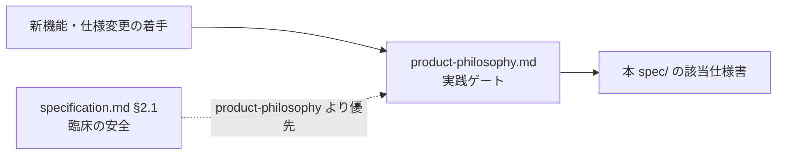

# spec/ — 仕様系（業務・画面・UI）

> **目的**: システムが「何をするか」の仕様系ドキュメントの索引を提供する。
> **読者**: 全開発者・AI エージェント。
> **タイミング**: 機能実装・仕様確認・画面変更の前。

技術設計（どう作られているか）は [../architecture/](../architecture/README.md)、運用は [../ops/](../ops/README.md) を参照。
新機能・仕様変更の着手前には [../product-philosophy.md](../product-philosophy.md) の実践ゲートを必ず通すこと。

## 索引

| ドキュメント | 内容 | いつ読むか |
|:---|:---|:---|
| [specification.md](specification.md) | システム全体の機能要件と主要ビジネスフロー（§2.1 臨床安全原則を含む） | 全体像の把握・臨床安全の判断時 |
| [screens/](screens/README.md) | 全画面インデックス（番号付き仕様 41 本。`route-inventory.test.tsx` が pin する製品ルート 88 leaf の全網羅ではない。settings/ にマスタ設定画面群） | 画面単位の仕様確認・UI 変更前 |
| [cash-register.md](cash-register.md) | レジ締め・日次/月次売上集計の業務仕様（AM/PM/EMG 境界） | 会計・締め処理の実装前 |
| [customer-aggregation.md](customer-aggregation.md) | 顧客分析ダッシュボード（累計売上・来院頻度・CPM/LTV） | 集計・分析機能の実装前 |
| [reservation-to-record-flow.md](reservation-to-record-flow.md) | 予約からカルテ作成までの統合フロー（appointments = 単一 source of truth） | 予約・受付・カルテ連携の実装前 |
| [design-system.md](design-system.md) | Notion ライクなデザイン規約とデザイントークン | フロントエンド UI 実装前 |
| [design-states.md](design-states.md) | インタラクション状態（hover / focus / disabled / loading / invalid 等）の視覚仕様・必須実装と WCAG コントラスト実測 | インタラクティブ UI の実装・レビュー時 |
| [design-token-layers.md](design-token-layers.md) | デザイントークンの 3 層モデル（Primitive → Semantic → Component）と参照方向・新規値の配置先 | トークン追加・色変更・新規 UI プリミティブ作成時 |
| [components/](components/README.md) | UI プリミティブのコンポーネント契約（badge / button / input / select 等の Anatomy・状態表・既知ギャップ。テンプレート: `_TEMPLATE.md`） | コンポーネント実装・変更前 |
| [ui-design-compliance.md](ui-design-compliance.md) | UI デザイン規約の準拠状況と機械検査（design-audit）の対応表 | 新規ページ追加時（§2 の表を同コミットで更新） |
| [line/](line/README.md) | LINE / Lステップ連携（CPM・配信トリガー・LIFF 予約・コスト分析） | LINE/Lステップ関連の実装前 |

## 実装 → 文書カバレッジ（2026-10-11 静的棚卸し）

route path・API method/path・生成 schema と primary 文書オーナーの対応を示す navigation であり、assertion 単位・runtime 受入の認証ではない。計測は base `f457821c4` で実施し、route/API/workflow の source は `f82badf36` と同一（差分は CI fixture/test のみ）。

**画面（88 product leaf → primary 仕様）**: 全 88 leaf の primary 仕様リンクは [ui-design-compliance.md §2](ui-design-compliance.md) の「仕様正本」列が一意の対応表。LIFF の 2 つの別 entrypoint app（`frontend/liff/src/App.tsx` は画面 38、`frontend/line-reserve/src/App.tsx` は画面 37 の仕様に包含）は main app の leaf 集計対象外。redirect 12 件と wildcard 404 は route code であり画面仕様を持たない。

**生成 schema**: `docs/architecture/erd-detail/` の schema 文書は生成物（135 物理テーブル / 137 生成ファイル）で、既存の `scripts/tools/generate-erd-detail.py --check` が migration との整合を検査する。手編集しない。

**API method/path（backend apicontract collector の静的計測）**: 23 の route 登録 root から 546 の実装 GET/POST/PUT/PATCH/DELETE pair を収集し、`backend/docs/api.yaml` の 519 operation と照合。516 が一致、real-only 30 件（alias 23 + clinic パラメータ名差異 3 + 運用系 surface 4）、spec-only 3 件（clinic パラメータ名差異）。既存ゲート `TestOpenAPIRouteDrift_*` は **新規（NEW）・陳腐化（STALE）の violation がともに 0** を検査するもので、差異が 0 という意味ではない。alias・param 差分の例外登録は `backend/internal/apicontract` の drift テスト（`knownMissingFromSpec`/`knownPhantomInSpec` リスト）が正本。collector は StaticFS（dev 条件付き `/uploads` GET+HEAD の 2 route）・一般 HEAD/OPTIONS を列挙せず、schema 全項目の証明でもない（runtime smoke が pin する 548 経路計数は本計測では未実行）。

### Route 登録 root（23）と契約オーナー

OpenAPI 列挙 operation（token 保護の local fixture 経路を含み、「全公開 API」と同義ではない）の wire 契約正本は `backend/docs/api.yaml` で、実装と spec の差異は discrepancy として残る。運用系 surface は各行のオーナー文書が primary。

| directory | prefix | 登録 root | ops | 仕様・契約オーナー |
|:---|:---|:---|---:|:---|
| `cmd/api` | （なし） | `registerBaseRoutes` | 3 | `GET /api/v1/health` の wire 契約は [backend/docs/api.yaml](../../backend/docs/api.yaml)。`GET /health`・`GET /health/db` の運用手順は [ops/infra/staging/runbook.md](../ops/infra/staging/runbook.md) |
| `internal/auth` | `/api/v1` | `RegisterRoutes` | 8 | [backend/docs/api.yaml](../../backend/docs/api.yaml) |
| `internal/auth` | `/api/v1/masters` | `RegisterPermissionGroupRoutes` | 7 | [backend/docs/api.yaml](../../backend/docs/api.yaml) |
| `internal/owner` | `/api/v1` | `RegisterRoutes` | 11 | [backend/docs/api.yaml](../../backend/docs/api.yaml) |
| `internal/pet` | `/api/v1` | `RegisterRoutes` | 20 | [backend/docs/api.yaml](../../backend/docs/api.yaml) |
| `internal/staff` | `/api/v1` | `RegisterRoutes` | 32 | [backend/docs/api.yaml](../../backend/docs/api.yaml) |
| `internal/clinic` | `/api/v1` | `RegisterClinicRoutes` | 5 | [backend/docs/api.yaml](../../backend/docs/api.yaml) |
| `internal/clinic` | `/api/v1` | `RegisterClinicHolidayRoutes` | 3 | [backend/docs/api.yaml](../../backend/docs/api.yaml) |
| `internal/clinic` | `/api/v1` | `RegisterCompanyRoutes` | 2 | [backend/docs/api.yaml](../../backend/docs/api.yaml) |
| `internal/clinic` | `/api/v1` | `RegisterClosingSettingsRoutes` | 9 | [backend/docs/api.yaml](../../backend/docs/api.yaml) |
| `internal/manualarticle` | `/api/v1` | `RegisterRoutes` | 5 | [backend/docs/api.yaml](../../backend/docs/api.yaml) |
| `internal/inventory` | `/api/v1` | `RegisterRoutes` | 11 | [backend/docs/api.yaml](../../backend/docs/api.yaml) |
| `internal/medicalrecord` | `/api/v1` | `RegisterRoutes` | 189 | [backend/docs/api.yaml](../../backend/docs/api.yaml) |
| `internal/reservation` | `/api/v1` | `RegisterRoutes` | 54 | [backend/docs/api.yaml](../../backend/docs/api.yaml) |
| `internal/billing` | `/api/v1` | `RegisterRoutes` | 53 | [backend/docs/api.yaml](../../backend/docs/api.yaml) |
| `internal/billing` | `/api/v1` | `RegisterUATRoutes` | 2 | [backend/docs/api.yaml](../../backend/docs/api.yaml) |
| `internal/lstep` | `/api/v1` | `RegisterRoutes` | 68 | [backend/docs/api.yaml](../../backend/docs/api.yaml) |
| `internal/trimming` | `/api/v1` | `RegisterRoutes` | 25 | [backend/docs/api.yaml](../../backend/docs/api.yaml) |
| `internal/identitylink` | `/api/v1` | `RegisterRoutes` | 13 | [backend/docs/api.yaml](../../backend/docs/api.yaml) |
| `internal/support` | `/api/v1` | `RegisterRoutes` | 11 | [backend/docs/api.yaml](../../backend/docs/api.yaml) |
| `internal/reservation` | （なし） | `RegisterLiffRoutes` | 13 | [backend/docs/api.yaml](../../backend/docs/api.yaml) |
| `internal/lstep` | （なし） | `RegisterWebhookRoutes` | 1 | [line/architecture.md](line/architecture.md)（`POST /api/line/webhook` の接続設計） |
| `internal/scheduler` | （なし） | `RegisterRoutes` | 1 | [ops/deploy/runbooks/SCHEDULER_OPERATIONS.md](../ops/deploy/runbooks/SCHEDULER_OPERATIONS.md)（`POST /_internal/scheduled-jobs/{jobAction}` の運用） |

補足:

- `RegisterUATRoutes` の 2 operation（`POST`/`DELETE /api/v1/uat/synthetic-closings*`）は OpenAPI に列挙済みで wire 契約は api.yaml が正本。token 保護の local-only fixture としての用途・安全境界は [ops/testing/S09-FIXTURE-DESIGN.md](../ops/testing/S09-FIXTURE-DESIGN.md) が正本（UAT/runtime 実行の合格を主張しない）。
- `RegisterLiffRoutes` の wire 契約は api.yaml が正本で、LIFF 接続・業務設計の説明は [line/architecture.md](line/architecture.md) を参照（同一 fact の共同正本ではない）。

### 更新責務

- 新規 route path → `ui-design-compliance.md` §2 の既存表へ 1 行追加し primary 仕様を一意に指す（redirect は対象外）。
- API 変更 → 正本 `backend/docs/api.yaml` を更新し、`TestOpenAPIRouteDrift_*` ゲートと必要に応じて本 root 表を更新。
- migration 変更 → `generate-erd-detail.py` で erd-detail を再生成する（手編集不可）。
- workflow 変更 → [ops/README.md](../ops/README.md) の workflow→文書オーナー表の対応を確認。
- 本節は実装→文書の対応 navigation であり、docs を実行台帳にはしない。実行状態・Done の正本は Plane。dated receipt は判定の根拠であり第二台帳ではない。

## AI エージェント向け注記

- screens/ 配下と design-system.md が言及するコンポーネント名・フック名・画面数はローカル `make ci` の docs-symbol-drift ゲートで実在チェックされる。実在しないシンボル名を書くとローカル検査が失敗する。GitHub Actions の必須 gate ではない。
- 「臨床の安全」（specification.md §2.1）は product-philosophy.md より優先される。
