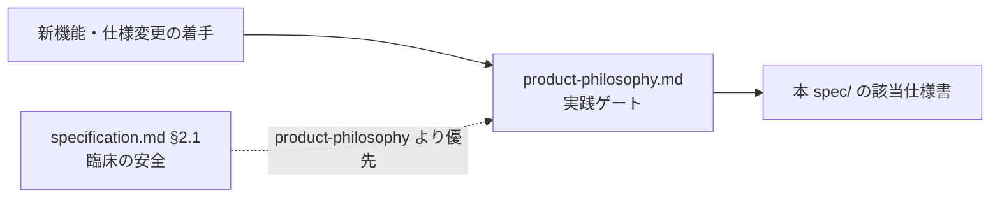

# spec/ — 仕様系（業務・画面・UI）

2026-10-17追加：ユーザー確定9群の[正本・受入条件・C01〜C13訂正対照](domains/SPECIFICATION_PROGRESS.md#confirmed-business-decisions-20261017)。問診統合・共通患者・医師確認／会計同期等はこの最新参照に従う。初回反映時の未公開/ontology保留という段階は履歴。後続承認により業務69文書とontology11文書をDraft PR #670のcommit `7e4171725c24c5be9807ddcf8c09b323aca31442`へ公開し、公開時の対象本文一致を確認済み。現在の語彙は[ontologyの適用境界](ontology/README.md#ontology-current-20261018)へ接続する。以後のローカル改善差分は公開済み版と区別し、実装・実機未確認と除外原資料の未読は維持する。

> **目的**: システムが「何をするか」の仕様系ドキュメントの索引を提供する。
> **読者**: 全開発者・AI エージェント。
> **タイミング**: 機能実装・仕様確認・画面変更の前。

技術設計（どう作られているか）は [../architecture/](../architecture/README.md)、運用は [../ops/](../ops/README.md) を参照。
新機能・仕様変更の着手前には [../product-philosophy.md](../product-philosophy.md) の実践ゲートを必ず通すこと。

## 仕様を書く・更新する前に

まず [仕様書の書き方](authoring-guide.md)を読む。仕様の追加・変更時は[オントロジー確認と記述完了チェック](authoring-guide.md#ontology-maintenance)を同じ更新手順で実施し、定義・関係・制約と画面／受入条件の整合を確認する。命名・正本関係・本文見出しと表の列・不足時の記法・決定状態と検証状態を共通化する。[画面テンプレート](templates/page-spec.md)・[フローテンプレート](templates/workflow-spec.md)は再利用用で、空の仕様本文を大量に作るためのものではない。

予約・受付・担当者・記録の意味は[予約ドメインの用語・概念関係の正本](ontology/reservations.md#reservation-ontology)を参照する。画面呼称・業務概念・現行モデルを区別し、語彙整理を未決業務の承認にしない。

## 予約 → 受付 → カルテ入力 → 会計・未納を読む順

1. [全体要件・臨床安全原則](specification.md)（特に §2.1）を確認する。
2. [横断フロー](workflows/README.md)から、予約・受付・記録・会計完了の関係を読む。
3. [予約](domains/reservations/README.md) → [受付](domains/reception/README.md) → [カルテ](domains/medical-records/README.md) → [会計・未納](domains/accounting/README.md)の順に、各ドメインのルール・画面・受入条件を辿る。
4. 用語・権限・共通マスタは [shared/](shared/README.md)、対象外ドメインを含む全画面の閲覧入口は [screens/](screens/README.md)を使う。

仕様本文は各リンク先が正本。入口には業務ルールを複製しない。未決要望・既知ギャップ・臨床承認待ちは元の記載状態を保持し、配置変更や Issue の Closed を承認の根拠にしない。仕様の決定状態と現在の実装状態・実機受入結果は分けて読む（実行状態の入口は [docs/work/](../work/README.md)）。

## 配置

| 場所 | 役割 |
|:---|:---|
| workflows/ | ドメインを跨ぐ業務フローの正本と閲覧入口 |
| domains/*/README.md | ドメイン概要・ルールと受入条件の所在・未決事項・読む順 |
| domains/*/pages/ | 予約・受付・カルテ・会計の画面仕様本文 |
| domains/medical-records/lifecycle.md | カルテの自動保存維持・通常編集・入力復元・診療終了／履歴（§2が保存ルーティングの正本、最新合意を優先） |
| shared/ | 共通用語・権限・マスタの参照入口 |
| screens/ | 全画面索引と対象外画面の本文。移設済み旧パスは移動案内のみ |

settings/ の共通マスタ、入院・トリミング・LINE 等の既存仕様、レジ締め本文は現在の場所を保持する。全88製品ルートの正本対応は引き続き [ui-design-compliance.md §2](ui-design-compliance.md)を使う。

## 索引

| ドキュメント | 内容 | いつ読むか |
|:---|:---|:---|
| [specification.md](specification.md) | システム全体の機能要件と主要ビジネスフロー（§2.1 臨床安全原則を含む） | 全体像の把握・臨床安全の判断時 |
| [screens/](screens/README.md) | 全画面インデックス（番号付き索引 41 件（移動案内を含む）。`route-inventory.test.tsx` が pin する製品ルート 88 leaf の全網羅ではない。settings/ にマスタ設定画面群） | 画面単位の仕様確認・UI 変更前 |
| [cash-register.md](cash-register.md) | レジ締め・日次/月次売上集計の業務仕様（AM/PM/EMG 境界） | 会計・締め処理の実装前 |
| [customer-aggregation.md](customer-aggregation.md) | 顧客分析ダッシュボード（累計売上・来院頻度・CPM/LTV） | 集計・分析機能の実装前 |
| [検査機器の旧解析資料](lab-device-integration/README.md) | 城東の構造/通信観測とD07・運用正本への接続。外注/画像/医院差・移行は未確認を区別 | 旧資料を機器対応や新規採用の根拠に使う前 |
| [reservation-to-record-flow.md](workflows/reservation-to-record-flow.md) | 予約からカルテ作成までの統合フロー（appointments = 単一 source of truth） | 予約・受付・カルテ連携の実装前 |
| [ui-design-guide.md](ui-design-guide.md) | UI 作業の入口（全エージェント共通）: 正本の読む順・design-audit ハードルール要約・UI の完了条件。新しい値は決定しない | フロントエンド UI 作業の最初に |
| [design-system.md](design-system.md) | 色の正本（brand / primary / ink / 臨床・業務ステータス色）と SSOT の分担表、デザイントークンへの写像 | フロントエンド UI 実装前 |
| [design-states.md](design-states.md) | インタラクション状態（hover / focus / disabled / loading / invalid 等）の視覚仕様・必須実装と WCAG コントラスト実測 | インタラクティブ UI の実装・レビュー時 |
| [design-patterns.md](design-patterns.md) | 画面パターン規約（ナビ現在地・一覧の列幅優先度と横スクロール・省略の全文到達・フォームの幅/検証/部品統一・固定要素の重なり・空状態/読込・カレンダー/ボード）。2026-10-20 STG 監査起点の提案、決裁は PR レビュー | 一覧・フォーム・画面シェルを作る/直す前 |
| [design-token-layers.md](design-token-layers.md) | デザイントークンの 3 層モデル（Primitive → Semantic → Component）と参照方向・新規値の配置先 | トークン追加・色変更・新規 UI プリミティブ作成時 |
| [components/](components/README.md) | UI プリミティブのコンポーネント契約（badge / button / input / select 等の Anatomy・状態表・既知ギャップ。テンプレート: `_TEMPLATE.md`） | コンポーネント実装・変更前 |
| [ui-design-compliance.md](ui-design-compliance.md) | UI デザイン規約の準拠状況と機械検査（design-audit）の対応表 | 新規ページ追加時（§2 の表を同コミットで更新） |
| [line/](line/README.md) | LINE / Lステップ連携（CPM・配信トリガー・LIFF 予約・コスト分析） | LINE/Lステップ関連の実装前 |

## 実装 → 文書カバレッジ（2026-10-11 静的棚卸し）

route path・API method/path・生成 schema と primary 文書オーナーの対応を示す navigation であり、assertion 単位・runtime 受入の認証ではない。計測は base `f457821c4` で実施し、route/API/workflow の source は `f82badf36` と同一（差分は CI fixture/test のみ）。

**画面（88 product leaf → primary 仕様）**: 全 88 leaf の primary 仕様リンクは [ui-design-compliance.md §2](ui-design-compliance.md) の「仕様正本」列が一意の対応表。LIFF の 2 つの別 entrypoint app（`frontend/liff/src/App.tsx` は画面 38、`frontend/line-reserve/src/App.tsx` は画面 37 の仕様に包含）は main app の leaf 集計対象外。redirect 12 件と wildcard 404 は route code であり画面仕様を持たない。

**生成 schema**: `docs/architecture/erd-detail/` の schema 文書は生成物（物理テーブル数は生成manifestを参照）で、既存の `scripts/tools/generate-erd-detail.py --check` が migration との整合を検査する。手編集しない。

**API method/path（backend apicontract collector の静的計測）**: 23 の route 登録 root から 546 の実装 GET/POST/PUT/PATCH/DELETE pair を収集し、`backend/docs/api.yaml` の 519 operation と照合。516 が一致、real-only 30 件（alias 23 + clinic パラメータ名差異 3 + 運用系 surface 4）、spec-only 3 件（clinic パラメータ名差異）。既存ゲート `TestOpenAPIRouteDrift_*` は **新規（NEW）・陳腐化（STALE）の violation がともに 0** を検査するもので、差異が 0 という意味ではない。alias・param 差分の例外登録は `backend/internal/apicontract` の drift テスト（`knownMissingFromSpec`/`knownPhantomInSpec` リスト）が正本。collector は StaticFS（dev 条件付き `/uploads` GET+HEAD の 2 route）・一般 HEAD/OPTIONS を列挙せず、schema 全項目の証明でもない（runtime smoke が pin する 548 経路計数は本計測では未実行）。

### Route 登録 root（23）と契約オーナー

OpenAPI 列挙 operation（token 保護の local fixture 経路を含み、「全公開 API」と同義ではない）の wire 契約正本は `backend/docs/api.yaml` で、実装と spec の差異は discrepancy として残る。運用系 surface は各行のオーナー文書が primary。

| directory | prefix | 登録 root | ops | 仕様・契約オーナー |
|:---|:---|:---|---:|:---|
| `cmd/api` | （なし） | `registerBaseRoutes` | 3 | `GET /api/v1/health` の wire 契約は [backend/docs/api.yaml](../../backend/docs/api.yaml)。`GET /health`・`GET /health/db` の運用手順は [ops/infra/staging/runbook.md](../ops/infra/staging/runbook.md) |
| `internal/auth` | `/api/v1` | `RegisterRoutes` | 8 | [backend/docs/api.yaml](../../backend/docs/api.yaml) |
| `internal/auth` | `/api/v1/masters` | `RegisterPermissionGroupRoutes` | 7 | [backend/docs/api.yaml](../../backend/docs/api.yaml) |
| `internal/owner` | `/api/v1` | `RegisterRoutes` | 11 | [backend/docs/api.yaml](../../backend/docs/api.yaml) |
| `internal/pet` | `/api/v1` | `RegisterRoutes` | 20 | [backend/docs/api.yaml](../../backend/docs/api.yaml) |
| `internal/staff` | `/api/v1` | `RegisterRoutes` | 32 | [backend/docs/api.yaml](../../backend/docs/api.yaml) |
| `internal/clinic` | `/api/v1` | `RegisterClinicRoutes` | 5 | [backend/docs/api.yaml](../../backend/docs/api.yaml) |
| `internal/clinic` | `/api/v1` | `RegisterClinicHolidayRoutes` | 3 | [backend/docs/api.yaml](../../backend/docs/api.yaml) |
| `internal/clinic` | `/api/v1` | `RegisterCompanyRoutes` | 2 | [backend/docs/api.yaml](../../backend/docs/api.yaml) |
| `internal/clinic` | `/api/v1` | `RegisterClosingSettingsRoutes` | 9 | [backend/docs/api.yaml](../../backend/docs/api.yaml) |
| `internal/manualarticle` | `/api/v1` | `RegisterRoutes` | 5 | [backend/docs/api.yaml](../../backend/docs/api.yaml) |
| `internal/inventory` | `/api/v1` | `RegisterRoutes` | 11 | [backend/docs/api.yaml](../../backend/docs/api.yaml) |
| `internal/medicalrecord` | `/api/v1` | `RegisterRoutes` | 189 | [backend/docs/api.yaml](../../backend/docs/api.yaml) |
| `internal/reservation` | `/api/v1` | `RegisterRoutes` | 54 | [backend/docs/api.yaml](../../backend/docs/api.yaml) |
| `internal/billing` | `/api/v1` | `RegisterRoutes` | 53 | [backend/docs/api.yaml](../../backend/docs/api.yaml) |
| `internal/billing` | `/api/v1` | `RegisterUATRoutes` | 2 | [backend/docs/api.yaml](../../backend/docs/api.yaml) |
| `internal/lstep` | `/api/v1` | `RegisterRoutes` | 68 | [backend/docs/api.yaml](../../backend/docs/api.yaml) |
| `internal/trimming` | `/api/v1` | `RegisterRoutes` | 25 | [backend/docs/api.yaml](../../backend/docs/api.yaml) |
| `internal/identitylink` | `/api/v1` | `RegisterRoutes` | 13 | [backend/docs/api.yaml](../../backend/docs/api.yaml) |
| `internal/support` | `/api/v1` | `RegisterRoutes` | 11 | [backend/docs/api.yaml](../../backend/docs/api.yaml) |
| `internal/reservation` | （なし） | `RegisterLiffRoutes` | 13 | [backend/docs/api.yaml](../../backend/docs/api.yaml) |
| `internal/lstep` | （なし） | `RegisterWebhookRoutes` | 1 | [line/architecture.md](line/architecture.md)（`POST /api/line/webhook` の接続設計） |
| `internal/scheduler` | （なし） | `RegisterRoutes` | 1 | [ops/deploy/runbooks/SCHEDULER_OPERATIONS.md](../ops/deploy/runbooks/SCHEDULER_OPERATIONS.md)（`POST /_internal/scheduled-jobs/{jobAction}` の運用） |

補足:

- `RegisterUATRoutes` の 2 operation（`POST`/`DELETE /api/v1/uat/synthetic-closings*`）は OpenAPI に列挙済みで wire 契約は api.yaml が正本。token 保護の local-only fixture としての用途・安全境界は [ops/testing/S09-FIXTURE-DESIGN.md](../ops/testing/S09-FIXTURE-DESIGN.md) が正本（UAT/runtime 実行の合格を主張しない）。
- `RegisterLiffRoutes` の wire 契約は api.yaml が正本で、LIFF 接続・業務設計の説明は [line/architecture.md](line/architecture.md) を参照（同一 fact の共同正本ではない）。

### 更新責務

- 新規 route path → `ui-design-compliance.md` §2 の既存表へ 1 行追加し primary 仕様を一意に指す（redirect は対象外）。
- API 変更 → 正本 `backend/docs/api.yaml` を更新し、`TestOpenAPIRouteDrift_*` ゲートと必要に応じて本 root 表を更新。
- migration 変更 → `generate-erd-detail.py` で erd-detail を再生成する（手編集不可）。
- workflow 変更 → [ops/README.md](../ops/README.md) の workflow→文書オーナー表の対応を確認。
- 本節は実装→文書の対応 navigation であり、docs を実行台帳にはしない。実行状態・Done の正本は Plane。dated receipt は判定の根拠であり第二台帳ではない。

## AI エージェント向け注記

- screens/・domains/・workflows/ 配下と design-system.md が言及するコンポーネント名・フック名・画面数はローカル `make ci` の docs-symbol-drift ゲートで実在チェックされる。実在しないシンボル名を書くとローカル検査が失敗する。GitHub Actions の必須 gate ではない。
- 「臨床の安全」（specification.md §2.1）は product-philosophy.md より優先される。

予約ドメインの今回の業務合意と正本整理の完了判断は[17:35最終整合性レビュー](domains/reservations/README.md#reservation-final-review-1735)を参照する。実装・移行・実機受入、対象外領域の臨床承認や会計後訂正とは分ける。

今回の予約確定範囲は[確定FR索引](domains/reservations/README.md#approved-reservation-scope)。用語正本は[ontology/](ontology/README.md)、[旧資料](../work/archive/reservations/README.md)・[未承認／設計](../work/design/reservations/README.md)とは役割を分ける。spec/全体を確定扱いしない。

予約の18:26一括是正と現在のレビュー範囲は[予約入口](domains/reservations/README.md#mece-corrections-1826)を参照する。合意済みの固有要件数・継承仕様数・検査定義数を区別する。

## このフォルダの役割と使い方

仕様全体の入口。全体要件と領域・画面・横断フロー・語彙・UI契約を案内する。

全体の要件・横断的UI方針と各仕様への入口を置く。実装設計・運用手順・進捗証跡・未承認案の本文は各既存領域へ置き、ここへ複製しない。

子フォルダ：[components/](components/README.md)、[domains/](domains/README.md)、[line/](line/README.md)、[ontology/](ontology/README.md)、[screens/](screens/README.md)、[shared/](shared/README.md)、[templates/](templates/README.md)、[workflows/](workflows/README.md)

主要文書：主要文書は本書の既存索引・上記の読む順を参照します。

読む順：[全体要件](specification.md)と[記述規約](authoring-guide.md) → [domains](domains/README.md) → 関連[workflows](workflows/README.md)・[ontology](ontology/README.md) → 各画面。

正本・状態：[決定状態と検証状態の規約](authoring-guide.md#status)に従い、各節・FRの承認根拠と実装／実機状態を別に読む。READMEへの掲載・フォルダ配置は承認や実装済みを表さず、対象外の既存仕様を新たに確定しない。既存の別名入口・索引の責務は維持し、本書は案内を補う。

## 2026-10-15 全領域仕様への案内

[全23業務・6共通・8接続](domains/SPECIFICATION_PROGRESS.md)を参照する。既存のルートprimary対応と過去の実行検証記録は保持し、今回の文書検査をruntime／実機合格へ転用しない。

## 2026-10-15会議4点の最新入口

自動保存維持・終了後通常編集・タブ開始時復元／複製直前取消・終了履歴、トリミング開始／終了・料金、勤務複製／CSVの合意を追加整理。[全体進捗](domains/SPECIFICATION_PROGRESS.md#meeting-four-decisions-20261015)と各owner本文を参照。途中の保存ボタン方式は撤回済み。今回差分は独立内容・構造レビューで重大指摘なしを確認し、文書再整合済み。全過去承認の監査完了・実装完了とは扱わない。

## 原資料追加採用6点の入口

[職員・月次未納・日次内訳・薬量の追加差分](domains/SPECIFICATION_PROGRESS.md#source-six-adoption-20261015)を参照する。採用範囲だけの文書再整合で、全原資料の読解完了ではない。職種／役職／雇用と認可、休業と退職、入金と充当／減額、税表示と元税額、自動薬量範囲と臨床数値承認を区別する。月次調整表示は2026-10-16に実受領のみの当月入金と別掲調整内訳として承認済み。今回の更新は既存3ACの期待結果を同期する文書候補で、内容レビュー・公開・実装は別段階。
