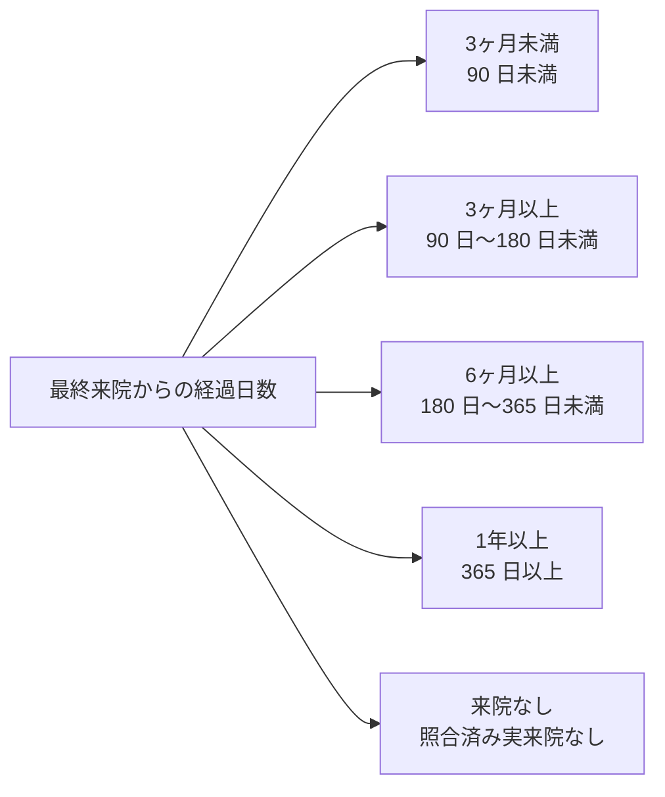

# 顧客分析・集計機能 仕様書 (Customer Intelligence)

| 管理項目 | 記載 |
|:---|:---|
| 文書ID・種別 | business.customer-aggregation.legacy-reference／既存契約参照 |
| 決定状態 | 来院回数は2026-10-15承認6の実来院日基準へ。その他の既存記載と実装差・承認範囲は業務正本を参照。 |
| 実装状態 | 現行差を分離。今回実装変更・網羅監査なし |
| 実機検証状態 | 未実施。受入条件は検査定義 |
| 文書確認日 | 2026-10-15 |
[業務正本・FR／受入条件・例外・未決](domains/analytics/business-rules.md)。本書の既存分析説明とSQLの実態を区別する。期間帰属・実入出金・来院日distinctとCPMの責務は新しい正本へ。

> **目的**: 顧客分析・CPM(来院頻度)集計機能の業務仕様を定義する。
> **読者**: 集計機能の実装者・経営分析担当。
> **タイミング**: CPM集計ロジックの実装・仕様確認時。

> **Animal Ekarte**: 経営判断を支援するデータ分析基盤
> **最新更新**: 2026-09-06 | **ステータス**: repo の集計・API・画面契約を照合。実環境の受入結果とは別。

---

## 1. 目的

飼主（オーナー）単位での売上実績や来院頻度を多角的に集計し、以下の 3 つの主要な経営アクションを支援します。

1.  **ロイヤル顧客の特定**: 年間売上ランキングによる、病院への貢献度が高い層の把握。
2.  **離脱の早期発見**: 最終来院日からの経過日数による、休眠予備軍の抽出。
3.  **セグメント配信の最適化**: 条件に合致する顧客リストの CSV 出力と、Lステップ連携への活用。

---

## 2. 集計軸と判定ロジック

### 2.1 年間売上ランキング (LTV Analysis)
- **対象**: 売上ランキングの既定は当暦年（1月1日〜12月31日）の選択期間に属する完了状態（`completed`）の会計レコード。現行SQLの期間判定はカルテ日、なければ会計予定日であり、`completed_at`の期間判定ではない。明示的な `from` / `to` や期間 preset が指定された場合は、その選択期間を使う。
- **来院回数の年次指標**: `annual_visit_count` は別に rolling 365 日で集計する。
- **指標**: 合計診療費（税込）、来院回数。2026-10-15承認の目標は[D16の確認済み実来院日](domains/analytics/business-rules.md#requirement-fr-analytics-owner-counts)基準で、同医院・同飼主の同日は1回、ペット単位では各1回。期間内・累計・年間は同じsourceを用いる。現行SQLの未削除カルテ日distinctはdraftを含む旧記録日数であり、実来院への適合済みとはしない。

### 2.2 最終来院日分類
同じ実来院指標から導く最終来院日を基準に、固定の4区分＋来院なしでセグメント分けを行う目標です。現行SQLの最終カルテ日との差、実来院の根拠不明と来院なしを区別します(`last_visit_bucket`)。
- **3ヶ月未満**: 最終来院から 90 日未満。
- **3ヶ月以上**: 90 日〜180 日未満。
- **6ヶ月以上**: 180 日〜365 日未満。
- **1年以上**: 365 日以上。
- **来院なし**: 対象sourceを照合したうえで実来院なし。未照合・取得失敗はこの区分へ自動確定しない。

> **境界の出典**: 境界日数(90/180/365)は `backend/internal/owner/ltv_repository_query.go` の `ownerLTVSelectSQL` に固定値として実装されており、clinic 単位の設定変更はできない。CPM ステージ（V1 の 6 区分 + ダッシュボード残余 `cpm_unclassified`。clinic 単位で設定変更可能な `CPMV1Thresholds`（`DormantDays` 既定240・`SpotInactiveDays` 既定90、`backend/internal/model/cpm_v1_thresholds.go`）を用いる）は Lステップ連携・CPMステージ絞り込み用の別軸の判定であり、本項の最終来院日分類とは別の仕組み。ダッシュボードの人数チップは [36-aggregation-dashboard.md](./screens/36-aggregation-dashboard.md) を正本とする。

---

## 3. 画面構成と機能

### 3.1 統合ダッシュボード
- **タブ切り替え**: 「売上順」「来院頻度順」「最終来院順」の各視点でリストを表示。
- **高度なフィルタ**: 動物種別、年齢層、特定の病名を持つ患者の絞り込み（計画中）。

### 3.2 アクション
- **CSV エクスポート**: 現在のサーバーページで選択した行のみを出力する。未選択時は出力できない。全フィルタ結果の一括出力契約はない。
- **詳細遷移**: 飼主名リンクから飼主詳細へ遷移する。行全体の click やペット履歴への直接リンクはない。

---

## 4. 技術仕様

### 4.1 パフォーマンス設計
以下は現行SQLの読取説明で、承認済み実来院sourceへの切替を実装したものではない。実来院の由来・未知の旧値・再受付履歴は[技術契約](../design/domains/finance-operations/technical-spec.md#analytics-actual-visit-source)へ従う。

集計は `owners`/`medical_records`/`billings`/`payments` を対象にリクエスト時の生 SQL で JOIN・集計する。入口は `backend/internal/owner/ltv_repository.go` の `FindOwnerLTV`、SELECT と最終来院日分類の境界は `ltv_repository_query.go`、期間・金額条件は同 package の query builder に分かれている。マテリアライズド・ビューや専用集計テーブルは使用していない。本書は表示速度の実測値を保証しない。

### 4.2 API エンドポイント
- `GET /api/v1/clinics/:clinic_id/owners/aggregations`: 期間とソート軸を指定した集計データの取得。

---
