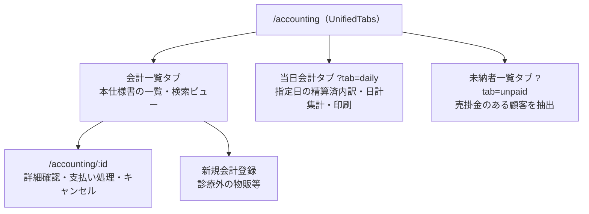

# 会計一覧 仕様書 (Accounting List)

| 管理項目 | 記載 |
|:---|:---|
| 文書ID・種別 | page.accounting.accounting-list／画面仕様 |
| 決定状態 | 既存記載を継承（決定根拠は未確認）。個別の合意・未決記述は本文のまま |
| 実装状態 | 既存記載を継承（再監査なし） |
| 実機検証状態 | 今回未実施。過去の記録と今回の文書確認を分ける |
| 文書確認日 | 2026-10-13（命名・形式・参照・本文保全のみ） |

## 目的・対象範囲

| シナリオ | 業務上の価値 | 優先度・理由 |
|:---|:---|:---|
| 日次集計を読む | 飼主とペットを一覧末尾で確認する | 未決／要確認（既存文書に優先度の根拠なし） |

### 概要

- **画面の目的**: 院内で行われた全診療・サービスの請求レコードを一覧表示・管理し、未精算の把握や過去の会計参照を行う。

## 利用者・権限・前提

- **アクセス権限**: `ResourceAccounting` の `view` 権限を保有するユーザー（`RequirePermission` によりルート単位で閲覧自体をブロック。作成・編集等の操作権限は `usePermission` で個別制御）

利用者の職種別の範囲は未記載／要確認。操作前提の詳細は本書の各操作・保存契約と関連正本を参照する。

## 入口・出口

- **URLパターン**: `/accounting`

### 主要なユーザーアクション

- **詳細・精算**: 日時リンクまたは操作ボタンから会計精算画面 (`/accounting/:id`) へ遷移し、支払い処理や詳細確認を行います。
- **未納管理**: 「未納者一覧」タブに切り替えることで、売掛金が発生している顧客を抽出するビューを同一画面内で表示します。
- **新規作成**: 診療外の物販等で個別に会計を作成する場合、ヘッダーの「新規会計登録」から実施します。

| 入口／出口 | 契機 | 引継ぎ情報 | 根拠 |
|:---|:---|:---|:---|
| URLパターン | 画面を開く | 上記URL／既存導線。呼出元の網羅は要確認 | 本節の元記載 |
| 戻り先・他画面 | 本節の既存操作 | 記載が無い引継ぎ・戻り先は要確認 | 本節／関連フロー |

## 表示情報・入力項目

| 項目 | 意味 | 型／形式 | 必須／任意 | 初期値 | 候補元 | 制約／根拠 |
|:---|:---|:---|:---|:---|:---|:---|
| 日付・キーワード・状態・支払方法 | 会計一覧の絞り込み | 未記載／要確認 | 未記載／要確認 | 未記載／要確認 | 飼主／ペット名等 | 下記「検索・フィルタリング」 |
| 当日会計日 | 日次集計の対象日 | daily_date（日付） | 未指定可 | JST当日 | URL・日付指定 | 下記「検索・フィルタリング」 |
| タブ・医院・ページ | 対象ビュー・医院・ページ | 未記載／要確認 | 未記載／要確認 | 取得件数既定20件、初期ページ・タブは要確認 | 会計一覧／当日会計／未納 | 下記「タブ構成」「パフォーマンスと体験」 |

### 画面構成

#### 0. タブ構成 (`UnifiedTabs`)

- **会計一覧**: 本仕様書が対象とする一覧・検索ビュー。
- **当日会計**: 指定日（デフォルトは当日）の精算済会計をカテゴリ別内訳と日計集計付きで表示・印刷するビュー（`?tab=daily`）。
- **未納者一覧**: 売掛金が発生している顧客を抽出するビュー（`?tab=unpaid`）。

タブ構成と一覧からの主な遷移先：

#### 1. 検索・フィルタリング (`PropertyFilter`)

- **日付・飼主/ペット名検索・ステータス・支払方法**: すべてサーバサイド（ページ横断）。既定 20 件。ページ内限定バナーは無い。キーワードは `useDeferredValue` 後に API へ送る。
- **当日会計**: 日付既定は JST 当日（`?daily_date=`）。
- **未納**: 期間既定は JST 当月（[unpaid-list.md](unpaid-list.md)）。「月末未納者一覧」を含む全表示単位で開始日・終了日の期間検索に対応。
- **医院**: 複数所属時は `ClinicScopeFilter`。一覧からのキャンセル操作は無い（`POST …/cancel` は詳細側）。

#### 2. データテーブル (`DataTable`)

請求額と現在の精算状況を一目で把握できるよう設計されています。

| カラム | 説明 |
|:---|:---|
| **日時** | 会計予定日（YYYY-MM-DD）。 |
| **飼主名** | 会計対象の飼主名。 |
| **ペット名** | 会計対象のペット名。 |
| **請求金額** | 税込の合計請求額。 |
| **支払方法** | 精算済の場合、使用された決済手段を表示。 |
| **ステータス** | **「未精算」**: 支払前。 |
| | **「保留」**: 精算を保留中。 |
| | **「精算済」**: 支払完了。 |
| | **「取消」**: 請求取り消し。 |
| **特殊バッジ** | **「返金あり」**: 部分返金または全額返金が発生している場合に表示。 |
| **関連リンク** | 診療内容（カルテ）への直接リンクボタン（存在する場合のみ）。 |

#### 3. 当日会計タブ（日次集計テーブル）

- **画面上の日次集計テーブル**: `領収No` → （複数医院選択時のみ `医院`）→ `診療` → `外科` → `RV` → `フード` → `トリミング` → `ホテル` → `用品他` → `売上合計` → `支払方法` → **`飼主名` → `ペット名`**。飼主名・ペット名はテーブル最右端の2列（この順）で、支払方法はその左隣。フッターの合計行はカテゴリ別合計と売上合計を表示する。
- **印刷面（日次集計一覧表・A4 landscape）**: `領収No` → `診療` → `外科` → `RV` → `フード` → `トリミング` → `ホテル` → `用品他` → `支払方法` → `合計` → **`飼主名` → `ペット名`**。画面と同様に最右端2列（この順）。フッターには医院合計・トリミング合計・全体合計の3行を出力する。

#### パフォーマンスと体験

- **視覚的フィードバック**: キーワード検索の絞り込み計算中（`useDeferredValue` による遅延中）、`FilteringIndicator` により計算中であることを通知し、UI のフリーズ感を排除します。
- **URL同期**: ページ番号や選択中のタブは URL パラメータと同期され、ページ再訪時も状態が維持されます（キーワード・フィルタ条件はローカル状態）。

## 操作・業務ルール・状態遷移

| 要件ID | 定義の所在 | 決定根拠 |
|:---|:---|:---|
| FR-accounting-daily-owner-pet-column-order | [既存の要件本文](#requirement-fr-accounting-daily-owner-pet-column-order) | 既存記載を継承。ID付与で合意済みにしない |

| 操作 | 実行条件 | 成功後状態／遷移 | 失敗挙動 | 根拠 |
|:---|:---|:---|:---|:---|
| 詳細・新規・未納タブ | view、作成権限は前提節参照 | 詳細画面・新規画面・未納ビュー | 未記載／要確認 | 入口出口節の既存アクション |

## 保存・取消・再試行・同時編集

該当なし（本一覧の検索・表示にレコード確定用の保存操作はない）。記録や精算の更新は遷移先仕様を参照する。検索条件の復元・取得失敗時の再試行について、既存本文にない条件は未記載／要確認。

## エラー・空状態

| 状況 | 検知／表示 | 利用者の次の操作 | 根拠 |
|:---|:---|:---|:---|
| 絞り込み計算中 | FilteringIndicator | 未記載／要確認（次操作の制約） | パフォーマンスと体験 |
| 一覧0件・API失敗 | 未記載／要確認 | 未記載／要確認 | 要確認 |

## 受入条件

この表は既存仕様から抽出した代表条件。すべての入力・操作・異常系への要件IDと受入条件の網羅的対応は未記載／要確認。

| 条件ID | Given（前提） | When（操作） | Then（期待結果） | 独立確認 | 成功条件 | 確認手順／証跡 |
|:---|:---|:---|:---|:---|:---|:---|
| AC-accounting-daily-owner-pet-column-order | 当日会計タブを表示する | 日次集計表の列を確認する | 最右端2列は飼主名→ペット名 | 日次集計表だけを確認 | 末尾2列の順序が飼主名→ペット名 | [要件](#requirement-fr-accounting-daily-owner-pet-column-order)・[既存UATの所在](../README.md#受入条件の所在)。実機未確認 |

## 未決事項・関連仕様・根拠

未記載の型・必須条件・初期値・エラー・受入結果は要確認。既存の未実装・判断待ち・臨床承認待ちは以下の元記載を維持する。今回の形式整理を合意や実装完了の根拠にしない。

[文書規約](../../../authoring-guide.md)・[ドメイン入口](../README.md)。根拠は整理前の既存仕様本文と、その本文が示す日付付き追記・関連資料。文書確認日は上記の構造確認日であり、過去の承認日を置き換えない。API表・コード名は参照情報で、wire型とDB定義の正本は文書規約に従う。

### 技術仕様

#### API連携

| メソッド | エンドポイント | 用途 | 必須権限 | 必須アクション |
|:---|:---|:---|:---|:---|
| GET | `/api/v1/accountings` | 条件に応じた会計一覧の取得 | `accounting` | `view` |

