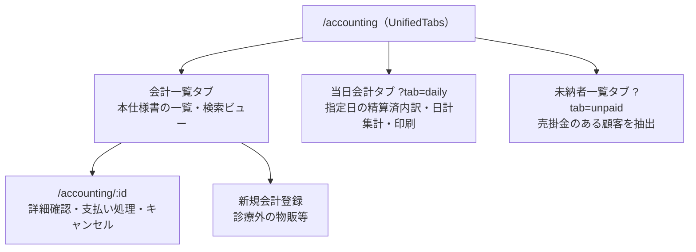

# 会計一覧 仕様書 (Accounting List)

| 管理項目 | 記載 |
|:---|:---|
| 文書ID・種別 | page.accounting.accounting-list／画面仕様 |
| 決定状態 | 2026-10-17追加決定は末尾と進捗入口を参照。従来：既存本文は継承（決定根拠未確認）。初回〜第十群の決定状態は下記正本で区別 |
| 実装状態 | 既存記載を継承（再監査なし） |
| 実機検証状態 | 今回未実施。過去の記録と今回の文書確認を分ける |
| 文書確認日 | 2026-10-17追加差分（従来確認2026-10-15）（初回〜第十群への参照・現行との差分明示） |

## 今回合意と現行画面の区別

[初回5FRの業務正本](../lifecycle.md#accounting-agreement-first-five)・[正本ライフサイクル本文181AC（基準174AC＋後続7AC）](../lifecycle.md#accounting-acceptance)に従う。同飼主の複数ペット／選択した未請求分の合算、元請求への任意額回収、未納／一部入金確定、理由付き訂正／取消／方法指定返金、締め後差分、根拠保存・単価手修正・割引併用は今回合意。[第二群](../lifecycle.md#accounting-agreement-second)で古い請求順／変更可・釣銭、予約前金、減額と実返金／訂正後表示、割合→金額と保険確認修正、帳票分離・再発行／旧履歴・過去未納表示、原請求日／実入出金日を合意。前金除外案は不採用で、充当時に新受領を作らない。[第三群](../lifecycle.md#accounting-agreement-third)で飼主単位預り金／予約任意・同飼主の別予約／ペット利用、割合合算→金額→割引後保険、同日作成順／理由付き保存後再配分、非現金超過の返金必要、別方法返金・金額追加承認なし、受領証／最終会計／返金元番号・再発行番号維持を合意。旧予約必須・未決表記は最新正本へ更新。[第四群](../lifecycle.md#accounting-agreement-fourth)で明細と会計全体の両割引、超過は入力エラーではなく警告し承認して進めた請求額は0円下限、会計取消時の預り金残高復元・実返金は別操作を合意。取消による解除・復元を残高へ反映する。残高式は業務正本へ従う。[第五群](../lifecycle.md#accounting-calculation-order)で明細→全体・明細後金額比の配賦、税抜計算／飼主向け税込表示、割合値引き額四捨五入・請求書税率別税切捨て、実値引き上限と他行転用なしを合意。計算例・保存根拠は正本へ参照し、本要約で新しい画面項目を定義しない。[第六群](../lifecycle.md#accounting-agreement-sixth)で複数保険会社（アニコムは例）、品目マスタの全体割引除外、飼主宛名・ペット別明細と訂正／部分返金の元取引・今回変更額の区別、管理者と対象変更権限付きスタッフのマスタ変更を合意。除外行は全体割引の対象額・配賦先から外す。[第七群](../lifecycle.md#accounting-insurance-window-scope)で資格／残限度はスタッフが外部画面等で確認して結果・保険負担額を記録し、窓口会計に限定。保険会社への請求・入金照合・査定差額管理と同一診療費への複数契約併用は対象外で、利用契約は会計ごと・ペットごとに1つ。会社／商品別の自動給付算式は今回の前提にしない。除外初期値／欠落時の意味と追加後反映は第十群で合意済み。

[第八群](../lifecycle.md#accounting-agreement-eighth)では、減額で解除する預り金を元飼主残高へ戻し、現金・カード併用時はスタッフが内訳を選択確認する。実返金は別操作。預り金は自動失効させず同医院・同飼主のみとする。取消後は元明細を選択確認し新番号で再請求して元取消請求へ関連付け、二重請求と金銭履歴の複製を防ぐ。新規会計と過去未納回収は同じ操作で扱い、支払額を元請求別に指定できる。過去未納を新請求の売上へ積み直さない。帳票のペットに紐づかない料金は「共通料金」別枠とし、架空のペットへ付けない。別医院移行・別飼主譲渡、督促・貸倒管理は今回対象外。

取消済み元請求と再請求の新番号を追跡し、元明細の有効請求への二重帰属を防ぐ。単なる帳票再発行とは別に表示する設計へ。取消／再請求で確定歴を消さず、通常Undoを再開しない。

[第九群](../lifecycle.md#accounting-rebill-snapshot-payment-source)では、再請求に元会計の価格・税・割引を初期継承し必要箇所だけスタッフが修正する。取消元に残る入金は自動移動せず、元資金・利用可能残・新請求・額を確認して充当し、元実受領額／日付と履歴を保持する。復元済み預り金は別の確認充当へ。保険結果も今回のペット／契約・対象明細で再確認して利用する。返金元の現金・カード・預り金の内訳が不明なら、記録を確認し内訳と理由を登録するまで対象返金を確定しない。元資金の内訳と実際の返金方法は別で、登録だけで実返金済みにしない。

[第十群](../lifecycle.md#accounting-empty-rounding-master)では、明細なし請求は確定不可、0円でも実際の明細と理由を保持。単価×数量の1円未満は行ごとに四捨五入してから値引き。除外初期値／設定欠落時は対象外にしない。追加済み行はmaster変更で自動更新せずスタッフ明示的再適用、確定後は訂正経路へ。

目標の[3画面・帳票契約](../../../../design/domains/accounting/technical-spec.md#accounting-screen-contract)と[操作／旧値／受け手](../../../../design/domains/accounting/technical-spec.md#accounting-reconciled-contract)を適用。取得中／失敗／真の0件／認可拒否を分け、未取得を0円／未納なしにしない。対象とrequest世代が違う遅延応答は採用せず、結果不明は同一operation照会、競合／失効は保存停止して未保存編集を保護。未対応の新業務を下記旧APIへ押し込まずadapterと実装受入が整うまで該当操作を開始しない。

[支払方法停止の追加合意](../lifecycle.md#accounting-inactive-payment-method)では、停止した方法を新しい入金で選べなくし、過去支払記録・帳票参照・方法別集計は保持する。後日回収や預り金の新規受領も新入金であり、保存前の停止を検査する。保存済み資金の再配分・充当・解除／復元、返金・金額不変の方法訂正へ新受領の制限を一律適用しない。取得失敗／候補0件・未保存保護・成立済み再送は[追加設計](../../../../design/domains/accounting/technical-spec.md#accounting-inactive-payment-design)へ従う。実入金を伴わない未納／0円確定に架空の入金方法を要求しない。

以下の既存UI・API表・図・権限・計算式・旧FR／ACは現行／継承挙動の参照。単一ペット／カルテや全額支払の制約、返金理由／方法任意、割引選択・丸め等を今回の確定仕様にしない。情報・filter／基準日と取得／保存の意味契約は全体設計、レイアウト・物理形式・実grantの適合は後続実装へ。新合意を現行権限の変更や全スタッフへの許可にしない。請求書／領収書の分離と旧帳票保持、今月売上なしの過去未納表示自体は合意済み。[現行との差分](../../../../design/domains/accounting/technical-spec.md#accounting-current-gap)を参照。今回の合意を現行実装済み／旧UAT合格と扱わない。

## 目的・対象範囲

| シナリオ | 業務上の価値 | 優先度・理由 |
|:---|:---|:---|
| 日次集計を読む | 飼主とペットを一覧末尾で確認する | 未決／要確認（既存文書に優先度の根拠なし） |

### 概要

- **画面の目的**: 院内で行われた全診療・サービスの請求レコードを一覧表示・管理し、未精算の把握や過去の会計参照を行う。

## 利用者・権限・前提

- **アクセス権限**: `ResourceAccounting` の `view` 権限を保有するユーザー（`RequirePermission` によりルート単位で閲覧自体をブロック。作成・編集等の操作権限は `usePermission` で個別制御）

利用者の職種別の範囲は未記載／要確認。操作前提の詳細は本書の各操作・保存契約と関連正本を参照する。

## 入口・出口

- **URLパターン**: `/accounting`

### 主要なユーザーアクション

- **詳細・精算**: 日時リンクまたは操作ボタンから会計精算画面 (`/accounting/:id`) へ遷移し、支払い処理や詳細確認を行います。
- **未納管理**: 「未納者一覧」タブに切り替えることで、売掛金が発生している顧客を抽出するビューを同一画面内で表示します。
- **新規作成**: 診療外の物販等で個別に会計を作成する場合、ヘッダーの「新規会計登録」から実施します。

| 入口／出口 | 契機 | 引継ぎ情報 | 根拠 |
|:---|:---|:---|:---|
| URLパターン | 画面を開く | 上記URL／既存導線。呼出元の網羅は要確認 | 本節の元記載 |
| 戻り先・他画面 | 本節の既存操作 | 記載が無い引継ぎ・戻り先は要確認 | 本節／関連フロー |

## 表示情報・入力項目

| 項目 | 意味 | 型／形式 | 必須／任意 | 初期値 | 候補元 | 制約／根拠 |
|:---|:---|:---|:---|:---|:---|:---|
| 日付・キーワード・状態・支払方法 | 会計一覧の絞り込み | 未記載／要確認 | 未記載／要確認 | 未記載／要確認 | 飼主／ペット名等 | 下記「検索・フィルタリング」 |
| 当日会計日 | 日次集計の対象日 | daily_date（日付） | 未指定可 | JST当日 | URL・日付指定 | 下記「検索・フィルタリング」 |
| タブ・医院・ページ | 対象ビュー・医院・ページ | 未記載／要確認 | 未記載／要確認 | 取得件数既定20件、初期ページ・タブは要確認 | 会計一覧／当日会計／未納 | 下記「タブ構成」「パフォーマンスと体験」 |

### 画面構成

#### 0. タブ構成 (`UnifiedTabs`)

- **会計一覧**: 本仕様書が対象とする一覧・検索ビュー。
- **当日会計**: 指定日（デフォルトは当日）の精算済会計をカテゴリ別内訳と日計集計付きで表示・印刷するビュー（`?tab=daily`）。
- **未納者一覧**: 売掛金が発生している顧客を抽出するビュー（`?tab=unpaid`）。

タブ構成と一覧からの主な遷移先：

#### 1. 検索・フィルタリング (`PropertyFilter`)

- **日付・飼主/ペット名検索・ステータス・支払方法**: すべてサーバサイド（ページ横断）。既定 20 件。ページ内限定バナーは無い。キーワードは検索ボタン押下で適用してAPIへ送る目標。旧文書の`useDeferredValue`後の送信は発火契機の最新仕様ではなく、適用後の描画最適化と区別する。
- **当日会計**: 日付既定は JST 当日（`?daily_date=`）。
- **未納**: 期間既定は JST 当月（[unpaid-list.md](unpaid-list.md)）。「月末未納者一覧」を含む全表示単位で開始日・終了日の期間検索に対応。
- **医院**: 複数所属時は `ClinicScopeFilter`。一覧からのキャンセル操作は無い（`POST …/cancel` は詳細側）。

#### 2. データテーブル (`DataTable`)

請求額と現在の精算状況を一目で把握できるよう設計されています。

| カラム | 説明 |
|:---|:---|
| **日時** | 会計予定日（YYYY-MM-DD）。 |
| **飼主名** | 会計対象の飼主名。 |
| **ペット名** | 会計対象のペット名。 |
| **請求金額** | 税込の合計請求額。 |
| **支払方法** | 保存済み入金の決済手段を表示。請求確定と全額回収を同一視しない。 |
| **ステータス** | **「未精算」**: 旧表示名。目標では請求の確定状態と入金・残額を別軸で確認する。 |
| | **「保留」**: 精算を保留中。 |
| | **「精算済」**: 旧表示名。請求確定は未入金・一部入金・0円でも成立し、全額入金済みを意味しない。[正本](../lifecycle.md#requirement-fr-accounting-receivable-partial-zero)の請求確定／入金・残額を別に示す。 |
| | **「取消」**: 請求取り消し。 |
| **特殊バッジ** | **「返金あり」**: 部分返金または全額返金が発生している場合に表示。 |
| **関連リンク** | 診療内容（カルテ）への直接リンクボタン（存在する場合のみ）。 |

#### 3. 当日会計タブ（日次集計テーブル）

日次集計帳票には[No.4の本人対象判断](../../cash-register/business-rules.md#closing-daily-discharge-information-20261017)に従い当日の退院情報を掲載・印刷する。[実退院日時のJST暦日](../../cash-register/business-rules.md#closing-discharge-actual-jst-day-20261017)で当日0時以上・翌日0時未満を抽出する。精算済会計の既存集計対象・支払日・レジ締め期間と退院情報の対象日は別であり、退院の掲載を精算済会計に限定したり金額を二重算入したりしない。退院一覧の掲載項目は[本人承認の4項目](../../cash-register/business-rules.md#closing-discharge-four-fields-20261017)（退院日時・飼主名・ペット名・入院日）とし、具体配置は下記の既存会計表の固定列を維持して設計する。

- **画面上の日次集計テーブル**: `領収No` → （複数医院選択時のみ `医院`）→ `診療` → `外科` → `RV` → `フード` → `トリミング` → `ホテル` → `用品他` → `売上合計` → `支払方法` → **`飼主名` → `ペット名`**。飼主名・ペット名はテーブル最右端の2列（この順）で、支払方法はその左隣。フッターの合計行はカテゴリ別合計と売上合計を表示する。
- **印刷面（日次集計一覧表・A4 landscape）**: `領収No` → `診療` → `外科` → `RV` → `フード` → `トリミング` → `ホテル` → `用品他` → `支払方法` → `合計` → **`飼主名` → `ペット名`**。画面と同様に最右端2列（この順）。フッターには医院合計・トリミング合計・全体合計の3行を出力する。

#### パフォーマンスと体験

- **視覚的フィードバック**: キーワード検索の絞り込み計算中（`useDeferredValue` による遅延中）、`FilteringIndicator` により計算中であることを通知し、UI のフリーズ感を排除します。
- **URL同期**: ページ番号や選択中のタブは URL パラメータと同期され、ページ再訪時も状態が維持されます（キーワード・フィルタ条件はローカル状態）。

## 操作・業務ルール・状態遷移

| 要件ID | 定義の所在 | 決定根拠 |
|:---|:---|:---|
| FR-accounting-daily-owner-pet-column-order | [既存の要件本文](#requirement-fr-accounting-daily-owner-pet-column-order) | 既存記載を継承。ID付与で合意済みにしない |

| 操作 | 実行条件 | 成功後状態／遷移 | 失敗挙動 | 根拠 |
|:---|:---|:---|:---|:---|
| 詳細・新規・未納タブ | view、作成権限は前提節参照 | 詳細画面・新規画面・未納ビュー | 未記載／要確認 | 入口出口節の既存アクション |

## 保存・取消・再試行・同時編集

該当なし（本一覧の検索・表示にレコード確定用の保存操作はない）。記録や精算の更新は遷移先仕様を参照する。検索条件の復元・取得失敗時の再試行について、既存本文にない条件は未記載／要確認。

## エラー・空状態

| 状況 | 検知／表示 | 利用者の次の操作 | 根拠 |
|:---|:---|:---|:---|
| 絞り込み計算中 | FilteringIndicator | 未記載／要確認（次操作の制約） | パフォーマンスと体験 |
| 一覧0件・API失敗 | 未記載／要確認 | 未記載／要確認 | 要確認 |

## 受入条件

この表は既存仕様から抽出した代表条件。すべての入力・操作・異常系への要件IDと受入条件の網羅的対応は未記載／要確認。

| 条件ID | Given（前提） | When（操作） | Then（期待結果） | 独立確認 | 成功条件 | 確認手順／証跡 |
|:---|:---|:---|:---|:---|:---|:---|
| AC-accounting-daily-owner-pet-column-order | 当日会計タブを表示する | 日次集計表の列を確認する | 最右端2列は飼主名→ペット名 | 日次集計表だけを確認 | 末尾2列の順序が飼主名→ペット名 | [要件](#requirement-fr-accounting-daily-owner-pet-column-order)・[既存UATの所在](../README.md#受入条件の所在)。実機未確認 |

## 未決事項・関連仕様・根拠

未記載の型・必須条件・初期値・エラー・受入結果は要確認。既存の未実装・判断待ち・臨床承認待ちは以下の元記載を維持する。今回の形式整理を合意や実装完了の根拠にしない。

[文書規約](../../../authoring-guide.md)・[ドメイン入口](../README.md)。根拠は整理前の既存仕様本文と、その本文が示す日付付き追記・関連資料。文書確認日は上記の構造確認日であり、過去の承認日を置き換えない。API表・コード名は参照情報で、wire型とDB定義の正本は文書規約に従う。

### 技術仕様

#### API連携

| メソッド | エンドポイント | 用途 | 必須権限 | 必須アクション |
|:---|:---|:---|:---|:---|
| GET | `/api/v1/accountings` | 条件に応じた会計一覧の取得 | `accounting` | `view` |

## 2026-10-17確定仕様との接続

[決定根拠・適用範囲](../../SPECIFICATION_PROGRESS.md#confirmed-business-decisions-20261017)：ユーザーの2026-10-16〜17 JSTの直接決定、文書更新承認は10月17日03:20 JST。以下は目標仕様・未実行の受入条件であり、実装・実機合格を示さない。

[業務正本・受入条件](../lifecycle.md#doctor-review-sync-billing-20261017)。会計ページは医師確認前から準備し待ち・金額未確定を表示する。確定精算は医師確認後。会計タブチェックが医師確認、診療終了で会計待ちへ進み、受付カードの確認状態は別軸とする。確認後の金額だけの変更は警告了承で可、薬剤処置追加削除・数量変更は再確認まで停止。未確定未手修正はプラン自動同期、手修正済みは値保護と差異判断、確定後は専用訂正。会計からプランへの自動逆書換えなし。通常請求対象は実施済み、持帰薬物販は内容数量確定・準備完了で、予定・実引渡し・在庫出庫と分離する。

## 一覧条件の確定（2026-10-17）

[決定根拠・適用範囲](../../SPECIFICATION_PROGRESS.md#confirmed-business-decisions-20261017)：ユーザーの2026-10-16〜17 JSTの直接決定、文書更新承認は10月17日03:20 JST。以下は目標仕様・未実行の受入条件であり、実装・実機合格を示さない。

[一覧の共通正本・4受入条件](../../../shared/ui-contracts.md#list-filter-contract-20261017)へ従う。台帳・カルテ履歴の初回医院は権限内全医院で次回選択保持。日付付き通常業務6一覧はメニュー当日・詳細復帰で条件保持、行ペットはID指定・日付解除全期間・医院維持。入院ホテル／見積は当日初期化除外、受付は選択日、未納は繰越表示、台帳マスタは当日対象外。表示ページだけを全期間検索結果としない。

## 10/19後続承認：同種操作・検索ボタン方式

本画面の既存キーワード欄は[適用台帳 L10](../../../shared/interaction-scope.md)と[共通FR/8AC](../../../shared/ui-contracts.md#interaction-consistency-20261019)へ従う。入力中/適用済みを分け、入力/待機/消去だけでは検索せず検索ボタンで適用。既存の明示リセット、独立filter、詳細復帰、認可・検索対象・取得上限/ページ内制限を保持し、全件検索や一律の保存方式へ変えない。取得中/0件/失敗と遅延応答を分け、検索で選択/保存/コピー/送信を確定しない。旧defer/debounceの記載は入力即適用の目標に用いず、適用後の描画最適化と区別する。[S14手順](../../../../ops/testing/scenarios/S14-search-and-multi-word.md#cross-ui-search-20261019)を各対象IDで実施する受入条件とし、実装適合・実機は未確認。
