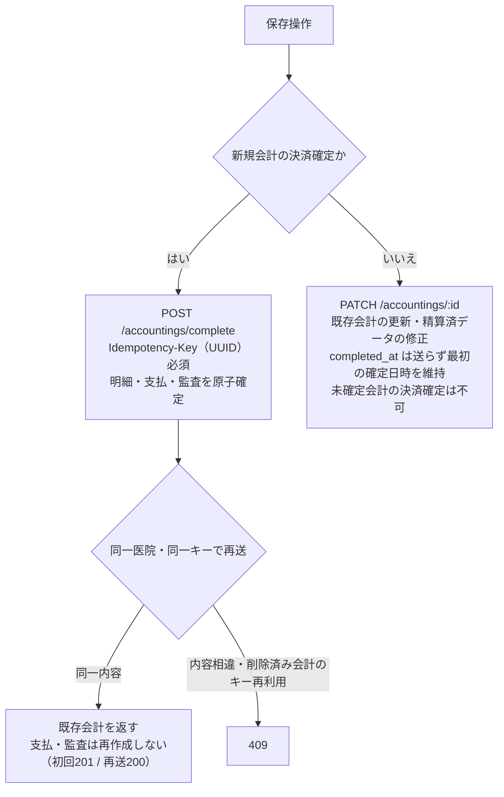

# 会計精算 詳細仕様書 (Accounting Detail)

| 管理項目 | 記載 |
|:---|:---|
| 文書ID・種別 | page.accounting.accounting-settlement／画面仕様 |
| 決定状態 | 既存本文は継承（決定根拠未確認）。初回〜第六群の決定状態は下記正本で区別 |
| 実装状態 | 既存記載を継承（再監査なし） |
| 実機検証状態 | 今回未実施。過去の記録と今回の文書確認を分ける |
| 文書確認日 | 2026-10-15（初回〜第六群への参照・現行との差分明示） |

## 今回合意と現行画面の区別

[初回5FRの業務正本](../lifecycle.md#accounting-agreement-first-five)・[合計92AC](../lifecycle.md#accounting-acceptance)に従う。同飼主の複数ペット／選択した未請求分の合算、元請求への任意額回収、未納／一部入金確定、理由付き訂正／取消／方法指定返金、締め後差分、根拠保存・単価手修正・割引併用は今回合意。[第二群](../lifecycle.md#accounting-agreement-second)で古い請求順／変更可・釣銭、予約前金、減額と実返金／訂正後表示、割合→金額と保険確認修正、帳票分離・再発行／旧履歴・過去未納表示、原請求日／実入出金日を合意。前金除外案は不採用で、充当時に新受領を作らない。[第三群](../lifecycle.md#accounting-agreement-third)で飼主単位預り金／予約任意・同飼主の別予約／ペット利用、割合合算→金額→割引後保険、同日作成順／理由付き保存後再配分、非現金超過の返金必要、別方法返金・金額追加承認なし、受領証／最終会計／返金元番号・再発行番号維持を合意。旧予約必須・未決表記は最新正本へ更新。[第四群](../lifecycle.md#accounting-agreement-fourth)で明細と会計全体の両割引、超過は入力エラーではなく警告し承認して進めた請求額は0円下限、会計取消時の預り金残高復元・実返金は別操作を合意。取消による解除・復元を残高へ反映する。残高式は業務正本へ従う。[第五群](../lifecycle.md#accounting-calculation-order)で明細→全体・明細後金額比の配賦、税抜計算／飼主向け税込表示、割合値引き額四捨五入・請求書税率別税切捨て、実値引き上限と他行転用なしを合意。計算例・保存根拠は正本へ参照し、本要約で新しい画面項目を定義しない。[第六群](../lifecycle.md#accounting-agreement-sixth)で複数保険会社（アニコムは例）、品目マスタの全体割引除外、飼主宛名・ペット別明細と訂正／部分返金の元取引・今回変更額の区別、管理者と対象変更権限付きスタッフのマスタ変更を合意。除外行は全体割引の対象額・配賦先から外す。保険会社／商品別の具体式、除外設定の初期値／移行等は未決。

以下の既存UI・API表・図・権限・計算式・旧FR／ACは現行／継承挙動の参照。単一ペット／カルテや全額支払の制約、返金理由／方法任意、割引選択・丸め等を今回の確定仕様にしない。具体的な画面構成・帳票紙面／保存形式・未納filter／基準日・現行grantとの対応は残件。新合意を現行権限の変更や全スタッフへの許可にしない。請求書／領収書の分離と旧帳票保持、今月売上なしの過去未納表示自体は合意済み。[現行との差分](../../../../design/domains/accounting/technical-spec.md#accounting-current-gap)を参照。今回の合意を現行実装済み／旧UAT合格と扱わない。

## 目的・対象範囲

| シナリオ | 業務上の価値 | 優先度・理由 |
|:---|:---|:---|
| 最新の未請求内容で精算する | 古い明細での精算確定を防ぐ | 未決／要確認（既存文書に優先度の根拠なし） |

### 概要

- **画面の目的**: 診療・サービス費用の精緻な計算、保険適用処理、支払い決済、およびインボイス制度で必要となる登録番号・税率別内訳等の帳票項目の出力。

## 利用者・権限・前提

- **アクセス権限**: ルートは `ResourceAccounting`（view/create）。画面内確定・編集（`canSubmit`）は **加えて `ResourceCashRegisterClose` の view** が必須。キャンセル=`ResourceAccountingCancel`、確定後修正=`ResourceAccountingPostCloseEdit`。

利用者の職種別の範囲は未記載／要確認。操作前提の詳細は本書の各操作・保存契約と関連正本を参照する。

## 入口・出口

- **URLパターン**: 
  - 新規作成: `/accounting/new?petId=xxx`
  - 編集・精算: `/accounting/:id`

| 入口／出口 | 契機 | 引継ぎ情報 | 根拠 |
|:---|:---|:---|:---|
| URLパターン | 画面を開く | 上記URL／既存導線。呼出元の網羅は要確認 | 本節の元記載 |
| 戻り先・他画面 | 本節の既存操作 | 記載が無い引継ぎ・戻り先は要確認 | 本節／関連フロー |

## 表示情報・入力項目

| 項目 | 意味 | 型／形式 | 必須／任意 | 初期値 | 候補元 | 制約／根拠 |
|:---|:---|:---|:---|:---|:---|:---|
| 明細・単価・数量・割引・金額 | 請求内容 | 未記載／要確認 | 未記載／要確認 | 連携明細・手動項目 | カルテ連携・商品・手入力 | 下記「明細管理エリア」 |
| 税率・内税／外税 | 項目別税区分 | 未記載／要確認 | 未記載／要確認 | 未記載／要確認 | 10%／8%／非課税 | 下記「明細管理エリア」 |
| 保険会社支払割合 | 保険控除の割合 | 百分率 | 未記載／要確認 | 未記載／要確認 | 新規50%／70%、保存済み90%／100%保持 | 下記「支払い・保険エリア」 |
| 支払内訳・お預かり金 | 複合決済・釣銭 | 未記載／要確認 | 未記載／要確認 | 未記載／要確認 | 支払方法、候補元は要確認 | 下記「支払い・保険エリア」 |
| 締め後修正理由 | 締め済み期間の修正理由 | 未記載／要確認 | 締め済み時必須 | 未記載／要確認 | 入力 | [保護と修正](#21-精算済みデータの保護と修正) |

### 1. 画面構成

#### 1.1 明細管理エリア (左カラム)

- **項目リスト**: カルテから自動連携された項目に加え、物販商品や手動項目（自由入力）を統合管理。
- **当日分/過去分の区分表示 (EMR-246)**: 新規会計の未請求候補は全期間から集約される（請求漏れ防止）が、`ItemListCard` が各行の `service_date`（発生日）で「当日分」「過去の未請求分」のセクションに分けて表示する。過去分が存在するときのみ見出しを出し、過去行は項目名セルに発生日バッジ（`aria-label` 付き）を表示する。`service_date` が無い行（手入力追加など）は当日分として扱う。日付の判定は JST 基準。
- **金額列の意味**: 明細行の「金額」列は税抜小計（単価×数量−割引額）。領収書の行金額 `recordedLineNet` と同式で、EMR-230 の金額直接編集（手入力/社販明細）の編集対象値とも一致する。
- **税率の個別制御**: 
    - 項目ごとに標準税率 (10%)、軽減税率 (8%)、非課税、内税/外税を個別に変更可能。
- **計算サマリ**: 税抜小計、消費税額、税込合計額をリアルタイム表示（税率別の内訳表示は印刷帳票のみ）。

#### 1.2 支払い・保険エリア (右カラム)

- **ペット保険窓口精算**:
    - 明細ごとの保険適用フラグに基づき、保険会社が支払う割合（新規は 50% / 70% の選択式。保存済みの 90% / 100% は表示を維持し、新規の選択肢には出さない。50% へ暗黙丸めしない）に応じた控除額を自動算出。飼主の窓口負担率ではない。`InsuranceCard` の選択値を使い、保険マスタの `coverage_rate` からは自動設定しない。
- **決済処理 (Payment Splits)**: 
    - **複数支払対応**: 「現金 5,000 円 ＋ クレジットカード残額」といった複合的な支払い（分割決済）をサポート。
    - **お釣り計算**: お預かり金額からの自動計算補助。

#### 2.3 インボイス制度への対応

- **帳票形式（継承・現行参照）**: A4 縦。診療明細書と領収書を 1 枚に集約して印字。[第二群の目標](../lifecycle.md#requirement-fr-accounting-document-and-aged-debt)は請求書と実受領額の領収書を分け、再発行表示と訂正前履歴を保持する。現行帳票を新要件対応済みとしない。
- **必須要件の網羅**: 
    - 適格請求書発行事業者登録番号。
    - 適用税率ごとの区分記載（8%対象、10%対象）。
    - 税率別消費税額。

## 操作・業務ルール・状態遷移

| 要件ID | 定義の所在 | 決定根拠 |
|:---|:---|:---|
| FR-accounting-stale-unbilled-completion-rejection | [既存の要件本文](#requirement-fr-accounting-stale-unbilled-completion-rejection) | 既存記載を継承。ID付与で合意済みにしない |

| 操作 | 実行条件 | 成功後状態／遷移 | 失敗挙動 | 根拠 |
|:---|:---|:---|:---|:---|
| 確定・修正・取消 | 操作別権限、集約版、締め後理由 | 精算済・既存更新・cancelled | 400／409、競合時は編集破棄して再取得 | 保存節の保護・競合・再試行契約 |

### 2. 業務・安全機能

## 保存・取消・再試行・同時編集

#### 2.1 精算済みデータの保護と修正

- **修正確認モーダル**: すでに「精算済」となった会計を修正・再保存しようとする際、「精算済みの会計を修正します」という確認ダイアログを強制表示。
- **レジ締め済み期間の編集**: 対象日（新規は JST 当日）がレジ締め確定済みの場合、修正理由（`post_close_reason`）を必須とする。理由が空、または `accounting-post-close-edit:edit` が無いときは確定ボタンを物理ブロックする。BE の `POST /accountings/complete` も FK 解決より先に理由を検証する。
- **会計キャンセル**: 誤請求等の場合、論理削除 (`status=cancelled`) を行うことで、監査証跡を残しつつ請求を無効化。

**確定日時の保護**: 精算済み会計の再保存では `completed_at` を送信せず、最初の確定日時を維持する。バックエンドはクライアントによる確定日時の指定を400で拒否する。支払内訳・金額・締め後修正理由はPATCHで送り、成功後に支払表示・一覧を更新する。新規会計の決済確定は専用Complete経路を使い、未確定の既存会計をPATCHで確定することはできない。

#### 2.2 会計中のカルテ追記との競合防止 (EMR-196)

- **楽観ロック**: 新規会計画面は `GET /billing-items/unbilled-details` の応答 `revision`（items+warnings の決定的フィンガープリント）を保持し、`POST /accountings/complete` の `expected_unbilled_revision` として返送する。`pet_id` 指定の complete では必須で、未指定・空値は400、集約が不一致なら409を返す（受付の差し戻し自体は従来どおり許可し、stale な表示のままの確定だけを物理ブロックする）。
- **409 応答**: `code=UNBILLED_ITEMS_CHANGED` と現在の集約版 `unbilled_revision` を返す。blocking unbilled warning（請求不能な予防接種候補）の検査は版照合より先に行われ、そちらの409が優先される。
- **画面の復帰導線**: 409 を検出した場合、再送はせずローカルの明細編集を破棄して最新の unbilled 集約を再取得し、`UnbilledConflictBanner`（`role="alert"`）で「最新の内容を確認してから再度確定」を案内する。バナーの再読み込みボタンで画面全体をリロードできる。

確定・更新経路の分岐と、同一キー再送時の応答：

#### 3.2 フロントエンド状態管理

- **`useActionState`**: 保存処理中の重複クリックを無効化（React 19）。
- **`paymentSplits`**: 複合決済の状態を `use-accounting-detail-state.ts` で一元管理。明細更新・返金・キャンセル等の非同期操作は React 19 の `useTransition` で処理中状態を管理。

#### 3.3 新規会計確定の再試行

- `Idempotency-Key` はUUID形式が必須。同一医院・同一キー・同一内容の再送は既存会計を返し、支払・監査を再作成しない（初回201、再送200）。同じキーで内容が異なる場合、または削除済み会計に使ったキーの再利用は409となる。
- `expected_unbilled_revision` は同一性判定の digest に含めない（操作内容ではなく前提条件のため）。409 で集約を再取得した後の再送は同じキー・同じ内容なら replay として扱われる。
- 画面は失敗後も、入力内容が同じ間はキーを保持して再試行に使う。入力内容の変更や画面再読込では新しいキーになる。通信切断で保存結果が不明なときは、会計一覧で登録状態を確認してから操作する。
- 別ドメインのAPIへ接続する環境では、このヘッダーのCORS許可も必要。バックエンドの固定allowlistに `Idempotency-Key` を含める。デプロイ後の確認は [STG readiness check](../../../../ops/deploy/runbooks/STG_PRE_DEPLOY_READINESS_CHECK.md) §3 を参照する（旧 [Vercel STG検証手順](../../../../ops/deploy/rehearsals/VERCEL-FRONTEND-STAGING-TEST.md) は EMR-255 以降 superseded）。

## エラー・空状態

| 状況 | 検知／表示 | 利用者の次の操作 | 根拠 |
|:---|:---|:---|:---|
| 未請求集約版の不一致 | 409・UnbilledConflictBanner | 編集破棄・再取得して内容確認 | 保存節の競合契約 |
| キー再利用・不正な確定日時 | 409または400 | 詳細は既存再試行／保護契約 | 保存節 |
| 通信切断で保存結果不明 | 結果不明 | 会計一覧で登録状態を確認 | 新規会計確定の再試行 |
| 明細0件・他のAPI失敗 | 未記載／要確認 | 未記載／要確認 | 要確認 |

## 受入条件

この表は既存仕様から抽出した代表条件。すべての入力・操作・異常系への要件IDと受入条件の網羅的対応は未記載／要確認。

| 条件ID | Given（前提） | When（操作） | Then（期待結果） | 独立確認 | 成功条件 | 確認手順／証跡 |
|:---|:---|:---|:---|:---|:---|:---|
| AC-accounting-stale-unbilled-completion-rejection | 表示後に未請求集約が変わった | 新規会計を確定しようとする | 競合を示して編集を破棄し最新内容を取得する | 明細変更と確定の組合せを確認 | 古い集約のまま精算確定されない | [要件](#requirement-fr-accounting-stale-unbilled-completion-rejection)・[既存UATの所在](../README.md#受入条件の所在)。実機未確認 |

## 未決事項・関連仕様・根拠

未記載の型・必須条件・初期値・エラー・受入結果は要確認。既存の未実装・判断待ち・臨床承認待ちは以下の元記載を維持する。今回の形式整理を合意や実装完了の根拠にしない。

[文書規約](../../../authoring-guide.md)・[ドメイン入口](../README.md)。根拠は整理前の既存仕様本文と、その本文が示す日付付き追記・関連資料。文書確認日は上記の構造確認日であり、過去の承認日を置き換えない。API表・コード名は参照情報で、wire型とDB定義の正本は文書規約に従う。

### 未実装の連携

保険会社へのオンライン請求送信（レセプト連携）は未実装。[#240](https://github.com/MinoruSoga/AnimalEkarte/issues/240) は PO の「着手しない」判断で Closed となっており、上記の窓口精算機能と区別する。

外部機器連携（ロール紙レシートプリンタへの直接印字、印刷連動のドロアーオープン、自動精算機・セルフレジ連携）はいずれも未実装。領収書出力は本画面の「明細兼領収書」（A4）をブラウザ印刷 / PDF 保存で行い、レジ現金管理は日次レジ締め（実現金入力・差額表示）で行う。機器連携には機種側の外部連携 API と個別の接続開発が前提となる（Plane EMR-171）。

---

### 3. 技術仕様

#### 3.1 集中計算エンジン (`calculations.ts`)

臨床（カルテ会計確認・入院）と会計で同一のロジック (`calculateBillingTotals`) を使用。印刷帳票 (`AccountingDocument`) は共通計算結果を props で受け取って再計算を避け、レイヤー間の丸め差を抑制します。帳票に印字するインボイス用の税率別内訳（8%/10%）は、丸め規則を固定した純関数 `calcTaxBreakdown`（`tax-breakdown.ts`）で算出します。

#### API連携

| メソッド | エンドポイント | 用途 | 必須権限 | 必須アクション |
|:---|:---|:---|:---|:---|
| GET | `/api/v1/accountings/:id` | 会計詳細および関連明細の取得 | `accounting` | `view` |
| GET | `/api/v1/billing-items/unbilled-details` | 新規会計の未請求候補・警告・集約版 `revision` の取得 | `accounting` | `view` |
| POST | `/api/v1/accountings/complete` | 新規会計の原子確定（明細・支払・監査。`Idempotency-Key` 必須、pet 指定時は `expected_unbilled_revision` 必須） | `accounting` | `create` |
| POST | `/api/v1/accountings` | レガシー新規作成（本画面の確定経路では使わない） | `accounting` | `create` |
| PATCH | `/api/v1/accountings/:id` | 既存会計の更新・精算済データの修正（未確定会計の決済確定は不可。確定は `POST /accountings/complete`） | `accounting` | `edit` |
| POST | `/api/v1/accountings/:id/refunds` | 理由を伴う部分返金の記録 | `accounting` | `create` |
| POST | `/api/v1/accountings/:id/credit-correction` | 確定済みカード金額の確定後訂正 | `accounting-post-close-edit` | `edit` |
| POST | `/api/v1/accountings/:id/cancel` | 会計のキャンセル（論理削除） | `accounting-cancel` | `edit` |

