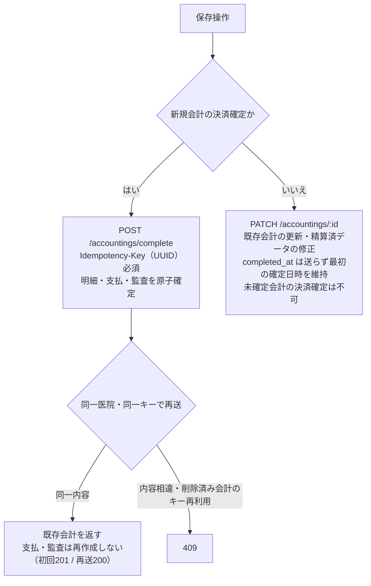

# 会計精算 詳細仕様書 (Accounting Detail)

| 管理項目 | 記載 |
|:---|:---|
| 文書ID・種別 | page.accounting.accounting-settlement／画面仕様 |
| 決定状態 | 2026-10-17追加決定は末尾と進捗入口を参照。従来：既存本文は継承（決定根拠未確認）。初回〜第十群の決定状態は下記正本で区別 |
| 実装状態 | 既存記載を継承（再監査なし） |
| 実機検証状態 | 今回未実施。過去の記録と今回の文書確認を分ける |
| 文書確認日 | 2026-10-17追加差分（従来確認2026-10-15）（初回〜第十群への参照・現行との差分明示） |

## 今回合意と現行画面の区別

[初回5FRの業務正本](../lifecycle.md#accounting-agreement-first-five)・[正本ライフサイクル本文181AC（基準174AC＋後続7AC）](../lifecycle.md#accounting-acceptance)に従う。同飼主の複数ペット／選択した未請求分の合算、元請求への任意額回収、未納／一部入金確定、理由付き訂正／取消／方法指定返金、締め後差分、根拠保存・単価手修正・割引併用は今回合意。[第二群](../lifecycle.md#accounting-agreement-second)で古い請求順／変更可・釣銭、予約前金、減額と実返金／訂正後表示、割合→金額と保険確認修正、帳票分離・再発行／旧履歴・過去未納表示、原請求日／実入出金日を合意。前金除外案は不採用で、充当時に新受領を作らない。[第三群](../lifecycle.md#accounting-agreement-third)で飼主単位預り金／予約任意・同飼主の別予約／ペット利用、割合合算→金額→割引後保険、同日作成順／理由付き保存後再配分、非現金超過の返金必要、別方法返金・金額追加承認なし、受領証／最終会計／返金元番号・再発行番号維持を合意。旧予約必須・未決表記は最新正本へ更新。[第四群](../lifecycle.md#accounting-agreement-fourth)で明細と会計全体の両割引、超過は入力エラーではなく警告し承認して進めた請求額は0円下限、会計取消時の預り金残高復元・実返金は別操作を合意。取消による解除・復元を残高へ反映する。残高式は業務正本へ従う。[第五群](../lifecycle.md#accounting-calculation-order)で明細→全体・明細後金額比の配賦、税抜計算／飼主向け税込表示、割合値引き額四捨五入・請求書税率別税切捨て、実値引き上限と他行転用なしを合意。計算例・保存根拠は正本へ参照し、本要約で新しい画面項目を定義しない。[第六群](../lifecycle.md#accounting-agreement-sixth)で複数保険会社（アニコムは例）、品目マスタの全体割引除外、飼主宛名・ペット別明細と訂正／部分返金の元取引・今回変更額の区別、管理者と対象変更権限付きスタッフのマスタ変更を合意。除外行は全体割引の対象額・配賦先から外す。[第七群](../lifecycle.md#accounting-insurance-window-scope)で資格／残限度はスタッフが外部画面等で確認して結果・保険負担額を記録し、窓口会計に限定。保険会社への請求・入金照合・査定差額管理と同一診療費への複数契約併用は対象外で、利用契約は会計ごと・ペットごとに1つ。会社／商品別の自動給付算式は今回の前提にしない。除外初期値／欠落時の意味と追加後反映は第十群で合意済み。

[第八群](../lifecycle.md#accounting-agreement-eighth)では、減額で解除する預り金を元飼主残高へ戻し、現金・カード併用時はスタッフが内訳を選択確認する。実返金は別操作。預り金は自動失効させず同医院・同飼主のみとする。取消後は元明細を選択確認し新番号で再請求して元取消請求へ関連付け、二重請求と金銭履歴の複製を防ぐ。新規会計と過去未納回収は同じ操作で扱い、支払額を元請求別に指定できる。過去未納を新請求の売上へ積み直さない。帳票のペットに紐づかない料金は「共通料金」別枠とし、架空のペットへ付けない。別医院移行・別飼主譲渡、督促・貸倒管理は今回対象外。

画面上では預り金の解除／復元額・残る有効充当と未払額・現金／カード側の返金必要額／実返金を区別し、確認前後の内訳を照合する。再請求の選択元明細と新旧請求リンク、同時回収の新請求／過去請求別の配分と残額を確認できる設計へ。第九群の継承値／必要な修正、旧入金の確認充当、保険再確認、返金元内訳と理由を示す設計へ。新URL・ボタン名・保存形式等は設計残件で、内訳／理由以外の追加必須入力は確定しない。

[第九群](../lifecycle.md#accounting-rebill-snapshot-payment-source)では、再請求に元会計の価格・税・割引を初期継承し必要箇所だけスタッフが修正する。取消元に残る入金は自動移動せず、元資金・利用可能残・新請求・額を確認して充当し、元実受領額／日付と履歴を保持する。復元済み預り金は別の確認充当へ。保険結果も今回のペット／契約・対象明細で再確認して利用する。返金元の現金・カード・預り金の内訳が不明なら、記録を確認し内訳と理由を登録するまで対象返金を確定しない。元資金の内訳と実際の返金方法は別で、登録だけで実返金済みにしない。

[第十群](../lifecycle.md#accounting-empty-rounding-master)では、明細なし請求は確定不可、0円でも実際の明細と理由を保持。単価×数量の1円未満は行ごとに四捨五入してから値引き。除外初期値／設定欠落時は対象外にしない。追加済み行はmaster変更で自動更新せずスタッフ明示的再適用、確定後は訂正経路へ。

目標の[3画面・帳票契約](../../../../design/domains/accounting/technical-spec.md#accounting-screen-contract)と[操作／旧値／受け手](../../../../design/domains/accounting/technical-spec.md#accounting-reconciled-contract)を適用。取得中／失敗／真の0件／認可拒否を分け、未取得を0円／未納なしにしない。対象とrequest世代が違う遅延応答は採用せず、結果不明は同一operation照会、競合／失効は保存停止して未保存編集を保護。未対応の新業務を下記旧APIへ押し込まずadapterと実装受入が整うまで該当操作を開始しない。

[支払方法停止の追加合意](../lifecycle.md#accounting-inactive-payment-method)では、停止した方法を新しい入金で選べなくし、過去支払記録・帳票参照・方法別集計は保持する。後日回収や預り金の新規受領も新入金であり、保存前の停止を検査する。保存済み資金の再配分・充当・解除／復元、返金・金額不変の方法訂正へ新受領の制限を一律適用しない。取得失敗／候補0件・未保存保護・成立済み再送は[追加設計](../../../../design/domains/accounting/technical-spec.md#accounting-inactive-payment-design)へ従う。実入金を伴わない未納／0円確定に架空の入金方法を要求しない。

[品目別保険設定の追加合意](../lifecycle.md#requirement-fr-accounting-item-insurance-setting)により、診察・処置・予防・健診も薬剤・検査と同様に元品目の保険対象設定を会計へ受ける。品目設定と会計で確認修正した対象区分・資格／残限度・保険負担額を区別し、「対象」を自動で実適用／補償保証にしない。全体割引除外・税・明細値引きとは独立。追加済み行・過去帳票はmaster変更で自動更新せず、編集中の明示再適用／確定後の既決訂正へ接続する。新規登録の4種別は保険対象外を初期値とするが、既存明示値・保存済み会計は変更しない。旧欠落の一括解釈は後続の移行課題であり、新規機能の採否未決へ戻さず、取得失敗を対象外設定へ補完しない。設定writer・読取・snapshot・競合／再送の[追加設計](../../../../design/domains/accounting/technical-spec.md#accounting-item-insurance-design)に従う。

以下の既存UI・API表・図・権限・計算式・旧FR／ACは現行／継承挙動の参照。単一ペット／カルテや全額支払の制約、返金理由／方法任意、割引選択・丸め等を今回の確定仕様にしない。情報・filter／基準日と取得／保存の意味契約は全体設計、レイアウト・物理形式・実grantの適合は後続実装へ。新合意を現行権限の変更や全スタッフへの許可にしない。請求書／領収書の分離と旧帳票保持、今月売上なしの過去未納表示自体は合意済み。[現行との差分](../../../../design/domains/accounting/technical-spec.md#accounting-current-gap)を参照。今回の合意を現行実装済み／旧UAT合格と扱わない。

## 目的・対象範囲

| シナリオ | 業務上の価値 | 優先度・理由 |
|:---|:---|:---|
| 最新の未請求内容で精算する | 古い明細での精算確定を防ぐ | 未決／要確認（既存文書に優先度の根拠なし） |

### 概要

- **画面の目的**: 診療・サービス費用の精緻な計算、保険適用処理、支払い決済、およびインボイス制度で必要となる登録番号・税率別内訳等の帳票項目の出力。

## 利用者・権限・前提

- **アクセス権限**: ルートは `ResourceAccounting`（view/create）。画面内確定・編集（`canSubmit`）は **加えて `ResourceCashRegisterClose` の view** が必須。キャンセル=`ResourceAccountingCancel`、確定後修正=`ResourceAccountingPostCloseEdit`。

利用者の職種別の範囲は未記載／要確認。操作前提の詳細は本書の各操作・保存契約と関連正本を参照する。

## 入口・出口

- **URLパターン**: 
  - 新規作成: `/accounting/new?petId=xxx`
  - 編集・精算: `/accounting/:id`

| 入口／出口 | 契機 | 引継ぎ情報 | 根拠 |
|:---|:---|:---|:---|
| URLパターン | 画面を開く | 上記URL／既存導線。呼出元の網羅は要確認 | 本節の元記載 |
| 戻り先・他画面 | 本節の既存操作 | 記載が無い引継ぎ・戻り先は要確認 | 本節／関連フロー |

## 表示情報・入力項目

| 項目 | 意味 | 型／形式 | 必須／任意 | 初期値 | 候補元 | 制約／根拠 |
|:---|:---|:---|:---|:---|:---|:---|
| 明細・単価・数量・割引・金額 | 請求内容 | 未記載／要確認 | 未記載／要確認 | 連携明細・手動項目 | カルテ連携・商品・手入力 | 下記「明細管理エリア」 |
| 税率・内税／外税 | 項目別税区分 | 未記載／要確認 | 未記載／要確認 | 未記載／要確認 | 10%／8%／非課税 | 下記「明細管理エリア」 |
| 品目由来の保険対象設定／会計での確認修正値 | 元品目の対象／対象外と今回の確認値を区別 | [追加設計](../../../../design/domains/accounting/technical-spec.md#accounting-item-insurance-design)の意味型 | 新規4種別は初期値を表示し、毎回の手動選択必須化なし | 新規登録は保険対象外。旧欠落の解釈・変換は後続の移行課題。保存済み会計はsnapshot維持 | 対象品目／保存済み明細・スタッフ確認 | 品目設定だけで資格・補償を保証せず、全体割引除外と独立 |
| 保険会社支払割合 | 保険控除の割合 | 百分率 | 未記載／要確認 | 未記載／要確認 | 新規50%／70%、保存済み90%／100%保持 | 下記「支払い・保険エリア」 |
| 支払内訳・お預かり金 | 複合決済・釣銭 | 未記載／要確認 | 未記載／要確認 | 未記載／要確認 | 現行は固定4種。新受領の目標は現在有効な方法のみ | [停止合意](../lifecycle.md#accounting-inactive-payment-method)と下記「支払い・保険エリア」。保存済み履歴の方法は保持 |
| 締め後修正理由 | 締め済み期間の修正理由 | 未記載／要確認 | 締め済み時必須 | 未記載／要確認 | 入力 | [保護と修正](#21-精算済みデータの保護と修正) |

### 1. 画面構成

#### 1.1 明細管理エリア (左カラム)

- **項目リスト**: カルテから自動連携された項目に加え、物販商品や手動項目（自由入力）を統合管理。
- **当日分/過去分の区分表示 (EMR-246)**: 新規会計の未請求候補は全期間から集約される（請求漏れ防止）が、`ItemListCard` が各行の `service_date`（発生日）で「当日分」「過去の未請求分」のセクションに分けて表示する。過去分が存在するときのみ見出しを出し、過去行は項目名セルに発生日バッジ（`aria-label` 付き）を表示する。`service_date` が無い行（手入力追加など）は当日分として扱う。日付の判定は JST 基準。
- **明細の項目名**: 権限あるスタッフが今回会計の項目名を編集でき、社販の処理済み目安として年月等を記録できる。元マスタ名は変更せず、名前変更だけで価格・割引・税・保険・実施状態を変更しない。確定後は既存の理由／履歴付き会計訂正条件を維持する。根拠はBacklog Phase1 No.59 F60:G60、2026-10-07回答。
- **金額列の意味**: 明細行の「金額」列は税抜小計（単価×数量−割引額）。領収書の行金額 `recordedLineNet` と同式で、EMR-230 の金額直接編集（手入力/社販明細）の編集対象値とも一致する。
- **税率の個別制御**: 
    - 項目ごとに標準税率 (10%)、軽減税率 (8%)、非課税、内税/外税を個別に変更可能。
- **計算サマリ**: 税抜小計、消費税額、税込合計額をリアルタイム表示（税率別の内訳表示は印刷帳票のみ）。

| 条件ID | 前提／操作 | 期待結果 | 検証状態 |
|:---|:---|:---|:---|
| AC-accounting-line-name-edit | 今回会計の項目名へ社販年月等を追記し保存・再表示する | 編集名を保持、マスタ名と金額条件は名前変更だけで変わらない。確定後は既存訂正理由・権限・履歴を適用 | No.59。未実施 |

#### 1.2 支払い・保険エリア (右カラム)

- **ペット保険窓口精算（継承・現行参照）**:
    - 目標は[第七群のスタッフ確認・記録](../lifecycle.md#accounting-insurance-window-scope)。未確認／不明を有効にせず、窓口利用不可と補償対象外を区別する。下記の現行自動控除だけで目標対応済みとはしない。
    - 以下は継承実装の説明であり、品目設定だけで適用可とする目標契約ではない。明細ごとの保険適用フラグに基づき、保険会社が支払う割合（新規は 50% / 70% の選択式。保存済みの 90% / 100% は表示を維持し、新規の選択肢には出さない。50% へ暗黙丸めしない）に応じた控除額を自動算出。飼主の窓口負担率ではない。`InsuranceCard` の選択値を使い、保険マスタの `coverage_rate` からは自動設定しない。
- **決済処理 (Payment Splits)**: 
    - **複数支払対応**: 「現金 5,000 円 ＋ クレジットカード残額」といった複合的な支払い（分割決済）をサポート。
    - **お釣り計算**: お預かり金額からの自動計算補助と、[No.30の手動修正・金額整合](../lifecycle.md#accounting-manual-change-reconciliation-20261017)を区別する。釣銭だけ変更して未整合のまま完了せず、実際の預かり・返却・請求充当・過受領の扱いを確認する。部分入金を全面禁止せず、[過受領の訂正・返金・了承付き預り金登録](../lifecycle.md#accounting-excess-receipt-resolution-20261017)を適用する。UI配置・保存方式は設計とし、処理の採否を再質問する未決には戻さない。同じ現金移動を預り金登録で再受領扱いにしない。

#### 2.3 インボイス制度への対応

- **帳票形式（継承・現行参照）**: A4 縦。診療明細書と領収書を 1 枚に集約して印字。[第二群の目標](../lifecycle.md#requirement-fr-accounting-document-and-aged-debt)は請求書と実受領額の領収書を分け、再発行表示と訂正前履歴を保持する。現行帳票を新要件対応済みとしない。
- **必須要件の網羅**: 
    - 適格請求書発行事業者登録番号。
    - 適用税率ごとの区分記載（8%対象、10%対象）。
    - 税率別消費税額。

## 操作・業務ルール・状態遷移

| 要件ID | 定義の所在 | 決定根拠 |
|:---|:---|:---|
| FR-accounting-stale-unbilled-completion-rejection | [既存の要件本文](#requirement-fr-accounting-stale-unbilled-completion-rejection) | 既存記載を継承。ID付与で合意済みにしない |

| 操作 | 実行条件 | 成功後状態／遷移 | 失敗挙動 | 根拠 |
|:---|:---|:---|:---|:---|
| 確定・修正・取消 | 操作別権限、集約版、締め後理由 | 精算済・既存更新・cancelled | 400／409、競合時は手修正・入力を保持し差異確認 | 保存節の保護・競合・再試行契約 |

### 2. 業務・安全機能

## 保存・取消・再試行・同時編集

#### 2.1 精算済みデータの保護と修正

- **修正確認モーダル**: すでに「精算済」となった会計を修正・再保存しようとする際、「精算済みの会計を修正します」という確認ダイアログを強制表示。
- **レジ締め済み期間の編集**: 対象日（新規は JST 当日）がレジ締め確定済みの場合、修正理由（`post_close_reason`）を必須とする。理由が空、または `accounting-post-close-edit:edit` が無いときは確定ボタンを物理ブロックする。BE の `POST /accountings/complete` も FK 解決より先に理由を検証する。
- **会計キャンセル**: 誤請求等の場合、論理削除 (`status=cancelled`) を行うことで、監査証跡を残しつつ請求を無効化。

**確定日時の保護**: 精算済み会計の再保存では `completed_at` を送信せず、最初の確定日時を維持する。バックエンドはクライアントによる確定日時の指定を400で拒否する。支払内訳・金額・締め後修正理由はPATCHで送り、成功後に支払表示・一覧を更新する。新規会計の決済確定は専用Complete経路を使い、未確定の既存会計をPATCHで確定することはできない。

#### 2.2 会計中のカルテ追記との競合防止 (EMR-196)

- **楽観ロック**: 新規会計画面は `GET /billing-items/unbilled-details` の応答 `revision`（items+warnings の決定的フィンガープリント）を保持し、`POST /accountings/complete` の `expected_unbilled_revision` として返送する。`pet_id` 指定の complete では必須で、未指定・空値は400、集約が不一致なら409を返す（受付の差し戻し自体は従来どおり許可し、stale な表示のままの確定だけを物理ブロックする）。
- **409 応答**: `code=UNBILLED_ITEMS_CHANGED` と現在の集約版 `unbilled_revision` を返す。blocking unbilled warning（請求不能な予防接種候補）の検査は版照合より先に行われ、そちらの409が優先される。
- **画面の復帰導線**: 409では古い集約での確定を止め、ローカルの手修正を保持して最新の unbilled 集約との差異を確認する。未確定未手修正だけを自動同期し、手修正済みはスタッフが反映判断する。以下のバナーは既存UI参照で、全面リロードによる編集破棄を目標としない。`UnbilledConflictBanner`（`role="alert"`）で「最新の内容を確認してから再度確定」を案内する。バナーの再読み込みボタンで画面全体をリロードできる。

確定・更新経路の分岐と、同一キー再送時の応答：

#### 3.2 フロントエンド状態管理

- **`useActionState`**: 保存処理中の重複クリックを無効化（React 19）。
- **`paymentSplits`**: 複合決済の状態を `use-accounting-detail-state.ts` で一元管理。明細更新・返金・キャンセル等の非同期操作は React 19 の `useTransition` で処理中状態を管理。

#### 3.3 新規会計確定の再試行

- `Idempotency-Key` はUUID形式が必須。同一医院・同一キー・同一内容の再送は既存会計を返し、支払・監査を再作成しない（初回201、再送200）。同じキーで内容が異なる場合、または削除済み会計に使ったキーの再利用は409となる。
- `expected_unbilled_revision` は同一性判定の digest に含めない（操作内容ではなく前提条件のため）。409 で集約を再取得した後の再送は同じキー・同じ内容なら replay として扱われる。
- 画面は失敗後も、入力内容が同じ間はキーを保持して再試行に使う。入力内容の変更や画面再読込では新しいキーになる。通信切断で保存結果が不明なときは、会計一覧で登録状態を確認してから操作する。
- 別ドメインのAPIへ接続する環境では、このヘッダーのCORS許可も必要。バックエンドの固定allowlistに `Idempotency-Key` を含める。デプロイ後の確認は [STG readiness check](../../../../ops/deploy/runbooks/STG_PRE_DEPLOY_READINESS_CHECK.md) §3 を参照する（旧 [Vercel STG検証手順](../../../../ops/deploy/rehearsals/VERCEL-FRONTEND-STAGING-TEST.md) は EMR-255 以降 superseded）。

## エラー・空状態

| 状況 | 検知／表示 | 利用者の次の操作 | 根拠 |
|:---|:---|:---|:---|
| 未請求集約版の不一致 | 409・UnbilledConflictBanner | 手修正・入力保持、最新との差異確認と反映判断 | 保存節の競合契約 |
| キー再利用・不正な確定日時 | 409または400 | 詳細は既存再試行／保護契約 | 保存節 |
| 通信切断で保存結果不明 | 結果不明 | 会計一覧で登録状態を確認 | 新規会計確定の再試行 |
| 明細0件・他のAPI失敗 | 未記載／要確認 | 未記載／要確認 | 要確認 |

## 受入条件

この表は既存仕様から抽出した代表条件。すべての入力・操作・異常系への要件IDと受入条件の網羅的対応は未記載／要確認。

| 条件ID | Given（前提） | When（操作） | Then（期待結果） | 独立確認 | 成功条件 | 確認手順／証跡 |
|:---|:---|:---|:---|:---|:---|:---|
| AC-accounting-stale-unbilled-completion-rejection | 表示後に未請求集約が変わった | 新規会計を確定しようとする | 競合を示して入力・手修正を保持し最新内容との差異確認へ。未手修正のみ自動同期し古い集約で確定しない | 明細変更と確定の組合せを確認 | 古い集約のまま精算確定されない | [要件](#requirement-fr-accounting-stale-unbilled-completion-rejection)・[既存UATの所在](../README.md#受入条件の所在)。実機未確認 |

## 未決事項・関連仕様・根拠

未記載の型・必須条件・初期値・エラー・受入結果は要確認。既存の未実装・判断待ち・臨床承認待ちは以下の元記載を維持する。今回の形式整理を合意や実装完了の根拠にしない。

[文書規約](../../../authoring-guide.md)・[ドメイン入口](../README.md)。根拠は整理前の既存仕様本文と、その本文が示す日付付き追記・関連資料。文書確認日は上記の構造確認日であり、過去の承認日を置き換えない。API表・コード名は参照情報で、wire型とDB定義の正本は文書規約に従う。

### 未実装の連携

保険会社へのオンライン請求送信（レセプト連携）は未実装。[#240](https://github.com/MinoruSoga/AnimalEkarte/issues/240) は PO の「着手しない」判断で Closed となっており、上記の窓口精算機能と区別する。[第七群](../lifecycle.md#accounting-insurance-window-scope)では請求送信に加え、保険会社からの入金照合・査定差額管理も今回の対象外。AnimalEkarte内の訂正だけで外部保険状態を変更したり変更済みと表示したりしない。

外部機器連携（ロール紙レシートプリンタへの直接印字、印刷連動のドロアーオープン、自動精算機・セルフレジ連携）はいずれも未実装。領収書出力は本画面の「明細兼領収書」（A4）をブラウザ印刷 / PDF 保存で行い、レジ現金管理は日次レジ締め（実現金入力・差額表示）で行う。機器連携には機種側の外部連携 API と個別の接続開発が前提となる（Plane EMR-171）。

---

### 3. 技術仕様

#### 3.1 集中計算エンジン (`calculations.ts`)

臨床（カルテ会計確認・入院）と会計で同一のロジック (`calculateBillingTotals`) を使用。印刷帳票 (`AccountingDocument`) は共通計算結果を props で受け取って再計算を避け、レイヤー間の丸め差を抑制します。帳票に印字するインボイス用の税率別内訳（8%/10%）は、丸め規則を固定した純関数 `calcTaxBreakdown`（`tax-breakdown.ts`）で算出します。

#### API連携

| メソッド | エンドポイント | 用途 | 必須権限 | 必須アクション |
|:---|:---|:---|:---|:---|
| GET | `/api/v1/accountings/:id` | 会計詳細および関連明細の取得 | `accounting` | `view` |
| GET | `/api/v1/billing-items/unbilled-details` | 新規会計の未請求候補・警告・集約版 `revision` の取得 | `accounting` | `view` |
| POST | `/api/v1/accountings/complete` | 新規会計の原子確定（明細・支払・監査。`Idempotency-Key` 必須、pet 指定時は `expected_unbilled_revision` 必須） | `accounting` | `create` |
| POST | `/api/v1/accountings` | レガシー新規作成（本画面の確定経路では使わない） | `accounting` | `create` |
| PATCH | `/api/v1/accountings/:id` | 既存会計の更新・精算済データの修正（未確定会計の決済確定は不可。確定は `POST /accountings/complete`） | `accounting` | `edit` |
| POST | `/api/v1/accountings/:id/refunds` | 理由を伴う部分返金の記録 | `accounting` | `create` |
| POST | `/api/v1/accountings/:id/credit-correction` | 確定済みカード金額の確定後訂正 | `accounting-post-close-edit` | `edit` |
| POST | `/api/v1/accountings/:id/cancel` | 会計のキャンセル（論理削除） | `accounting-cancel` | `edit` |

### 死亡登録後の生前診療の精算

[死亡後精算の正本](../lifecycle.md#accounting-posthumous-settlement)に従い、対象患者・生前の元明細／請求を確認し、死亡状態を戻さず理由と履歴付きで精算・回収・誤記訂正を行う。通常新規診療の選択拒否をこの専用入口へ一律適用せず、過去請求・預り金の元飼主帰属と現在認可・期待版・再送条件を保持する。新臨床行為や自動返金・在庫返却は生じさせない。

## 2026-10-17確定仕様との接続

[決定根拠・適用範囲](../../SPECIFICATION_PROGRESS.md#confirmed-business-decisions-20261017)：ユーザーの2026-10-16〜17 JSTの直接決定、文書更新承認は10月17日03:20 JST。以下は目標仕様・未実行の受入条件であり、実装・実機合格を示さない。

[業務正本・受入条件](../lifecycle.md#doctor-review-sync-billing-20261017)。会計ページは医師確認前から準備し待ち・金額未確定を表示する。確定精算は医師確認後。会計タブチェックが医師確認、診療終了で会計待ちへ進み、受付カードの確認状態は別軸とする。確認後の金額だけの変更は警告了承で可、薬剤処置追加削除・数量変更は再確認まで停止。未確定未手修正はプラン自動同期、手修正済みは値保護と差異判断、確定後は専用訂正。会計からプランへの自動逆書換えなし。通常請求対象は実施済み、持帰薬物販は内容数量確定・準備完了で、予定・実引渡し・在庫出庫と分離する。

## Backlog原条文の補足受入条件

保存済み原Q/Aと既存業務契約の照合による補足。対応済みという旧回答は実装・実機検証の合格証明に用いない。後続の本人合意、医院scope、権限、履歴・会計訂正の既存条件を維持する。

### 2.3 インボイス制度への対応

| 条件ID | 受入条件 | 根拠 | 検証状態 |
|:---|:---|:---|:---|
| AC-accounting-invoice-registration-number-output | 医院の発行事業者登録番号が設定済み／対象帳票を表示・印刷する／対象医院の登録番号を既存の帳票必要項目として出力し、請求額と実受領額を混同しない。再発行・旧版は既決の発行履歴に従う。 | Phase1 F4:G4 | 未実施 |

### 明細管理エリア／物販・その他追加

物販等の追加時に既存マスタの品目を選択し、品名と単価を明細へ取り込める。正規の手入力その他とは区別し、追加後のsnapshot・単価手修正・税率・確定後訂正はD10の既決を維持する。

| 条件ID | 受入条件 | 根拠 | 検証状態 |
|:---|:---|:---|:---|
| AC-accounting-merchandise-master-selection | 医院の有効な物販マスタに品名・単価がある／追加で当該品目を選択する／品名・単価が対象明細へ入り、別医院や無効な新規品目を選択扱いにしない。追加後のmaster変更で既存明細は無断更新しない。 | Phase1 F15:G15 | 未実施 |

### 飼主未納サマリー

会計画面で対象飼主の未入金件数と未納合計金額を確認できる。表示の対象はD10の既存医院・飼主・元請求・残額の範囲とし、今回会計の合計や未請求候補と混同しない。

| 条件ID | 受入条件 | 根拠 | 検証状態 |
|:---|:---|:---|:---|
| AC-accounting-owner-unpaid-summary | 対象飼主に残額がある確定請求が複数存在する／当該飼主の会計画面を開く／未入金件数と未納合計が同じ元請求の範囲で表示され、今回新請求へ過去売上を再生成しない。取得失敗を0件0円としない。 | Phase1 F31:G31 | 未実施 |

### 2.3 インボイス制度への対応

| 条件ID | 受入条件 | 根拠 | 検証状態 |
|:---|:---|:---|:---|
| AC-accounting-a4-document-output | A4明細兼領収書をブラウザ印刷／PDF保存する際、インボイス登録番号と税率別内訳が同じ保存対象に対応して出力される。請求と実受領の別帳票契約を維持し、ロール紙直接印字・ドロアー連動を起動しない。 | Phase1 F37:G37 | 未実施 |

### 割引初期値／飼主設定との引継ぎ

| 条件ID | 受入条件 | 根拠 | 検証状態 |
|:---|:---|:---|:---|
| AC-accounting-owner-discount-default | 飼主マスタに登録済み値引率あり／未登録を比較すると、それぞれ今回会計の値引初期値へ登録値／0を反映する。ペット別の新値引率マスタを作らず、既存の手修正や確定済みsnapshotを飼主設定変更で上書きしない。 | Phase1 F60:G60 | 未実施 |

### 1.1 明細管理エリア

| 条件ID | 受入条件 | 根拠 | 検証状態 |
|:---|:---|:---|:---|
| AC-accounting-line-unit-quantity-amount | 会計行の単価800・数量2・割引なしを表示すると、単価800／数量2／税抜行金額1,600を同時に確認できる。割引ありでは既存の単価×数量−割引と端数規則に対応し、税額・請求総額と混同しない。 | Phase1 F61:G61 | 未実施 |

### 1.1 明細管理エリア

| 条件ID | 受入条件 | 根拠 | 検証状態 |
|:---|:---|:---|:---|
| AC-accounting-manual-line-amount-quantity-edit | 権限あるスタッフが会計で追加した社販等の明細の行金額／数量を直接修正し保存・再表示すると、選択した同じ行の変更値と既存計算根拠を保持する。確定済みは既存理由付き会計訂正へ進む。カルテ由来行の価格だけの変更と臨床数量変更は最新の警告／医師再確認の別契約へ従い、一律変更禁止に戻さない。 | Phase1 F61:G61 | 未実施 |

## 手入力その他の追加の補足受入条件

保存済みSlack SLK-304とBacklog No.40 F41:G41のマスタにない品目は、既存の正規の手入力その他明細として扱う。既存行の単価修正と行の追加を区別し、マスタの自動作成や、カルテ側の診療記録の自動書換えに置き換えない。

| 条件ID | 前提／操作 | 期待結果 | 根拠・検証状態 |
|:---|:---|:---|:---|
| AC-accounting-manual-other-create | 権限あるスタッフがマスタにない品目を正規の手入力その他として追加し、名称・単価・数量を入力して保存・再表示する | 入力した同じ明細を保持し、マスタ選択行と混同せず元マスタは作成・変更しない。既存の必要理由・税／割引・医師確認・確定後訂正の条件を維持し、カルテを自動変更しない | SLK-304、No.40、既存自由入力契約。未実施 |

## 飼主との購入内容確認の補足受入条件

保存済みSlack SLK-191（2026-09-03 黒木）の購入内容を顧客と確認する要求は、既存会計明細画面または提示する帳票で満たす。今回の品目・数量・金額が対象会計と一致することを確認し、スタッフ限定の特記を混入させない。スマレジ導入の納品後延期とは別に保持する。新しい顧客専用画面・モニター・機器API・確認チェック欄を設ける指定ではない。提示、医師確認、請求確定、実入金は別判定とする。

| 条件ID | 前提／操作 | 期待結果 | 根拠・検証状態 |
|:---|:---|:---|:---|
| AC-accounting-owner-purchase-review | 対象会計の既存明細画面または帳票を飼主と確認する | 同じ対象の購入品目・数量・金額を照合できる。提示内容へ非公開スタッフ情報を含めず、閲覧だけで確定・支払・プラン更新・新送信を起動しない | SLK-191、既存会計明細/帳票契約。未実施 |
