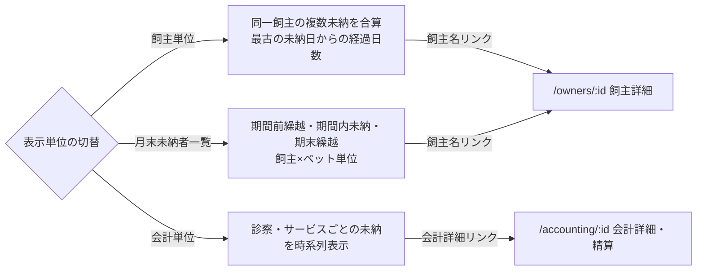

# 未納者一覧（売掛管理） 仕様書 (Unpaid List)

| 管理項目 | 記載 |
|:---|:---|
| 文書ID・種別 | page.accounting.unpaid-list／画面仕様 |
| 決定状態 | 2026-10-17追加決定は末尾と進捗入口を参照。従来：既存本文は継承（決定根拠未確認）。初回〜第十群の決定状態は下記正本で区別 |
| 実装状態 | 既存記載を継承（再監査なし） |
| 実機検証状態 | 今回未実施。過去の記録と今回の文書確認を分ける |
| 文書確認日 | 2026-10-17追加差分（従来確認2026-10-15）（初回〜第十群への参照・現行との差分明示） |

## 今回合意と現行画面の区別

[初回5FRの業務正本](../lifecycle.md#accounting-agreement-first-five)・[合計151AC](../lifecycle.md#accounting-acceptance)に従う。同飼主の複数ペット／選択した未請求分の合算、元請求への任意額回収、未納／一部入金確定、理由付き訂正／取消／方法指定返金、締め後差分、根拠保存・単価手修正・割引併用は今回合意。[第二群](../lifecycle.md#accounting-agreement-second)で古い請求順／変更可・釣銭、予約前金、減額と実返金／訂正後表示、割合→金額と保険確認修正、帳票分離・再発行／旧履歴・過去未納表示、原請求日／実入出金日を合意。前金除外案は不採用で、充当時に新受領を作らない。[第三群](../lifecycle.md#accounting-agreement-third)で飼主単位預り金／予約任意・同飼主の別予約／ペット利用、割合合算→金額→割引後保険、同日作成順／理由付き保存後再配分、非現金超過の返金必要、別方法返金・金額追加承認なし、受領証／最終会計／返金元番号・再発行番号維持を合意。旧予約必須・未決表記は最新正本へ更新。[第四群](../lifecycle.md#accounting-agreement-fourth)で明細と会計全体の両割引、超過は入力エラーではなく警告し承認して進めた請求額は0円下限、会計取消時の預り金残高復元・実返金は別操作を合意。取消による解除・復元を残高へ反映する。残高式は業務正本へ従う。[第五群](../lifecycle.md#accounting-calculation-order)で明細→全体・明細後金額比の配賦、税抜計算／飼主向け税込表示、割合値引き額四捨五入・請求書税率別税切捨て、実値引き上限と他行転用なしを合意。計算例・保存根拠は正本へ参照し、本要約で新しい画面項目を定義しない。[第六群](../lifecycle.md#accounting-agreement-sixth)で複数保険会社（アニコムは例）、品目マスタの全体割引除外、飼主宛名・ペット別明細と訂正／部分返金の元取引・今回変更額の区別、管理者と対象変更権限付きスタッフのマスタ変更を合意。除外行は全体割引の対象額・配賦先から外す。[第七群](../lifecycle.md#accounting-insurance-window-scope)で資格／残限度はスタッフが外部画面等で確認して結果・保険負担額を記録し、窓口会計に限定。保険会社への請求・入金照合・査定差額管理と同一診療費への複数契約併用は対象外で、利用契約は会計ごと・ペットごとに1つ。会社／商品別の自動給付算式は今回の前提にしない。除外初期値／欠落時の意味と追加後反映は第十群で合意済み。

[第八群](../lifecycle.md#accounting-agreement-eighth)では、減額で解除する預り金を元飼主残高へ戻し、現金・カード併用時はスタッフが内訳を選択確認する。実返金は別操作。預り金は自動失効させず同医院・同飼主のみとする。取消後は元明細を選択確認し新番号で再請求して元取消請求へ関連付け、二重請求と金銭履歴の複製を防ぐ。新規会計と過去未納回収は同じ操作で扱い、支払額を元請求別に指定できる。過去未納を新請求の売上へ積み直さない。帳票のペットに紐づかない料金は「共通料金」別枠とし、架空のペットへ付けない。別医院移行・別飼主譲渡、督促・貸倒管理は今回対象外。

新請求と選択した過去請求の残額を区別して回収へ渡す。取消・別入金・訂正で現在残が変われば旧配分を確定しない。以下の旧説明の「督促」は現行文書の目的記載であり、今回の督促機能を追加する承認ではない。

[第九群](../lifecycle.md#accounting-rebill-snapshot-payment-source)では、再請求に元会計の価格・税・割引を初期継承し必要箇所だけスタッフが修正する。取消元に残る入金は自動移動せず、元資金・利用可能残・新請求・額を確認して充当し、元実受領額／日付と履歴を保持する。復元済み預り金は別の確認充当へ。保険結果も今回のペット／契約・対象明細で再確認して利用する。返金元の現金・カード・預り金の内訳が不明なら、記録を確認し内訳と理由を登録するまで対象返金を確定しない。元資金の内訳と実際の返金方法は別で、登録だけで実返金済みにしない。

[第十群](../lifecycle.md#accounting-empty-rounding-master)では、明細なし請求は確定不可、0円でも実際の明細と理由を保持。単価×数量の1円未満は行ごとに四捨五入してから値引き。除外初期値／設定欠落時は対象外にしない。追加済み行はmaster変更で自動更新せずスタッフ明示的再適用、確定後は訂正経路へ。

目標の[3画面・帳票契約](../../../../design/domains/accounting/technical-spec.md#accounting-screen-contract)と[操作／旧値／受け手](../../../../design/domains/accounting/technical-spec.md#accounting-reconciled-contract)を適用。取得中／失敗／真の0件／認可拒否を分け、未取得を0円／未納なしにしない。対象とrequest世代が違う遅延応答は採用せず、結果不明は同一operation照会、競合／失効は保存停止して未保存編集を保護。未対応の新業務を下記旧APIへ押し込まずadapterと実装受入が整うまで該当操作を開始しない。

[支払方法停止の追加合意](../lifecycle.md#accounting-inactive-payment-method)では、停止した方法を新しい入金で選べなくし、過去支払記録・帳票参照・方法別集計は保持する。後日回収や預り金の新規受領も新入金であり、保存前の停止を検査する。保存済み資金の再配分・充当・解除／復元、返金・金額不変の方法訂正へ新受領の制限を一律適用しない。取得失敗／候補0件・未保存保護・成立済み再送は[追加設計](../../../../design/domains/accounting/technical-spec.md#accounting-inactive-payment-design)へ従う。実入金を伴わない未納／0円確定に架空の入金方法を要求しない。

以下の既存UI・API表・図・権限・計算式・旧FR／ACは現行／継承挙動の参照。単一ペット／カルテや全額支払の制約、返金理由／方法任意、割引選択・丸め等を今回の確定仕様にしない。情報・filter／基準日と取得／保存の意味契約は全体設計、レイアウト・物理形式・実grantの適合は後続実装へ。新合意を現行権限の変更や全スタッフへの許可にしない。請求書／領収書の分離と旧帳票保持、今月売上なしの過去未納表示自体は合意済み。[現行との差分](../../../../design/domains/accounting/technical-spec.md#accounting-current-gap)を参照。今回の合意を現行実装済み／旧UAT合格と扱わない。

## 目的・対象範囲

| シナリオ | 業務上の価値 | 優先度・理由 |
|:---|:---|:---|
| 対象期間の未納を探す | 期間未指定を未納なしと誤認しない | 未決／要確認（既存文書に優先度の根拠なし） |

### 概要

- **画面の目的**: 指定した期間内に支払予定日がある未納の売掛金を把握し、督促や回収業務を支援するための管理ビュー。

## 利用者・権限・前提

- **アクセス権限**: 会計管理権限が必要（`ResourceAccounting`）

利用者の職種別の範囲は未記載／要確認。操作前提の詳細は本書の各操作・保存契約と関連正本を参照する。

## 入口・出口

- **URLパターン**: `/accounting?tab=unpaid`

#### 直接ナビゲーション

- **飼主詳細へ**: 飼主単位・月末未納者一覧表示で飼主名リンクをクリックすると、連絡先や全履歴を確認できる `/owners/:id` へ遷移します。
- **会計詳細へ**: 会計単位表示で飼主名セルの会計詳細リンクをクリックすると、精算処理を行える `/accounting/:id` へ直接遷移します。

| 入口／出口 | 契機 | 引継ぎ情報 | 根拠 |
|:---|:---|:---|:---|
| URLパターン | 画面を開く | 上記URL／既存導線。呼出元の網羅は要確認 | 本節の元記載 |
| 戻り先・他画面 | 本節の既存操作 | 記載が無い引継ぎ・戻り先は要確認 | 本節／関連フロー |

## 表示情報・入力項目

| 項目 | 意味 | 型／形式 | 必須／任意 | 初期値 | 候補元 | 制約／根拠 |
|:---|:---|:---|:---|:---|:---|:---|
| 開始日・終了日 | 支払予定日の抽出期間 | 日付（start_date／end_date） | 未指定時は既定を適用 | JST当月 | URL・期間入力 | 下記「管理ツールバー」 |
| 表示単位 | 集計軸 | group_by | 未記載／要確認 | 未記載／要確認 | 飼主／会計／月末未納者一覧 | 下記「管理ツールバー」「パフォーマンスと拡張性」 |
| ページ | 表示範囲 | 未記載／要確認 | 未記載／要確認 | 1ページ20件 | ローカルstate（URL非同期） | 下記「パフォーマンスと拡張性」 |

### 画面構成

#### 1. 売掛金サマリー

抽出された条件における財務リスクを即座に確認できます。
- **売掛金総額**: 税込の未納累計額。
- **対象件数 / 人数**: 該当する会計の総数と飼主の人数。

#### 2. 管理ツールバー

- **期間指定**: 開始日・終了日の2つの日付で支払予定日の範囲を絞り込み（飼主単位・会計単位・月末未納者一覧の全モード共通）。未指定時は JST 当月を既定にして API を発火する（空のまま「未納者はいません」と出さない）。
- **表示単位の切替**: 用途に応じて集計軸を変更。
    - **飼主単位**: 同一の飼主が抱える複数の未納分を合算。
    - **会計単位**: 個別の診察・サービスごとの未納分を時系列で表示。
    - **月末未納者一覧**: 期間前繰越・期間内未納・期末繰越を飼主×ペット単位で表示。

### 表示項目と操作

#### グルーピング別の詳細

- **飼主単位表示**: 最古の未納日から終了日までの経過日数を算出し、回収の優先順位判断を助けます。「最古未納日」「最新未納日」列（その飼主の未納会計の MIN/MAX(scheduled_date)、YYYY-MM-DD）を表示します。
- **会計単位表示**: ペット名や具体的な診療日を確認でき、詳細な内訳の把握に適しています。「最新未納日」列にその会計の scheduled_date（YYYY-MM-DD）を表示します。
- **月末未納者一覧表示**: 期間前繰越額（期間開始前の未納）・期間内発生した未納額・期末繰越額を飼主×ペット単位の一覧で確認できます。「最新未納日」列にその飼主×ペットグループの未納会計の MAX(scheduled_date)（YYYY-MM-DD、`GET /api/v1/accountings/unpaid-period` の `latest_scheduled`）を表示します。
    - **第二群の目標との相違**: [過去未納の表示](../lifecycle.md#requirement-fr-accounting-document-and-aged-debt)では今月売上なしでも対象。以下は現行抽出制約で、新合意を満たす条件ではない。
    - **対象飼主の条件 (EMR-228)**: 一覧・件数・サマリーは「期間内に非取消 (`status != cancelled`) の billing を持つ飼主」に限定されます。期間内に売上が無い飼主の期間外未納は一覧に出ません（`FindPeriodUnpaidCarryover`）。対象飼主の期間外未納は従来どおり繰越列として表示します。

## 操作・業務ルール・状態遷移

| 要件ID | 定義の所在 | 決定根拠 |
|:---|:---|:---|
| FR-accounting-unpaid-default-period | [既存の要件本文](#requirement-fr-accounting-unpaid-default-period) | 既存記載を継承。ID付与で合意済みにしない |

| 操作 | 実行条件 | 成功後状態／遷移 | 失敗挙動 | 根拠 |
|:---|:---|:---|:---|:---|
| 集計軸切替・詳細を開く | 会計管理権限・指定期間 | 対応集計・飼主詳細・会計詳細 | 未記載／要確認 | 表示入力節・入口出口節 |

## 保存・取消・再試行・同時編集

#### パフォーマンスと拡張性

- **URLパラメータ同期**: 期間（`start_date`/`end_date`）・表示単位（`group_by`）は URL と同期され、共有やブックマークが可能です。`group_by=period` が月末未納者一覧で、旧 `group_by=monthly` の URL はレガシーエイリアスとして同モードで開きます。
- **ページネーション**: `page` は URL ではなくローカル `useState` で管理し、1ページ20件で表示します。

## エラー・空状態

| 状況 | 検知／表示 | 利用者の次の操作 | 根拠 |
|:---|:---|:---|:---|
| 期間未指定 | JST当月を適用して取得 | 期間を確認・指定 | 管理ツールバー |
| 取得前・取得失敗・実際の0件 | 未記載／要確認 | 未記載／要確認 | 未指定のまま未納なしと表示しない既存契約。その他は要確認 |

## 受入条件

この表は既存仕様から抽出した代表条件。すべての入力・操作・異常系への要件IDと受入条件の網羅的対応は未記載／要確認。

| 条件ID | Given（前提） | When（操作） | Then（期待結果） | 独立確認 | 成功条件 | 確認手順／証跡 |
|:---|:---|:---|:---|:---|:---|:---|
| AC-accounting-unpaid-default-period | 期間が指定されていない | 未納一覧を開く | JST当月を既定にして取得する | 期間未指定の表示を確認 | 未取得のまま未納なしと案内しない | [要件](#requirement-fr-accounting-unpaid-default-period)・[既存UATの所在](../README.md#受入条件の所在)。実機未確認 |

## 未決事項・関連仕様・根拠

未記載の型・必須条件・初期値・エラー・受入結果は要確認。既存の未実装・判断待ち・臨床承認待ちは以下の元記載を維持する。今回の形式整理を合意や実装完了の根拠にしない。

[文書規約](../../../authoring-guide.md)・[ドメイン入口](../README.md)。根拠は整理前の既存仕様本文と、その本文が示す日付付き追記・関連資料。文書確認日は上記の構造確認日であり、過去の承認日を置き換えない。API表・コード名は参照情報で、wire型とDB定義の正本は文書規約に従う。

### 技術仕様

#### API連携

| メソッド | エンドポイント | 用途 | 必須権限 | 必須アクション |
|:---|:---|:---|:---|:---|
| GET | `/api/v1/accountings/unpaid` | 期間・表示単位に応じた未納データの集計取得 | `accounting` | `view` |
| GET | `/api/v1/accountings/unpaid-period` | 月末未納者一覧の期間集計（`start_date`/`end_date` 必須）取得 | `accounting` | `view` |
| GET | `/api/v1/accountings/unpaid-balance` | 特定飼主の未入金残高と件数の取得（本画面からは未呼出。実際は会計詳細画面 `/accounting/:id` の `OwnerUnpaidBalanceCard` から呼び出される） | `accounting` | `view` |

## 月次未納帳票の追加採用

[backlog「例）5月の未納者の出力」A1:K10](https://docs.google.com/spreadsheets/d/17jaFBv7NmbPzk88lZx94vFxa_G1shGNX2O_lFGt4QdQ/edit#gid=806555289&range=A1:K10)と2026-10-15の採用回答に基づく。前月末残・当月未払い・当月入金・翌月繰越を月次帳票へ表示する。毎月1日に前月分を期間指定して手動印刷できることが目標で、自動配信／自動印刷や全画面の現在月既定値の変更ではない。

元請求・実入金と各訂正のidentity／発生日を維持する。預り金の受領と充当を二重に入金計上せず、請求減額・取消を現金入金へ変換しない。帳票表示のために請求残高や実収支を変更しない。単純な請求・入金だけの月は前月末残＋当月未払い−当月入金＝翌月繰越で照合する。

2026-10-16、質問 Sentinel_c50970f9f824819192f17015b8988092 に対するユーザー Sentinel_da11a245e1148191b61b70626a45160a「ok」および Sentinel_460eaca825288191b708b939c2499549「yes」により、当月入金を実際に受け取った金額だけとし、預り金充当・請求減額・取消を別の「調整内訳」で表示する方針を採用した。前月末残・当月未払い・当月入金・翌月繰越の4列は保持する。調整内訳はこれらと同じ対象期間・医院／飼主／元請求の範囲で併記し、印刷にも含める。

- 当月入金へ預り金充当／解除・請求減額／取消・既存入金の再配分を混入させない。元実受領日を保持し、充当日や再配分日を新しい入金日へ付け替えない。預り金受領の実受領記録は保持するが、請求に充当した時点で二度目の受領を作らない。
- 調整内訳には種別・元請求／元資金・発生日・残高への増減額と根拠を対応付ける。残高を増やす調整を正、減らす調整を負として、預り金充当は減少、解除は増加、請求減額／取消はその請求残高への影響を表示する。取消額全額と充当解除を無条件にそれぞれ残高から引かず、同じ影響を二重計上しない。元請求額と履歴は消さない。
- 対象請求への実入金と上記非入金調整だけの月は、前月末残＋当月未払い−当月入金＋調整増減合計＝翌月繰越で照合する。当月未払いは当月発生分であり、別掲した減額等を既に差し引いた値と調整額を重ねて控除しない。調整なしなら従来の4列式へ戻る。翌月の前月末残も同一cutoffの繰越に一致させる。
- 以下の2例の預り金は前月以前に受領済みとする。例：前月末残10,000円、当月未払い5,000円、実入金4,000円、預り金充当2,000円、請求減額1,000円なら、調整内訳は−2,000円と−1,000円、翌月繰越は8,000円。当月入金を7,000円に置き換えない。預り金だけで5,000円を充当した請求を同月に全額取消する例は、請求発生＋5,000円・充当−5,000円・解除＋5,000円・取消−5,000円で残0円、実入金0円。残高復元を実返金にしない。

未充当の預り金受領や非現金超過の実受領総額は、請求残高を減らした額と区別する既存契約を維持する。これらを含む月は実受領総額と対象請求への帰属額の差を根拠付きで照合し、上記の限定式へ無条件に実受領総額を代入しない。差を架空の充当／減額や実返金で埋めない。実返金は既存の元取引・方法・実返金日・資金内訳の契約へ従い、今回の回答から当月入金との相殺方法や新しい返金ルールを決めない。実返金等を含む表示対応の詳細と実装適合は後続照合事項として区別し、説明できない差額があれば照合済み／受入済みとしない。保存済み請求・税額・実収支を帳票の都合で再計算／変更しない。

既存FR-accounting-document-and-aged-debtの追加受入（実機未実施）：

| AC | Given / When | Then |
|:---|:---|:---|
| AC-unpaid-source-month | 月初に前月期間を指定して印刷する | 指定月の4列・対象期間と承認済み調整内訳が出力され、当月既定検索／自動印刷は変更されない |
| AC-unpaid-source-reconcile | 調整なしの月と、上記前月末残10,000円の例・充当済み5,000円取消の例を表示する | 調整なしは従来4列式、対象請求への実入金と非入金調整の月は調整増減を加えて突合し、例の翌月繰越は8,000円／0円。翌月の前月末残に連続し、充当／解除／取消を二重計上しない |
| AC-unpaid-source-adjustment-boundary | 預り金充当／解除・請求減額／取消、既存資金再配分を含む月、および実返金・未充当受領・非現金超過を含む月を照合する | 非入金を当月入金に混ぜず元ID／日付・調整根拠・保存済み税額を保持。実受領と請求への帰属を区別し、返金規則を追加しない。差額を説明できない表示対応やcutoffの根拠不足を検出し、完成／受入済みとしない |

## 一覧条件の確定（2026-10-17）

[決定根拠・適用範囲](../../SPECIFICATION_PROGRESS.md#confirmed-business-decisions-20261017)：ユーザーの2026-10-16〜17 JSTの直接決定、文書更新承認は10月17日03:20 JST。以下は目標仕様・未実行の受入条件であり、実装・実機合格を示さない。

[一覧の共通正本・4受入条件](../../../shared/ui-contracts.md#list-filter-contract-20261017)へ従う。台帳・カルテ履歴の初回医院は権限内全医院で次回選択保持。日付付き通常業務6一覧はメニュー当日・詳細復帰で条件保持、行ペットはID指定・日付解除全期間・医院維持。入院ホテル／見積は当日初期化除外、受付は選択日、未納は繰越表示、台帳マスタは当日対象外。表示ページだけを全期間検索結果としない。
